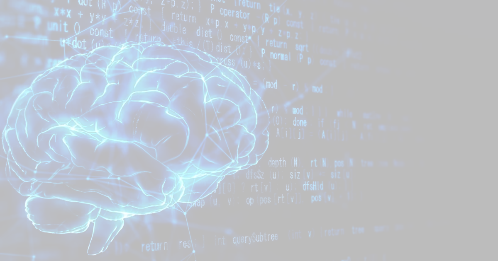
# 1. Introducción a la inteligencia artificial
### Modelos de inteligencia artificial

## ¿Qué es la inteligencia artificial?

| | |
| --- | --- |
| **Inteligencia** | Capacidad de aprender, comprender y resolver problemas. |
| **Inteligencia artificial** | Estudio y construcción de sistemas capaces de percibir, razonar, aprender o actuar para alcanzar objetivos. |
| **Máquina inteligente** | Sistema que utiliza información del entorno para seleccionar acciones orientadas a un objetivo. |

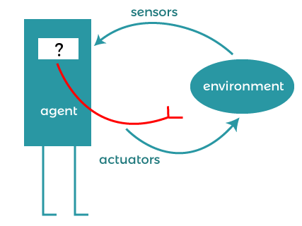
## Agentes inteligentes (I)
- Un **agente** percibe el entorno mediante **sensores** y actúa en él con **actuadores**.
- Un **agente racional** selecciona acciones para maximizar el rendimiento esperado con la información disponible.
- El **objetivo** describe qué se quiere conseguir.
- La **medida de rendimiento** permite evaluar el resultado: por ejemplo, limpieza, tiempo y energía consumida.

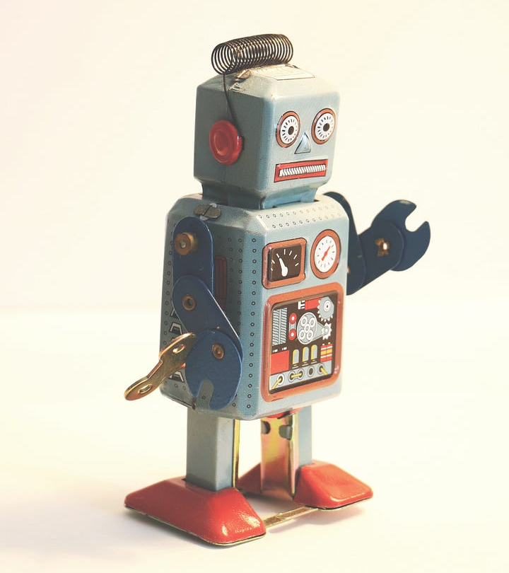
## Agentes inteligentes (II)
- La asignatura trata sobre la **construcción de agentes inteligentes**.
- Veremos:
  - Diferentes **técnicas** para construir agentes inteligentes.
  - Sus **ventajas e inconvenientes**.
  - Sus **campos de aplicación**.
  - Sus **riesgos y retos éticos**.

# Un poco de historia

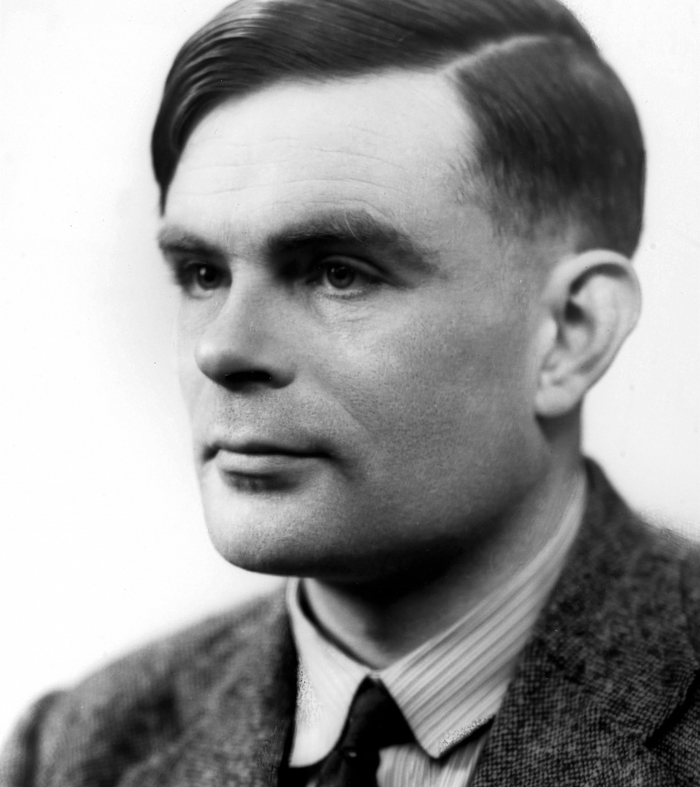
## 1950: Alan Turing
- Turing publica *Computing Machinery and Intelligence*.
- Propone sustituir «¿pueden pensar las máquinas?» por el **juego de imitación**, una prueba del comportamiento observable.
- La prueba evalúa la capacidad de conversar de forma parecida a una persona.
- Superarla no demuestra, por sí sola, conciencia o comprensión.

Fuente: [Turing (1950)](https://www.cse.msu.edu/~cse841/papers/Turing.html).

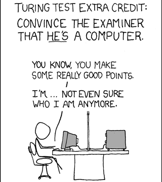
## La prueba
- En la versión habitual, una persona conversa por escrito con **un humano y una máquina**, sin verlos.
- Debe identificar cuál de los interlocutores es la máquina a partir de las respuestas.
- El resultado depende de las preguntas, el tiempo y las condiciones de la prueba.
- Imitar una conversación humana no equivale a demostrar todas las capacidades intelectuales humanas.

Fuente: [Turing (1950)](https://www.cse.msu.edu/~cse841/papers/Turing.html).

## La pregunta de Turing
- **Pregunta inicial:** «¿Pueden pensar las máquinas?»
- **Dificultad:** no hay una definición única y operativa de «pensar».
- **Propuesta:** estudiar si una máquina puede participar con éxito en el juego de imitación.
- **Alcance:** es un criterio de comportamiento en una situación concreta, no una prueba general de conciencia.

Este resumen es una paráfrasis del artículo, no una cita literal.

Fuente: [Turing (1950), apartados 1 y 6](https://www.cse.msu.edu/~cse841/papers/Turing.html).

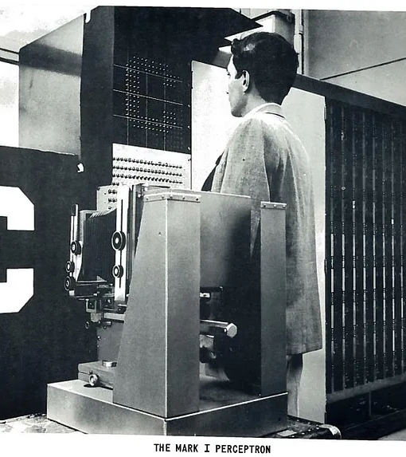
## 1955–1974: Los inicios
- **1955:** McCarthy y sus colaboradores utilizan el término *inteligencia artificial* en la propuesta de Dartmouth.
- **1956:** se celebra el encuentro de Dartmouth.
- **1958:** Rosenblatt publica su trabajo sobre el perceptrón, un modelo que aprende a clasificar.
- Las primeras demostraciones generan expectativas que superan las capacidades de los sistemas de la época.

Fuentes: [Dartmouth (1955)](https://www-formal.stanford.edu/jmc/history/dartmouth/dartmouth.html), [Rosenblatt (1958)](https://www.cs.cmu.edu/~epxing/Class/10715/reading/Rosenblatt.perceptron.pdf).

## 1974–1993: Expectativas y límites
- Los **inviernos de la IA** son periodos de desencanto y reducción de la financiación.
- En los años 80 crece el uso comercial de los **sistemas expertos**, con antecedentes como DENDRAL en los años 60.
- Recopilar y mantener el conocimiento experto resulta costoso.
- Las dificultades comerciales no hacen desaparecer la investigación ni los sistemas basados en reglas.

Fuente: [Historia de DENDRAL y de los sistemas expertos](https://softwarepreservation.computerhistory.org/AI/DENDRAL/).

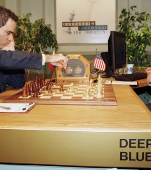
## 1997: Deep Blue
- Deep Blue, de IBM, derrota al campeón mundial Garri Kaspárov en un encuentro de ajedrez.
- Combina **búsqueda**, evaluación de posiciones y hardware especializado.
- Demuestra que una máquina puede superar a los mejores humanos en una tarea delimitada.
- Ganar al ajedrez no demuestra inteligencia general.

Fuente: [IBM: Deep Blue](https://www.ibm.com/history/deep-blue).

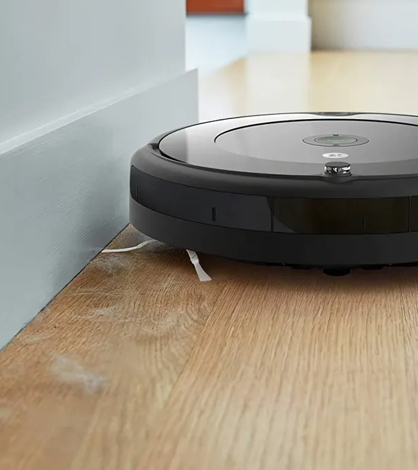
## 2002: Roomba
- iRobot lanza Roomba en **2002** y contribuye a popularizar los robots aspiradores domésticos.
- Combina sensores y acciones para limpiar el suelo y reaccionar ante obstáculos.
- La autonomía no elimina el mantenimiento ni la preparación del entorno por parte del usuario.
- Las funciones, como volver a la base o crear mapas, dependen del modelo y de la generación.

Fuente: [Historia de iRobot](https://about.irobot.com/history).

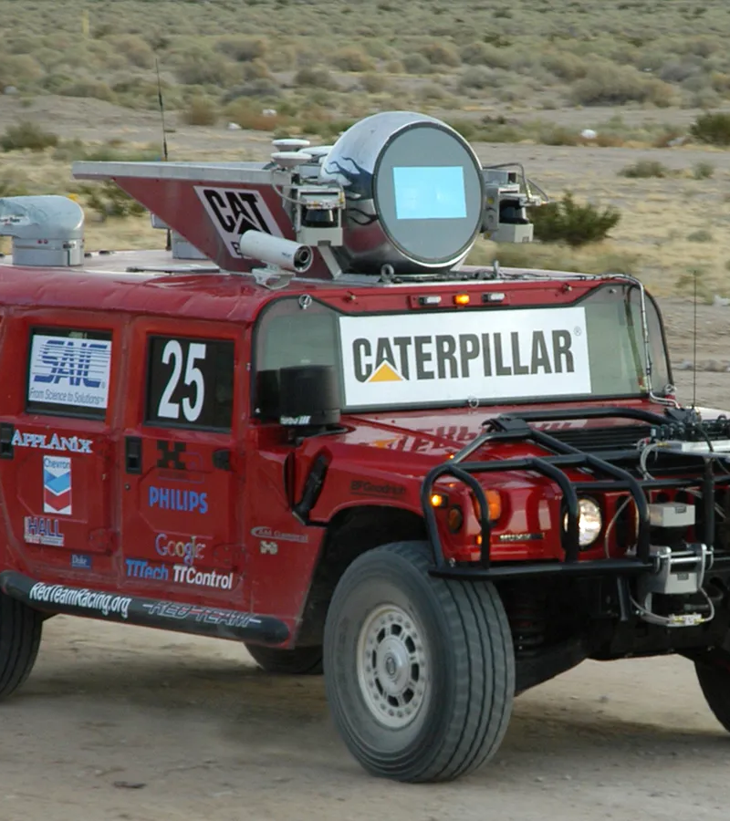
## 2004–2005: DARPA Grand Challenge
- En **2004**, 15 vehículos intentan recorrer autónomamente una ruta desértica de unos **229 km**.
- Ningún vehículo completa el recorrido.
- En **2005**, cinco equipos completan una nueva ruta de unos **212 km**.
- El reto impulsa la integración de percepción, planificación y control para la conducción autónoma.

Fuentes: [DARPA: 2004](https://www.darpa.mil/news/2014/grand-challenge-ten-years-later), [DARPA: 2005](https://www.darpa.mil/about/innovation-timeline/grand-challenge).

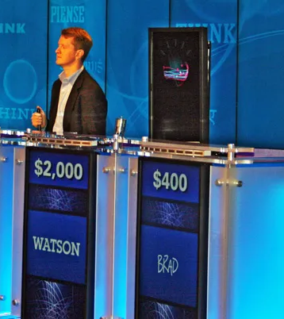
## 2011: Watson
- Watson, de IBM, gana a **Ken Jennings y Brad Rutter** en un concurso de *Jeopardy!*.
- Procesa preguntas en lenguaje natural y busca posibles respuestas.
- Combina evidencias y estima la confianza de cada respuesta.
- El éxito en el concurso no implica que comprenda cualquier situación como una persona.

Fuente: [IBM: Watson en Jeopardy!](https://www.ibm.com/history/watson-jeopardy).

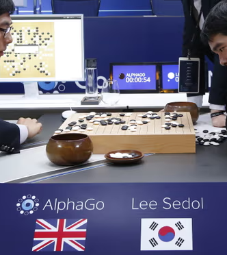
## 2016: AlphaGo
- AlphaGo derrota a **Lee Sedol por 4–1** en un encuentro de Go.
- Combina **redes neuronales, aprendizaje por refuerzo y búsqueda**.
- La jugada 37 de la segunda partida ejemplifica una decisión sorprendente para los expertos.
- Alcanzar un nivel sobrehumano no significa haber resuelto matemáticamente el juego.

Fuente: [Google DeepMind: AlphaGo](https://deepmind.google/research/alphago/).

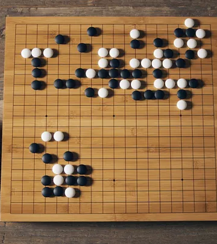
## 2017: AlphaGo Zero
- Parte de las **reglas del Go**, sin entrenarse con partidas humanas.
- Aprende jugando contra sí mismo mediante **aprendizaje por refuerzo**.
- Combina una red neuronal con búsqueda para seleccionar jugadas.
- Tras tres días de entrenamiento, supera por **100–0** a la versión de AlphaGo que había derrotado a Lee Sedol.

Fuente: [Silver y Hassabis (2017)](https://deepmind.google/blog/alphago-zero-starting-from-scratch/).

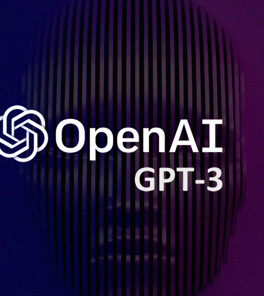
## 2020: GPT-3
- Modelo de lenguaje **autoregresivo** de la familia GPT, basado en Transformers.
- La versión más grande presentada tiene **175.000 millones de parámetros**.
- Genera texto prediciendo el siguiente token a partir del contexto.
- Puede realizar tareas como traducir y responder preguntas mediante instrucciones y ejemplos en el contexto, sin actualizar los pesos.

Fuente: [Brown y colaboradores (2020)](https://arxiv.org/abs/2005.14165).

## 2021: DALL·E
- El primer DALL·E genera imágenes a partir de descripciones textuales.
- Utiliza un Transformer que modela secuencias de tokens de texto e imagen.
- El modelo tiene **12.000 millones de parámetros**: esta cifra no es el tamaño de una base de datos en GB.
- Se entrena con pares de texto e imagen.

Fuente: [Ramesh y colaboradores (2021)](https://arxiv.org/abs/2102.12092).

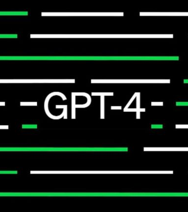
## 2023: GPT-4
- El informe de 2023 presenta un modelo basado en **Transformers** que acepta texto e imágenes y produce **texto**.
- Puede generar explicaciones, resúmenes y código; esto no equivale a generar directamente imágenes o audio.
- El informe no publica el número de parámetros.
- Puede producir errores e información inventada, aunque la respuesta parezca convincente.

Fuente: [Informe técnico de GPT-4 (2023)](https://arxiv.org/abs/2303.08774).

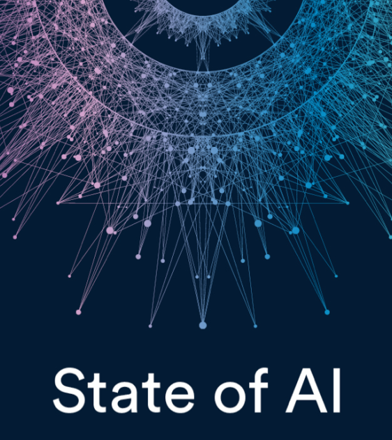
## Situación actual
- Los sistemas de IA pueden trabajar con texto, imágenes, audio, predicciones o acciones, según el modelo y la tarea.
- Sus capacidades y limitaciones varían: un buen resultado en una prueba no garantiza el mismo rendimiento en cualquier contexto.
- Para valorar una aplicación, pregúntate qué hace, con qué datos y en qué condiciones.

## Mundo laboral
- La IA puede automatizar, complementar o reorganizar tareas. **Exposición potencial no es una predicción de puestos de trabajo que desaparecerán.**
- Según la OIT (2025), una de cada cuatro personas trabajadoras ocupa un puesto con algún grado de exposición a la IA generativa. El estudio apunta a que es más probable que muchos empleos se transformen a que desaparezcan.
- La OCDE compara las capacidades de la IA con las tareas de las ocupaciones; los efectos reales también dependen de la adopción, la regulación y las decisiones de cada organización y sociedad.
- Para valorar un caso concreto, analiza qué tareas cambian, quién asume las consecuencias y qué competencias o controles hacen falta.

# ¿Tenemos ya una máquina inteligente?

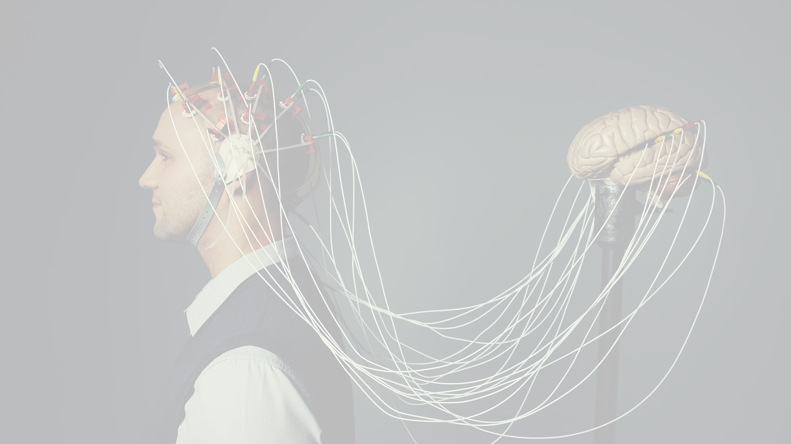
## Inteligencia humana (I)
- Es una capacidad muy compleja, resultado de millones de años de evolución.
- Algunos aspectos de la inteligencia humana:
  - Aprender
  - Resolver problemas
  - Adaptarse a entornos nuevos
  - Tomar decisiones
  - Comunicarse y colaborar con otras personas
  - Sentir emociones

## Inteligencia humana (II)
- La inteligencia humana implica percepción, memoria, aprendizaje, razonamiento e interacción social.
- Estos procesos se relacionan entre sí y con la experiencia de cada persona.
- Los modelos computacionales permiten estudiar y reproducir aspectos concretos de estas capacidades.
- Resolver una tarea con éxito no implica utilizar los mismos mecanismos que una persona.
- **¿Cómo podemos evaluar las capacidades y los límites de un sistema?**

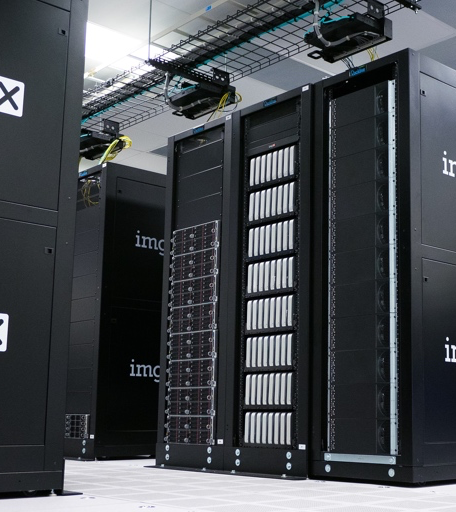
## Inteligencia computacional
- La IA estudia y construye sistemas capaces de percibir, razonar, aprender o actuar para alcanzar objetivos.
- Algunos enfoques se inspiran en la inteligencia humana; otros buscan soluciones distintas.
- Evaluamos los sistemas según las tareas que resuelven y las condiciones en las que funcionan.
- Es un campo de la **informática** con aportaciones de las matemáticas, la psicología y otras disciplinas.

## Inteligencia humana y artificial

| Aspecto | Personas | Sistemas de IA |
| --- | --- | --- |
| Aprendizaje | Experiencia, cuerpo e interacción social | Datos, reglas e interacción, según el sistema |
| Adaptación | Transferencia entre contextos | Variable; hay que evaluarla en cada tarea |
| Decisiones | Razonamiento, emociones y sesgos | Objetivos definidos, aproximaciones y sesgos |
| Limitaciones | Errores y recursos limitados | Errores y dependencia del diseño y los datos |

El rendimiento observable no demuestra, por sí solo, conciencia o experiencia subjetiva.

## IA estrecha, IA general e IA fuerte
- **IA estrecha:** especializada en tareas o dominios delimitados; puede superar el rendimiento humano en esos ámbitos.
- **IA general (AGI):** capacidad de aprender y transferir conocimiento entre una gran variedad de tareas. La definición y la evaluación son objeto de debate.
- **IA fuerte, en sentido filosófico:** tesis de que un sistema computacional puede tener comprensión o estados mentales reales.
- Son distinciones diferentes: amplitud de capacidades y naturaleza de la comprensión. No conviene usar «general» y «fuerte» como sinónimos automáticos.

Fuente: [McCarthy sobre el debate de la IA fuerte](https://www-formal.stanford.edu/jmc/chinese.html).

# Racionalidad

## ¿Qué es una decisión racional?
- Un agente racional selecciona la acción con **mayor utilidad o rendimiento esperado**, según la información disponible.
- Hay que considerar los posibles resultados, sus probabilidades, los costes y las restricciones.
- **Ejemplo:** un robot puede elegir una ruta más larga si reduce suficientemente el riesgo de colisión.
- Racionalidad no significa omnisciencia: una buena decisión puede tener un resultado desfavorable.

Fuente: [Poole y Mackworth: utilidad esperada](https://artint.info/3e/html/ArtInt3e.Ch12.S1.html).

# Paradigmas de la IA

## Definiciones
- Un **paradigma** es un enfoque para representar y resolver problemas.
- En IA podemos destacar los enfoques **simbólico**, **conexionista** y **estadístico**.
- Esta clasificación es orientativa: los enfoques se solapan y pueden combinarse.
- Por ejemplo, una red neuronal también puede entrenarse con métodos estadísticos.

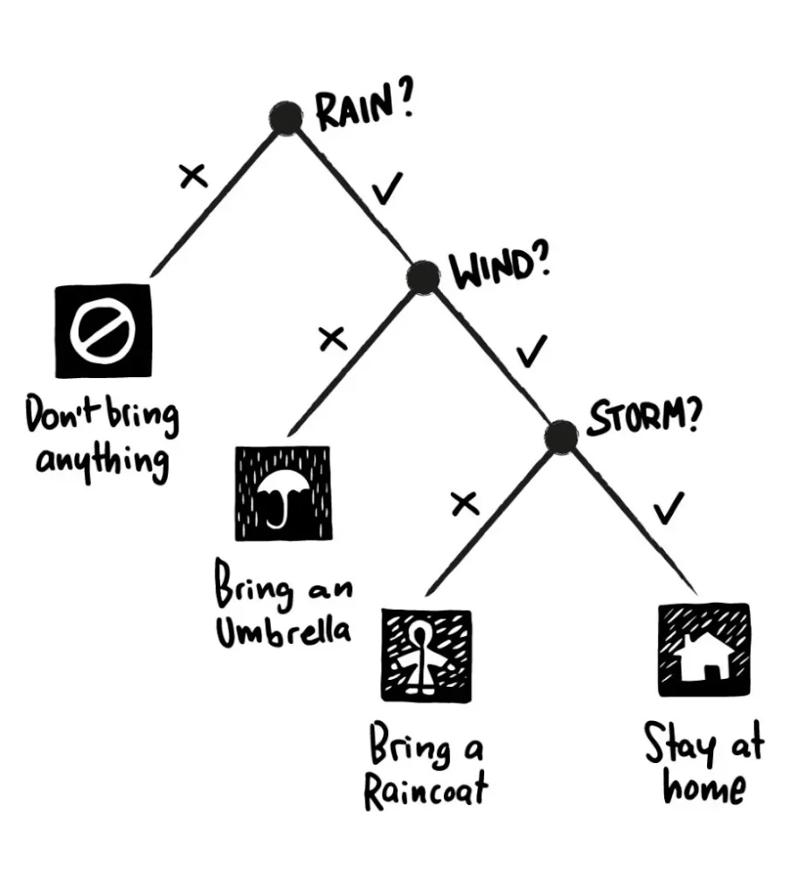
## Paradigma simbólico
- Representa conocimiento explícito mediante **símbolos, hechos, relaciones y reglas**.
- Manipula estas representaciones para inferir conclusiones o construir planes.
- La validez de los resultados depende del conocimiento y de las reglas utilizadas.
- Ejemplos: **sistemas basados en reglas**, **planificación** y **razonamiento lógico**.

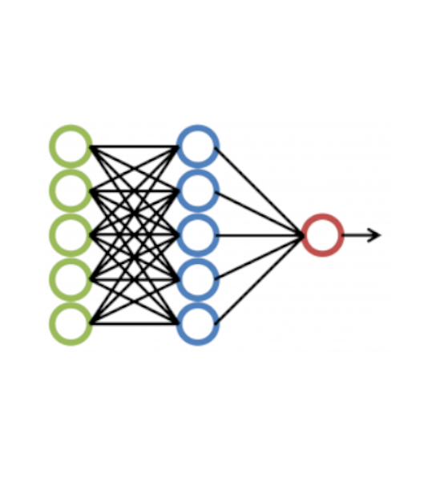
## Paradigma conexionista
- Utiliza **redes de neuronas artificiales**, unidades de cálculo interconectadas.
- Ajusta los pesos de las conexiones durante el aprendizaje.
- La inspiración biológica es parcial: estas redes no reproducen fielmente el cerebro.
- Aplicaciones: reconocimiento de imágenes, lenguaje y control.

Fuente: [Stanford CS231n: neuronas artificiales](https://cs231n.github.io/neural-networks-1/).

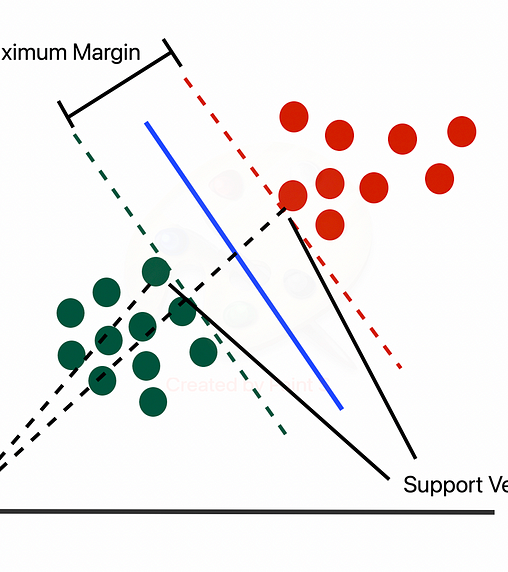
## Paradigma estadístico
- Utiliza modelos estadísticos y probabilísticos para analizar datos y representar la incertidumbre.
- Estima patrones o relaciones y evalúa las predicciones con datos.
- La calidad depende de los datos, de los supuestos del modelo y del contexto de uso.
- Se combina con otros enfoques, incluidas las redes neuronales.
- Ejemplos: clasificación, regresión y agrupamiento.

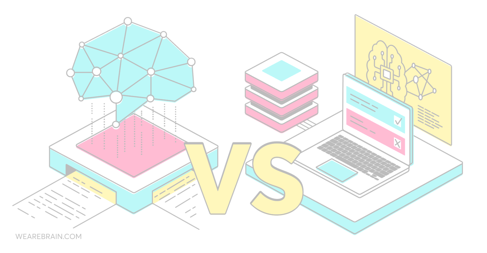
# Técnicas de IA

## Definiciones
- **Técnica:** conjunto de procedimientos o recursos que se aplican para alcanzar un objetivo.
- **Técnicas de IA:** conjunto de técnicas, algoritmos y métodos que se aplican para resolver problemas de IA.
- Una técnica puede combinar ideas de distintos paradigmas.

## Técnicas de IA
- Algunas de las técnicas más utilizadas son:
  - **Sistemas expertos**
  - **Redes neuronales**
  - **Algoritmos genéticos**
  - **Sistemas multiagente**
  - **Algoritmos de búsqueda**
  - **Algoritmos de planificación**
  - **Algoritmos de aprendizaje**

## Sistemas expertos
- Un sistema experto utiliza conocimiento especializado para resolver problemas en un dominio concreto.
- Combina una representación del conocimiento con mecanismos de razonamiento.
- Puede apoyar tareas que requieren experiencia, pero los resultados dependen de la calidad del conocimiento incorporado.

## Sistemas expertos (II)
### Sistemas basados en casos
- Se intenta resolver un problema a partir de casos similares resueltos anteriormente.
- Se recuperan casos parecidos y se adaptan a la nueva situación.
- Una vez resuelto el problema, el caso se guarda para utilizarlo en el futuro.
- Los casos nuevos, una vez revisados, pueden ampliar el conocimiento reutilizable del sistema.
- Campos de aplicación: **medicina**, **ingeniería**, **diseño**, etc.

## Sistemas expertos (III)
### Sistemas basados en reglas
- La base de conocimiento contiene **hechos y reglas**, a menudo definidos con ayuda de especialistas.
- El motor de inferencia aplica las reglas para derivar **nuevos hechos o conclusiones**.
- **Ejemplo:** «si el suelo está seco, hay que regar» + «el suelo está seco» → «hay que regar».
- Inferir conclusiones no es lo mismo que aprender o generar nuevas reglas.
- Aplicaciones: diagnóstico, control de procesos y apoyo a decisiones.

Fuente: [Poole y Mackworth: inferencia con cláusulas definidas](https://artint.info/2e/html2e/ArtInt2e.Ch5.S3.SS2.html).

## Sistemas expertos (IV)
### Sistemas basados en lógica difusa
- Representan conceptos graduales, como «temperatura alta» o «velocidad baja».
- Un **grado de pertenencia entre 0 y 1** indica hasta qué punto un valor encaja en un conjunto difuso.
- **Ejemplo:** 28 °C puede pertenecer a «calor» con grado 0,7, según la función definida. No significa una probabilidad del 70 % de que haga calor.
- Las reglas se activan gradualmente y combinan sus resultados.
- Aplicaciones: control de temperatura, robótica y otros sistemas de control.

Fuente: [Fuzzy sets, Scholarpedia](https://www.scholarpedia.org/article/Fuzzy_sets).

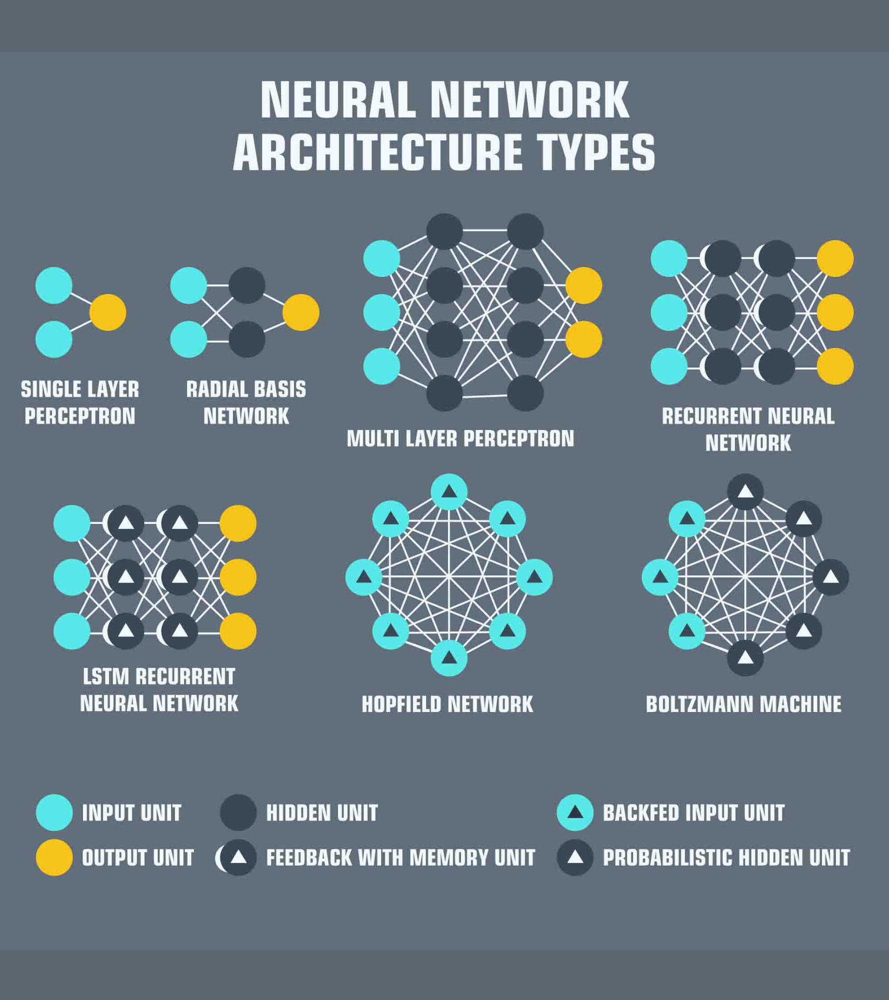
## Redes neuronales
- Modelos formados por **unidades de cálculo** y conexiones con pesos que se ajustan durante el entrenamiento.
- En una red de **propagación hacia delante**, la información va de la entrada a la salida sin ciclos.
- En un perceptrón multicapa, cada capa transforma la salida de la anterior.
- Otras arquitecturas incorporan recurrencia o conexiones entre capas no consecutivas.
- Aplicaciones: clasificación, regresión y generación de contenido.

Fuente: [Deep Learning, capítulo 6](https://www.deeplearningbook.org/contents/mlp.html).

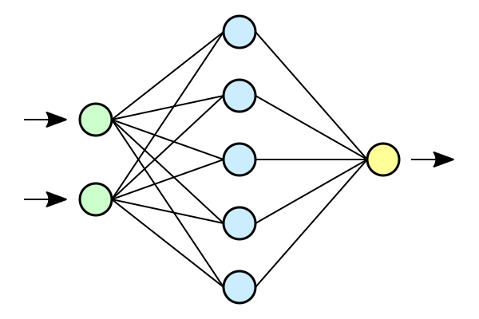
## Tipos de redes neuronales
- **Perceptrón:** modelo sencillo de clasificación con una frontera de decisión lineal.
- **Redes profundas:** combinan múltiples capas de transformación para aprender representaciones.
- **Redes recurrentes:** mantienen un estado que se actualiza al procesar una secuencia.
- **Redes convolucionales:** utilizan filtros compartidos para detectar patrones locales, por ejemplo, en imágenes.

Estas categorías se solapan: una red convolucional o recurrente también puede ser profunda.

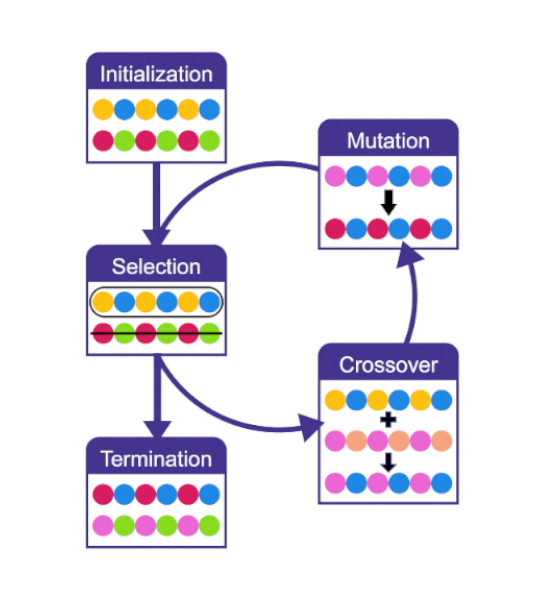
## Algoritmos genéticos
- Los algoritmos genéticos son una técnica de **optimización** basada en la teoría de la evolución de Darwin.
- Se genera una población de individuos y se les aplican operadores genéticos.
- La selección favorece a los individuos con mejor valor de la **función de aptitud**, definida según el problema.
- Son útiles para resolver problemas de **optimización y búsqueda**.

## Sistemas multiagente
- Un sistema multiagente está formado por varios agentes que interactúan entre sí.
- Un agente es un sistema computacional que actúa en un entorno.
- Los agentes pueden ser **reactivos**, **deliberativos** o **sociales**.
- Son útiles para resolver problemas de **planificación**, **diseño**, **control**, etc.

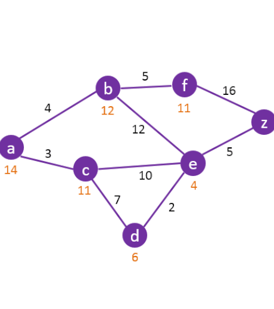
## Algoritmos de búsqueda
- Exploran estados y acciones para encontrar una solución.
- **Búsqueda no informada:** no utiliza una estimación heurística del coste restante.
  - Anchura, profundidad, profundidad limitada, profundización iterativa y **coste uniforme**.
- **Búsqueda informada:** utiliza una heurística para orientar la exploración.
  - Búsqueda voraz y **A\***.
- Coste uniforme ordena por el coste acumulado; A* combina ese coste con la estimación del coste restante.

Fuente: [Poole y Mackworth: búsqueda A*](https://artint.info/html1e/ArtInt_57.html).

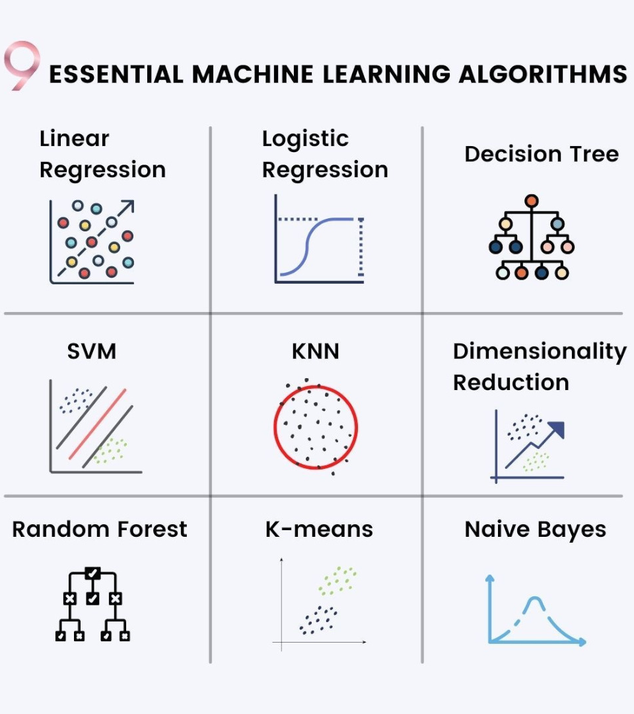
## Algoritmos de aprendizaje
- Ajustan un modelo a partir de datos o de la interacción con un entorno.
- **Supervisado:** aprende con ejemplos que incluyen la respuesta esperada; clasificación y regresión.
- **No supervisado:** busca estructura en datos sin respuestas etiquetadas; por ejemplo, agrupamiento.
- **Por refuerzo:** aprende a seleccionar acciones a partir de recompensas; por ejemplo, Q-learning.

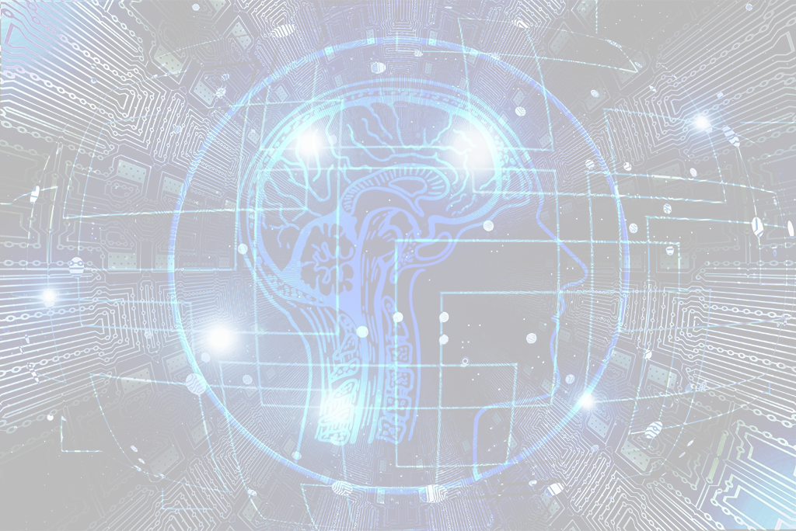
# Aplicaciones de la IA

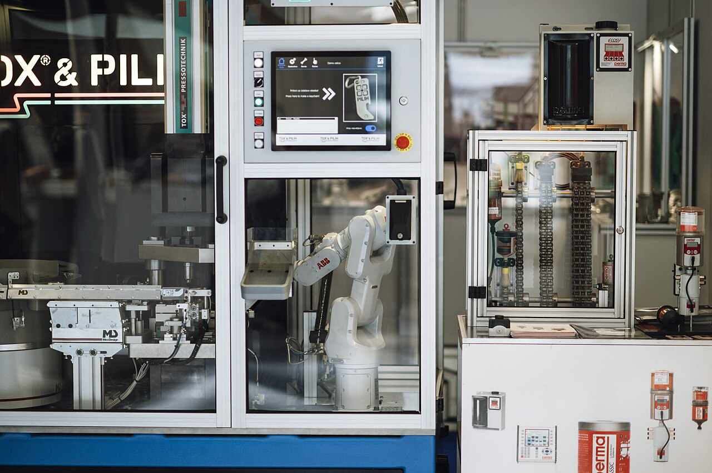
## Robótica
- La robótica es una de las aplicaciones más conocidas de la IA.
- Estudia el diseño, la construcción y el control de robots.
- Un robot es un sistema físico programable que actúa sobre su entorno.
- Los robots pueden ser **autónomos** o **teleoperados**.
- Campos de aplicación: **industria**, **sanidad**, **exploración espacial**, **ámbito militar**, **hogar**, etc.

## Procesamiento del lenguaje natural
- El **PLN** estudia métodos para analizar, representar y generar lenguaje humano.
- El contexto y la ambigüedad hacen que una misma expresión pueda tener distintas interpretaciones.
- Las respuestas de un sistema pueden ser útiles sin implicar comprensión humana.
- Aplicaciones: **traducción automática**, **resumen de textos**, **clasificación de documentos** y **asistentes conversacionales**.

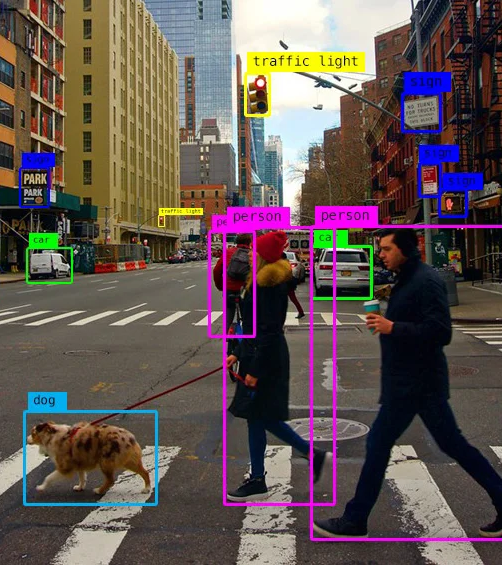
## Visión por computador
- Extrae e interpreta información de imágenes y vídeos para resolver tareas concretas.
- **Clasificación:** asigna una categoría a una imagen.
- **Detección y segmentación:** localizan objetos o asignan categorías a los píxeles.
- Aplicaciones: inspección industrial, seguimiento de objetos y reconstrucción 3D.
- Los resultados pueden cambiar con la iluminación, el punto de vista y la calidad de la imagen.

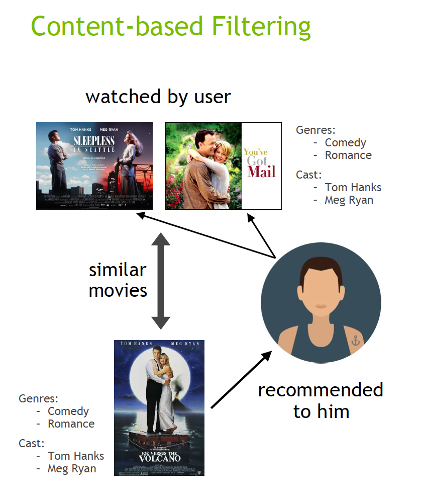
## Sistemas de recomendación
- Un sistema de recomendación propone un conjunto de elementos a una persona usuaria.
- Las personas utilizamos recomendaciones para tomar decisiones.
- El acceso a grandes cantidades de datos ha hecho que estos sistemas sean cada vez más importantes.
- Campos de aplicación: **recomendación de productos**, **música**, **películas**, **libros**, **noticias**, etc.

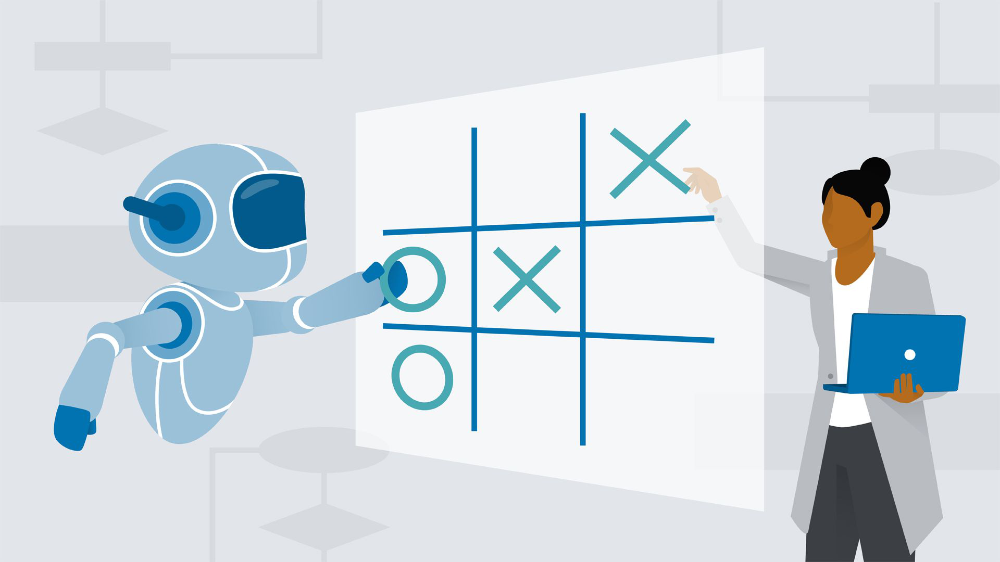
## Juegos
- Los juegos nos ayudan a entender la inteligencia.
- Las personas jugamos para aprender, divertirnos y competir.
- Las reglas y los resultados medibles hacen de los juegos un buen banco de pruebas para la IA.
- Campos de aplicación: **juegos de mesa**, **cartas**, **rol**, **estrategia**, etc.

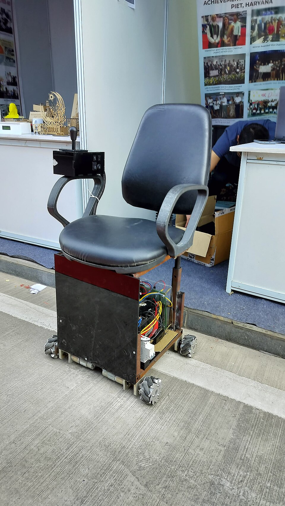
## Otras aplicaciones
- **Medicina:** apoyo al diagnóstico, cirugía asistida y medicina personalizada.
- **Ingeniería:** diseño y control de procesos.
- **Finanzas:** predicción de mercados y recomendación de inversiones.
- **Ámbito militar:** drones y sistemas autónomos.
- **Ámbito doméstico:** robots, asistentes virtuales y domótica.
- **Transporte:** vehículos autónomos y planificación de rutas.

## Referencias
- [Artificial Intelligence: A Modern Approach](http://aima.cs.berkeley.edu/)
- [Artificial Intelligence: Foundations of Computational Agents](http://artint.info/2e/html/ArtInt2e.html)
- [Deep Learning](https://www.deeplearningbook.org/)
- [Machine Learning](https://www.cs.ubc.ca/~murphyk/MLbook/)
- [Fast.ai](https://www.fast.ai/)
- [OIT (2025), *Generative AI and jobs: A 2025 update*](https://www.ilo.org/publications/generative-ai-and-jobs-2025-update)
- [OCDE (2026), *The OECD AI exposure measure*](https://www.oecd.org/en/publications/the-oecd-ai-exposure-measure_f3da0f0a-en.html)

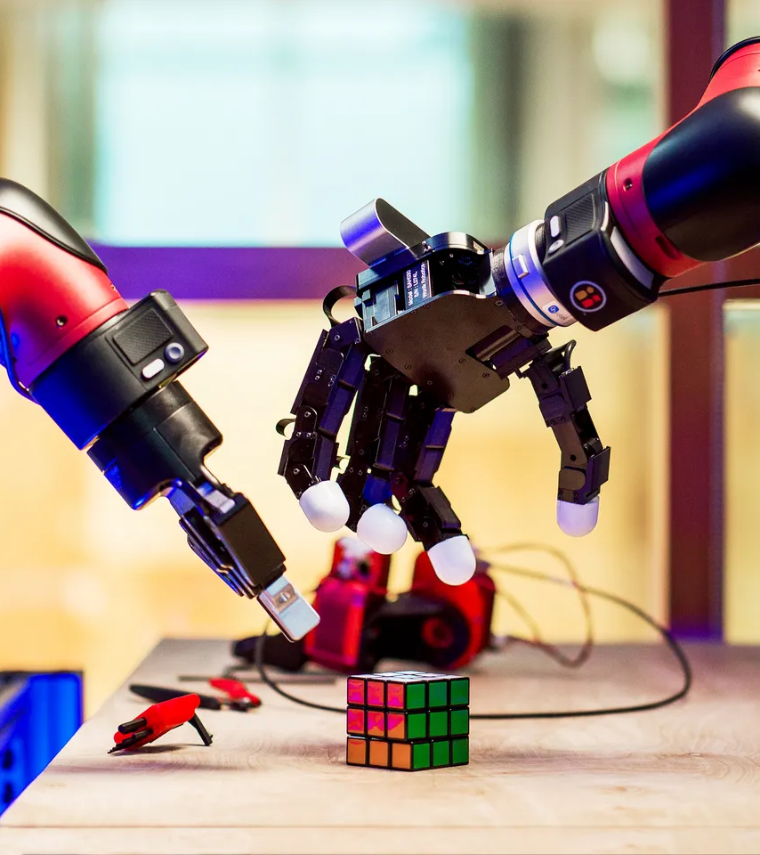
## Trabajo práctico 1 · Analiza una aplicación de IA

Elige una aplicación documentada y explica:
- qué problema resuelve, quién la utiliza y qué recibe o produce;
- qué técnicas del tema 1.1 intervienen;
- qué pruebas muestran sus resultados y cuáles son sus límites.

**Entrega:** informe breve y explicación de 3 minutos.

[Guía, estructura y criterios de evaluación](treball-practic-1-es.md)

La pregunta sobre las personas afectadas, los riesgos y los controles dará paso al tema 1.2.
