<style>
section h3 { font-size: 1.15em; }
</style>

# Búsqueda en espacios<br>de estados

## Conceptos previos
### Modelos de inteligencia artificial
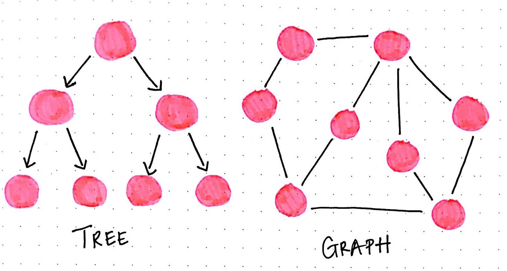

# Conceptos previos
- Para abordar los temas relacionados con la **búsqueda** necesitaremos algunos **conceptos previos**.
- En esta unidad nos centraremos en adquirirlos.
- Los conceptos que necesitaremos son:
  - Grafos
  - Árboles
  - Listas y colas
  - Algoritmos sobre grafos y árboles
  - Complejidad temporal y espacial

## Grafos


### Teoría de grafos
- La teoría de grafos es una **rama de las matemáticas** que estudia las **relaciones entre objetos**.
- Un grafo es un conjunto de puntos (**nodos**) conectados por líneas (**aristas**).
- Muchos problemas se representan mediante grafos o redes:
  - **Transporte**: carreteras, vías de tren, vías fluviales, etc.
  - **Comunicaciones**: redes informáticas, sociales, etc.
  - **Distribución**: redes eléctricas, de agua, etc.
  - **Relaciones**: entre personas, conceptos, etc.
  - **Dependencias**: entre tareas, procesos, etc.
- **Ejemplo**: grafo no dirigido con 6 nodos y 7 aristas.
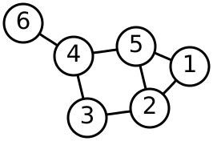

### Historia
#### Los puentes de Königsberg (1/2)
- Los grafos fueron introducidos por **Leonhard Euler** en el siglo XVIII para resolver el **problema de los puentes de Königsberg**.
- El problema consistía en encontrar un camino que pasara por **todos los puentes** de la ciudad sin pasar por **ningún puente más de una vez**.
- El problema se puede representar como un grafo sin pérdida de generalidad.
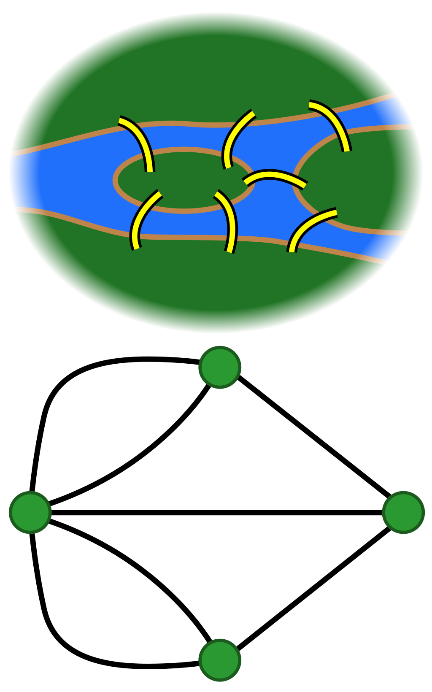

### Historia
#### Los puentes de Königsberg (2/2)
- Euler demostró que **no existe ningún camino** que pase por todos los puentes sin pasar por ninguno más de una vez.
- Por ello introdujo el concepto de **grafo euleriano**.
- Un grafo es euleriano si **todos sus nodos tienen grado par**.
- El grafo de los puentes de Königsberg no es euleriano porque tiene **4 nodos de grado impar**.
- Esta demostración fue el **punto de partida** de la teoría de grafos.


### Definiciones (1/2)
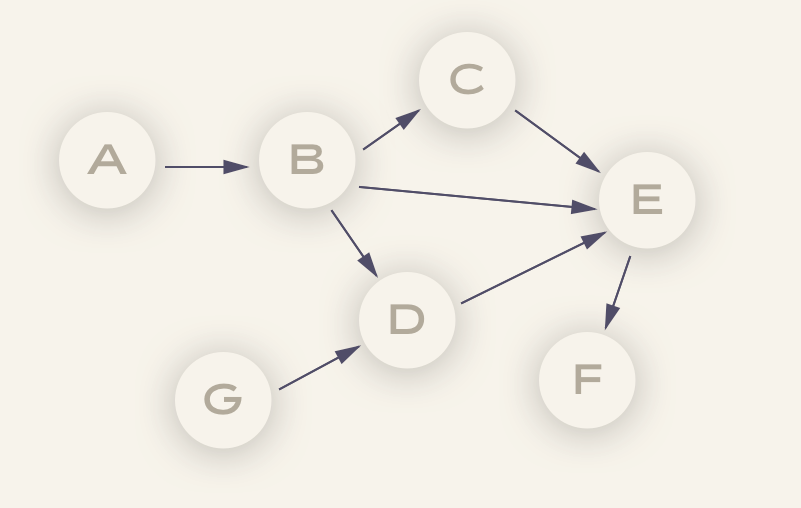
- Un grafo es un **conjunto de nodos** conectados por **aristas**.
- Un grafo es **ponderado** si las aristas tienen un **peso**.
- Un grafo es **cíclico** si tiene **ciclos** (un ciclo es un camino que empieza y termina en el mismo nodo).
- Un grafo es **dirigido** si las aristas tienen una **dirección**.
  - Si una arista **no está dirigida**, se considera que tiene dirección en **ambos sentidos**.
  - Si de un nodo solo salen aristas, es una **fuente**.
  - Si a un nodo solo llegan aristas, es un **sumidero**.
- Un grafo dirigido acíclico es un **DAG** (*Directed Acyclic Graph*). Los DAG se utilizan mucho en programación.

### Definiciones (2/2)
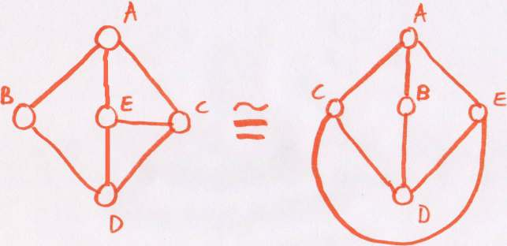
- Un grafo es **completo** si todos los nodos están conectados entre sí.
- Un grafo es **conexo** si hay un camino entre cualquier par de nodos.
- No importa la **distancia** entre los nodos ni la posición de cada uno en el espacio, sino la **relación entre ellos**.
  - La forma de las aristas tampoco es importante: puede variar para facilitar la visualización.
  - Dos grafos son **isomorfos** si se pueden **transformar el uno en el otro** sin cambiar la **relación entre los nodos**.

### Estructuras de datos para representar grafos
- Hay **dos estructuras de datos básicas** para representar grafos:
  - **Matriz de adyacencia**
  - **Lista de adyacencia**
- Veamos sus diferencias y las ventajas e inconvenientes de cada una.

#### Matriz de adyacencia (1/2)
- Una matriz de adyacencia es una **matriz cuadrada** cuyas filas y columnas representan los nodos del grafo.
- Si hay una arista entre dos nodos, el valor de la posición correspondiente de la matriz será 1; en caso contrario, será 0.
- Si el grafo es **dirigido**, la matriz no será simétrica.
- Si el grafo tiene **pesos**, las posiciones de la matriz contendrán los pesos de las aristas.
- En Python podemos utilizar una lista de listas para representar la matriz.
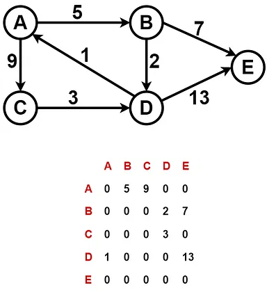

#### Matriz de adyacencia (2/2)
- **Ventajas**:
  - Es fácil saber si hay una arista entre dos nodos.
  - Es fácil saber qué nodos están conectados a uno dado y cuál es su grado.
- **Inconvenientes**:
  - La matriz será muy grande y ocupará mucho espacio en memoria, aunque el grafo sea disperso (con pocos nodos conectados).
    - Para representar matrices dispersas se pueden utilizar estructuras especiales, como diccionarios de tuplas. En este caso el coste espacial será mucho menor, pero se pierden algunas ventajas de la matriz de adyacencia.
- Es apropiada para grafos densos o para grafos que no se van a modificar.

#### Lista de adyacencia (1/2)
- Una lista de adyacencia es una **lista de listas** o un **diccionario** donde cada lista o clave representa un nodo y contiene sus nodos adyacentes.
- Si el grafo no es dirigido y _B_ es adyacente a _A_, _A_ también será adyacente a _B_.
- Si el grafo tiene pesos, la lista contendrá tuplas con el nodo adyacente y el peso de la arista.
- En general, suele ser más eficiente que la matriz de adyacencia porque ocupa menos espacio en memoria.
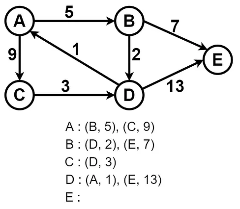

#### Lista de adyacencia (2/2)
- **Ventajas**:
  - Es más eficiente en espacio que la matriz de adyacencia.
  - Es fácil saber qué nodos están conectados a uno dado y cuál es su grado.
  - Permite modificar el grafo añadiendo o eliminando nodos y aristas.
- **Inconvenientes**:
  - No es fácil saber si hay una arista entre dos nodos.
  - La implementación puede ser más compleja que la matriz de adyacencia.
- Es apropiada para grafos dispersos o para grafos que se van a modificar.

#### Matrices de adyacencia frente a listas de adyacencia
| Operación | Matriz de adyacencia | Lista de adyacencia |
| --- | :---: | :---: |
| Espacio | O(n^2) | O(n + m) |
| Adyacencia | O(1) | O(n) |
| Grado de un nodo | O(n) | O(1) |
| Añadir nodo | O(n^2) | O(1) |
| Añadir arista | O(1) | O(1) |
| Eliminar nodo | O(n^2) | O(n + m) |
| Eliminar arista | O(1) | O(n) |

### Tipos de problemas
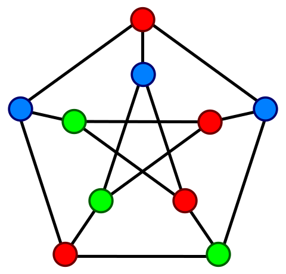
- Algunos problemas típicos sobre grafos son:
  - **Recorrido**: encontrar un camino entre dos nodos.
  - **Conectividad**: averiguar si dos nodos están conectados.
  - **Ciclos**: determinar si un grafo tiene ciclos.
  - **Coloración**: encontrar una coloración de los nodos de un grafo.
  - **Componentes**: encontrar los componentes de un grafo.
  - **Ordenación topológica**: encontrar un orden lineal de los nodos de un grafo dirigido acíclico.
  - **Camino mínimo**: encontrar el camino de coste mínimo entre dos nodos o entre todos los pares.
  - **Árbol de expansión mínimo**: encontrar un árbol de expansión de coste mínimo.
  - **Flujo máximo**: encontrar el flujo máximo entre dos nodos.

### Algoritmos sobre grafos
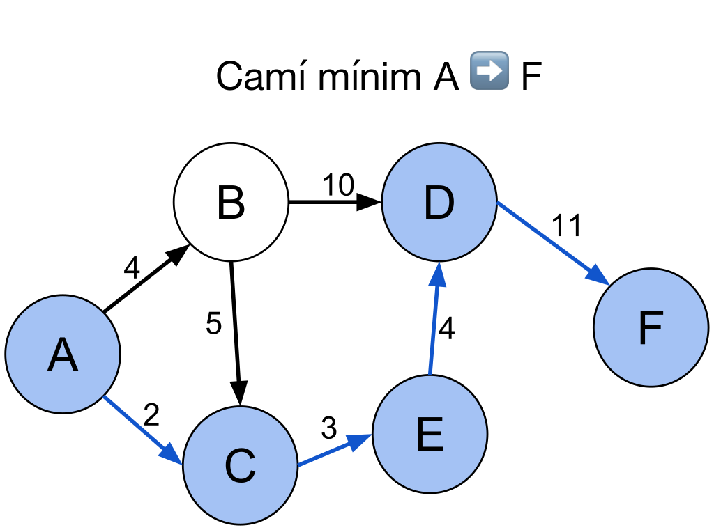
- Algunos de los más importantes:
  - **Búsqueda en anchura** (BFS)
  - **Búsqueda en profundidad** (DFS)
  - Ordenación topológica de grafos dirigidos acíclicos (DAG)
  - Algoritmo de **Dijkstra** o **UCS (Uniform Cost Search)**
  - Algoritmo de **Prim**
  - Algoritmo de **Kruskal**
  - Algoritmo de **Bellman-Ford**
  - Algoritmo de **Floyd-Warshall**
  - Algoritmo de **Ford-Fulkerson**

## Árboles


### Árboles
- Un **árbol** es un tipo especializado de **grafo**.
- Los árboles tienen estas propiedades:
  - **Conexo**: hay un camino entre cualquier par de nodos.
  - **Acíclico**: no hay ciclos.
  - **No dirigido**: las aristas no tienen dirección.
  - **Único**: no hay más de un camino entre cualquier par de nodos.
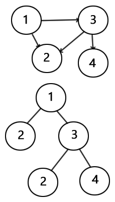

### Utilidad de los árboles
- Los árboles se utilizan mucho en programación para representar **jerarquías**.
- Ejemplos:
  - **Sistemas de archivos**.
  - **Sintaxis de un lenguaje**.
  - **Estructuras de datos**.
    - Se utilizan para implementar otras estructuras, como las tablas de símbolos o los diccionarios.

### Tipos de árboles
- **Árbol general**: cada nodo puede tener un número arbitrario de hijos.
- **Árbol n-ario**: cada nodo tiene como máximo n hijos.
- **Árbol binario**: cada nodo tiene como máximo dos hijos.
- **Árbol binario de búsqueda**: cada nodo tiene como máximo dos hijos; los valores de los nodos de la izquierda son menores que el nodo y los de la derecha son mayores.
- **Heaps**: árboles binarios equilibrados que cumplen una propiedad adicional. Se pueden utilizar para implementar colas de prioridad.

### Árboles binarios de búsqueda
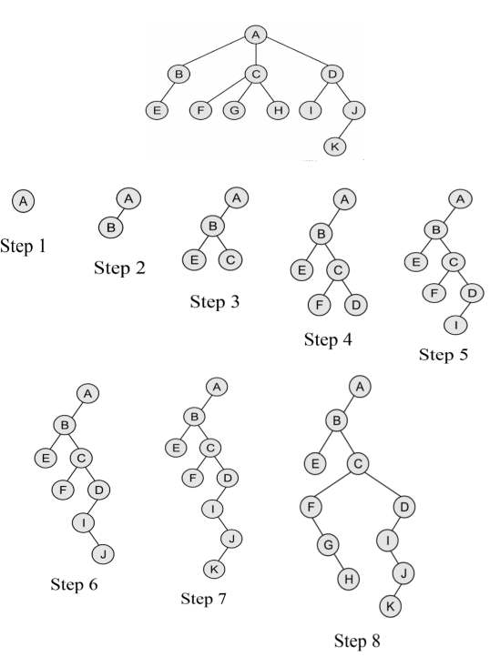
- Un **árbol binario de búsqueda** es un árbol binario en el que el valor de los nodos de la izquierda es **menor** que el del nodo y el de los nodos de la derecha es **mayor**.
- Permiten acceder a los datos de forma **eficiente**. El coste de acceso es $O(\log(n))$.
- Si se producen muchas inserciones y eliminaciones, el árbol puede dejar de estar equilibrado y el coste de acceso puede aumentar hasta $O(n)$.
  - Para evitar este problema se pueden utilizar árboles equilibrados, como los AVL o los Red-Black.
- Cualquier árbol se puede representar como árbol binario de búsqueda y, a partir de ahora, **hablaremos siempre de este tipo de árboles** salvo que indiquemos lo contrario.

### Estructuras de datos para representar árboles
- La forma más habitual de representar un árbol es mediante una lista enlazada.
- Cada nodo está formado por un valor y punteros a sus dos hijos.
```python
class Node:
    def __init__(self, value):
        self.value = value
        self.left = None
        self.right = None

root = Node(1)
root.left = Node(2)
root.right = Node(3)

root.left.left = Node(4)
```

### Recorrido de árboles
- Cuando tengamos que realizar una operación sobre el árbol, partiremos del nodo raíz y recorreremos los nodos hasta llegar al que nos interesa.
- La recursividad es una herramienta muy útil para recorrer árboles. En árboles grandes, sin embargo, puede ser más eficiente utilizar un recorrido iterativo con una pila o una cola.
```python
def buscar(node, value):
    if node is None:
        return False
    if node.value == value:
        return True
    return buscar(node.left, value) or buscar(node.right, value)
```

## Listas, colas y pilas
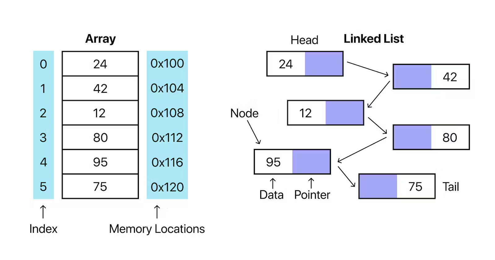

### Listas enlazadas
- Una **lista enlazada** es una estructura de datos que permite **insertar** y **eliminar** elementos de forma eficiente.
- El **acceso** a sus elementos es **secuencial**.
- Una lista enlazada está formada por una serie de nodos enlazados entre sí.
- Cada nodo contiene un valor y, como mínimo, un puntero al siguiente nodo.
- El primer nodo de la lista es la **cabeza** y el último es la **cola**.
- Los nodos de la lista no tienen por qué ocupar posiciones contiguas de memoria.
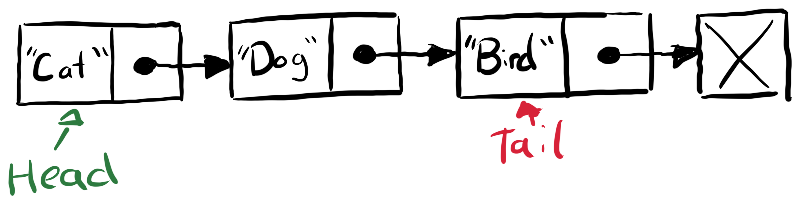

### Vector frente a lista enlazada
- Las listas de Python son vectores dinámicos.
- Si se añade un elemento a un vector y no hay espacio suficiente, hay que crear un vector nuevo y copiar todos los elementos.
- Si se elimina un elemento de un vector, hay que desplazar una posición a la izquierda todos los elementos posteriores.
- En una lista enlazada, en cambio, solo hay que modificar los punteros de los nodos afectados.
- Si vamos a insertar y eliminar elementos con frecuencia, las listas enlazadas son más eficientes que los vectores.
- En Python, las listas enlazadas se pueden implementar con la clase `deque` del módulo `collections`.

| Operación | Vector | Lista enlazada |
| --- | :---: | :---: |
| Acceso | O(1) | O(n) |
| Inserción | O(n) | O(1) |
| Eliminación | O(n) | O(1) |

### Cola
- Una **cola** es una estructura en la que los elementos se **insertan** por un extremo y se **eliminan** por el otro.
- Las colas siguen el principio **FIFO** (*First In, First Out*).
- Se pueden implementar mediante una lista enlazada o un vector.
- En Python podemos utilizar la clase `deque` del módulo `collections`.
- Algunos algoritmos que utilizan colas son **BFS** (*Breadth-First Search*), **UCS** y **Ford-Fulkerson**.
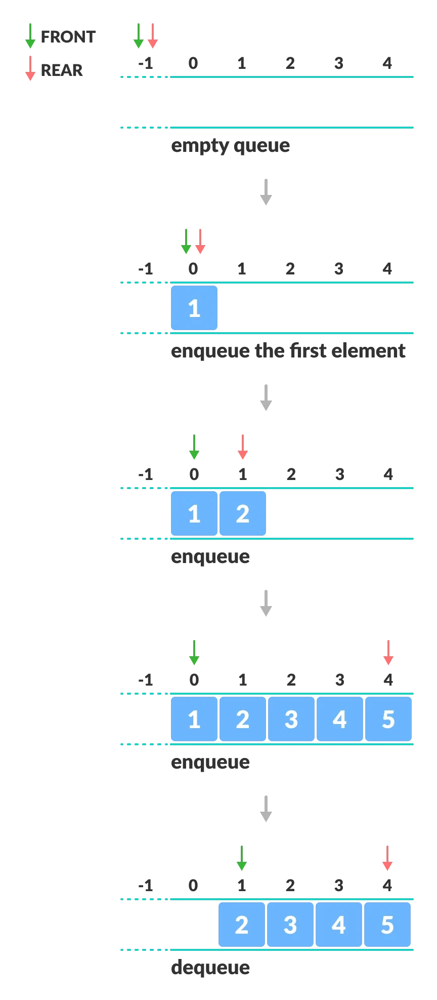

### Cola de prioridad
- Una **cola de prioridad** es una estructura basada en una cola en la que cada elemento tiene asociado un **valor de prioridad**.
- Los elementos se insertan por un extremo y se eliminan por el otro.
- Se ordenan según su valor de prioridad.
- Se puede implementar mediante un **heap** o un array ordenado (menos eficiente).
- En Python podemos utilizar la clase `PriorityQueue` del módulo `queue` o la clase `heapq` del módulo `heapq`.
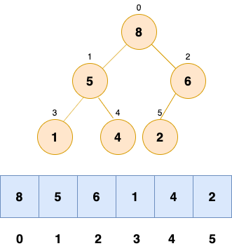

### Pila
- Una **pila** es una estructura en la que los elementos se **insertan** y se **eliminan** por el mismo extremo.
- Las pilas siguen el principio **LIFO** (*Last In, First Out*).
- Se pueden implementar mediante una lista enlazada o un vector.
- En Python podemos utilizar la clase `deque` del módulo `collections`.
- Algunos algoritmos que utilizan pilas son **DFS** (*Depth-First Search*) y *backtracking*.
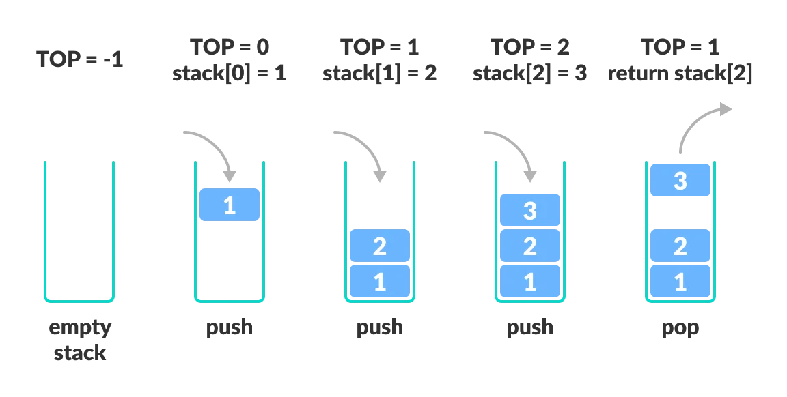

## Complejidad
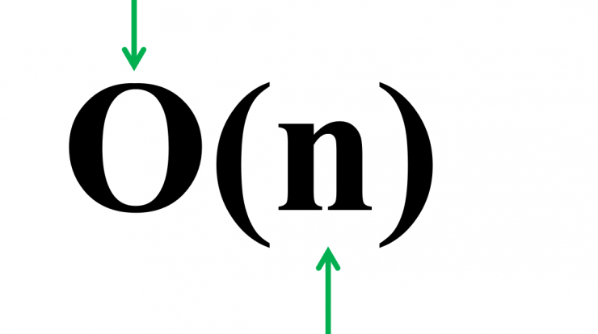

### Complejidad temporal y espacial (1/2)
- La **complejidad temporal** de un algoritmo es su **tiempo de ejecución** en función del **tamaño de los datos de entrada (n)**.
- La **complejidad espacial** es el **espacio de memoria** que necesita en función de **n**.
- La complejidad temporal y espacial se mide mediante la **notación asintótica**.
- Esta notación permite **clasificar** los algoritmos según su **comportamiento** en función de n.
- También se conoce como **complejidad asintótica** o notación **O grande**.

### Complejidad temporal y espacial (2/2)
- La notación asintótica se divide en tres clases:
  - **O grande**: da una cota superior del tiempo de ejecución o del espacio en memoria.
  - **Omega**: da una cota inferior del tiempo de ejecución o del espacio en memoria.
  - **Theta**: da una cota superior y una inferior del tiempo de ejecución o del espacio en memoria.
  - **O grande** es la más utilizada.
- La notación asintótica se expresa en función de **n**.

### Cómo calcular la complejidad temporal
- Para calcular la complejidad temporal de un algoritmo debemos seguir estos pasos:
  - **Identificar** los bucles y las llamadas recursivas.
  - **Contar** el número de iteraciones de cada bucle y las llamadas recursivas.
  - **Sumar** los resultados.
  - **Simplificar** la expresión resultante.
  - **Descartar** los términos de menor orden y los coeficientes.
  - **Expresar** el resultado en función de n.

### Cómo calcular la complejidad temporal
#### Ejemplo: algoritmo de búsqueda binaria (1/3)
- El algoritmo tiene un bucle que se ejecuta mientras el índice inicial sea menor o igual que el índice final.
- En cada iteración se calcula el índice central y se compara con el elemento buscado.
- Si el elemento es menor, el índice final se desplaza a la izquierda; si es mayor, el índice inicial se desplaza a la derecha.
- En cada iteración, el número de elementos que hay que buscar se reduce a la mitad.

### Cómo calcular la complejidad temporal
#### Ejemplo: algoritmo de búsqueda binaria (2/3)
```python
def binary_search(array, value):
    start = 0
    end = len(array) - 1
    while start <= end:
        mid = (start + end) // 2
        if array[mid] == value:
            return mid
        elif array[mid] < value:
            start = mid + 1
        else:
            end = mid - 1
    return -1
```

### Cómo calcular la complejidad temporal
#### Ejemplo: algoritmo de búsqueda binaria (3/3)
- Cálculo de la complejidad temporal:
  - El bucle se ejecuta $O(\log(n))$ veces (en cada iteración, el número de elementos buscados se reduce a la mitad).
  - En cada iteración se realizan $O(1)$ operaciones.
  - La complejidad temporal del algoritmo es $O(\log(n))$.

### Ejemplos de notación asintótica
- $O(1)$: constante. No depende de n. Acceso a un elemento de un vector.
- $O(\log(n))$: logarítmica. Búsqueda binaria.
- $O(n)$: lineal. Recorrido de un vector.
- $O(n \log(n))$: casi lineal. Algoritmo de mergesort.
- $O(n^x)$: polinómica. Recorrido de una matriz.
- $O(x^n)$: exponencial. Torres de Hanói.
- $O(n!)$: factorial. Problema del viajante de comercio por fuerza bruta.


