# Búsqueda en espacios de estados

### Modelos de inteligencia artificial

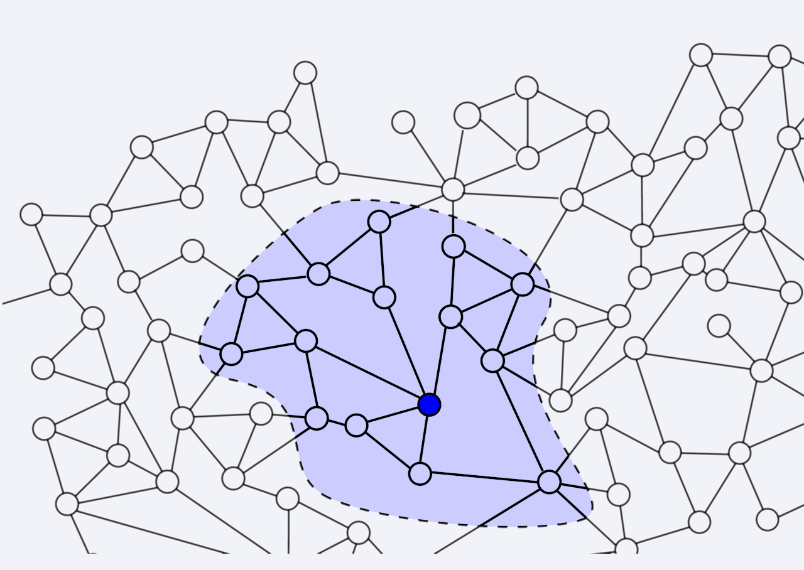

---

# Búsqueda

- Es fundamental en muchos ámbitos:
  - Juegos, planificación…
- Funciona muy bien en otros tipos de problemas:
  - Diagnóstico, control, aprendizaje…
- Es una técnica muy general:
  - Se puede aplicar a problemas sin una solución específica.
  - Resulta muy útil para aproximar soluciones.
- Las técnicas de búsqueda son la base de muchos sistemas inteligentes.

---

## Búsqueda en espacios de estados

- Los **problemas de búsqueda** tienen:
  - Un estado inicial.
  - Una función sucesora, que define los estados a los que se puede llegar desde uno dado y el coste de cada transición.
  - Un estado objetivo.
- Una **solución** es una secuencia de estados (un plan) que lleva del estado inicial al estado objetivo.

---

## Ejemplo: viajar por Rumanía

- **Espacio de estados**: ciudades.
- **Función sucesora**: carreteras. Coste: distancia.
- **Estado inicial**: Arad.
- **Comprobación de objetivo**: el estado es Bucarest.
- **Solución**: secuencia de ciudades que lleva de Arad a Bucarest.

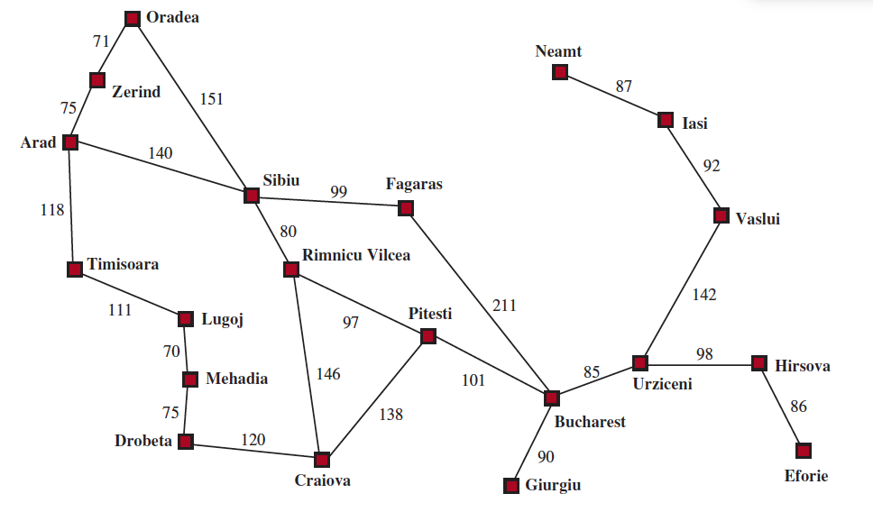

---

## Ejemplo: jarras de agua (I)

> Tenemos dos jarras de agua: una de 4 litros y otra de 3 litros. Queremos obtener 2 litros de agua. Podemos llenar las jarras, vaciarlas o trasvasar agua de una a otra.

- **Espacio de estados**: cantidad de agua en cada jarra.
- **Función sucesora**: operaciones de vaciar, llenar y trasvasar.
- **Estado inicial**: (0, 0).
- **Comprobación de objetivo**: estado = (2, 0).
- **Solución**: secuencia de operaciones que lleva de (0, 0) a (2, 0).

---

## Ejemplo: jarras de agua (II)

### Observaciones

- Tal como está formulado el problema, no puede haber cantidades no enteras.
- Algunos estados son imposibles de alcanzar. Por ejemplo, (1, 2).
- Algunas acciones no producen cambios.
  - Ejemplo: `(0, 0) + vaciar(4) = (0, 0)`.

---

## Ejemplo: puzle del 8 (I)

> Tenemos un tablero de 3 × 3 con 8 fichas numeradas del 1 al 8 y un espacio vacío. Queremos mover las fichas para alcanzar el estado objetivo.

- **Espacio de estados**: …
- **Función sucesora**: …
- **Estado inicial**: …
- **Comprobación del objetivo**: …
- **Solución**: …

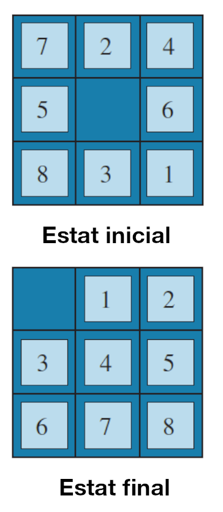

---

## Ejemplo: puzle del 8 (II)

- **Espacio de estados**: las distintas posiciones de las fichas. ¿Cuántas hay?
- **Función sucesora**: podemos mover la ficha vacía en 4 direcciones. ¿Siempre podemos hacer los 4 movimientos?
- **Estado inicial**: por ejemplo, el de la figura anterior.
- **Comprobación del objetivo**: verificar que las fichas están en la posición correcta.
- **Solución**: secuencia de movimientos que lleva al estado objetivo.


---

## Ejemplo: puzle del 8 (III)

### Observaciones

- El número de estados es muy grande: $9! = 362.880$.
- Solo podemos hacer los 4 movimientos cuando la ficha vacía está en el centro.
- No todos los estados tienen solución.
- Hay muchas soluciones. ¿Cuál es la mejor?

---

## Situaciones más complicadas

- En los ejemplos anteriores, conocíamos para cada estado:
  - Los estados sucesores.
  - El coste de cada transición.
- En otros problemas, el resultado de cada acción es incierto.
- Veremos técnicas para tratar algunas de estas situaciones:
  - _Métodos probabilísticos_: asignan probabilidades a los estados sucesores.
  - _Métodos de búsqueda adversaria_: los estados sucesores dependen de un oponente.

---

## Representación de los problemas de búsqueda

### Árboles de búsqueda

- Los problemas de búsqueda se pueden representar como un árbol.
- Los nodos son estados.
- Las aristas son acciones.
- Los costes son los pesos de las aristas.
- Podemos aplicar algoritmos de búsqueda de caminos mínimos.
- El espacio de búsqueda debe ser finito.

---

### Ejemplo: viajar por Rumanía

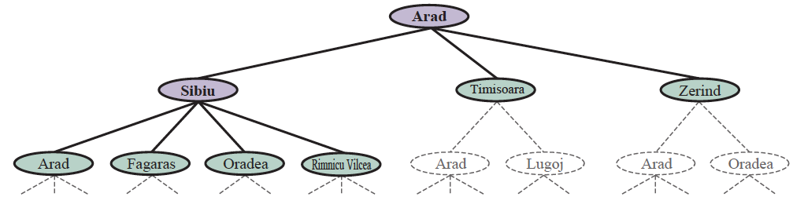

- Los nodos ya visitados aparecen en gris.
- Los nodos abiertos aparecen en blanco; los que quedan por visitar, con líneas discontinuas.

---

<!-- _class: invert lead -->

# Algoritmos de búsqueda

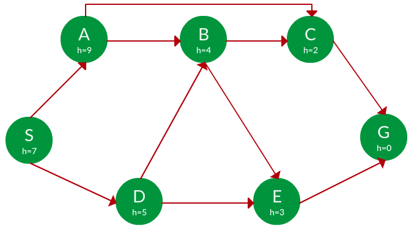

---

## Definición

- Los algoritmos de búsqueda son algoritmos de propósito general:
  - Se pueden aplicar a cualquier problema de búsqueda.
  - Los problemas de búsqueda son un caso particular de los problemas de caminos mínimos.
- **Salida**:
  - Una secuencia de acciones que lleva del estado inicial al objetivo.
  - El resultado puede ser óptimo en coste, óptimo en tiempo o no tener ninguna garantía de optimalidad.

---

## Funcionamiento general

- Mantenemos una lista de estados conocidos pendientes de visitar, llamada **frontera**. Al principio contiene el estado inicial.
- En cada iteración, extraemos un estado de la frontera, aplicamos la función sucesora y añadimos los nuevos estados:
  - Si el estado es objetivo, hemos terminado.
  - Si la frontera está vacía, no hay solución.
  - Guardamos el padre de cada estado para reconstruir la solución.
- En cada iteración, una estrategia determina qué estado de la frontera se extrae.

---

### Ejemplo de ejecución (alternativa I)

- Frontera: {**Arad**}. Objetivo: **Bucarest**.
1. Expandimos **Arad**: {Z←A, T←A, **S←A**}.
2. Expandimos **Sibiu**: {Z←A, T←A, A←S←A, O←S←A, **F←S←A**, R←S←A}.
3. Expandimos **Făgăraș**: {Z←A, T←A, A←S←A, O←S←A, R←S←A, S←F←S←A, **B←F←S←A**}.
4. La frontera contiene una solución. Coste: 140 + 99 + 211 = **450**.


---

### Ejemplo de ejecución (alternativa II)


1. Frontera: **{Arad}**. Objetivo: **Bucarest**.
2. Expandimos **Arad**: {Z←A, T←A, **S←A**}.
3. Expandimos **Sibiu**: {Z←A, T←A, A←S←A, O←S←A, **F←S←A**, R←S←A}.
4. Expandimos **Rîmnicu Vîlcea**: {Z←A, T←A, A←S←A, O←S←A, R←S←A, S←R←S←A, **P←R←S←A**, C←R←S←A}.
5. Expandimos **Pitești**: {Z←A, T←A, A←S←A, O←S←A, R←S←A, S←R←S←A, P←R←S←A, C←R←S←A, R←P←R←S←A, C←P←R←S←A, **B←P←R←S←A**}.
6. La frontera contiene una solución. Coste: **140 + 80 + 97 + 101 = 418**.

---

### Ejemplo de ejecución: observaciones

- En este ejemplo, los estados son ciudades.
- Problemas:
  - Pueden aparecer estados repetidos en la frontera.
  - También pueden producirse ciclos.
- El orden de las ciudades en la frontera determina:
  - Si encontramos una solución.
  - El coste de la solución.
  - El tiempo de ejecución y el espacio de memoria necesario.

---

## Propiedades de los algoritmos de búsqueda

- **Criterios** para comparar algoritmos:
  - **Completitud**: garantía de encontrar una solución si existe.
  - **Optimalidad**: garantía de encontrar la solución óptima.
  - **Complejidad temporal**: tiempo de ejecución.
  - **Complejidad espacial**: memoria necesaria.

---

<!-- _class: invert lead -->

## Búsqueda no informada

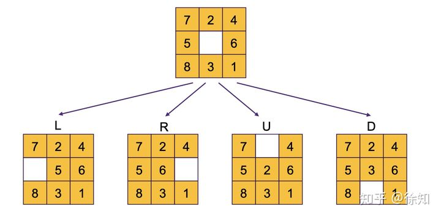

---

### Búsqueda no informada: características

- No utiliza información específica sobre el problema.
- Aplica una estrategia de búsqueda hasta encontrar la solución.
- La estrategia determina el orden en que se exploran los estados.
- Es fija: no cambia en función del problema.
- Algunos algoritmos de búsqueda no informada son **anchura**, **profundidad**, **coste uniforme**, **profundidad limitada** y **profundización iterativa**.

---

#### Búsqueda en anchura

- Es adecuada cuando todas las acciones tienen el mismo coste.
- Explora todos los estados a profundidad $p$ antes de explorar los de profundidad $p+1$.
- Garantiza encontrar una solución óptima cuando todos los pasos cuestan lo mismo.
- Definimos la **frontera** como una **cola** (FIFO).
- Guardamos los estados visitados en una lista o conjunto para evitar ciclos.

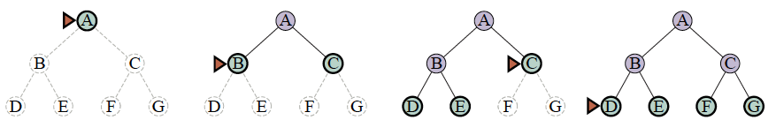

---

##### Implementación

```python
def cerca_amplada(estat_inicial):
    """Búsqueda en anchura en un problema."""
    frontera = collections.deque([estat_inicial])
    visitats = set()

    while frontera:
        estat = frontera.popleft()
        visitats.add(estat)

        if es_solucio(estat):
            return estat

        for succesor in succesors(estat):
            if succesor not in visitats:
                frontera.append(succesor)
```

---

##### Ejemplo: jarras de agua (I)

- **Estado inicial**: `(0, 0)` · **Estado objetivo**: `(2, *)` o `(*, 2)`.
- **Función sucesora**: operaciones de vaciar, llenar y trasvasar.

1. Frontera = {**[(0,0)]**}
2. Frontera = {**[(0,0),(3,0)]**, **[(0,0),(0,4)]**}
3. Frontera = {[(0,0),(0,4)], **[(0,0),(3,0),(0,0)]**, **[(0,0),(3,0),(3,4)]**, **[(0,0),(3,0),(0,3)]**}
4. Frontera = {[(0,0),(3,0),(0,0)], [(0,0),(3,0),(3,4)], [(0,0),(3,0),(0,3)], **[(0,0),(0,4),(0,0)]**, **[(0,0),(0,4),(3,4)]**, **[(0,0),(0,4),(3,1)]**}
5. …

---

##### Ejemplo: jarras de agua (II)

- Representación del árbol de búsqueda:
  - Cada nodo es un par de valores (a, b) que representa el estado de las jarras.
  - La búsqueda en anchura explora el árbol por niveles.
  - Solo se explora una parte pequeña de todos los estados posibles.

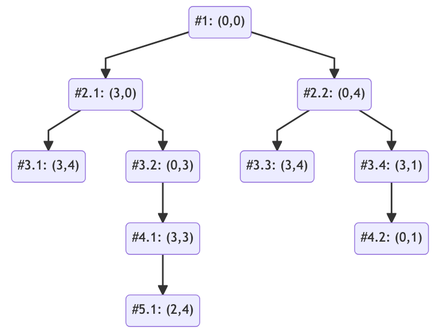

---

##### Propiedades de la búsqueda en anchura

| Propiedad | Valor | Comentarios |
| --- | --- | --- |
| Completitud | Sí | Si el espacio de búsqueda es finito, se encontrará una solución. |
| Optimalidad | Sí | Si todas las acciones tienen el mismo coste, la primera solución es óptima. |
| Complejidad temporal | $O(b^d)$ | $b$ es el factor de ramificación y $d$ la profundidad de la solución. |
| Complejidad espacial | $O(b^d)$ | $b$ es el factor de ramificación y $d$ la profundidad de la solución. |

---

##### Problemas de la búsqueda en anchura

- La complejidad espacial puede ser un problema real.
  - Supongamos que cada estado ocupa **1 KB** y que el **factor de ramificación es 10**.
  - Si la solución está a profundidad **10**, necesitaremos **10 GB** de memoria.
  - A profundidad **100**, necesitaremos **10 TB**.
  - A profundidad **1000**, necesitaremos **10 PB**.
- Normalmente, _nos quedaremos sin espacio antes que sin tiempo_.

---

#### Búsqueda en profundidad

- La estrategia se parece a la búsqueda en anchura.
- Utiliza una **pila** (LIFO) en lugar de una cola.
- **No** garantiza encontrar la solución óptima.
- El algoritmo avanza hasta una profundidad máxima $m$ y después retrocede para probar otro camino.

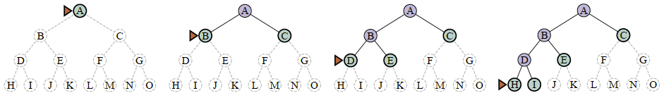

---

##### Implementación

```python
def cerca_profunditat(estat_inicial):
    """Búsqueda en profundidad en un problema."""
    frontera = collections.deque([estat_inicial])

    while frontera:
        estat = frontera.pop()

        if es_solucio(estat):
            return estat

        for succesor in succesors(estat):
            if not cicle(problema, succesor):
                frontera.append(succesor)
```

---

##### Ejemplo: jarras de agua (I)

- **Estado inicial**: `(0, 0)` · **Estado objetivo**: `(2, *)` o `(*, 2)`.
- **Función sucesora**: operaciones de vaciar, llenar y trasvasar.

1. Frontera = {**[(0,0)]**}
2. Frontera = {**[(0,0),(3,0)]**, [(0,0),(0,4)]}
3. Frontera = {**[(0,0),(3,0),(0,0)]**, **[(0,0),(3,0),(3,4)]**, **[(0,0),(3,0),(0,3)]**, [(0,0),(0,4)]}
4. …

---

##### Ejemplo: jarras de agua (II)

- En la búsqueda en profundidad se explora el árbol hasta encontrar una solución.
- Si no se encuentra, se vuelve atrás para probar otro camino.
- Si hay soluciones infinitas, el algoritmo puede no terminar.

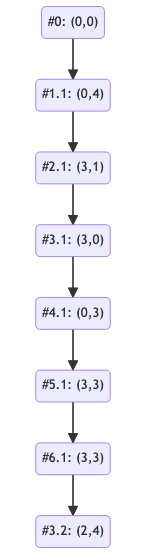

---

##### Propiedades de la búsqueda en profundidad

| Propiedad | Valor | Comentarios |
| --- | --- | --- |
| Completitud | No | Puede no encontrar una solución si hay ramas infinitas. |
| Optimalidad | No | La primera solución encontrada no tiene por qué ser óptima. |
| Complejidad temporal | $O(b^m)$ | $b$ es el factor de ramificación y $m$ la profundidad máxima. |
| Complejidad espacial | $O(bm)$ | Es mucho menor que en anchura si no hay ciclos; con ciclos, depende de cómo se controlen. |

---

##### ¿Cuándo utilizarla?

- En la práctica, puede ser mucho más rápida que la búsqueda en anchura.
- Necesita menos espacio que la búsqueda en anchura.
- Resulta útil cuando:
  - El factor de ramificación es muy grande.
  - La solución está a poca profundidad.
  - No necesitamos una solución óptima.
  - Comprobamos que no se creen ciclos.

---

#### Búsqueda en profundidad limitada

- Es una variante de la búsqueda en profundidad.
- Se detiene al alcanzar una profundidad máxima $l$.
- Si la solución está a profundidad $d > l$, no se encontrará.
- Es completa si $l$ es suficientemente grande y el espacio de búsqueda lo permite.
- Evita que la búsqueda en profundidad continúe indefinidamente por una rama.

---

##### Implementación

```python
def cerca_profunditat_limitada(estat_inicial, l):
    """Búsqueda en profundidad limitada en un problema."""
    frontera = collections.deque([estat_inicial])

    while frontera:
        estat = frontera.pop()

        if es_solucio(estat):
            return estat

        for succesor in succesors(estat):
            if not cicle(problema, succesor) and profunditat(succesor) < l:
                frontera.append(succesor)
```

---

#### Búsqueda en profundidad iterativa

- Resuelve parte de las limitaciones de la búsqueda en anchura y en profundidad.
- Repite una búsqueda en profundidad limitada, aumentando $l$ en cada iteración.
- Empieza con $l=0$ e incrementa el límite hasta encontrar la solución.

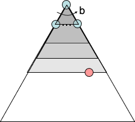

---

##### Traza del algoritmo (I)


---

##### Traza del algoritmo (II)


---

##### Traza del algoritmo (III)


---

##### Implementación

```python
def cerca_profunditat_iterativa(estat_inicial):
    """Búsqueda en profundidad iterativa en un problema."""
    l = 0
    while True:
        solucio = cerca_profunditat_limitada(estat_inicial, l)
        if solucio is not None:
            return solucio
        l += 1
```

---

##### Propiedades de la búsqueda en profundidad iterativa

| Propiedad | Valor | Comentarios |
| --- | --- | --- |
| Completitud | Sí | Si el espacio de búsqueda es finito, encontrará una solución. |
| Optimalidad | Sí | La primera solución encontrada será óptima si todas las acciones tienen el mismo coste. |
| Complejidad temporal y espacial | Como la búsqueda en profundidad, con repetición de estados | El límite aumenta progresivamente. |

---

#### Búsqueda de coste uniforme

- Es una variante de la búsqueda en anchura.
- La frontera se ordena según el coste del camino hasta cada estado: se utiliza una **cola de prioridad**.
- Se visitan los estados por orden creciente de coste acumulado.
- Si todas las acciones tienen el mismo coste, equivale a la búsqueda en anchura.

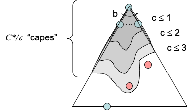

---

##### Ejemplo: viajar por Rumanía (I)

- **Estado inicial**: Arad.
- **Función sucesora**: carreteras.
- **Coste**: distancia entre ciudades (en km).
- **Comprobación del objetivo**: el estado es Bucarest.
- **Solución**: secuencia de ciudades que lleva de Arad a Bucarest.


---

##### Ejemplo: viajar por Rumanía (II)

- Representación mediante un árbol de búsqueda.
- En este ejemplo, cada nodo representa una ciudad; no el estado de las jarras de agua.
- La búsqueda de coste uniforme expande primero el estado con menor coste acumulado.
- El orden de expansión puede diferir de la búsqueda en anchura.

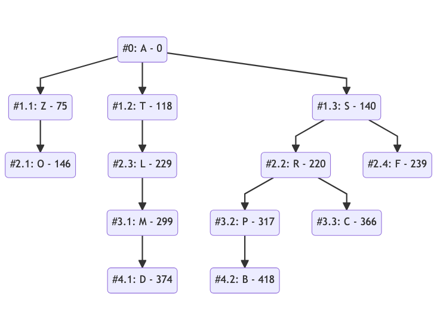

---

##### Implementación

```python
def cerca_cost_uniforme(estat_inicial):
    """Búsqueda de coste uniforme en un problema."""
    frontera = priority_queue([(0, estat_inicial)])
    visitats = set()

    while frontera:
        cost_actual, estat = frontera.pop()

        # La frontera puede contener el mismo estado más de una vez.
        if estat in visitats:
            continue

        visitats.add(estat)

        if es_solucio(estat):
            return estat

        for cost_accio, succesor in succesors(estat):
            if succesor not in visitats:
                frontera.append(cost_actual + cost_accio, succesor)
```

---

##### Propiedades de la búsqueda de coste uniforme

| Propiedad | Valor | Comentarios |
| --- | --- | --- |
| Completitud | Sí | Si todos los costes son positivos y se cumplen las condiciones del algoritmo. |
| Optimalidad | Sí | La primera solución extraída es óptima. |
| Complejidad temporal y espacial | $O(b^{1+C/\epsilon})$ | $b$ es el factor de ramificación, $C$ el coste de la solución óptima y $\epsilon$ el coste mínimo de una acción. |

---

### Gestión de fronteras

- La gestión de la **frontera** es un aspecto importante de los algoritmos de búsqueda.
- Los algoritmos vistos son parecidos; se diferencian en cómo gestionan la frontera:
  - Conceptualmente, se trata de una **cola de prioridad**.
  - En la práctica, para búsqueda en profundidad o en anchura podemos utilizar una pila o una cola.
    - Así evitamos el coste adicional $O(\log(n))$ de una cola de prioridad.
  - También podríamos programar una implementación que permita **cambiar la estructura de frontera**.

---

<!-- _class: invert lead -->

## Búsqueda informada

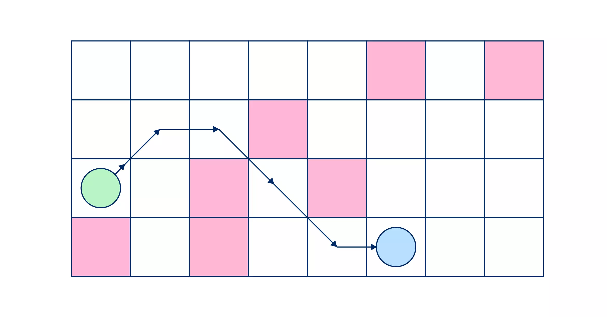

---

### Definición

- La búsqueda de coste uniforme es eficiente, pero tiene algunas limitaciones:
  - Busca en todas las direcciones, sin considerar cuál acerca a la solución.
  - Por eso analiza más estados de los necesarios.
- En esta parte de la unidad veremos técnicas para reducir esa exploración.

---

### Heurísticas

- Una **heurística** es una función que permite _estimar_ el coste de llegar a la solución desde un estado.
- Se diseña para un problema concreto.
- Heurísticas para rutas:
  - Distancia en línea recta (euclídea).
  - Distancia de Manhattan.

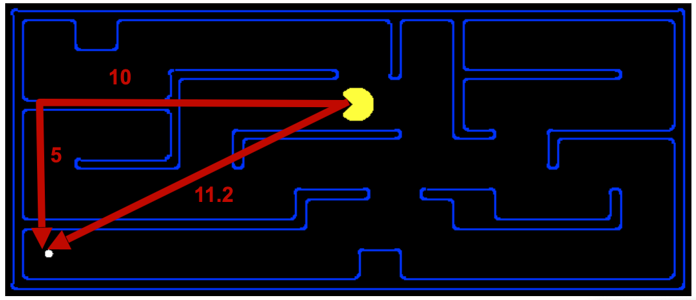

---

#### Ejemplo: viajar por Rumanía

- **Heurística**: distancia en línea recta (euclídea).

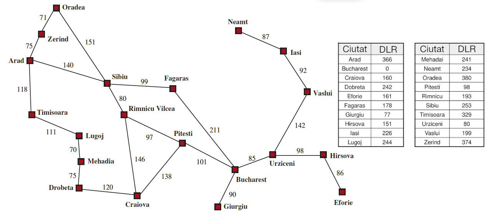

---

### Búsqueda voraz

- Si utilizamos solo la heurística para elegir qué estado de la frontera explorar, tenemos una **búsqueda voraz**.
- Suele ser más eficiente que la búsqueda de coste uniforme.
- No garantiza encontrar la solución óptima.

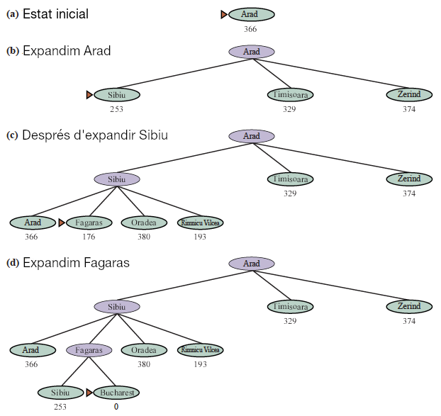

---

### Búsqueda voraz: un contraejemplo

- En verde aparece la ruta correcta y en rojo la ruta elegida por la búsqueda voraz.
- ¿Qué podemos hacer para que el algoritmo encuentre la solución correcta?

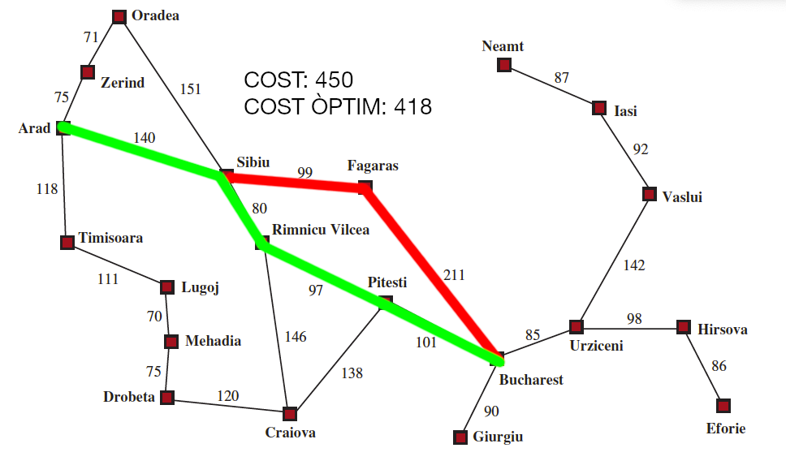

---

#### Implementación

```python
def cerca_voraç(estat_inicial):
    """Búsqueda voraz en un problema."""
    frontera = priority_queue([(0, estat_inicial)])
    visitats = set()

    while frontera:
        cost_actual, estat = frontera.pop()
        visitats.add(estat)

        if es_solucio(estat):
            return estat

        for cost, succesor in succesors(estat):
            if succesor not in visitats:
                frontera.append(heuristica(succesor), succesor)
```

---

#### Propiedades de la búsqueda voraz

| Propiedad | Valor | Comentarios |
| --- | --- | --- |
| Completitud | Sí | Si el espacio de búsqueda es finito y se evitan ciclos. |
| Optimalidad | No | La primera solución puede no ser óptima. |
| Complejidad temporal y espacial | $O(b^m)$ | $b$ es el factor de ramificación y $m$ la profundidad máxima. |

---

### A*

- **A*** combina la búsqueda de coste uniforme y la búsqueda voraz:
  - Coste del camino o coste acumulado: **$g(n)$**.
  - Estimación heurística o coste restante: **$h(n)$**.
  - A* ordena por la suma: **$f(n) = g(n) + h(n)$**.
  - El coste real del camino recorrido es siempre **$g(n)$**; $f(n)$ solo ordena la frontera.

> **Garantiza encontrar la solución óptima si $h(n)$ es admisible**, bajo las condiciones correspondientes.

---

#### Ejemplo: viajar por Rumanía (I)

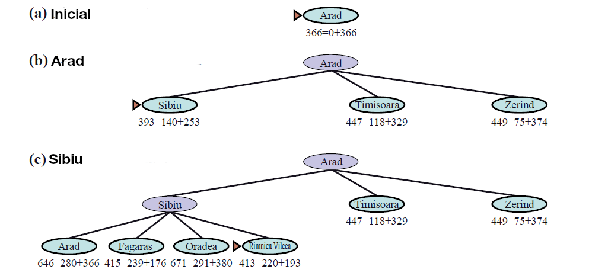

---

#### Ejemplo: viajar por Rumanía (II)

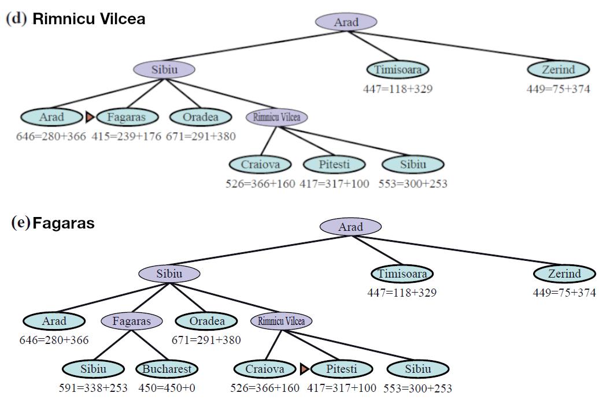

---

#### Ejemplo: viajar por Rumanía (III)

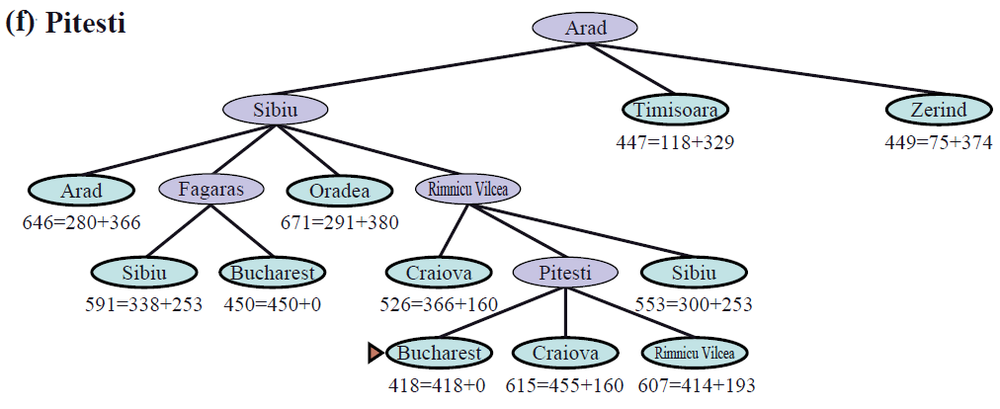

---

#### Implementación de A*

```python
def cerca_a_estrella(estat_inicial):
    """Búsqueda A* en un problema."""
    frontera = priority_queue([(h(estat_inicial), 0, estat_inicial)])
    visitats = set()

    while frontera:
        _, cost_actual, estat = frontera.pop()

        if estat in visitats:
            continue

        visitats.add(estat)

        if es_solucio(estat):
            return estat, cost_actual

        for cost_accio, succesor in succesors(estat):
            if succesor not in visitats:
                nou_cost = cost_actual + cost_accio
                prioritat = nou_cost + h(succesor)
                frontera.append(prioritat, nou_cost, succesor)
```

---

#### Propiedades de A*

| Propiedad | Valor | Comentarios |
| --- | --- | --- |
| Completitud | Sí | Bajo las condiciones habituales de costes positivos y ramificación finita. |
| Optimalidad | Sí | Si la heurística es admisible; para búsqueda en grafos, se requiere consistencia o reabrir estados. |
| Complejidad temporal y espacial | $O(b^d)$ en el peor caso | $b$ es el factor de ramificación y $d$ la profundidad de la solución. |

> Estas propiedades se cumplen si la heurística es **consistente**, como la distancia en línea recta en el mapa de Rumanía.

---

#### Conexión con el ejercicio de Rumanía

- Podemos ponderar la heurística con $f_w(n) = g(n) + w h(n)$:
  - $w = 0$: búsqueda de coste uniforme.
  - $w = 1$: A* con heurística admisible.
  - $w > 1$: A* ponderado; explora menos estados, pero puede perder optimalidad y acercarse a la búsqueda voraz.
- Pruébalo en el [ejercicio de Rumanía](4.-romania-es.ipynb) comparando los pesos 0, 1, 2 y 100.

---

#### Heurísticas admisibles (I)

- Una heurística es **admisible** si no sobreestima el coste restante hasta una solución óptima.
- Si el coste óptimo desde $n$ es $C^*(n)$, entonces $h(n) \leq C^*(n)$.
- Encontrar una heurística admisible puede ser difícil.

---

##### Ejemplo: puzle del 8 (I)

- Una técnica útil consiste en reducir el problema a otro más sencillo.
- **Relajar las reglas del juego**:
  1. Permitir que las fichas se intercambien entre sí.
  2. Permitir que las fichas se muevan a cualquier posición vacía.
  3. Permitir que las fichas se muevan a cualquier posición, sin restricciones (1 + 2).


---

##### Ejemplo: puzle del 8 (II)

- La primera relajación da lugar a la heurística de **distancia de Manhattan**:
  - Equivale a deslizar cada ficha hasta su posición.
  - Suma las distancias horizontales y verticales de cada ficha a su posición final.
  - Es admisible porque no sobreestima el coste de la solución.
- La tercera relajación da lugar a la heurística de **fichas fuera de lugar**:
  - Equivale a colocar directamente cada ficha en su posición.
  - Cuenta las fichas que no están en su posición final.
  - También es admisible.

---

### Optimalidad de las heurísticas admisibles (I)

- Sea $n_d$ un estado objetivo alcanzado por una ruta óptima de coste $g(n_d)$.
- Sea $n'_d$ el mismo objetivo alcanzado por una ruta subóptima, con $g(n'_d) > g(n_d)$.
- Una heurística admisible no sobreestima el coste que falta por recorrer.
- A* puede extraer una solución subóptima antes que una ruta óptima hacia el objetivo? **No**: la ruta óptima mantiene una prioridad $f$ menor o igual que la solución subóptima.
- Por eso, A* encuentra una solución óptima bajo las condiciones indicadas.

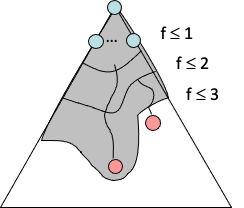

---

### Optimalidad de las heurísticas admisibles (II)

- A* explora nodos en orden creciente de $f(n)$.
- Va incorporando gradualmente curvas de nivel de $f$.
- Cada curva de nivel representa los nodos con un valor de $f(n)$ inferior a un umbral.


---

### Optimalidad de las heurísticas admisibles (III)

- Sean $h_1$ y $h_2$ dos heurísticas admisibles y supongamos que $h_1(n) \leq h_2(n)$ para todos los estados $n$.
- Entonces $h_2$ es más informativa que $h_1$ y, normalmente, permite explorar menos estados.
- Por eso, preferimos la heurística de Manhattan a la de fichas fuera de lugar para el puzle del 8.


---

### Limitaciones del algoritmo A*

- A* es óptimo bajo las condiciones vistas y puede mejorar la búsqueda de coste uniforme.
- Tiene dos limitaciones:
  - **Memoria**: puede necesitar mucha memoria.
  - **Tiempo de ejecución**: puede tardar mucho.
- Se han desarrollado variantes para mejorar estas limitaciones. En esta unidad veremos:
  - **A* de profundización iterativa**.
  - **A* ponderado**.

---

### A* de profundización iterativa

- Es una variante de A* parecida a la búsqueda en profundidad iterativa.
- Utiliza la función $f(n)$ para limitar la exploración, en lugar de la profundidad.
- Reduce la memoria necesaria, a cambio de volver a visitar algunos nodos.

---

#### Implementación (I)

```python
def cerca_a_limitada(estat_inicial, l):
    """Búsqueda A* limitada en un problema."""
    frontera = priority_queue([(0, estat_inicial)])
    visitats = set()

    while frontera:
        cost_actual, estat = frontera.pop()
        visitats.add(estat)

        if es_solucio(estat):
            return estat

        for cost, succesor in succesors(estat):
            if succesor not in visitats and cost_acumulat_h < l:
                cost_acumulat_h = cost_actual + cost + h(succesor)
                frontera.append(cost_acumulat_h, succesor)
```

---

#### Implementación (II)

```python
def cerca_a_iterativa(estat_inicial):
    """Búsqueda A* iterativa en un problema."""
    l = 0
    while True:
        solucio = cerca_a_limitada(estat_inicial, l)
        if solucio is not None:
            return solucio
        l += 1
```

---

### A* ponderado: definición

- A* ponderado es una variante de A*.
- Se define un factor de ponderación $\epsilon$ que determina el peso de la heurística.
- Ordena por $f(n) = g(n) + \epsilon h(n)$.
- Si $\epsilon = 1$, equivale a A*.
- Si $\epsilon > 1$, se aproxima a la búsqueda voraz.

---

#### Utilidad de A* ponderado

- A* ponderado puede reducir el tiempo y el espacio de búsqueda, a costa de una solución que quizá no sea óptima.
- En el ejemplo de la derecha, con $W = 2$ (b):
  - Se exploran siete veces menos estados.
  - La solución es un 5 % menos eficiente.


---

#### Implementación

```python
def cerca_a_ponderat(estat_inicial, epsilon):
    """Búsqueda A* ponderada en un problema."""
    frontera = priority_queue([(0, estat_inicial)])
    visitats = set()

    while frontera:
        cost_actual, estat = frontera.pop()
        visitats.add(estat)

        if es_solucio(estat):
            return estat

        for cost, succesor in succesores(estat):
            if succesor not in visitats:
                cost_acumulat_h = cost_actual + cost + h(succesor) * epsilon
                frontera.append(cost_acumulat_h, succesor)
```

---

### Anytime A*

- Podemos utilizar A* ponderado para construir **Anytime A***:
  - Buscamos una ruta con un valor grande de $\epsilon$.
  - Vamos reduciendo $\epsilon$ hasta llegar a 1.
  - Así obtenemos pronto una solución razonable y, si hay tiempo, seguimos buscando una mejor hasta alcanzar la óptima.


---

#### Implementación

```python
def cerca_anytime_a(estat_inicial):
    """Búsqueda Anytime A* en un problema."""
    epsilon = 100
    while epsilon > 1:
        solucio = cerca_a_ponderat(estat_inicial, epsilon)
        yield solucio
        epsilon /= 2
```

---

### Demostración de algoritmos de búsqueda

#### Pac-Man

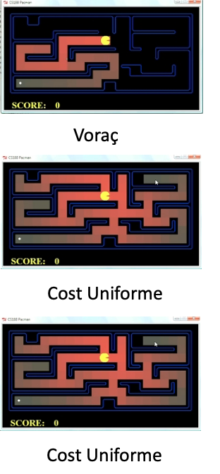

[Ver demostración en YouTube](https://www.youtube.com/watch?v=2XjzjAfGWzY)
