<style scoped>
h1, h2, h3, h4, h5, h6, p {
  color: #FFFFFF;
  font-weight: 800;
  text-shadow:
    0px 0px 3px #000000;
}
</style>

# 4. Búsqueda local y satisfacción de restricciones

Modelos de inteligencia artificial

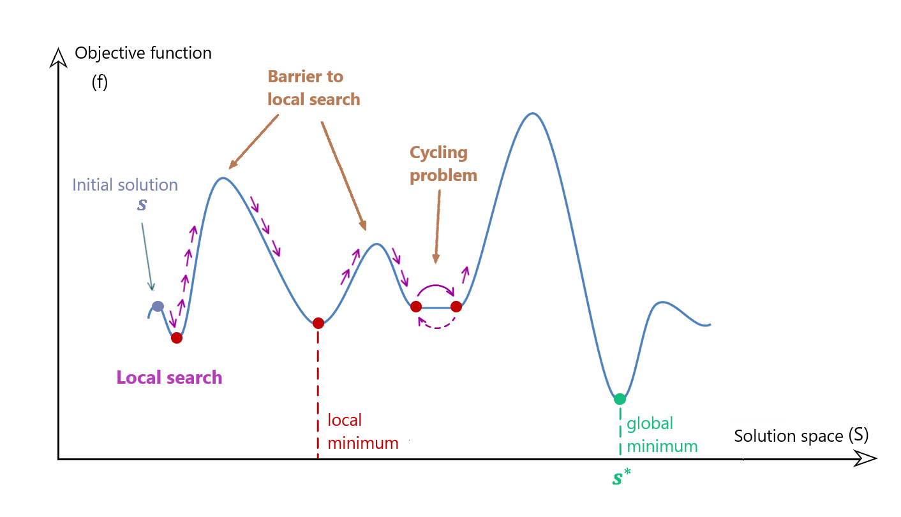

---

<!--
_class: invert lead
-->

<style scoped>
h1, h2, h3, h4, h5, h6, p {
  color: #FFFFFF;
  text-shadow:
    0px 0px 3px #000000;
}
</style>

# Optimización

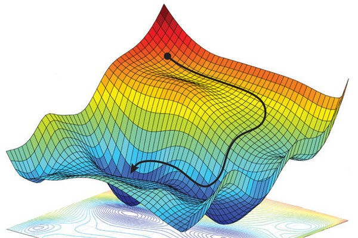

---

<style scoped>section { font-size:32px; }</style>

## Definición

- Hasta ahora hemos planteado los problemas como la **búsqueda de un camino en un espacio de estados**.
- A veces esta búsqueda no es posible o no es lo que necesitamos.
  - Puede que queramos encontrar un estado que satisfaga ciertas **restricciones** o que **maximice** o **minimice** una función.
  - **Puede que no sea posible representar el camino** en el espacio de estados.
  - O puede que no nos interese el camino, sino **solo el estado final**.
- En estos casos puede ser fácil **encontrar una solución**, aunque no sea la mejor.
- Esta solución se puede **mejorar mediante técnicas de búsqueda local**.

---

<style scoped>section { font-size:33px; }</style>

## Aplicaciones reales

- Los algoritmos de optimización se utilizan en muchos problemas reales.
- Algunos ejemplos:
  - Optimización de redes neuronales
  - Optimización de circuitos electrónicos
  - Optimización de problemas de planificación
  - Optimización de problemas de logística
  - Optimización de problemas de diseño
  - Optimización de problemas de fabricación

---

## Problemas NP-completos

- Los problemas que no pueden resolverse en **tiempo polinómico** se denominan **problemas NP-completos**.
- Estos problemas son **intratables**, porque no se conoce ningún algoritmo que los resuelva en un tiempo razonable.
- Con frecuencia, los problemas de optimización son NP-completos, porque para encontrar la solución óptima hay que **explorar todo el espacio de estados**.
- Por eso **no es posible** encontrar la solución óptima en un tiempo razonable.

---

<!--
_class: invert lead
-->

<style scoped>
h1, h2, h3, h4, h5, h6, p {
  color: #FFFFFF;
  text-shadow:
    0px 0px 3px #000000;
}
</style>

# Búsqueda local


---

<style scoped>section { font-size:35px; }</style>

## Características (I)

- La **búsqueda local** **no** mantiene una **estructura de datos** que represente todo el espacio de estados.
  - En su lugar, **genera un estado inicial** y obtiene sus **estados sucesores**.
  - Estos sucesores se generan **modificando el estado actual**.
  - Las técnicas de búsqueda local también se denominan metaheurísticas.

---

## Características (II)

  - Una **función de evaluación** asigna un valor a cada estado. Según el problema, queremos maximizar el valor o minimizar el coste.
- Ventajas:
  - Consume **poca memoria** y **poca CPU**.
  - Permite encontrar soluciones **razonables** en espacios de estados **muy grandes**.

---

## Algoritmo de escalada

- Partimos de un estado inicial y evaluamos sus vecinos.
- Pasamos al mejor vecino si mejora el estado actual.
- Cuando ningún vecino lo mejora, nos detenemos en un óptimo local.
- En el viajante, mejorar significa acortar el circuito.

---


---

<style scoped>section { font-size:30px; }</style>

## Definición del problema

### Ejemplo: problema del viajante (I)

- Tenemos un **mapa** con **ciudades** y queremos encontrar el **recorrido más corto** que pase por **todas ellas** y vuelva a la **ciudad inicial**.
- Las **variables** son las **ciudades** y sus **dominios** son las **posiciones**.
- La **restricción** es que **no puede haber dos ciudades en la misma posición**.
- Las **soluciones** son las **permutaciones de las ciudades** que satisfacen las restricciones.

---

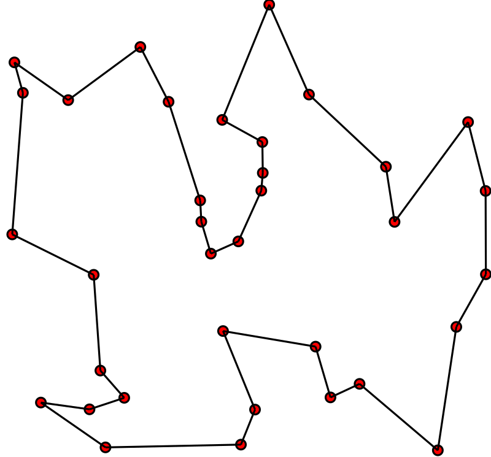

---

### El viajante como problema de búsqueda local

- **Estado**: una ruta que mantiene la ciudad 0 al principio.
- **Coste**: la distancia total, incluido el regreso a la ciudad 0.
- **Vecinos**: intercambiamos dos ciudades de la ruta.
- En cada paso, buscamos un intercambio que reduzca la distancia.

---

### Viajante · Datos y ruta inicial

```python
from itertools import combinations, permutations
from math import dist, exp
from random import Random

rng = Random(1)
ciutats = [(rng.randrange(100), rng.randrange(100)) for _ in range(8)]
inicial = tuple(range(len(ciutats)))
```

---

<style scoped>section { font-size: 28px; }</style>

### Viajante · Coste y sucesores

```python
def cost(ruta):
    circuit = ruta + (ruta[0],)
    return sum(dist(ciutats[a], ciutats[b]) for a, b in zip(circuit, circuit[1:]))

def intercanvia(ruta, i, j):
    nova = list(ruta)
    nova[i], nova[j] = nova[j], nova[i]
    return tuple(nova)

def veines(ruta):
    for i, j in combinations(range(1, len(ruta)), 2):
        yield intercanvia(ruta, i, j)
```

---

### El primer paso de la escalada

```python
millor_vei = min(veines(inicial), key=cost)
print(inicial, round(cost(inicial), 2))
print(millor_vei, round(cost(millor_vei), 2))
```

---

### Hill climbing

```python
def hill_climbing(ruta):
    while True:
        millor = min(veines(ruta), key=cost, default=ruta)
        if cost(millor) >= cost(ruta):
            return ruta
        ruta = millor
```

---

### Comprueba el óptimo local

```python
local = hill_climbing(inicial)
print(local, round(cost(local), 2))
```

---

### ¿Es la mejor ruta posible?

Cuando la escalada se detiene, ningún intercambio mejora la ruta. Para saber si hay un circuito más corto, comparamos las 7! rutas que empiezan en 0. Con ocho ciudades es viable. El número de rutas crece rápidamente al añadir ciudades.

---

### Ruta óptima por enumeración

```python
optima = min(((0,) + resta for resta in permutations(inicial[1:])), key=cost)
print(optima, round(cost(optima), 2))
print(round(cost(local) - cost(optima), 2))  # Diferencia de coste
```

---

### Memoria y vecinos

`veines` genera un vecino cada vez. `min` los compara sin crear una lista con todas las rutas.


---

### Problemas

- El algoritmo de escalada **no** garantiza encontrar el **máximo global**.
- Puede quedarse atrapado en un **máximo local**.
  - Un pico más alto que sus vecinos, pero no el máximo global.
  - Depende **mucho** del **estado inicial**.
- Para evitarlo se han desarrollado distintas variantes:
  - Escalada del primer mejor
  - Escalada con reinicio aleatorio
  - Escalada estocástica

---

## Escalada del primer mejor

- El algoritmo de escalada del primer mejor **no** elige el **mejor sucesor**.
  - En su lugar, elige el **primer sucesor** que **mejora** el estado actual.
  - Si ningún sucesor mejora el estado actual, el algoritmo se detiene.
  - También puede detenerse al alcanzar un número máximo de iteraciones.
- Puede ser útil cuando hay muchos sucesores.

---

### Escalada del primer mejor

```python
def primer_millor(ruta, rng):
    while True:
        candidates = list(veines(ruta))
        rng.shuffle(candidates)
        for candidata in candidates:
            if cost(candidata) < cost(ruta):
                ruta = candidata
                break
        else:
            return ruta
```

---

## Escalada con reinicio aleatorio

- El algoritmo de escalada con reinicio aleatorio **reinicia la búsqueda** cada cierto tiempo.
- Esto permite **escapar de los máximos locales**.
- **No garantiza** encontrar el **máximo global**, pero **aumenta las posibilidades**.
- Este algoritmo se puede **combinar con otras técnicas** de búsqueda local.

---

### Escalada con reinicios

```python
def amb_reinicis(ruta, rng, intents=10):
    millor = hill_climbing(ruta)
    for _ in range(intents):
        nova = (ruta[0],) + tuple(rng.sample(ruta[1:], len(ruta) - 1))
        resultat = hill_climbing(nova)
        if cost(resultat) < cost(millor):
            millor = resultat
    return millor
```

---

### Prueba los reinicios

```python
reinicis = amb_reinicis(inicial, Random(42))
print(reinicis, round(cost(reinicis), 2))
```

---

## Algoritmo de recocido simulado

- El algoritmo de recocido simulado o **simulated annealing** se inspira en el proceso de **recocido** de la metalurgia.
  - Se calienta un metal a una temperatura muy alta.
  - Después se deja enfriar lentamente.
  - Esto permite que las moléculas se **reorganicen** y **minimicen la energía**.
  - En determinadas condiciones, el algoritmo puede aceptar estados peores que el actual.
  - Incorpora el azar al algoritmo de escalada.


---

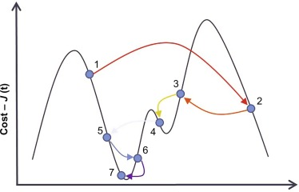

---

### Probabilidad de aceptación

- La probabilidad de aceptar un estado peor depende de la **temperatura**.
  - A medida que avanza el algoritmo, la temperatura **disminuye** y se vuelve **menos probable** aceptar un estado peor.
  - La probabilidad de aceptar un estado peor se calcula con la fórmula siguiente:
    - $P = e^{-\frac{\Delta E}{T}}$, donde $\Delta E$ es la diferencia entre el valor del estado actual y el del estado sucesor.

---

### Propiedades

- El recocido simulado **puede encontrar el máximo global**.
  - **No** lo garantiza, pero la probabilidad de encontrarlo aumenta con el número de iteraciones.
- Es uno de los algoritmos de búsqueda local más utilizados.
- Aplicaciones reales:
  - Optimización de redes neuronales
  - Optimización de circuitos electrónicos
  - Optimización de problemas de planificación


---


---

<style scoped>section { font-size: 28px; }</style>

### Recocido simulado

```python
def recuit(ruta, rng, passos=500, temperatura=30):
    millor = ruta
    for _ in range(passos):
        i, j = rng.sample(range(1, len(ruta)), 2)
        candidata = intercanvia(ruta, i, j)
        delta = cost(candidata) - cost(ruta)
        if delta <= 0 or rng.random() < exp(-delta / temperatura):
            ruta = candidata
            if cost(ruta) < cost(millor):
                millor = ruta
        temperatura *= 0.99
    return millor
```

---

### Prueba el recocido

```python
recuit_final = recuit(inicial, Random(42))
print(recuit_final, round(cost(recuit_final), 2))
```

---

<!--
_class: invert lead
-->

<style scoped>
h1, h2, h3, h4, h5, h6, p {
  color: #FFFFFF;
  text-shadow:
    0px 0px 3px #000000;
}
</style>

# Algoritmos genéticos


---

# Algoritmos genéticos

- Los **algoritmos genéticos** son una técnica de optimización inspirada en la **evolución biológica**.
  - Se pueden entender como una **técnica de búsqueda local en paralelo**.
  - Cada **individuo** de la población representa un **estado**.
  - Cada **gen** del individuo representa una **variable** del estado.
  - Los **valores** de los genes representan los **valores** de las **variables**.
  - Los **individuos** evolucionan **generando nuevos individuos**.

---


---

### Procedimiento

- El algoritmo **genera una población inicial** de estados.
- Después, **genera una nueva población** a partir de la población actual.
- Esta nueva población **hereda** los **genes** de la población actual.
- Además, **muta** algunos de sus genes.
- El algoritmo **selecciona los mejores** individuos de la nueva población y **descarta el resto**.
- El algoritmo **se detiene** al alcanzar un **número máximo de iteraciones**.

---

### Definición del problema

- El primer paso es definir el problema como un **espacio de estados**.
- Los **estados** son **individuos**.
- Los **genes** son las **variables**.
- Los **valores de los genes** son los **valores de las variables**.
- Para simplificar, **representaremos los genes como números enteros**.
  - _Problema del viajante_: secuencia de números que representan las ciudades en orden.
  - _Mochila_: secuencia de 0 y 1 que indica si cada objeto está o no en la mochila.

---

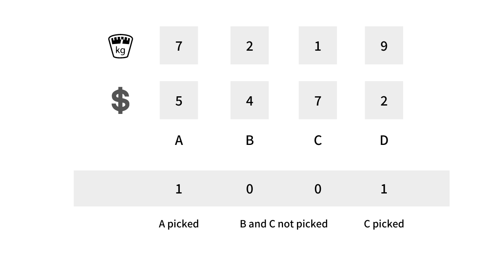

---

### Función de evaluación

- Debemos definir una **función de evaluación**.
- Esta función **asigna un valor** a cada **individuo**.
- Este valor **representa la calidad** del individuo.
- Debemos ponderar los valores de las variables según las características del individuo que queramos favorecer.

---

<style scoped>section { font-size:31px; }</style>

### Creación de la población inicial

- El tercer paso es **crear una población inicial**.
- Esta población **se genera aleatoriamente** dentro de los **dominios** de las variables.
- La población inicial debe tener suficientes individuos y ser **diversa**, pero no demasiado grande.
- Opcionalmente, ordenaremos los individuos según su función de evaluación.

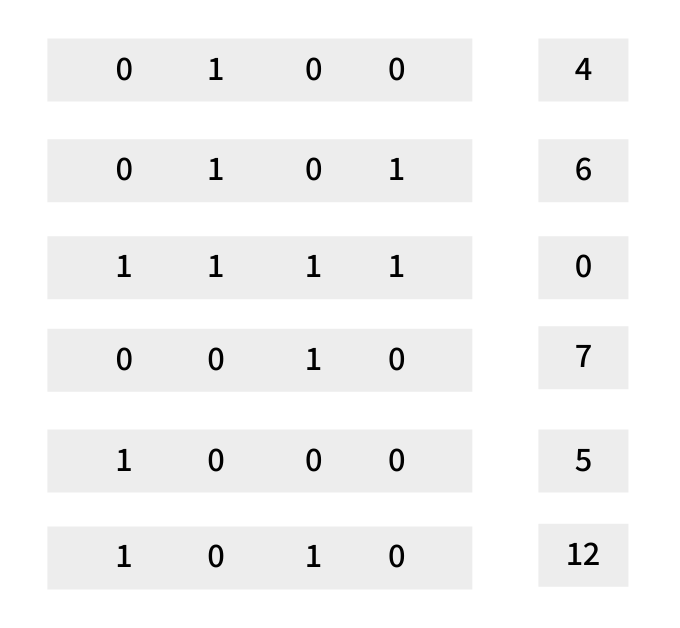

---
<style scoped>section { font-size:33px; }</style>

### Selección

- Para que la población evolucione, hay que **seleccionar los mejores individuos**; estos **transmitirán sus genes a la generación siguiente**.
- Hay varias técnicas de selección:
  - **Por torneo**: se eligen **$k$ individuos al azar** y se **selecciona el mejor**.
  - **Por ruleta**: se **asigna una probabilidad** a cada individuo, proporcional a su puntuación de evaluación.
  - **Por rango**: la **probabilidad** es proporcional a la posición del individuo.

---

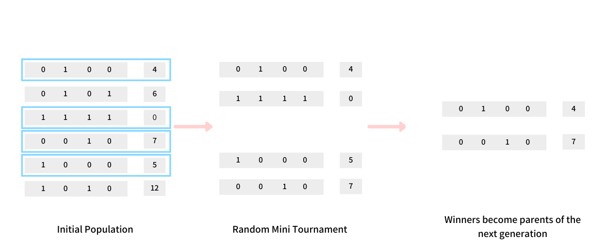

---

<style scoped>section { font-size:30px; }</style>

### Cruce

- El **cruce** es el proceso por el que se **genera un nuevo individuo** a partir de dos individuos, con cierta probabilidad.
- Los **descendientes** heredan una combinación de los **genes** de sus progenitores.
- Hay varias técnicas de cruce:
  - **Cruce de un punto**: se elige un **punto al azar** y se **combinan** los genes a partir de él.
  - **Cruce de dos puntos**: se eligen **dos puntos al azar** y se **combinan** los genes comprendidos entre ellos.
  - **Cruce uniforme**: para cada gen se decide **al azar** si se **hereda de uno u otro progenitor**.
  - **Otras técnicas**: recombinación ordenada, máscara, etc.

---

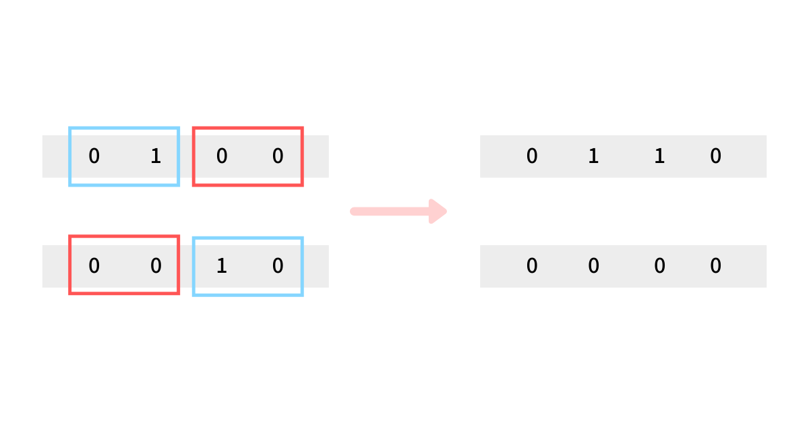

---
<style scoped>section { font-size:32.8px; }</style>

### Mutación

- La **mutación** es el proceso por el que se **modifica un gen** de un individuo.
- La mutación **puede ser necesaria** para **evitar que el algoritmo quede atrapado en un máximo local**.
- Al igual que la selección, la mutación **se aplica con cierta probabilidad** (normalmente muy baja).
- Hay varias técnicas de mutación:
  - **Mutación aleatoria**: se elige un **gen al azar** y se **modifica**.
  - **Mutación dirigida**: se elige un **gen al azar** y se **modifica** en una **dirección concreta**.

---

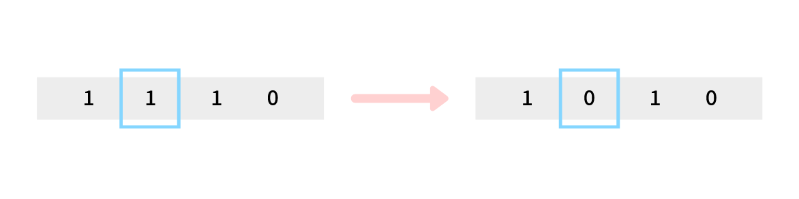

---

<style scoped>section { font-size: 28px; }</style>

### Mochila · Datos y puntuación

```python
from random import Random

PES_MAXIM = 100
MAX_UNITATS = 10
objectes = [
    ('Coca-Cola', 1, 1.5),
    ('Cerveza', 2, 2.5),
    ('Agua', 1, 0.5),
    ('Cacahuetes', 1, 1.0),
    ('Patatas', 2, 1.5),
    ('Galletas', 1, 1.0),
    ('Manzanas', 1, 1.0),
    ('Naranjas', 1, 1.0),
    ('Plátanos', 1, 1.0),
    ('Peras', 1, 1.0),
    ('Fresas', 1, 1.0),
    ('Piña', 1, 1.0),
    ('Manzanas', 1, 1.0),
]
```

---

### Mochila · Peso, valor y puntuación

```python
def pes(individu):
    return sum(q * p for q, (_, p, _) in zip(individu, objectes))

def valor(individu):
    return sum(q * v for q, (_, _, v) in zip(individu, objectes))

def puntuacio(individu):
    if pes(individu) > PES_MAXIM:
        return -1
    return valor(individu)
```

---

### Mochila · Cruce y mutación

```python
def creua(a, b, rng):
    tall = rng.randrange(1, len(a))
    return a[:tall] + b[tall:]

def muta(individu, rng):
    i = rng.randrange(len(individu))
    opcions = [q for q in range(MAX_UNITATS + 1) if q != individu[i]]
    quantitat = rng.choice(opcions)
    return individu[:i] + (quantitat,) + individu[i + 1:]
```

---

<style scoped>section { font-size: 28px; }</style>

### Mochila · Algoritmo genético

```python
def genetic(rng, generacions=30):
    poblacio = [(0,) * len(objectes)]
    for _ in range(19):
        poblacio.append(tuple(rng.randrange(MAX_UNITATS + 1) for _ in objectes))

    for _ in range(generacions):
        poblacio.sort(key=puntuacio, reverse=True)
        pares = poblacio[:10]
        nova = [poblacio[0]]
        while len(nova) < len(poblacio):
            a, b = rng.sample(pares, 2)
            fill = creua(a, b, rng)
            if rng.random() < 0.25:
                fill = muta(fill, rng)
            nova.append(fill)
        poblacio = nova
    return max(poblacio, key=puntuacio)
```

---

### Prueba el algoritmo genético

```python
resultat = genetic(Random(42))
for quantitat, (nom, _, _) in zip(resultat, objectes):
    if quantitat:
        print(quantitat, nom)
print(f"{pes(resultat)} kg · {valor(resultat):.2f} €")
```

---

### Conclusiones y limitaciones

- Los algoritmos genéticos pueden ser difíciles de **representar**.
- Funcionan mejor con problemas que pueden representarse mediante **variables binarias**.
- Suelen ser más lentos que otras técnicas de búsqueda local.
- Para muchos problemas es difícil definir los operadores de cruce y mutación.
- Su capacidad para entrenar redes neuronales los hace muy útiles en este ámbito.

---

<!--
_class: invert lead
-->

<style scoped>
h1, h2, h3, h4, h5, h6, p {
  color: #FFFFFF;
  text-shadow:
    0px 0px 3px #000000;
}
</style>


# Satisfacción de restricciones


---

<style scoped>section { font-size:30px; }</style>

## Definiciones (I)

- Algunos problemas se modelan mejor como problemas de satisfacción de restricciones **CSP** (**Constraint Satisfaction Problems**).
  - Es un tipo específico de problema de búsqueda, pero puede ser difícil de resolver por su tamaño.
- Algunos de estos problemas se pueden resolver con las técnicas de **búsqueda local** que ya hemos visto.
  - Sin embargo, el resultado puede no ser **óptimo**.
  - Por eso se han desarrollado técnicas específicas para estos problemas.
  - También veremos cómo **mejorar** los resultados de las técnicas de búsqueda local.

---

## Definiciones (II)

- En estos problemas, el **estado** es un **conjunto de variables**.
- Cada variable tiene un **dominio** de valores posibles.
- Las **restricciones** son las **relaciones** entre las variables.
- Los **estados** que satisfacen las **restricciones** son las **soluciones**.
- Los **estados** que no satisfacen las **restricciones** son **incompatibles**.
- Los **estados** que no son soluciones ni incompatibles son **parciales**.

---

<style scoped>section { font-size:31px; }</style>

## Ejemplo: mapa de colores (I)

- Tenemos un mapa con **países**.
- Queremos **colorear** cada país con un **color**.
  - No queremos que dos países **adyacentes** tengan el **mismo color**.
  - Las **variables** son los **países**.
  - Los **dominios** son los **colores**.
  - La **restricción** es que **dos países adyacentes no pueden tener el mismo color**.
  - Los **estados** son las **combinaciones de colores** asignadas a cada país.
  - Las **soluciones** son las **combinaciones de colores que satisfacen las restricciones**.

---

<style scoped>section { font-size:33px; }</style>

## Ejemplo: mapa de colores (II)

- Los algoritmos que veremos representan las restricciones mediante **grafos**.
  - Se denominan grafos de restricciones o **constraint graphs**.
- Los nodos del grafo son las **variables**.
- Las **aristas** del grafo representan las **restricciones**.
- Las **soluciones** son las asignaciones de los **nodos del grafo** que **no comparten ninguna arista conflictiva**.

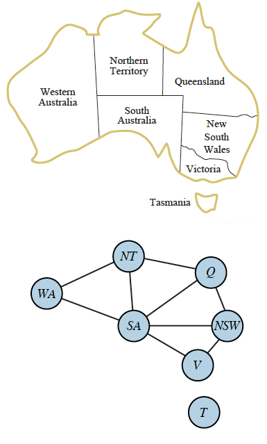

---

<style scoped>section { font-size:31px; }</style>

## Fuerza bruta

- Una forma de resolver el problema es **probar todas las combinaciones**.
- Este método es **poco eficiente**.
  - El número de combinaciones es **muy grande**.
  - Con 10 países y 4 colores hay $4^{10} = 1.048.576$ combinaciones.
- Este problema **no** es **tratable**.
  - El número de combinaciones crece **exponencialmente** con el número de variables.
  - Este problema es **NP-completo**.

---

<!--
_class: invert lead
-->

<style scoped>
h1, h2, h3, h4, h5, h6, p {
  color: #FFFFFF;
  text-shadow:
    0px 0px 3px #000000;
}
</style>


## Búsqueda con vuelta atrás (backtracking)

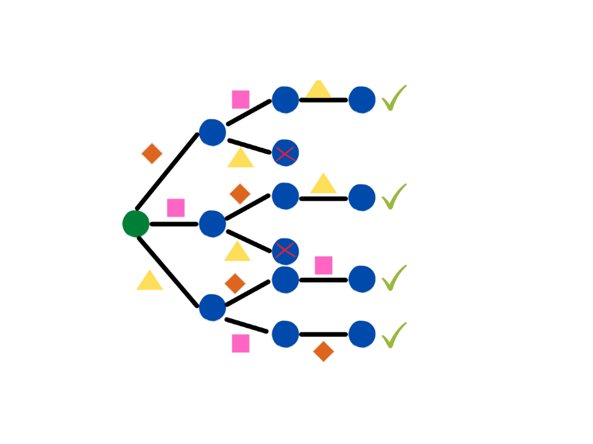

---

<style scoped>section { font-size:31.9px; }</style>

### Descripción

- El algoritmo de **búsqueda con vuelta atrás** o **backtracking** es un algoritmo de búsqueda no informada.
- Partiendo de una serie de variables:
  - El algoritmo **asigna un valor** a una **variable**.
  - Después, **comprueba** si la asignación **viola alguna restricción**.
  - Si no la viola, **asigna un valor** a la **siguiente variable**.
  - Si la viola, **deshace la asignación** y **cambia el valor** de la **variable anterior**.
  - El algoritmo **se detiene** cuando ha **asignado un valor a todas las variables**.

---

<!--
_footer:  ""
-->


### Implementación

```python
def backtrack():
  return _backtrack([], 0)

def _backtrack(estat, posicio):
  if posicio==len_solucio and es_solucio(estat):
    return estat

  for i in range(len_solucio):
    estat.append(i)
    if es_valid(estat) == 0:
      solu = _backtrack(estat, posicio + 1)
      if solu is not None:
        return solu
    estat.pop()

  return None
```

---

### Problemas

- La búsqueda con vuelta atrás **garantiza** que encontrará una **solución** si existe.
- Su **coste** puede ser muy **alto**.
- El **número de estados** que hay que **explorar** puede ser muy **grande**.
  - Será menor que el número total de estados, aunque quizá no mucho menor.
- Veremos algunas optimizaciones que podemos aplicar.

---

<style scoped>section { font-size:30px; }</style>

### Ordenación de variables

- El **orden** en que se seleccionan las variables afecta al **número de estados** que hay que **explorar**.
- Algunas estrategias de ordenación:
  - **Variable más restringida (MRV)**: la variable con menos valores posibles.
    - Puede **detectar incompatibilidades** antes.
  - **Variable menos restringida (LRV)**: la variable con más valores posibles.
    - Puede aportar más **flexibilidad** al principio.
  - **Grado (degree)**: la variable con más restricciones.
    - Puede **resolver incompatibilidades críticas** antes.

---

<style scoped>section { font-size:30px; }</style>

### Ordenación de valores

- El **orden** en que se seleccionan los valores también determina el **número de estados** que hay que **explorar**.
- Algunas estrategias de ordenación:
  - **Menos restricciones (LCV)**: el valor que deja más opciones a las variables restantes.
    - Intenta minimizar los conflictos futuros.
  - **Más restricciones (MCV)**: el valor que deja menos opciones a las variables restantes.
    - Puede ayudar a encontrar soluciones viables antes.
  - **Aleatorio**: el valor se elige al azar.
    - Puede **aportar más flexibilidad** al principio.

---

### Implementación de las optimizaciones (I)

```python
def backtrack():
  estat = [-1]*len_solucio
  variables = list(range(len_solucio))

  return _backtrack(estat, variables)
```

---

### Implementación de las optimizaciones (II)

```python
def _backtrack(estat, variables):
  if es_solucio(estat):
    return estat
  var = selecciona_variable(variables)
  for i in ordena_valors(var):
      estat[var] = i
      if es_valid(estat) == 0:
        variables.remove(var)
      solu = _backtrack(estat, variables)
      if solu is not None:
          return solu
      variables.append(var)
      estat[var] = -1
```

---

<!--
_class: invert lead
-->

<style scoped>
h1, h2, h3, h4, h5, h6, p {
  color: #FFFFFF;
  text-shadow:
    0px 0px 3px #000000;
}
</style>

## Algoritmo de mínimos conflictos

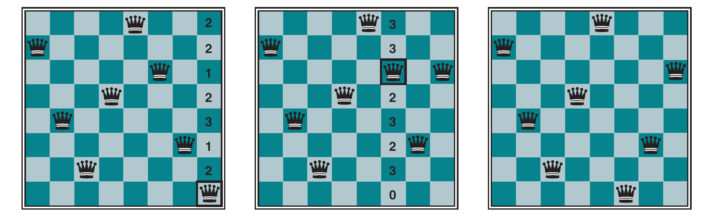

---

<style scoped>section { font-size:33px; }</style>

### Descripción

- El algoritmo de mínimos conflictos o **minimum conflicts** es un algoritmo de búsqueda local **específico para CSP**.
- Elige una variable al azar y le asigna el valor que **minimiza el número de restricciones incumplidas**.
- Repite el proceso hasta que **se satisfacen todas las restricciones**
  - o se alcanza un **número máximo de iteraciones**.
- Es muy eficiente si la **asignación inicial** es buena.
  - Puede ser recomendable usar un **algoritmo voraz** para encontrar una buena asignación inicial.

---

### Ejemplo: problema de las N reinas (I)

- Tenemos un tablero de ajedrez de **N × N**.
- Queremos **colocar N reinas** en el tablero.
- Queremos que **ninguna reina pueda capturar a otra**.
- Las **variables** son las **filas**.
- Los **dominios** son las **columnas**.
- La **restricción** es que **no haya dos reinas en posiciones desde las que puedan atacarse**.

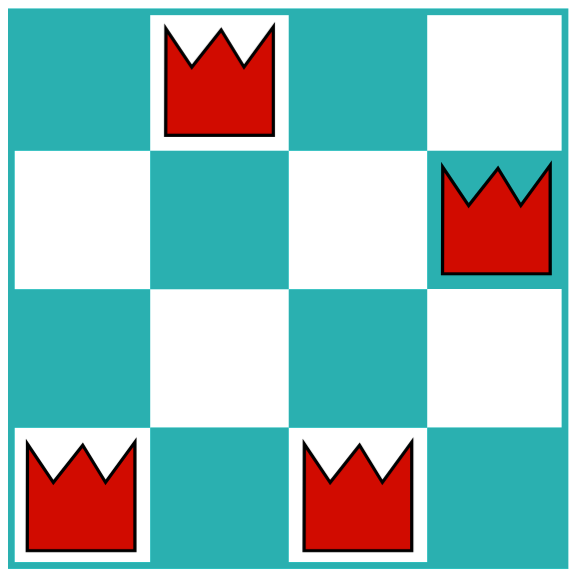

---
<style scoped>section { font-size:33px; }</style>

### Ejemplo: problema de las N reinas (II)

- Para el problema de las $N$ reinas con $N = 8$, hay hasta $8^8 = 16.777.216$ estados.
- El algoritmo de mínimos conflictos **no** genera **estados sucesores**: **modifica el estado actual**.
- **No** necesitamos una **estructura de datos** que represente el espacio de estados.
  - Por eso, mínimos conflictos puede ser **más eficiente que la búsqueda con vuelta atrás**.
- El algoritmo de mínimos conflictos **no** garantiza encontrar una **solución**, aunque **la encuentra en la mayoría de los casos**.

---

<!--
_footer:  ""
-->

### Ejemplo: problema de las N reinas (III): implementación

```python
def minims_conflictes(espai_estats, funcio, max_iteracions):
    inicial = espai_estats.estat_inicial()

    actual = inicial
    for _ in range(max_iteracions):
        if espai_estats.es_solucio(actual):
            return actual

        i = random.randint(0, len(actual.tauler) - 1)
        act_conflicts = funcio(actual)

        for j in range(len(actual.tauler)):
            if j != i:
                actual[i], actual[j] = actual[j], actual[i]
                new_conflicts = funcio(actual)
                if new_conflicts <= act_conflicts:
                    act_conflicts = new_conflicts
                else:
                    actual[i], actual[j] = actual[j], actual[i]
    return actual
```

---
