# 4. Búsqueda local y satisfacción de restricciones

Modelos de inteligencia artificial

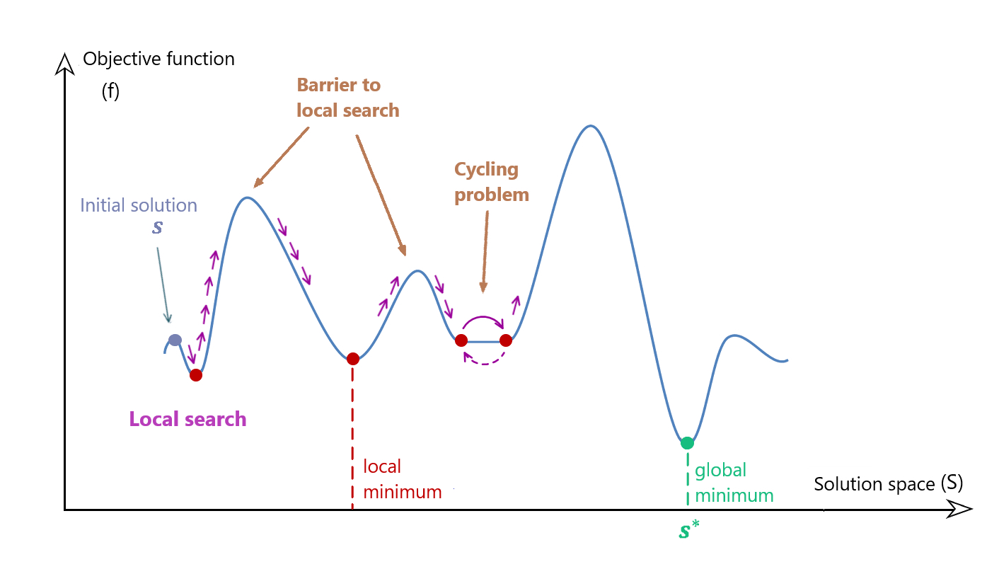

# Optimización

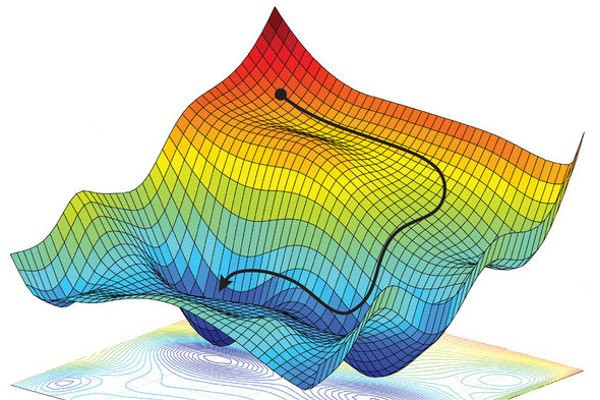

## Definición

- Hasta ahora hemos planteado los problemas como la **búsqueda de un camino en un espacio de estados**.
- A veces esta búsqueda no es posible o no es lo que necesitamos.
  - Puede que queramos encontrar un estado que satisfaga ciertas **restricciones** o que **maximice** o **minimice** una función.
  - **Puede que no sea posible representar el camino** en el espacio de estados.
  - O puede que no nos interese el camino, sino **solo el estado final**.
- En estos casos puede ser fácil **encontrar una solución**, aunque no sea la mejor.
- Esta solución se puede **mejorar mediante técnicas de búsqueda local**.

## Aplicaciones reales

- Los algoritmos de optimización se utilizan en muchos problemas reales.
- Algunos ejemplos:
  - Optimización de redes neuronales
  - Optimización de circuitos electrónicos
  - Optimización de problemas de planificación
  - Optimización de problemas de logística
  - Optimización de problemas de diseño
  - Optimización de problemas de fabricación

## Problemas NP-completos

- Los problemas que no pueden resolverse en **tiempo polinómico** se denominan **problemas NP-completos**.
- Estos problemas son **intratables**, porque no se conoce ningún algoritmo que los resuelva en un tiempo razonable.
- Con frecuencia, los problemas de optimización son NP-completos, porque para encontrar la solución óptima hay que **explorar todo el espacio de estados**.
- Por eso **no es posible** encontrar la solución óptima en un tiempo razonable.

# Búsqueda local


## Características (I)

- La **búsqueda local** **no** mantiene una **estructura de datos** que represente todo el espacio de estados.
  - En su lugar, **genera un estado inicial** y obtiene sus **estados sucesores**.
  - Estos sucesores se generan **modificando el estado actual**.
  - Las técnicas de búsqueda local también se denominan metaheurísticas.

## Características (II)

  - Utilizaremos una **función de evaluación** que **maximiza** un valor. Esta función representa la **calidad** del estado, no su coste. Podemos ponderar las variables según las características del estado que queramos favorecer.
- Ventajas:
  - Consume **poca memoria** y **poca CPU**.
  - Permite encontrar soluciones **razonables** en espacios de estados **muy grandes**.

## Definición del problema

```python
class ProblemaBusquedaLocal(object):
  def __init__(self, inicial=None, **kwds):
    self.__dict__.update(inicial=inicial, **kwds)

  def estats_successors(self, estat):    raise NotImplementedError

  def es_solucio(self, estat):           raise NotImplementedError

  def funcio_avaluacio(self, state):     return NotImplementedError

  def __repr__(self):
    return '{}({!r})'.format(
      type(self).__name__, self.inicial)
```

## Definición del problema

### Ejemplo: problema del viajante (I)

- Tenemos un **mapa** con **ciudades** y queremos encontrar el **recorrido más corto** que pase por **todas ellas** y vuelva a la **ciudad inicial**.
- Las **variables** son las **ciudades** y sus **dominios** son las **posiciones**.
- La **restricción** es que **no puede haber dos ciudades en la misma posición**.
- Las **soluciones** son las **permutaciones de las ciudades** que satisfacen las restricciones.

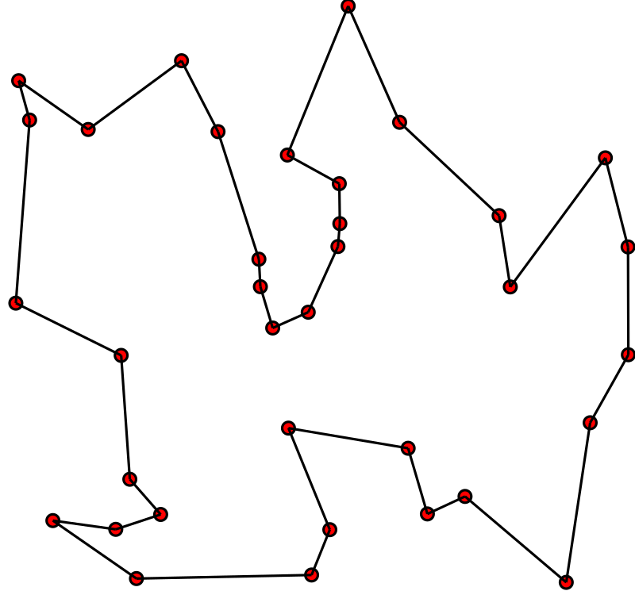

## Definición del problema

### Ejemplo: problema del viajante (II)

- El **número de estados** que hay que **explorar** es **muy grande**.
  - Para 10 ciudades, hay $$10! = 3.628.800$$ estados.
- Lo plantearemos como un problema de búsqueda local.
- No necesitamos una **estructura de datos** que represente el espacio de estados.
- Solo necesitamos un **estado inicial** y una **función de evaluación**.
- Iremos modificando el estado actual hasta que ya no podamos mejorarlo.
- Utilizaremos una **función de evaluación** cuyo valor **mejora cuanto menor es el coste del recorrido**.
- A continuación se muestra una posible implementación.

### Ejemplo: problema del viajante: implementación (I)

```python
class TSP(ProblemaBusquedaLocal):
  def estats_successors(self, estat):
    successors = []
    for i in range(len(estat)):
      for j in range(i + 1, len(estat)):
        successor = estat.copy()
        successor[i], successor[j] = successor[j], successor[i]
        successors.append(successor)
    return successors

  def distancia(self, ciutat1, ciutat2):
    # Fórmula de la distancia euclidiana
    return math.sqrt((ciutat1[0] - ciutat2[0]) ** 2 + (ciutat1[1] - ciutat2[1]) ** 2)

```

### Ejemplo: problema del viajante: implementación (II)

```python
  def funcio_avaluacio(self, estat):
    distancia = 0
    for i in range(len(estat)):
      distancia += self.distancia(estat[i], estat[(i + 1) % len(estat)])
    return 1/distancia

  @classmethod
  def genera_estat_inicial(cls, ciutats):
    return random.sample(ciutats, len(ciutats))

ciutats = [
  (random.randint(0, 1000), random.randint(0, 1000)) for _ in range(100)
]
tsp = TSP(inicial=TSP.genera_estat_inicial(ciutats), ciutats=ciutats)
```

## Vuelta atrás

- La **técnica de vuelta atrás** o **backtracking** es una técnica de búsqueda local.
- Consiste en **explorar el espacio de estados** hasta encontrar una solución.
- Si no se encuentra una solución, se **retrocede** y se **modifica el último estado**.
- Esta técnica garantiza encontrar la **solución óptima**, pero puede ser **muy lenta**.

### Implementación

```python
def backtracking(problema):
  cua = [problema.inicial]
  visitats = set()
  millor_estat, millor_fitness = None, float('inf')
  while cua:
    estat = cua.pop(0)
    if problema.es_solucio(estat) and problema.funcio_avaluacio(estat) > millor_fitness:
        millor_estat = estat
        millor_fitness = problema.funcio_avaluacio(estat)
    if str(estat) not in visitats:
      visitats.add(str(estat))
      successors = problema.estats_successors(estat)
      for successor in successors:
        if es_compleixen_restriccions(successor):
            cua.append(successor)

  return millor_estat
```

### Ejecución

```python
ciutats = [
  (random.randint(0, 1000),
    random.randint(0, 1000))
  for _ in range(7)
]
tsp = TSP(
  inicial=TSP.genera_estat_inicial(ciutats),
  ciutats=ciutats
)
solucio = backtracking(tsp)

Millor fitness: 4030.1303415460707
...
Millor fitness: 2718.3988057871697

3min 52s ± 24.7 s per loop
(mean ± std. dev. of 7 runs, 1 loop each)

```

## Algoritmo de escalada

- El algoritmo de escalada o **Hill Climbing** es el algoritmo de búsqueda local más sencillo.
- Si representamos los estados como **puntos en el espacio**,
  - La altura de cada punto representa el valor de la función que se quiere optimizar.
  - el algoritmo consiste en **desplazarse** hacia **puntos más altos**.
  - Si ya no podemos subir, concluimos que hemos alcanzado el **máximo global** y encontrado la solución.


### Implementación

```python
def hill_climbing(problema, iteracions=10000):
  estat = problema.inicial
  fitness = problema.funcio_avaluacio(estat)

  for _ in range(iteracions):
    successors = problema.estats_successors(estat)
    if not successors:
      break
    successor = min(successors, key=problema.funcio_avaluacio)
    fitness_succ = problema.funcio_avaluacio(successor)
    if fitness_succ > fitness:
      print(f"{fitness_succ} > {fitness}")
      estat = successor
      fitness = fitness_succ
    else:
      break
  return estat
```

### Ejecución

```python
ciutats = [
  (random.randint(0, 1000),
    random.randint(0, 1000))
  for _ in range(100)
]
tsp = TSP(
  inicial=TSP.genera_estat_inicial(ciutats),
  ciutats=ciutats
)
solucio = hill_climbing(tsp)

51442.77444568607 > 54092.0949691196
...

41.1 s ± 6.22 s per loop
(mean ± std. dev. of 7 runs, 1 loop each)

Inline:
2.13 s ± 922 ms per loop
(mean ± std. dev. of 7 runs, 1 loop each)
```

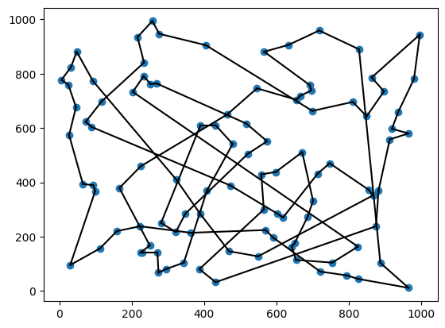

### Consumo de memoria

- Un problema de los algoritmos de búsqueda local es que pueden consumir mucha **memoria**.
  - Hay que **mantener una estructura de datos** que represente los estados sucesores.
  - Podemos **mejorar** la eficiencia del recocido simulado **eliminando** esta estructura de datos.
  - Para ello, **no** generaremos nuevos **estados sucesores**.
  - En su lugar, **modificaremos el estado actual** (`inline`) para generar el sucesor y, si no mejora, **desharemos los cambios**.

### Implementación `inline`

```python
def hill_climbing_inline(problema, iteracions=10000):
    estat = problema.inicial
    fitness = problema.funcio_avaluacio(estat)

    for _ in range(iteracions):
        millorat_iter = False
        for i in range(len(estat)):
            for j in range(len(estat)):
                if i != j:
                    estat[i], estat[j] = estat[j], estat[i]
                    fitness_succ = problema.funcio_avaluacio(estat)
                    if fitness_succ > fitness:
                        print(f"{fitness} > {fitness_succ}")
                        fitness = fitness_succ
                        millorat_iter = True
                    else:
                        estat[i], estat[j] = estat[j], estat[i]
        if not millorat_iter:
            break
    return estat
```

### Problemas

- El algoritmo de escalada **no** garantiza encontrar el **máximo global**.
- Puede quedarse atrapado en un **máximo local**.
  - Un pico más alto que sus vecinos, pero no el máximo global.
  - Depende **mucho** del **estado inicial**.
- Para evitarlo se han desarrollado distintas variantes:
  - Escalada del primer mejor
  - Escalada con reinicio aleatorio
  - Escalada estocástica

## Escalada del primer mejor

- El algoritmo de escalada del primer mejor **no** elige el **mejor sucesor**.
  - En su lugar, elige el **primer sucesor** que **mejora** el estado actual.
  - Si ningún sucesor mejora el estado actual, el algoritmo se detiene.
  - También puede detenerse al alcanzar un número máximo de iteraciones.
- Puede ser útil cuando hay muchos sucesores.

### Implementación

```python
def first_choice_hill_climbing(espai_estats, funcio, max_iteracions):
  estat_actual = espai_estats.estat_inicial()
  for _ in range(max_iteracions):
    successor = espai_estats.genera_successor(estat_actual)
    if not successor:
      return estat_actual
    if funcio(successor) >= funcio(estat_actual):
      estat_actual = successor

  return estat_actual
```

### Implementación `inline`

```python
def first_choice_hill_climbing_inline(problema, iteracions=10000):
    estat = problema.inicial
    fitness = problema.funcio_avaluacio(estat)

    for _ in range(iteracions):
        millorat_iter = False
        for i in range(len(estat)):
            if not millorat_iter:
                for j in range(len(estat)):
                    if i != j:
                        estat[i], estat[j] = estat[j], estat[i]
                        fitness_succ = problema.funcio_avaluacio(estat)
                        if fitness_succ > fitness:
                            print(f"{fitness} > {fitness_succ}")
                            fitness = fitness_succ
                            millorat_iter = True
                            break
                        else:
                            estat[i], estat[j] = estat[j], estat[i]
    return estat
```

## Escalada con reinicio aleatorio

- El algoritmo de escalada con reinicio aleatorio **reinicia la búsqueda** cada cierto tiempo.
- Esto permite **escapar de los máximos locales**.
- **No garantiza** encontrar el **máximo global**, pero **aumenta las posibilidades**.
- Este algoritmo se puede **combinar con otras técnicas** de búsqueda local.

### Implementación

```python
def random_restart_hill_climbing(problema, ciutats, iteracions=1000, restarts=10):
  millor_estat = None
  millor_fitness = float('inf')
  for _ in range(restarts):
    inicial = TSP.genera_estat_inicial(ciutats)
    problema.inicial = inicial
    estat = hill_climbing(problema, iteracions=iteracions)
    fitness = problema.funcio_avaluacio(estat)
    if fitness > millor_fitness:
      millor_estat = estat
      millor_fitness = fitness
      print(f"Millor fitness: {millor_fitness}")
  return millor_estat
```

### Ejecución

```python
solucio = random_restart_hill_climbing(
  tsp, ciutats, 1000, 10
)
```

```bash
Millor fitness: 12936.962711620448
Millor fitness: 12887.286272582816
Millor fitness: 12798.50074780205
```

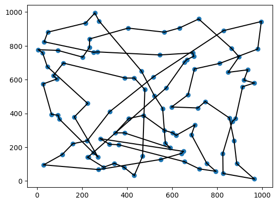

## Algoritmo de recocido simulado

- El algoritmo de recocido simulado o **simulated annealing** se inspira en el proceso de **recocido** de la metalurgia.
  - Se calienta un metal a una temperatura muy alta.
  - Después se deja enfriar lentamente.
  - Esto permite que las moléculas se **reorganicen** y **minimicen la energía**.
  - En determinadas condiciones, el algoritmo puede aceptar estados peores que el actual.
  - Incorpora el azar al algoritmo de escalada.

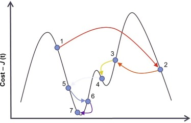

### Probabilidad de aceptación

- La probabilidad de aceptar un estado peor depende de la **temperatura**.
  - A medida que avanza el algoritmo, la temperatura **disminuye** y se vuelve **menos probable** aceptar un estado peor.
  - La probabilidad de aceptar un estado peor se calcula con la fórmula siguiente:
    - $P = e^{-\frac{\Delta E}{T}}$, donde $\Delta E$ es la diferencia entre el valor del estado actual y el del estado sucesor.

### Propiedades

- El recocido simulado **puede encontrar el máximo global**.
  - **No** lo garantiza, pero la probabilidad de encontrarlo aumenta con el número de iteraciones.
- Es uno de los algoritmos de búsqueda local más utilizados.
- Aplicaciones reales:
  - Optimización de redes neuronales
  - Optimización de circuitos electrónicos
  - Optimización de problemas de planificación


### Implementación

```python
def simulated_annealing(espai_estats, funcio, temperatura=100, refredament=0.9):
    estat_actual = espai_estats.estat_inicial()
    while True:
        successors = espai_estats.estats_successors(estat_actual)
        successors_ordenats = sorted(successors, key=funcio)

        if funcio(successors_ordenats[0]) <= funcio(estat_actual):
            estat_actual = successors_ordenats[0]
        else:
            delta = funcio(successors_ordenats[0]) - funcio(estat_actual)
            probabilitat = math.exp(-delta / temperatura)
            if random.random() < probabilitat:
                estat_actual = successors_ordenats[0]

        temperatura *= refredament
        if temperatura < 0.00001:
            return estat_actual
```

### Ejecución

```python

solucio = hill_climbing(tsp)
plot_tsp(tsp, solucio)

Cost:        50976.93306917217
Cost:        51376.91701004807
...
Cost:        11354.397010378212
Cost:        11350.41254307539
Cost final:  11350.41254307539
```

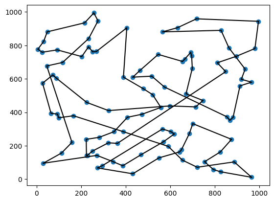

### Implementación `inline` (I)

```python

def simulated_annealing(problema, temp=100000, refredament=0.9999, iteracions=10000):
    estat = problema.inicial
    cost = problema.funcio_avaluacio(estat)

    while temp > 0.1:
        i = random.randint(1, len(estat) - 1)
        j = random.randint(1,len(estat) - 1)

        while i == j:
            j = random.randint(1, len(estat) - 1)

        estat[i], estat[j] = estat[j], estat[i]
        cost_nou = problema.funcio_avaluacio(estat)
        ...
```

### Implementación `inline` (II)

```python
        ...
        delta = cost_nou - cost
        if delta < 0 or math.exp(-delta / temp) > random.uniform(0, 1):
            cost = cost_nou
            print("Cost: ", cost)
        else:
            estat[i], estat[j] = estat[j], estat[i]

        temp = temp * refredament

    print("Cost final: ", cost)
    print("Estat final: ", estat)

    return estat

```

# Algoritmos genéticos


# Algoritmos genéticos

- Los **algoritmos genéticos** son una técnica de optimización inspirada en la **evolución biológica**.
  - Se pueden entender como una **técnica de búsqueda local en paralelo**.
  - Cada **individuo** de la población representa un **estado**.
  - Cada **gen** del individuo representa una **variable** del estado.
  - Los **valores** de los genes representan los **valores** de las **variables**.
  - Los **individuos** evolucionan **generando nuevos individuos**.


### Procedimiento

- El algoritmo **genera una población inicial** de estados.
- Después, **genera una nueva población** a partir de la población actual.
- Esta nueva población **hereda** los **genes** de la población actual.
- Además, **muta** algunos de sus genes.
- El algoritmo **selecciona los mejores** individuos de la nueva población y **descarta el resto**.
- El algoritmo **se detiene** al alcanzar un **número máximo de iteraciones**.

### Definición del problema

- El primer paso es definir el problema como un **espacio de estados**.
- Los **estados** son **individuos**.
- Los **genes** son las **variables**.
- Los **valores de los genes** son los **valores de las variables**.
- Para simplificar, **representaremos los genes como números enteros**.
  - _Problema del viajante_: secuencia de números que representan las ciudades en orden.
  - _Mochila_: secuencia de 0 y 1 que indica si cada objeto está o no en la mochila.

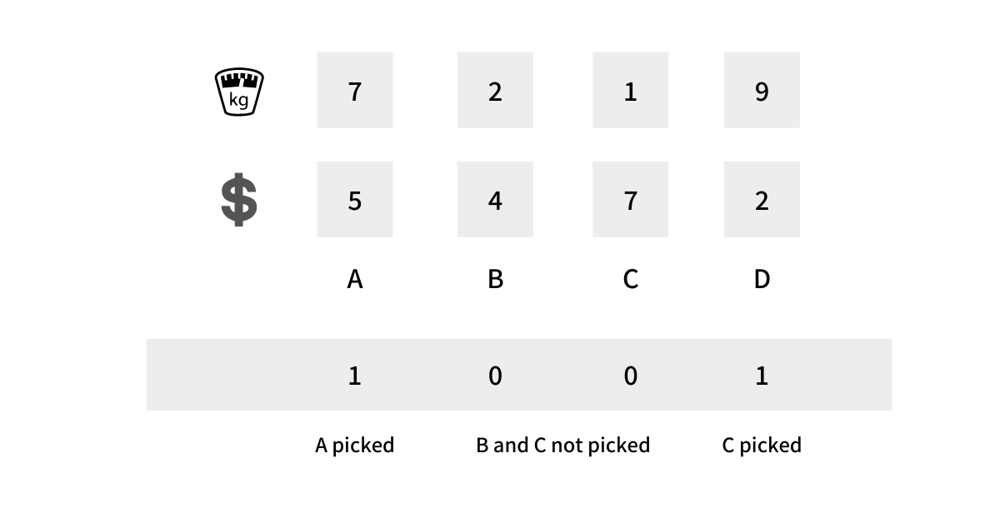

### Función de evaluación

- Debemos definir una **función de evaluación**.
- Esta función **asigna un valor** a cada **individuo**.
- Este valor **representa la calidad** del individuo.
- Debemos ponderar los valores de las variables según las características del individuo que queramos favorecer.

### Creación de la población inicial

- El tercer paso es **crear una población inicial**.
- Esta población **se genera aleatoriamente** dentro de los **dominios** de las variables.
- La población inicial debe tener suficientes individuos y ser **diversa**, pero no demasiado grande.
- Opcionalmente, ordenaremos los individuos según su función de evaluación.

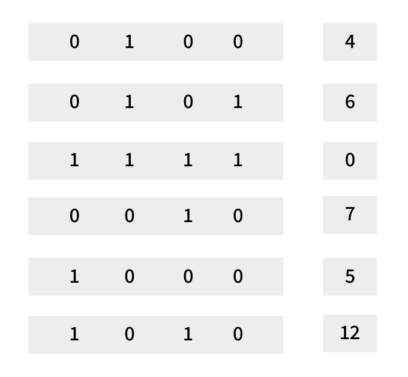

### Selección

- Para que la población evolucione, hay que **seleccionar los mejores individuos**; estos **transmitirán sus genes a la generación siguiente**.
- Hay varias técnicas de selección:
  - **Por torneo**: se eligen **$k$ individuos al azar** y se **selecciona el mejor**.
  - **Por ruleta**: se **asigna una probabilidad** a cada individuo, proporcional a su puntuación de evaluación.
  - **Por rango**: la **probabilidad** es proporcional a la posición del individuo.

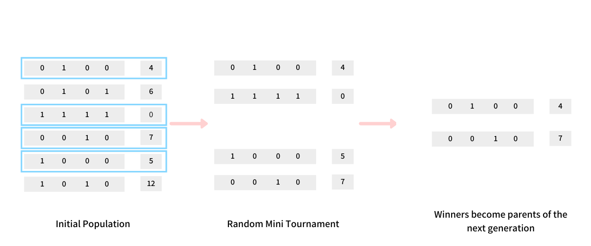

### Cruce

- El **cruce** es el proceso por el que se **genera un nuevo individuo** a partir de dos individuos, con cierta probabilidad.
- Los **descendientes** heredan una combinación de los **genes** de sus progenitores.
- Hay varias técnicas de cruce:
  - **Cruce de un punto**: se elige un **punto al azar** y se **combinan** los genes a partir de él.
  - **Cruce de dos puntos**: se eligen **dos puntos al azar** y se **combinan** los genes comprendidos entre ellos.
  - **Cruce uniforme**: para cada gen se decide **al azar** si se **hereda de uno u otro progenitor**.
  - **Otras técnicas**: recombinación ordenada, máscara, etc.

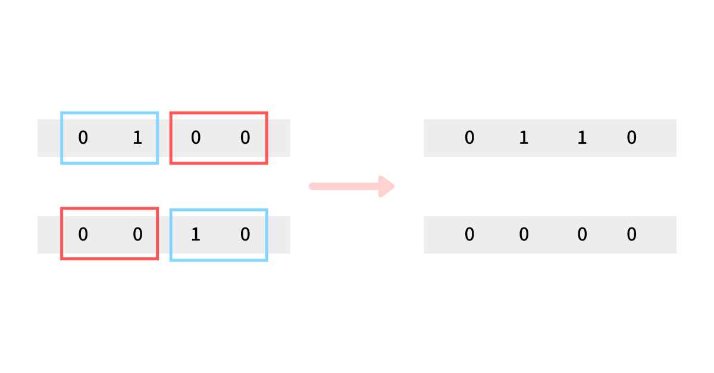

### Mutación

- La **mutación** es el proceso por el que se **modifica un gen** de un individuo.
- La mutación **puede ser necesaria** para **evitar que el algoritmo quede atrapado en un máximo local**.
- Al igual que la selección, la mutación **se aplica con cierta probabilidad** (normalmente muy baja).
- Hay varias técnicas de mutación:
  - **Mutación aleatoria**: se elige un **gen al azar** y se **modifica**.
  - **Mutación dirigida**: se elige un **gen al azar** y se **modifica** en una **dirección concreta**.

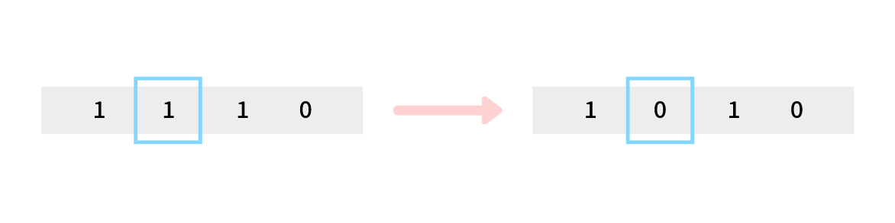

### Implementación (I)

```python
def genetic_algorithm(espai_estats, funcio, num_individus=100, num_iteracions=100):
    poblacio = [espai_estats.estat_inicial() for _ in range(num_individus)]
    for _ in range(num_iteracions):
        seleccionats = sorted(poblacio, key=funcio)[:num_individus]
        nova_poblacio = []
        for i in range(num_individus):
            pare = random.choice(seleccionats)
            mare = random.choice(seleccionats)
            fill = creuament(pare, mare)
            if random.random() < 0.1:
                fill = espai_estats.mutacio(fill)
            poblacio.append(fill)

        poblacio = nova_poblacio

    return poblacio[0]
```

### Implementación (II)

```python
def creuament(pare, mare):
    punt = random.randint(0, len(pare))
    fill = pare[:punt] + mare[punt:]
    return fill

def mutacio(individu):
    punt = random.randint(0, len(individu))
    nou_valor = random.randint(0, 100)
    individu[punt] = nou_valor
    return individu
```

### Conclusiones y limitaciones

- Los algoritmos genéticos pueden ser difíciles de **representar**.
- Funcionan mejor con problemas que pueden representarse mediante **variables binarias**.
- Suelen ser más lentos que otras técnicas de búsqueda local.
- Para muchos problemas es difícil definir los operadores de cruce y mutación.
- Su capacidad para entrenar redes neuronales los hace muy útiles en este ámbito.

# Satisfacción de restricciones


## Definiciones (I)

- Algunos problemas se modelan mejor como problemas de satisfacción de restricciones **CSP** (**Constraint Satisfaction Problems**).
  - Es un tipo específico de problema de búsqueda, pero puede ser difícil de resolver por su tamaño.
- Algunos de estos problemas se pueden resolver con las técnicas de **búsqueda local** que ya hemos visto.
  - Sin embargo, el resultado puede no ser **óptimo**.
  - Por eso se han desarrollado técnicas específicas para estos problemas.
  - También veremos cómo **mejorar** los resultados de las técnicas de búsqueda local.

## Definiciones (II)

- En estos problemas, el **estado** es un **conjunto de variables**.
- Cada variable tiene un **dominio** de valores posibles.
- Las **restricciones** son las **relaciones** entre las variables.
- Los **estados** que satisfacen las **restricciones** son las **soluciones**.
- Los **estados** que no satisfacen las **restricciones** son **incompatibles**.
- Los **estados** que no son soluciones ni incompatibles son **parciales**.

## Ejemplo: mapa de colores (I)

- Tenemos un mapa con **países**.
- Queremos **colorear** cada país con un **color**.
  - No queremos que dos países **adyacentes** tengan el **mismo color**.
  - Las **variables** son los **países**.
  - Los **dominios** son los **colores**.
  - La **restricción** es que **dos países adyacentes no pueden tener el mismo color**.
  - Los **estados** son las **combinaciones de colores** asignadas a cada país.
  - Las **soluciones** son las **combinaciones de colores que satisfacen las restricciones**.

## Ejemplo: mapa de colores (II)

- Los algoritmos que veremos representan las restricciones mediante **grafos**.
  - Se denominan grafos de restricciones o **constraint graphs**.
- Los nodos del grafo son las **variables**.
- Las **aristas** del grafo representan las **restricciones**.
- Las **soluciones** son las asignaciones de los **nodos del grafo** que **no comparten ninguna arista conflictiva**.

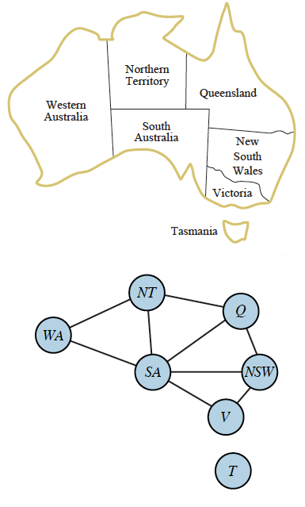

## Fuerza bruta

- Una forma de resolver el problema es **probar todas las combinaciones**.
- Este método es **poco eficiente**.
  - El número de combinaciones es **muy grande**.
  - Con 10 países y 4 colores hay $4^{10} = 1.048.576$ combinaciones.
- Este problema **no** es **tratable**.
  - El número de combinaciones crece **exponencialmente** con el número de variables.
  - Este problema es **NP-completo**.

## Búsqueda con vuelta atrás (backtracking)

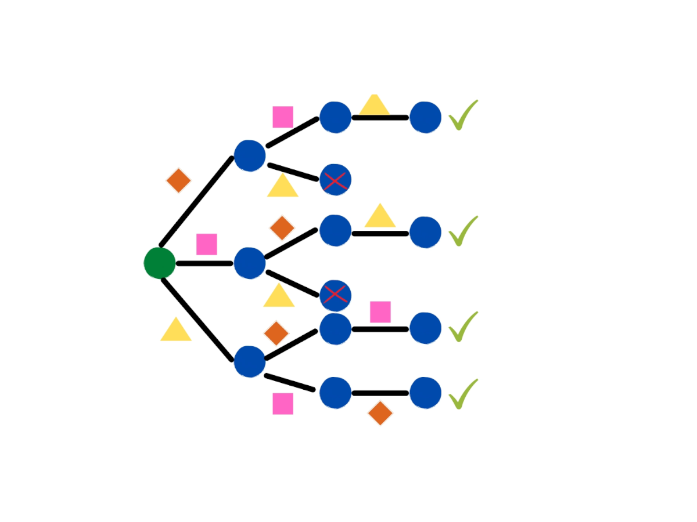

### Descripción

- El algoritmo de **búsqueda con vuelta atrás** o **backtracking** es un algoritmo de búsqueda no informada.
- Partiendo de una serie de variables:
  - El algoritmo **asigna un valor** a una **variable**.
  - Después, **comprueba** si la asignación **viola alguna restricción**.
  - Si no la viola, **asigna un valor** a la **siguiente variable**.
  - Si la viola, **deshace la asignación** y **cambia el valor** de la **variable anterior**.
  - El algoritmo **se detiene** cuando ha **asignado un valor a todas las variables**.

### Implementación

```python
def backtrack():
  return _backtrack([], 0)

def _backtrack(estat, posicio):
  if posicio==len_solucio and es_solucio(estat):
    return estat

  for i in range(len_solucio):
    estat.append(i)
    if es_valid(estat) == 0:
      solu = _backtrack(estat, posicio + 1)
      if solu is not None:
        return solu
    estat.pop()

  return None
```

### Problemas

- La búsqueda con vuelta atrás **garantiza** que encontrará una **solución** si existe.
- Su **coste** puede ser muy **alto**.
- El **número de estados** que hay que **explorar** puede ser muy **grande**.
  - Será menor que el número total de estados, aunque quizá no mucho menor.
- Veremos algunas optimizaciones que podemos aplicar.

### Ordenación de variables

- El **orden** en que se seleccionan las variables afecta al **número de estados** que hay que **explorar**.
- Algunas estrategias de ordenación:
  - **Variable más restringida (MRV)**: la variable con menos valores posibles.
    - Puede **detectar incompatibilidades** antes.
  - **Variable menos restringida (LRV)**: la variable con más valores posibles.
    - Puede aportar más **flexibilidad** al principio.
  - **Grado (degree)**: la variable con más restricciones.
    - Puede **resolver incompatibilidades críticas** antes.

### Ordenación de valores

- El **orden** en que se seleccionan los valores también determina el **número de estados** que hay que **explorar**.
- Algunas estrategias de ordenación:
  - **Menos restricciones (LCV)**: el valor que deja más opciones a las variables restantes.
    - Intenta minimizar los conflictos futuros.
  - **Más restricciones (MCV)**: el valor que deja menos opciones a las variables restantes.
    - Puede ayudar a encontrar soluciones viables antes.
  - **Aleatorio**: el valor se elige al azar.
    - Puede **aportar más flexibilidad** al principio.

### Implementación de las optimizaciones (I)

```python
def backtrack():
  estat = [-1]*len_solucio
  variables = list(range(len_solucio))

  return _backtrack(estat, variables)
```

### Implementación de las optimizaciones (II)

```python
def _backtrack(estat, variables):
  if es_solucio(estat):
    return estat
  var = selecciona_variable(variables)
  for i in ordena_valors(var):
      estat[var] = i
      if es_valid(estat) == 0:
        variables.remove(var)
      solu = _backtrack(estat, variables)
      if solu is not None:
          return solu
      variables.append(var)
      estat[var] = -1
```

## Algoritmo de mínimos conflictos

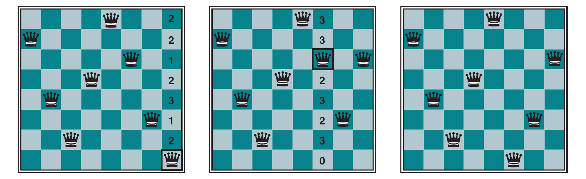

### Descripción

- El algoritmo de mínimos conflictos o **minimum conflicts** es un algoritmo de búsqueda local **específico para CSP**.
- Elige una variable al azar y le asigna el valor que **minimiza el número de restricciones incumplidas**.
- Repite el proceso hasta que **se satisfacen todas las restricciones**
  - o se alcanza un **número máximo de iteraciones**.
- Es muy eficiente si la **asignación inicial** es buena.
  - Puede ser recomendable usar un **algoritmo voraz** para encontrar una buena asignación inicial.

### Ejemplo: problema de las N reinas (I)

- Tenemos un tablero de ajedrez de **N × N**.
- Queremos **colocar N reinas** en el tablero.
- Queremos que **ninguna reina pueda capturar a otra**.
- Las **variables** son las **filas**.
- Los **dominios** son las **columnas**.
- La **restricción** es que **no haya dos reinas en posiciones desde las que puedan atacarse**.

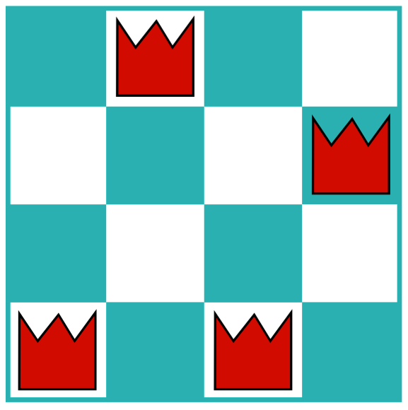

### Ejemplo: problema de las N reinas (II)

- Para el problema de las $N$ reinas con $N = 8$, hay hasta $8^8 = 16.777.216$ estados.
- El algoritmo de mínimos conflictos **no** genera **estados sucesores**: **modifica el estado actual**.
- **No** necesitamos una **estructura de datos** que represente el espacio de estados.
  - Por eso, mínimos conflictos puede ser **más eficiente que la búsqueda con vuelta atrás**.
- El algoritmo de mínimos conflictos **no** garantiza encontrar una **solución**, aunque **la encuentra en la mayoría de los casos**.

### Ejemplo: problema de las N reinas (III): implementación

```python
def minims_conflictes(espai_estats, funcio, max_iteracions):
    inicial = espai_estats.estat_inicial()

    actual = inicial
    for _ in range(max_iteracions):
        if espai_estats.es_solucio(actual):
            return actual

        i = random.randint(0, len(actual.tauler) - 1)
        act_conflicts = funcio(actual)

        for j in range(len(actual.tauler)):
            if j != i:
                actual[i], actual[j] = actual[j], actual[i]
                new_conflicts = funcio(actual)
                if new_conflicts <= act_conflicts:
                    act_conflicts = new_conflicts
                else:
                    actual[i], actual[j] = actual[j], actual[i]
    return actual
```
