# 4. Búsqueda local i satisfacció de restriccions

Models d'intel·ligència artificial

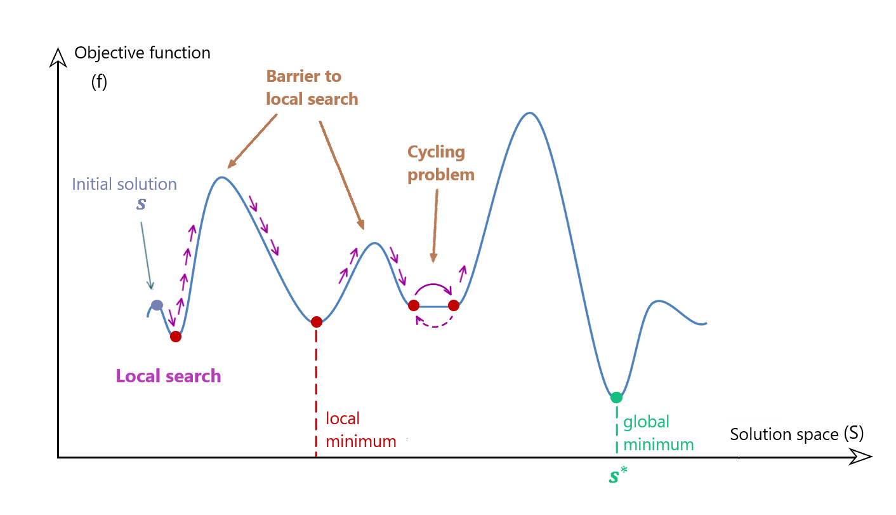

# Optimització

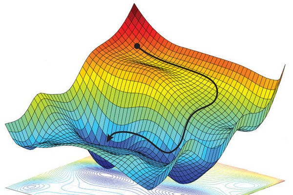

## Definició

- Fins ara hem plantejat els problemes com a la **cerca d'un camí en un espai d'estats**.
- A vegades aquesta cerca no és possible, o no és el que volem.
  - Podem voler trobar un estat que satisfaci unes **restriccions** o que **maximitzi** o **minimitzi** una funció
  - **Pot no ser possible representar el camí** en l'espai d'estats.
  - O que no ens interessi el camí, sinó **només l'estat final**.
- En aquests casos, pot ser fàcil **trobar una solució**, encara que no sigui la millor.
- Aquesta solució es pot **refinar amb tècniques de cerca local**.

## Usos reals

- Els algorismes d'optimització són molt utilitzats en problemes reals.
- Alguns exemples:
  - Optimització de xarxes neuronals
  - Optimització de circuits electrònics
  - Optimització de problemes de planificació
  - Optimització de problemes de logística
  - Optimització de problemes de disseny
  - Optimització de problemes de fabricació

## Problemes NP-complets

- Els problemes que no es poden resoldre amb una **complexitat polinòmica** s'anomenen **problemes NP-complets**.
- Aquests problemes són **intractables**, ja que no es coneix cap algorisme que els resolga en un temps raonable.
- Frequentment, els problemes d'optimització són problemes NP-complets, perquè cal **explorar tot l'espai d'estats** per a trobar la solució òptima.
- Aixó fa que **no siga possible** trobar la solució òptima en un temps raonable.

# Búsqueda local


## Característiques (I)

- La **búsqueda local** **no** manté una **estructura de dades** que representi l'espai d'estats.
  - En lloc d'això, **genera un estat inicial** i **genera estats successors** a partir d'aquest.
  - Aquests estats successors es generen **modificant l'estat actual**.
  - Les técniques de búsqueda local també s'anomenen metaheurístiques.

## Característiques (II)

  - Una **funció d’avaluació** assigna un valor a cada estat. Segons el problema, volem maximitzar el valor o minimitzar el cost.
- Avantatges:
  - Utilitza **poca memòria** i **poca CPU**.
  - Permeten trobar solucions **raonables** en espais d'estats **molt grans**.

## Algorisme d’escalada

- Partim d’un estat inicial i avaluem els seus veïns.
- Passem al millor veí si millora l’estat actual.
- Quan cap veí el millora, ens aturem en un òptim local.
- En el viatjant, millorar vol dir fer el circuit més curt.


## Definició del problema

### Exemple: Viajant de comerç (I)

- Tenim un **mapa** amb **ciutats** i volem trobar el **camí més curt** que passi per **totes les ciutats**, per tornar a la **ciutat inicial**.
- Les **variables** són les **ciutats** i els **dominis** són les **posicions**.
- Les **restriccions** són que **no hi pugui haver dues ciutats en la mateixa posició**.
- Les **solucions** són les **permutacions de les ciutats** que satisfan les restriccions.

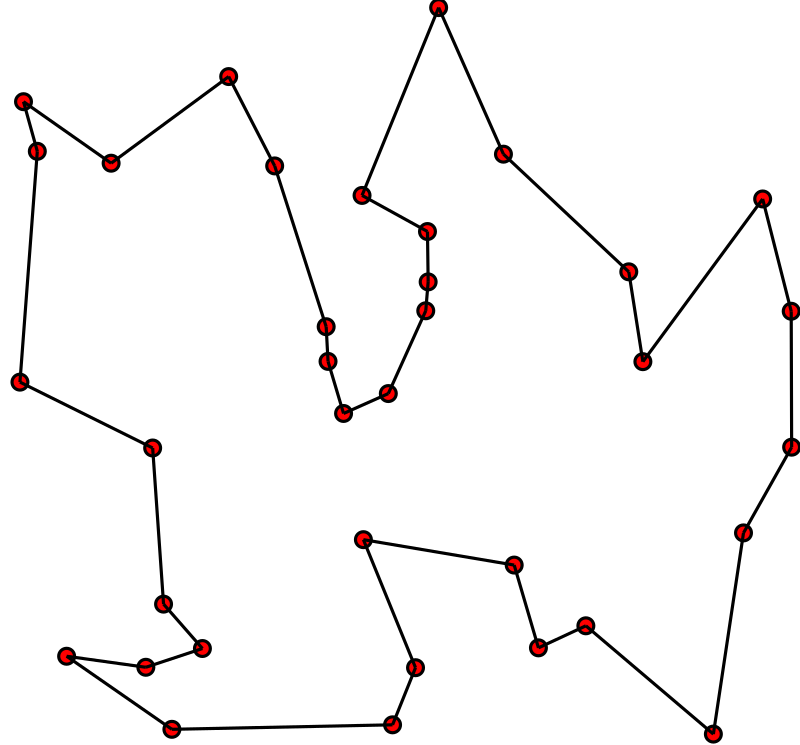

### El viatjant com a problema de cerca local

- **Estat**: una ruta que manté la ciutat 0 al principi.
- **Cost**: la distància total, inclòs el retorn a la ciutat 0.
- **Veïns**: intercanviem dues ciutats de la ruta.
- A cada pas, busquem un intercanvi que reduïsca la distància.

### Viatjant · Dades i ruta inicial

```python
from itertools import combinations, permutations
from math import dist, exp
from random import Random

rng = Random(1)
ciutats = [(rng.randrange(100), rng.randrange(100)) for _ in range(8)]
inicial = tuple(range(len(ciutats)))
```

### Viatjant · Cost i successors

```python
def cost(ruta):
    circuit = ruta + (ruta[0],)
    return sum(dist(ciutats[a], ciutats[b]) for a, b in zip(circuit, circuit[1:]))

def intercanvia(ruta, i, j):
    nova = list(ruta)
    nova[i], nova[j] = nova[j], nova[i]
    return tuple(nova)

def veines(ruta):
    for i, j in combinations(range(1, len(ruta)), 2):
        yield intercanvia(ruta, i, j)
```

### El primer pas de l’escalada

```python
millor_vei = min(veines(inicial), key=cost)
print(inicial, round(cost(inicial), 2))
print(millor_vei, round(cost(millor_vei), 2))
```

### Hill climbing

```python
def hill_climbing(ruta):
    while True:
        millor = min(veines(ruta), key=cost, default=ruta)
        if cost(millor) >= cost(ruta):
            return ruta
        ruta = millor
```

### Comprova l’òptim local

```python
local = hill_climbing(inicial)
print(local, round(cost(local), 2))
```

### És la millor ruta possible?

Quan l’escalada s’atura, cap intercanvi millora la ruta. Per saber si hi ha un circuit més curt, comparem totes les 7! rutes que comencen en 0. Amb huit ciutats és viable. El nombre de rutes creix ràpidament quan afegim ciutats.

### Ruta òptima per enumeració

```python
optima = min(((0,) + resta for resta in permutations(inicial[1:])), key=cost)
print(optima, round(cost(optima), 2))
print(round(cost(local) - cost(optima), 2))  # Diferència de cost
```

### Memòria i veïns

`veines` genera un veí cada vegada. `min` els compara sense crear una llista amb totes les rutes.

### Problemes

- L'algorisme d'escalada **no** garanteix trobar el **màxim global**.
- Pot quedar atrapat en un **màxim local**.
  - Pic més alt que els seus veïns, però no el màxim global.
  - Dependrà **molt** de l'**estat inicial**.
- Per evitar-ho s'han desenvolupat diverses variants:
  - Escalada de primer millor
  - Escalada amb reinici aleatori
  - Escalada estocàstica

## Escalada de primer millor

- L'algorisme d'escalada de primer millor **no** tria el **millor successor**.
  - En lloc d'això, tria el **primer successor** que **millora** l'estat actual.
  - Si no hi ha cap successor que millori l'estat actual, l'algorisme s'atura.
  - Pot també parar quan s'arribe a un nombre màxim d'iteracions.
- Pot ser molt útil quan el nombre de successors és molt gran.

### Escalada de primer millor

```python
def primer_millor(ruta, rng):
    while True:
        candidates = list(veines(ruta))
        rng.shuffle(candidates)
        for candidata in candidates:
            if cost(candidata) < cost(ruta):
                ruta = candidata
                break
        else:
            return ruta
```

## Escalada amb reinici aleatori

- L'algorisme d'escalada amb reinici aleatori **reinicia l'algorisme** cada cert temps.
- Això permet **escapar dels màxims locals**.
- **No garanteix** trobar el **màxim global**, però **augmenta les possibilitats**.
- Aquest algorisme es pot **combinar amb altres tècniques** de cerca local.

### Escalada amb reinicis

```python
def amb_reinicis(ruta, rng, intents=10):
    millor = hill_climbing(ruta)
    for _ in range(intents):
        nova = (ruta[0],) + tuple(rng.sample(ruta[1:], len(ruta) - 1))
        resultat = hill_climbing(nova)
        if cost(resultat) < cost(millor):
            millor = resultat
    return millor
```

### Prova els reinicis

```python
reinicis = amb_reinicis(inicial, Random(42))
print(reinicis, round(cost(reinicis), 2))
```

## Algorisme de recuit simulat

- L'algorisme de recuit simulat o **simulated annealing** es basa en el procés de **recuit** de la metal·lúrgia.
  - Un metall es calenta fins a una temperatura molt alta.
  - Després es deixa refredar lentament.
  - Això permet que les molècules es **reorganicin** i **minimitzin l'energia**.
  - Permet acceptar estats que empitjoren l'actual, en certes condicions.
  - Incopora l'aleatorietat a l'algorisme d'escalada.

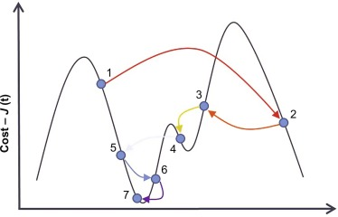

### Probabilitat d'acceptació

- La probabilitat d'acceptar un estat empitjorant depèn de la **temperatura**.
  - A mesura que l'algorisme avança, la temperatura **disminueix** i fa que sigui **menys probable** acceptar un estat empitjorant.
  - La probabilitat d'acceptar un estat empitjorant es calcula amb la següent fórmula:
    - $P = e^{-\frac{\Delta E}{T}}$, on $\Delta E$ és la diferència entre el valor de l'estat actual i el valor de l'estat successor.

### Propietats

- L'algorisme de recuit simulat **pot trobar el màxim global**.
  - **No** ho garanteix, però la probabilitat de trobar-lo augmenta amb el nombre d'iteracions.
- Es un dels algorismes de cerca local més utilitzats.
- Usos reals:
  - Optimització de xarxes neuronals
  - Optimització de circuits electrònics
  - Optimització de problemes de planificació


### Recuit simulat

```python
def recuit(ruta, rng, passos=500, temperatura=30):
    millor = ruta
    for _ in range(passos):
        i, j = rng.sample(range(1, len(ruta)), 2)
        candidata = intercanvia(ruta, i, j)
        delta = cost(candidata) - cost(ruta)
        if delta <= 0 or rng.random() < exp(-delta / temperatura):
            ruta = candidata
            if cost(ruta) < cost(millor):
                millor = ruta
        temperatura *= 0.99
    return millor
```

### Prova el recuit

```python
recuit_final = recuit(inicial, Random(42))
print(recuit_final, round(cost(recuit_final), 2))
```

# Algorismes genètics


# Algorismes genètics

- Els **algorismes genètics** són una tècnica d'optimització inspirada en la **evolució biològica**.
  - Es pot veure com una **tècnica de cerca local en paral·lel**.
  - Cada **individu** de la població representa un **estat**.
  - Cada **gen** de l'individu representa una **variable** de l'estat.
  - Els **valors** dels gens representen els **valors** de les **variables**.
  - Els **individus** evolucionen **generant nous individus**.


### Procediment

- L'algorisme **genera una població inicial** d'estats.
- Després, **genera una nova població** a partir de la població actual.
- Aquesta nova població **hereta** els **gens** de la població actual.
- A més, **muta** alguns dels seus gens.
- L'algorisme **selecciona els millors** de la nova població i **descarta la resta**.
- L'algorisme **s'atura** quan s'arriba a un **nombre màxim d'iteracions**.

### Definició del problema

- El primer pas és definir el problema com a un **espai d'estats**.
- Els **estats** són **individus**.
- Els **gens** són les **variables**.
- Els **valors dels gens** són els **valors de les variables**.
- Per simplificar, **representarem els gens com a enters**.
  - _Viatjant de comerç_: Seqüència de nombres que representen les ciutats en ordre
  - _Motxilla_: Série de 0/1 que indica si un objecte està o no a la motxilla.

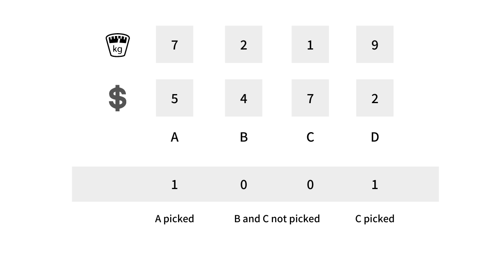

### Funció d'avaluació

- Haurem de definir una **funció d'avaluació**.
- Aquesta funció **assigna un valor** a cada **individu**.
- Aquest valor **representa la qualitat** de l'individu.
- Haurem de ponderar els valors de les variables, segons les característiques de l'inidividu que vullguem potenciar.

### Creació de la població inicial

- El tercer pas és **crear una població inicial**.
- Aquesta població **s'ha de crear aleatòriament**, dins dels **dominis** de les variables.
- El nombre d'individus de la població inicial **ha de ser suficientment gran i divers**, sense fer-lo massa gran.
- Opcionalment, ordenarem els individus segons la seva funció d'avaluació.

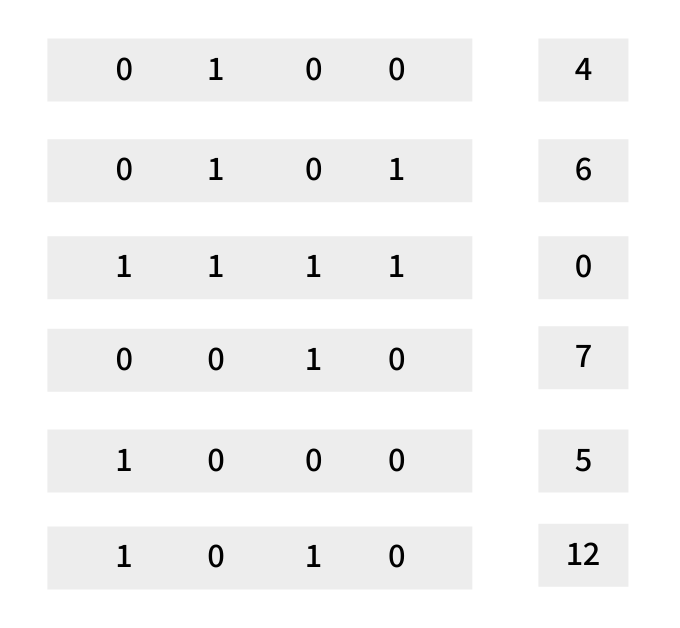

### Selecció

- Per evolucionar la població s'han de **seleccionar els millors individus** i serán els que **passaran els seus gens a la següent generació**.
- Hi ha diverses tècniques de selecció:
  - **Per torneig**: Es trien **$k$ individus aleatoris** i es **selecciona el millor**.
  - **Per ruleta**: S'**assigna una probabilitat** a cada individu, proporcional a la seva funció d'avaluació.
  - **Per rang**: La **probabilitat** serà proporcional a la seva posició.

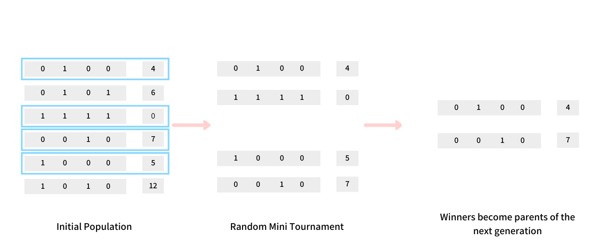

### Creuament

- El **creuament** és el procés pel qual es **genera un nou individu** (en certa probabilitat) a partir de dos individus.
- Els **fills** hereten els **gens** dels seus pares, barrejats.
- Hi ha diverses tècniques de creuament:
  - **Creuament per un punt**: Es tria un **punt aleatori** i es **barregen** els gens a partir d'aquest punt.
  - **Creuament per dos punts**: Es trien **dos punts aleatoris** i es **barregen** els gens entre aquests punts.
  - **Creuament uniforme**: Es tria **aleatòriament** per a cada gen si es **hereta del pare o de la mare**.
  - **Altres tècniques**: recombinació ordenada, màscara, etc.

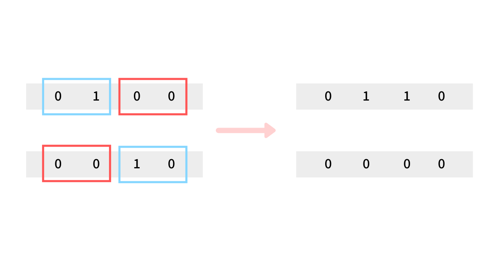

### Mutació

- La **mutació** és el procés pel qual es **modifica un gen** d'un individu.
- La mutació **pot ser necessària** per a **evitar que l'algorisme quede atrapat en un màxim local**.
- Al igual que en la selecció, la mutació **s'aplica amb una certa probabilitat** (normalment molt baixa).
- Hi ha diverses tècniques de mutació:
  - **Mutació aleatòria**: Es tria un **gen aleatori** i es **modifica**.
  - **Mutació dirigida**: Es tria un **gen aleatori** i es **modifica** en una **direcció concreta**.

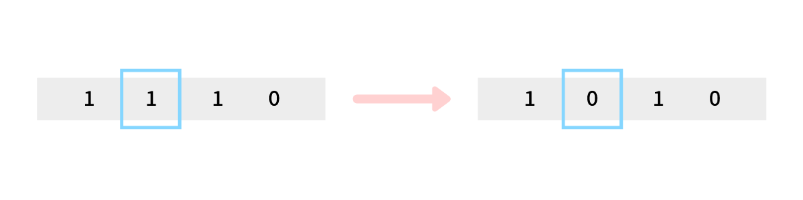

### Motxilla · Dades i puntuació

```python
from random import Random

PES_MAXIM = 100
MAX_UNITATS = 10
objectes = [
    ('Coca-Cola', 1, 1.5),
    ('Cervesa', 2, 2.5),
    ('Aigua', 1, 0.5),
    ('Cacauets', 1, 1.0),
    ('Patates', 2, 1.5),
    ('Galetes', 1, 1.0),
    ('Pomes', 1, 1.0),
    ('Taronges', 1, 1.0),
    ('Plàtans', 1, 1.0),
    ('Peres', 1, 1.0),
    ('Maduixes', 1, 1.0),
    ('Pinya', 1, 1.0),
    ('Pomes', 1, 1.0),
]
```

### Motxilla · Pes, valor i puntuació

```python
def pes(individu):
    return sum(q * p for q, (_, p, _) in zip(individu, objectes))

def valor(individu):
    return sum(q * v for q, (_, _, v) in zip(individu, objectes))

def puntuacio(individu):
    if pes(individu) > PES_MAXIM:
        return -1
    return valor(individu)
```

### Motxilla · Creuament i mutació

```python
def creua(a, b, rng):
    tall = rng.randrange(1, len(a))
    return a[:tall] + b[tall:]

def muta(individu, rng):
    i = rng.randrange(len(individu))
    opcions = [q for q in range(MAX_UNITATS + 1) if q != individu[i]]
    quantitat = rng.choice(opcions)
    return individu[:i] + (quantitat,) + individu[i + 1:]
```

### Motxilla · Algorisme genètic

```python
def genetic(rng, generacions=30):
    poblacio = [(0,) * len(objectes)]
    for _ in range(19):
        poblacio.append(tuple(rng.randrange(MAX_UNITATS + 1) for _ in objectes))

    for _ in range(generacions):
        poblacio.sort(key=puntuacio, reverse=True)
        pares = poblacio[:10]
        nova = [poblacio[0]]
        while len(nova) < len(poblacio):
            a, b = rng.sample(pares, 2)
            fill = creua(a, b, rng)
            if rng.random() < 0.25:
                fill = muta(fill, rng)
            nova.append(fill)
        poblacio = nova
    return max(poblacio, key=puntuacio)
```

### Prova l’algorisme genètic

```python
resultat = genetic(Random(42))
for quantitat, (nom, _, _) in zip(resultat, objectes):
    if quantitat:
        print(quantitat, nom)
print(f"{pes(resultat)} kg · {valor(resultat):.2f} €")
```

### Conclusions i problemes

- Els algorismes genètics poden ser difícils de **representar**.
- Funcionen millor amb els problemes que es poden representar com a un conjunt de **variables binàries**.
- Solen ser més lents que altres tècniques de cerca local.
- Per molts problemes els operadors de creuament i mutació són difícils de definir.
- La seva capacitat d'entrenar xarxes neuronals els fa molt útils en aquest camp.

# Satisfacció de restriccions


## Definicions (I)

- Alguns problemes es poden modelar millor com a problemes de satisfacció de restriccions **CSP** (**Constraint Satisfaction Problems**)
  - Tipus específic de problemes de búsqueda, pero difícils de tractar pel seu tamany.
- Alguns d'aquestos problemes podem solucionar-los amb les técniques de **cerca local** que ja hem vist.
  - El resultat, però, pot no ser una solució **optima**.
  - Per això, s'han desenvolupat tècniques específiques per a aquests problemes.
  - Veurem també com podem **millorar** els resultats de les tècniques de cerca local.

## Definicions (II)

- En aquests problemes, l'**estat** és un **conjunt de variables**.
- Cada variable té un **domini** de valors possibles.
- Les **restriccions** són les **relacions** entre les variables.
- Els **estats** que satisfan les **restriccions** són les **solucions**.
- Els **estats** que no satisfan les **restriccions** són **incompatibles**.
- Els **estats** que no són ni solucions ni incompatibles són **parcials**.

## Exemple: Mapa de colors (I)

- Tenim un mapa amb **països**.
- Volem **pintar** cada país amb un **color**.
  - No volem que dos països **adjacents** tinguin el **mateix color**.
  - Les **variables** són els **països**.
  - Els **dominis** són els **colors**.
  - Les **restriccions** són que **dos països adjacents no poden tenir el mateix color**.
  - Els **estats** són les **combinacions de colors** per a cada país.
  - Les **solucions** són les **combinacions de colors que satisfan les restriccions**.

## Exemple: Mapa de colors (II)

- Els algorismes que veurem es basen en representar les restriccions com a **grafs**.
  - Grafs de restriccions o **constraint graphs**.
- Els nodes del graf són les **variables**.
- Les **arestes** del graf són les **restriccions**.
- Les **solucions** són els **nodes del graf** que **no tenen cap aresta que els connecte**.

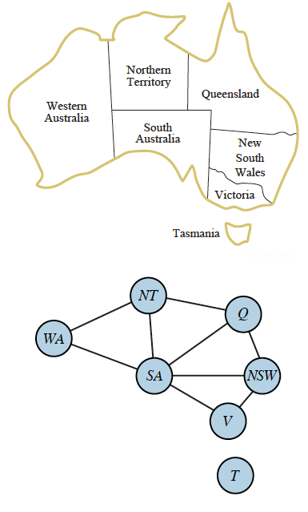

## Força bruta

- Una forma de solucionar aquest problema és **provar totes les combinacions**.
- Aquesta solució és **poc eficient**.
  - El nombre de combinacions és **molt gran**.
  - Si tenim 10 països i 4 colors, el nombre de combinacions és de $4^{10} = 1.048.576$.
- Aquesta solució **no** és **tractable**.
  - El nombre de combinacions creix **exponencialment** amb el nombre de variables.
  - Aquest problema és **NP-complet**.

## Búsqueda en tornada (backtracking)

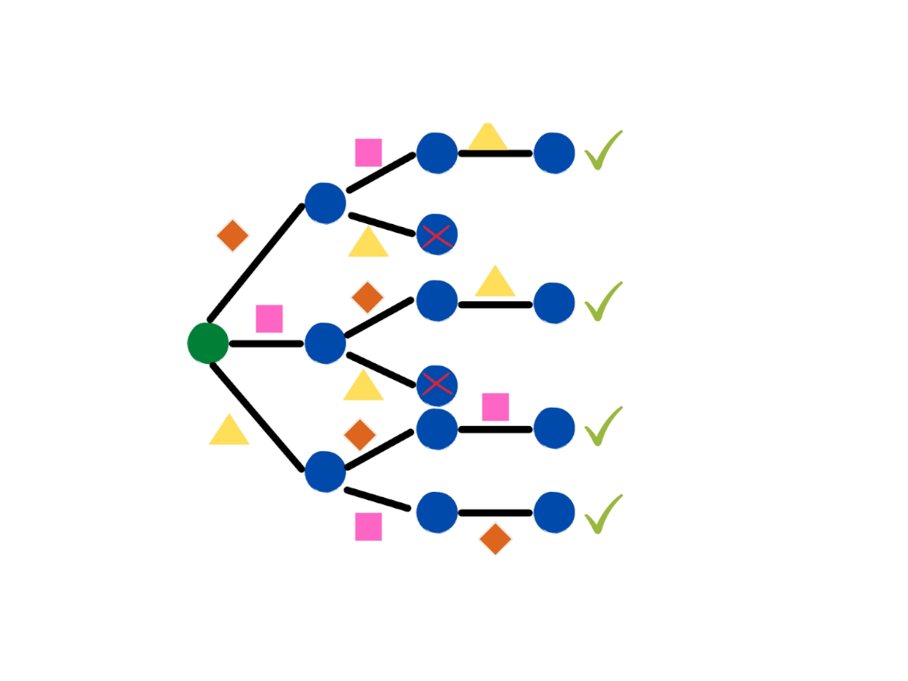

### Descripció

- L'algorisme de **búsqueda en tornada** o **backtracking** és un algorisme de búsqueda no informada.
- Partint d'una serie de variables
  - L'algorisme **assigna un valor** a una **variable**.
  - Després, **comprova** si aquesta assignació **viola alguna restricció**.
  - Si no la viola, **assigna un valor** a la **següent variable**.
  - Si la viola, **desfà l'assignació** i **cambia el valor** de la **variable anterior**.
  - L'algorisme **s'atura** quan ha **assignat un valor a totes les variables**.

### Implementació

```python
def backtrack():
  return _backtrack([], 0)

def _backtrack(estat, posicio):
  if posicio==len_solucio and es_solucio(estat):
    return estat

  for i in range(len_solucio):
    estat.append(i)
    if es_valid(estat) == 0:
      solu = _backtrack(estat, posicio + 1)
      if solu is not None:
        return solu
    estat.pop()

  return None
```

### Problemes

- L'algorisme de búsqueda en tornada **garanteix** trobar la **solució**.
- El seu **cost** és molt **alt**.
- El **nombre d'estats** que cal **explorar** és molt **gran**.
  - Serà menor que el nombre d'estats de l'espai d'estats, però pot ser no molt menor.
- Veurem algunes de les optimitzacions que podem aplicar

### Ordenació de variables

- L'**ordre** de selecció les variables afecta al **nombre d'estats** que cal **explorar**.
- Algunes estrategies d'ordenació:
  - **Variable més restringida (MRV)**: La variable amb menys valors possibles.
    - Pot **detectar incompatibilitats** abans.
  - **Variable menys restringida (LRV)**: La variable amb més valors possibles.
    - Pot donar més **flexibilitat** al principi.
  - **Grau (degree)**: La variable amb més restriccions.
    - Pot **resoldre incompatibilitats crítiques** abans.

### Ordenació de valors

- L'**ordre** de selecció els valors també determina el **nombre d'estats** que cal **explorar**.
- Algunes estrategies d'ordenació:
  - **Menys restriccions (LCV)**: El valor que deixa més opcions a les variables restants.
    - Intenta minimitzar els conflictes futurs.
  - **Més restriccions (MCV)**: El valor que deixa menys opcions a les variables restants.
    - Pot permetre accelerar cap a solucions viables.
  - **Aleatori**: El valor es tria aleatòriament.
    - Pot **donar més flexibilitat** al principi.

### Implementació de les optimitzacions (I)

```python
def backtrack():
  estat = [-1]*len_solucio
  variables = list(range(len_solucio))

  return _backtrack(estat, variables)
```

### Implementació de les optimitzacions (II)

```python
def _backtrack(estat, variables):
  if es_solucio(estat):
    return estat
  var = selecciona_variable(variables)
  for i in ordena_valors(var):
      estat[var] = i
      if es_valid(estat) == 0:
        variables.remove(var)
      solu = _backtrack(estat, variables)
      if solu is not None:
          return solu
      variables.append(var)
      estat[var] = -1
```

## Algorisme de mínims conflictes

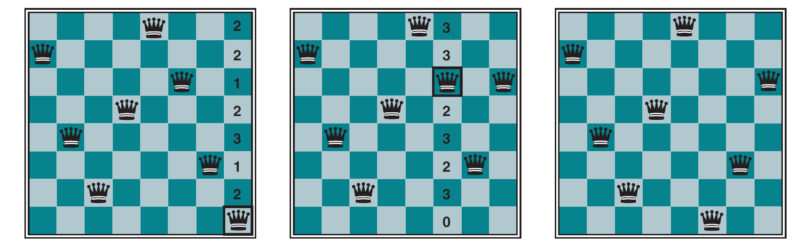

### Descripció

- L'algorisme de mínims conflictes o **minimum conflicts** és un algorisme de búsqueda local **específic per a CSP**.
- Tria una variable aleatoriament i li assigna un valor que **minimitzi el nombre de restriccions violades**.
- Repeteix aquest procés fins que **totes les restriccions estiguin satisfetes**
  - o s'arriba a un **nombre màxim d'iteracions**.
- Molt eficient si l'**assignació inicial** és bona.
  - Pot ser recomanable utilitzar un **algorisme voraç** per a trobar una bona assignació inicial.

### Exemple: N Reines (I)

- Tenim un tauler d'escacs de **N x N**.
- Volem **col·locar N reines** en el tauler.
- No volem que **cap reina pugui matar a una altra**.
- Les **variables** són les **files**.
- Els **dominis** són les **columnes**.
- Les **restriccions** són que **no hi pugui haver dues reines en posició d'atac**.

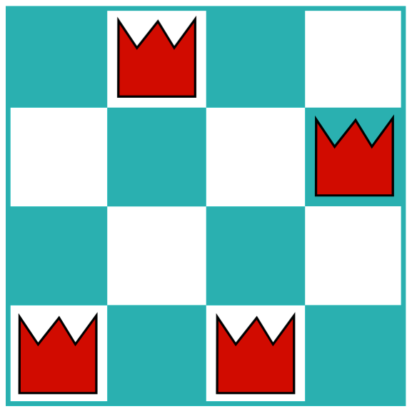

### Exemple: N Reines (II)

- Per al problema de les $N$ reines i una $N = 8$, tindrem fins a $8^8 = 16.777.216$ estats.
- L'algorisme de mínims conflictes **no** genera **estats successors**, **modifica l'estat actual**.
- **No** necessitem una **estructura de dades** que representi l'espai d'estats.
  - Aixó fa qué l'algorisme de mínims conflictes siga **més eficient que la búsqueda en tornada**.
- L'algorisme de mínims conflictes **no** garanteix trobar la **solució** però **en la gran majoria dels casos** la troba.

### Exemple: N Reines (III) - Implementació

```python
def minims_conflictes(espai_estats, funcio, max_iteracions):
    inicial = espai_estats.estat_inicial()

    actual = inicial
    for _ in range(max_iteracions):
        if espai_estats.es_solucio(actual):
            return actual

        i = random.randint(0, len(actual.tauler) - 1)
        act_conflicts = funcio(actual)

        for j in range(len(actual.tauler)):
            if j != i:
                actual[i], actual[j] = actual[j], actual[i]
                new_conflicts = funcio(actual)
                if new_conflicts <= act_conflicts:
                    act_conflicts = new_conflicts
                else:
                    actual[i], actual[j] = actual[j], actual[i]
    return actual
```
