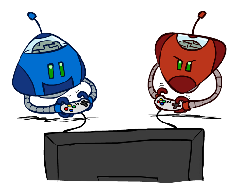
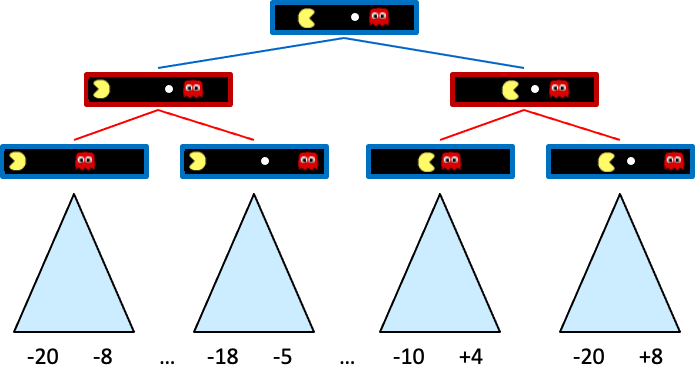
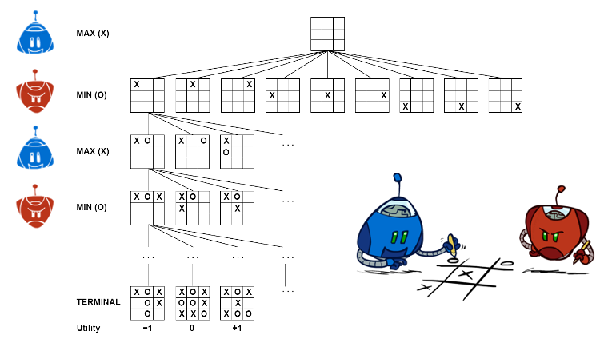
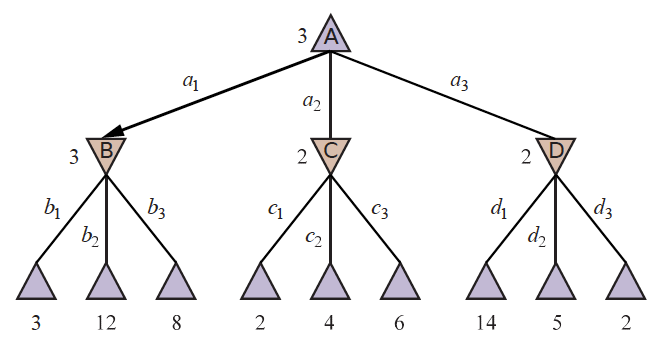
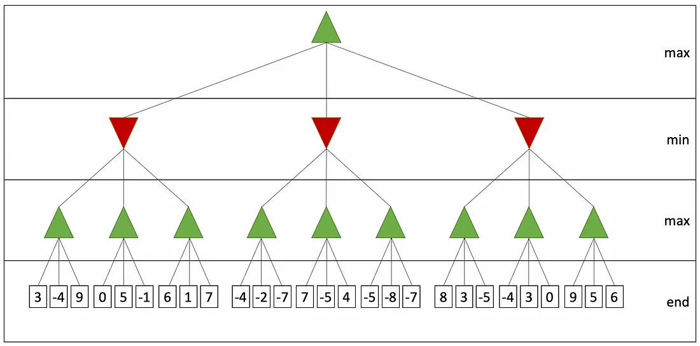
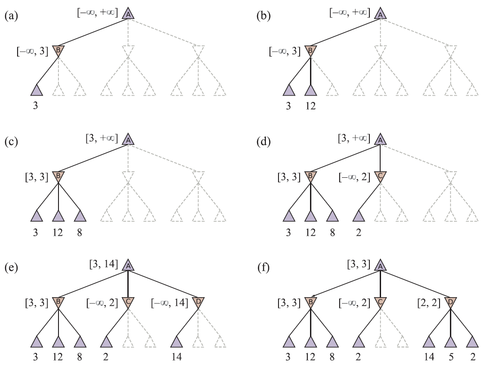
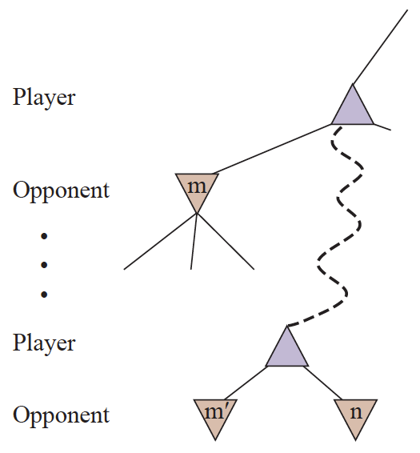

# Búsqueda con adversarios

### Juegos

Modelos de inteligencia artificial



## Juegos

- Hasta ahora, en nuestros problemas de búsqueda, el entorno era **determinista** y **totalmente observable**.
  - Solo había que **planificar** una secuencia de acciones para llegar al estado objetivo.
- En los juegos hay **adversarios**: cada jugador tiene un **objetivo** diferente.
  - Los jugadores modifican el estado del entorno en beneficio propio.
  - Puede haber cooperación, pero solo si resulta beneficiosa para todos los jugadores.
- Los juegos son un **ámbito** muy importante de la inteligencia artificial.
  - Son un ámbito muy **común**, **complejo** y útil para la **investigación**.

### Propiedades

Tendremos en cuenta las siguientes propiedades:

- **Dos jugadores**: uno puede ser la máquina y el otro una persona.
- **Finito**: número finito de estados. Si es muy grande, pueden utilizarse aproximaciones.
- **Suma cero**: la ganancia de un jugador es la pérdida del otro.
- **Determinista**: no hay azar.
- Información **perfecta**: los jugadores conocen el estado del juego en todo momento (ajedrez, Go, etc.).

#### Dos jugadores y suma cero

- Dos jugadores: $MAX$ y $MIN$.
- Un conjunto de **posiciones** $P$ (estados)
- Una posición inicial $p_0 \in P$
- Un conjunto de **posiciones terminales** $T \subseteq P$
- Un conjunto de aristas dirigidas $E_{Max}$ y $E_{Min}$ entre las posiciones.
  - Representan los movimientos posibles de cada jugador.
- Una **función de utilidad** $u: T \rightarrow \mathbb{R}$ que asigna a cada posición terminal un valor para $MAX$.



## Árbol de juego (I)

Características:

- **Árbol de juego**: **capas** de estados que **alternan** entre los jugadores.
- **Raíz**: estado **inicial**.
- **Estado del juego**: **posición** y **jugador** al que le toca mover.
- **Final del juego**: cuando un jugador llega a una **posición terminal**.
- **Función de utilidad**: junto con los estados terminales, permite valorar los resultados.
  - Cada nodo **terminal** $t$ se etiqueta según su **utilidad** $U(t)$.
  - Para $MAX$ será $U(t)$; para $MIN$, $-U(t)$.
  - En la mayoría de los juegos que veremos, $U(t) \in \{-1, 0, 1\}$.

## Árbol de juego (II): ejemplo



## Estrategias

- $MAX$ quiere **maximizar** su utilidad.
- $MIN$ quiere **minimizar** la utilidad de $MAX$.
- $MAX$ no decide por sí solo a qué estado terminal llegará.
  - Cuando $MAX$ mueve, $MIN$ decide a qué estado siguiente se llegará.
- $MAX$ necesita una **estrategia**:
  - Debe decidir qué hacer **ante cada posible** **movimiento** de $MIN$.
  - No basta con una secuencia de acciones predefinida: la estrategia **depende de las acciones** de $MIN$.

### MiniMax



### MiniMax

- Estrategia recursiva.
- Suponiendo que $MIN$ siempre juega **su mejor movimiento**,
  - ¿qué movimiento debe elegirse para minimizar la utilidad de $MIN$?
- Cada nodo tendrá una **puntuación minimax**.
  - Será la **utilidad mínima** que $\mathbf{MAX}$ puede obtener **si $\mathbf{MIN}$ juega de forma óptima**.

**Al minimizar la ganancia de $\mathbf{MIN}$, maximizamos la nuestra.**

#### Ejemplo

- En el ejemplo de la derecha, los nodos $\triangle$ son $MAX$ y los $\triangledown$ son $MIN$.
- Los nodos terminales muestran la **utilidad** para $MAX$.
- El resto de nodos muestra su puntuación **minimax**
- En la raíz, la mejor opción para $MAX$ es $a_1$, porque conduce al nodo con la mejor puntuación minimax.
- En el segundo nivel, la mejor opción para $MIN$ es $b_1$, porque conduce al nodo con la puntuación más baja.


#### Algoritmo

- **Entrada**: un árbol de juego $A$, un nodo $n$ y un jugador $j$.
- **Salida**: la puntuación minimax del nodo $n$.
- **Algoritmo**: recursivo.
  - Si $n$ es un nodo terminal, devolver su utilidad.
  - Si $j$ es $MAX$, devolver la puntuación máxima de sus hijos.
  - Si $j$ es $MIN$, devolver la puntuación mínima de sus hijos.

#### Implementaciónnn (I)

```python
def cerca_minimax(joc, estat):
    jugador = estat.a_moure
    return valor_maxim(joc, jugador, estat)

def valor_maxim(joc, jugador, estat):
    if joc.es_terminal(estat):
        return joc.utilitat(estat, jugador), None
    v, moviment = float('-inf'), None
    for a in joc.accions(estat):
        v2, _ = valor_minim(joc, jugador, joc.resultat(estat, a))
        if v2 > v:
            v, moviment = v2, a
    return v, moviment
```

#### Implementaciónnn (II)

```python
def valor_minim(joc, jugador, estat):
    if joc.es_terminal(estat):
        return joc.utilitat(estat, jugador), None
    v, moviment = float('inf'), None
    for a in joc.accions(estat):
        v2, _ = valor_maxim(joc, jugador, joc.resultat(estat, a))
        if v2 < v:
            v, moviment = v2, a
    return v, moviment
```

#### Problemas

- **Complejidad**: $O(b^m)$
  - donde $b$ es el número de ramas por nodo y $m$ la profundidad del árbol.
- La complejidad puede ser **enorme**.
  - En ajedrez, $b \approx 35$ y $m \approx 100$. $Nodos \approx 10^{54}$
  - En Go, $b \approx 250$ y $m \approx 150$. $Nodos \approx 10^{360}$
- Por eso es **imposible** explorar todo el árbol de juego en juegos complejos.
  - Veremos técnicas que pueden ayudarnos.

## Poda alfa-beta



### Introducciónn

- **Poda alfa-beta**: **técnica** para reducir el número de nodos que hay que explorar en el árbol de juego.
- **Poda**: **eliminar** nodos del árbol de juego sin explorarlos.
- **Alfa**: **valor** mínimo que $MAX$ tiene **garantizado** que podrá obtener.
- **Beta**: **valor** máximo que $MIN$ tiene **garantizado** que podrá obtener.
- **Nodos que se podan**: nodos que, independientemente de su valor, no modificarán el nivel superior.

### Ejemplo (I)

- La primera hoja bajo $B$ tiene valor $3$. Por tanto, $B$ (nodo $MIN$) tiene un valor máximo de $3$.
- La segunda hoja bajo $B$ tiene valor $12$.
  - $MIN$ evitaría este movimiento, así que $B$ sigue teniendo un valor máximo de $3$.
- La tercera hoja bajo $B$ tiene valor $8$. El valor final de $B$ es $3$.
  - Podemos deducir que el valor mínimo de $A$ es $3$, ya que tiene un nodo terminal con valor $3$.



### Ejemplo (II)

- La primera hoja bajo $C$ tiene valor $2$. Por tanto, $C$, que es un nodo $MIN$, tiene un valor máximo de $2$.
  - Sabemos que $B$ tiene un valor de $3$, así que $MAX$ nunca elegirá $C$.
    - Por tanto, sabemos que no hace falta explorar los demás nodos hijos de $C$.
  - Esto es la **poda alfa-beta**.
- Al terminar la exploración conocemos los valores de los nodos necesarios.


### Reglas

- La poda alfa-beta **no** afecta al resultado del algoritmo.
- Se puede aplicar a cualquier profundidad del árbol.
  - A menudo se pueden podar incluso árboles enteros.
- Principio general para un nodo $n$:
  - Si hay una opción mejor en el mismo nivel $($m'$)$ o en uno superior $($m$)$, no se visitará $n$.



### Implementaciónn (I)

```python
def busqueda_alfa_beta(joc, estat):
    jugador = estat.a_moure
    return valor_maxim_ab(joc, jugador, estat, float('-inf'), float('inf'))

def valor_maxim_ab(joc, jugador, estat, alfa, beta):
    if joc.es_terminal(estat):
        return joc.utilitat(estat, jugador), None
    v, moviment = float('-inf'), None
    for a in joc.accions(estat):
        v2, _ = valor_minim_ab(joc, jugador, joc.resultat(estat, a), alfa, beta)
        if v2 > v:
            v, moviment = v2, a
        if v >= beta:
            return v, moviment
        alfa = max(alfa, v)
    return v, moviment
```

### Implementaciónn (II)

```python
def valor_minim_ab(joc, jugador, estat, alfa, beta):
    if joc.es_terminal(estat):
        return joc.utilitat(estat, jugador), None
    v, moviment = float('inf'), None
    for a in joc.accions(estat):
        v2, _ = valor_maxim_ab(
          joc, jugador, joc.resultat(estat, a), alfa, beta
        )
        if v2 < v:
            v, moviment = v2, a
        if v <= alfa:
            return v, moviment
        beta = min(beta, v)
    return v, moviment
```

### Mejoras

- **Ordenación de nodos**: ordenar correctamente los nodos hijos permite podar más.
  - Una buena ordenación puede reducir la exploración de $O(b^{3d/4})$ a $O(b^{d/2})$.
    - En ajedrez, es más probable que sean buenos los movimientos que capturan piezas.
- Para no explorar estados repetidos, se puede utilizar una **tabla de transposiciones**, parecida al conjunto de visitados, pero que guarde los valores de cada nodo.
- Aplicar **heurísticas** para limitar la evaluación: aplicar una función de evaluación a las posiciones no terminales para tratarlas como terminales.

## Funciones de evaluación

### Introducciónn

- En juegos complejos no se puede explorar todo el árbol de juego.
- En su lugar, se puede utilizar una **función de evaluación** para estimar la utilidad de un estado.
- La función de evaluación **no** tiene que ser perfecta.
  - Debe ser **rápida** de calcular.
  - Debe ser **coherente** con la utilidad real.

## Funciones de evaluación

### Ejemplo: tres en raya

- En el tres en raya podemos utilizar la siguiente función de evaluación:
  - $u(s) = \sum_{i=1}^3 \sum_{j=1}^3 \begin{cases}
    1 & \text{si } s_{i,j} = \text{MAX} \\
    -1 & \text{si } s_{i,j} = \text{MIN} \\
    0 & \text{en otro caso}
  \end{cases}$
  - Explicación: sumamos 1 por cada ficha de $MAX$ y restamos 1 por cada ficha de $MIN$.

## Funciones de evaluación

### Implementaciónn

```python
def avalua_tres_en_ratlla(joc, estat):
    jugador = estat.a_moure
    utilitat = 0
    for i in range(3):
        for j in range(3):
            if estat.tauler[i][j] == jugador:
                utilitat += 1
            elif estat.tauler[i][j] == joc.jugador_contrari(jugador):
                utilitat -= 1
    return utilitat
```
