

# 6. Sistemas basados en reglas

Modelos de inteligencia artificial

---

<!--
_class: invert lead
-->

# IA simbólica

---

## Inteligencia artificial simbólica

- **IA simbólica** o **IA basada en conocimiento**:
  - Extraemos conocimiento de especialistas y lo representamos de forma que las máquinas puedan entenderlo.
  - Utilizamos este conocimiento para:
    - Resolver problemas automáticamente.
    - Explicar el razonamiento de la máquina.
    - Aprender cosas nuevas.
    - Mejorar el conocimiento existente.

---

## Representación del conocimiento

- Conocimiento frente a datos e información:
  - **Datos**: hechos o valores.
  - **Información**: datos con significado.
  - **Conocimiento**: información con significado y estructura.

> El conocimiento es un conjunto de información estructurada e interrelacionada que permite a un agente realizar tareas.

---

## Jerarquía del conocimiento (I)

- A menudo definimos el conocimiento en relación con conceptos similares.
- La jerarquía del conocimiento, o jerarquía DIKW, representa la relación entre _datos_, _información_, _conocimiento_ y _sabiduría_.

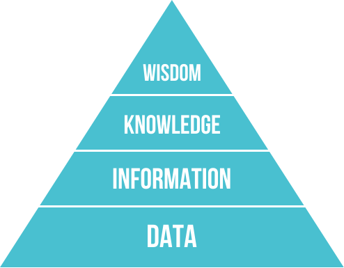

---

## Jerarquía del conocimiento (II)

- **Datos** (**D**ata): hechos o valores registrados en un soporte físico. Son independientes del agente y pueden interpretarse de distintas maneras.

  - Ejemplo: _«Un reloj inteligente registra la temperatura corporal de una persona»._

- **Información** (**I**nformation): interpretación de los datos por parte de un agente. Es subjetiva y depende del agente.
  - Ejemplo: _«La temperatura corporal de la persona es de 37 °C»._

---

## Jerarquía del conocimiento (III)

- **Conocimiento** (**K**nowledge): información integrada en nuestro modelo del mundo. Depende del agente y de sus conocimientos previos.

  - Ejemplo: _«Si la temperatura supera los 37 °C, la persona tiene fiebre»._

- **Sabiduría** (**W**isdom): metaconocimiento, es decir, saber cómo y cuándo aplicar el conocimiento.
  - Ejemplo: _«Si la persona tiene fiebre, debe tomar paracetamol»._

---

## Representación del conocimiento (I)

- Es la forma en que representamos el conocimiento para que las máquinas puedan entenderlo.
- Es uno de los problemas fundamentales de la inteligencia artificial.
- Debe representarse de manera que:
  - Sea **comprensible** para las máquinas.
  - Sea **útil** para resolver problemas.
  - Pueda procesarse de forma **eficiente**.

---

## Representación del conocimiento (II)

- Podemos entender las distintas representaciones como un **continuo**:
  - A la izquierda están las representaciones más **simples** (algoritmos): los ordenadores las utilizan de forma eficiente, pero son poco flexibles.
  - A la derecha están las representaciones más **flexibles** (lenguaje natural): son muy potentes, pero las máquinas no pueden utilizarlas directamente.

---

## Continuo del conocimiento

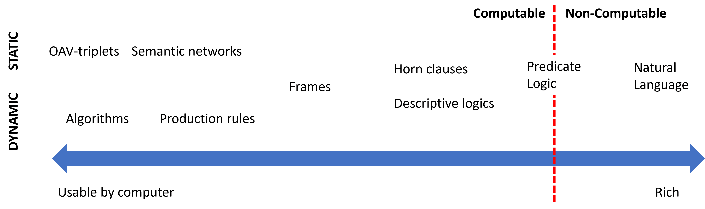

---

## Representación del conocimiento (III)

- **Representaciones en red**:
  - En la mente humana, el conocimiento se representa como una red de conceptos relacionados.
  - Las representaciones en red intentan hacer lo mismo mediante grafos en los ordenadores.
    - Las llamamos **redes semánticas**.
  - Hay distintos tipos: pares atributo-valor, representaciones jerárquicas y procedimentales, lógica, etc.

---

## Pares atributo-valor o tripletas objeto-atributo-valor

- Aprovechamos que un grafo puede representarse como una lista de nodos y aristas para representar el conocimiento.
- El conocimiento se representa como una lista de pares atributo-valor.
  - _«El perro es un animal, tiene cuatro patas, pelo, cola, etc.»_
  - _«La paloma es un animal y un ave; tiene dos patas, etc.»_
  - _«El coche es un vehículo; tiene cuatro ruedas, un motor, etc.»_

---

## Representaciones jerárquicas

- El conocimiento se representa como un árbol.
- Los nodos del árbol representan conceptos.
- Las aristas representan relaciones entre conceptos.
  - Animales $\rightarrow$ Vertebrados $\rightarrow$ Mamíferos $\rightarrow$ Perros $\rightarrow$ Caniche
  - Animales $\rightarrow$ Vertebrados $\rightarrow$ Aves $\rightarrow$ Palomas $\rightarrow$ Paloma bravía
  - Objetos $\rightarrow$ Vehículos $\rightarrow$ Coches $\rightarrow$ Coche de gasolina

---

## Representaciones procedimentales

- El conocimiento se representa como un conjunto de acciones que pueden ejecutarse cuando se cumplen ciertas condiciones.
- Llamamos **reglas de producción** a las **declaraciones** que permiten obtener conclusiones a partir de ciertas premisas.
- Tienen la forma: **IF** (premisa) **THEN** (conclusión)
  - **IF** (la temperatura supera los 37 °C) **THEN** (la persona tiene fiebre)
  - **IF** (la persona tiene fiebre) **THEN** (la persona debe tomar paracetamol)

---

## Lógica

- La lógica es un sistema formal para representar el conocimiento y razonar sobre él. Aristóteles la propuso hace más de 2.000 años como herramienta de **deducción**.
- La lógica proposicional permite representar el conocimiento y razonar sobre él. Es muy potente en teoría, pero no se utiliza directamente en las máquinas; algunos sistemas, como Prolog, utilizan un subconjunto.
- Ejemplo: $p$: «La persona tiene fiebre», $q$: «La persona debe tomar paracetamol»
  - $p \rightarrow q$: «Si la persona tiene fiebre, debe tomar paracetamol»
  - $p \land q$: «La persona tiene fiebre y debe tomar paracetamol»

---

<!--
_class: invert lead
-->

# Sistemas expertos

---

## Aprovechamiento del conocimiento humano

### Definición

- **Sistemas basados en el conocimiento** (SBC) o **sistemas expertos** (SE):
  - Sistemas que utilizan el conocimiento humano para resolver problemas.
- El conocimiento humano se expresa mediante **reglas**.
  - La mayoría de los sistemas expertos utiliza **reglas de producción**.
- Los SBC son un **subconjunto** de la inteligencia artificial.
  - Actualmente predominan los sistemas basados en datos.
  - Aun así, los SBC siguen cumpliendo una función importante en la IA.

---

### Características

- **Conocimiento**:
  - El conocimiento humano se expresa mediante reglas.
  - El conocimiento es **declarativo**.
- **Rendimiento**:
  - Los SBC son **especialistas** y **eficientes** en un dominio concreto.
- **Explicación**:
  - Los SBC pueden explicar su razonamiento y sus conclusiones.

---

<!--
_class: invert lead
-->

## Sistemas basados en reglas

---

### Definición

- Es un tipo de sistema basado en el conocimiento.
- Utiliza un conjunto de reglas explícitas para razonar.
- Las reglas tienen la forma:
  - **IF** (premisa) **THEN** (conclusión)
- Es determinista.
  - De una misma premisa siempre se deduce la misma conclusión.
- Puede representarse como un árbol de decisión.
  - Esto facilita la comprensión del razonamiento.

---

### Componentes de un sistema basado en reglas (I)

- **Memoria activa** (base de hechos):
  - Base de datos con hechos que describen la situación actual. Es _volátil_.
- **Base de conocimiento**:
  - Conjunto de reglas que describe el conocimiento experto. Es _persistente_.
- **Motor de inferencia**:
  - Busca las reglas aplicables a la situación actual (**conjunto de conflicto**) y las ejecuta según el orden establecido.

---

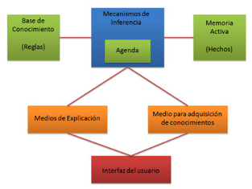

---

### Componentes de un sistema basado en reglas (II)

- **Mecanismos de explicación**:
  - Permiten explicar el razonamiento del sistema al usuario.
- **Mecanismos de adquisición de conocimiento**:
  - Permiten añadir reglas nuevas al sistema, de forma manual o automática.
- **Interfaz de usuario**:
  - Permite al usuario interactuar con el sistema.

---

### Ejemplo: clasificar un animal (I)

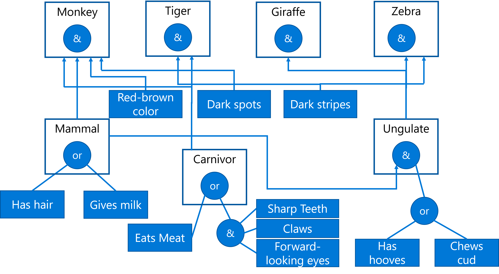

---

### Ejemplo: clasificar un animal (II)

**IF** (el animal tiene pelo **OR** produce leche) **THEN** es un mamífero
**IF** el animal come carne **OR** (tiene dientes afilados AND tiene garras **AND** tiene los ojos orientados hacia delante) **THEN** es carnívoro

- Los elementos de la premisa son **antecedentes**, parecidos a las tripletas objeto-atributo-valor.
- La **memoria activa** contiene los hechos que describen la situación actual.
- El **sistema de reglas** comprueba qué antecedentes se cumplen y añade sus conclusiones a la **memoria activa**.

---

### Ejemplo: clasificar un animal (III)

- _Observaciones_:
  - Se necesitan muchas reglas para cubrir todos los casos.
  - Las reglas son difíciles de mantener.
  - Las reglas pueden entrar en contradicción con facilidad.
    - ¿Cómo representaríamos al ornitorrinco? ¿Es un mamífero o un ave?

---

### Ejemplo: dolor de muelas (I)

- **IF** (me duelen las muelas) **THEN** (tengo caries)
- **IF** (me duelen las muelas) **THEN** (tengo una infección)
- **IF** (me duelen las muelas) **THEN** (tengo sensibilidad dental)
- **IF** (me duelen las muelas) **THEN** (tengo una fractura)
- **IF** (me duelen las muelas) **THEN** (tengo una maloclusión)
- **IF** (me duelen las muelas) **THEN** (tengo sinusitis)
- **IF** (la encía está _más roja_) **THEN** (tengo una infección)

---

### Ejemplo: dolor de muelas (II)

- _Observaciones_:
  - El dolor de muelas puede tener muchas causas.
  - No se puede determinar la causa con una sola regla.
    - Necesitamos herramientas para gestionar la **incertidumbre**.
  - No podemos representar la regla _«si la encía está más roja»_.
    - Necesitamos herramientas para representar el **conocimiento impreciso**.

---

### Limitaciones

- Requieren una **gran cantidad de conocimiento experto**.
- El conocimiento experto es difícil de **obtener, representar y mantener**.
- Razonamiento con **incertidumbre**:
  - Los sistemas basados en reglas solo pueden utilizar las **reglas definidas**.
  - Tienen dificultades para trabajar con datos **imprecisos o incompletos**.
- Flexibilidad:
  - Dificultad para **adaptarse** a problemas nuevos.
  - Dificultad para **aprender** conocimiento nuevo.

---

### Estrategias de inferencia

#### Encadenamiento hacia delante: _forward chaining_ (I)

- Revisa los antecedentes de las reglas, busca coincidencias con los hechos e infiere nuevas conclusiones.
  - Razonamiento **deductivo**.
- Se basa en la **lógica proposicional**.
  - *Modus ponens*: $p \rightarrow q, p \vdash q$
- **Problema**: puede que no encuentre la conclusión buscada.
  - Ejemplo: _«Si el perro está enfermo, entonces el perro está enfermo»_.

---

#### _Forward chaining_ (II)

- El razonamiento **no está guiado por la conclusión**.
  - Se obtienen todas las conclusiones posibles, sean relevantes o no.
  - Se realiza más trabajo del necesario.
- La **estrategia de resolución** de conflictos es fundamental.
  - Puede mejorarse mediante heurísticas.
- **Problema**: identificar las reglas que deben activarse.
  - Algoritmo RETE (Forgy, 1979).

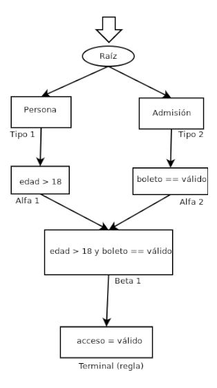

---

### Estrategias de inferencia

#### Encadenamiento hacia atrás: _backward chaining_ (I)

- Empieza por la conclusión y busca los antecedentes que la justifican.
  - Razonamiento **inductivo**.
  - Utiliza el **modus ponens en sentido inverso**.
  - $$p \rightarrow q, q \vdash p$$
- Los objetivos determinan qué reglas se aplican.
  - El razonamiento está **guiado por la conclusión**.

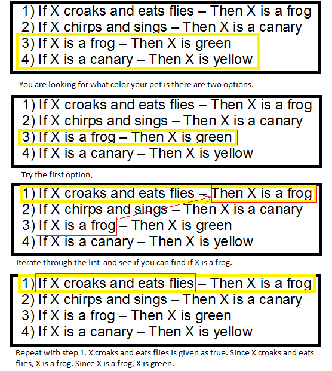

---

### Plataformas para sistemas basados en reglas

- **CLIPS** (C Language Integrated Production System): lenguaje de programación y motor de inferencia.
- **Drools**: lenguaje de programación y motor de inferencia.
- **Prolog**: lenguaje de programación lógica.
- **Python**
  - Bibliotecas _PyKnow_, _PyKE_ y _Experta_.
  - Biblioteca _PyCLIPS_.
  - Biblioteca _PyDrools_.

---

## Sistemas híbridos de reglas y datos (I)

- Hay dos enfoques:
  - Deducir reglas a partir de datos facilita la **interpretación** del razonamiento.
  - Combinar reglas definidas por el usuario con aprendizaje automático permite **mejorar** las reglas.

---

## Sistemas híbridos de reglas y datos (II)

### Bibliotecas

- [Human-Learn](https://koaning.github.io/human-learn/index.html): permite definir y visualizar reglas que pueden mejorarse mediante aprendizaje automático.
- [skope-rules](https://github.com/scikit-learn-contrib/skope-rules): analiza los datos e infiere reglas de clasificación.
  - Permite analizar las reglas, mejorarlas e interpretarlas.
- [SpaCy](https://spacy.io/usage/rule-based-matching):
  - Permite definir reglas para extraer información de textos.
  - Es útil cuando no hay suficientes datos etiquetados o para casos específicos.

---

<!--
_class: lead
-->

## Sistemas de razonamiento impreciso

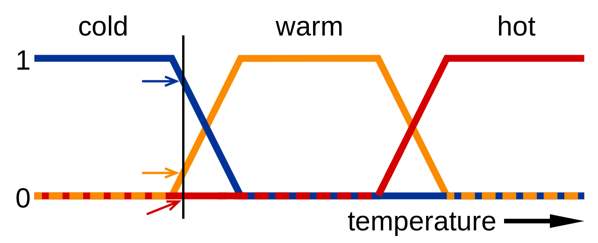

---

### Definición

- **Lógica difusa** o **lógica borrosa**:
  - Extensión de la lógica proposicional para trabajar con la incertidumbre.
  - Permite trabajar con valores imprecisos.
- **Sistemas de razonamiento impreciso**:
  - Sistemas basados en reglas que utilizan lógica difusa.
  - Permiten trabajar con valores **continuos**.
  - Facilitan la representación del **conocimiento humano**.
  - Son muy adecuados para **sistemas de control**.
  - Permiten encontrar una solución **buena**, aunque no siempre la **mejor**.

---

### Lógica difusa (I)

- La lógica proposicional es **binaria**.
  - Un enunciado es **verdadero** o **falso**.
- La lógica difusa permite trabajar con valores **continuos**.
  - Un enunciado puede ser **verdadero** _y_ **falso** en cierto grado **parcial**.
- Los valores de verdad son **números reales** del intervalo $[0, 1]$.
  - $0: Falso$, $1: Verdadero$, $0.5:$ $Verdadero$ en un $50\%$.
- La pertenencia de un elemento a un conjunto se expresa mediante una **función de pertenencia**.
  - $\mu_A(x)$: grado de pertenencia de $x$ al conjunto $A$.

---

---

### Lógica difusa (II)

- La lógica difusa facilita la **representación del conocimiento humano**.
  - Las personas no razonamos en términos binarios.
  - No tenemos un conocimiento preciso ni completo.
- Conceptos como $$húmedo$$ o $$frío$$ son difíciles de definir con precisión.
  - La lógica difusa permite definirlos mediante **funciones de pertenencia**.
  - Trabajar con estos conceptos facilita crear dispositivos como **secadores** o **termostatos**.
    - _«Si la temperatura es fría, enciende la calefacción»._

---

### Conceptos básicos (I)

- **Variable lingüística**: variable que puede tomar valores lingüísticos.
  - Ejemplo: $Temperatura$
- **Valores lingüísticos**: valores que puede tomar una variable lingüística.
  - Ejemplo: $Frío, Calor$
- **Función de pertenencia**: asigna a cada valor de una variable lingüística un grado de pertenencia a un valor lingüístico.
  - Ejemplo: $Temperatura = 27^oC \rightarrow Calor = 0.8,\; Mucho\,Calor = 0.2$

---

### Conceptos básicos (II)

- **Regla difusa**: regla que utiliza valores difusos.
  - Ejemplo: _«Si la temperatura es **fría**, entonces la **calefacción está alta**»._
- **Función de agregación**: combina los valores difusos de las reglas para deducir una conclusión final.
  - Ejemplo: $Calor = 0.8, Húmedo = 0.7 \rightarrow Sensación\:desagradable = 0.8$.
- **Sistema de razonamiento impreciso**:
  - Sistema basado en reglas que utiliza lógica difusa.
  - Ejemplo: sistema para controlar la temperatura de una vivienda.

---

### Funcionamiento de los sistemas de razonamiento impreciso (I)

- _Fuzzificación_:
  - Conversión de los datos de entrada precisos a valores difusos.
  - Transformamos valores precisos en valores difusos.
  - Utiliza las **funciones de pertenencia**.
    - Asignan a cada valor de entrada un grado de pertenencia a cada **variable lingüística**.
    - $$27^oC \rightarrow Calor = 0.8, Mucho\:calor = 0.2$$

---

### Funcionamiento de los sistemas de razonamiento impreciso (II)

- _Evaluación de las reglas_:
  - En este paso se **aplican las reglas del sistema**.
  - Se establece la relación entre las **variables de entrada** y las **variables de salida**.
  - _«Si la temperatura es **alta** y la humedad es **baja**, la velocidad del ventilador debe ser **alta**»._
  - Se combinan las **funciones de pertenencia** de las variables de **entrada**.
    - Así se deduce el grado de **pertenencia** de la variable de **salida**.

---

### Funcionamiento de los sistemas de razonamiento impreciso (III)

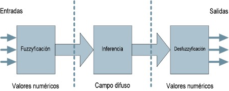

- _Desdifusificación_:
  - Conversión de los datos difusos de salida a valores precisos.
  - Transformamos valores difusos en valores precisos.
  - Utiliza las **funciones de agregación**.
    - Combina las conclusiones de las reglas para deducir el resultado final.
    - Se suele utilizar el método del **centroide** o el **máximo**.

---

### Funciones de pertenencia (I)

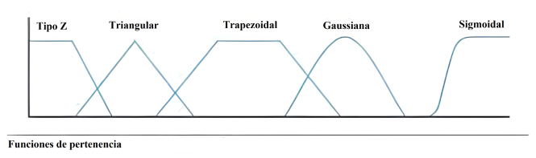

- Las más utilizadas son las **funciones trapezoidales** y las **triangulares**.
- Las funciones sinusoidales son útiles para representar **periodos**.
- Las funciones sigmoidales son útiles para representar **probabilidades**.

---

### Ejemplo: propinas (I)

#### Variables de entrada

Utilizaremos funciones triangulares para representar las variables de entrada y salida.

- **Servicio**:
  - **Bajo**: $[0, 5]$
  - **Medio**: $[0, 10]$
  - **Alto**: $[5, 10]$
- **Calidad de la comida**:
  - **Baja**: $[0, 5]$
  - **Media**: $[0, 10]$
  - **Alta**: $[5, 10]$

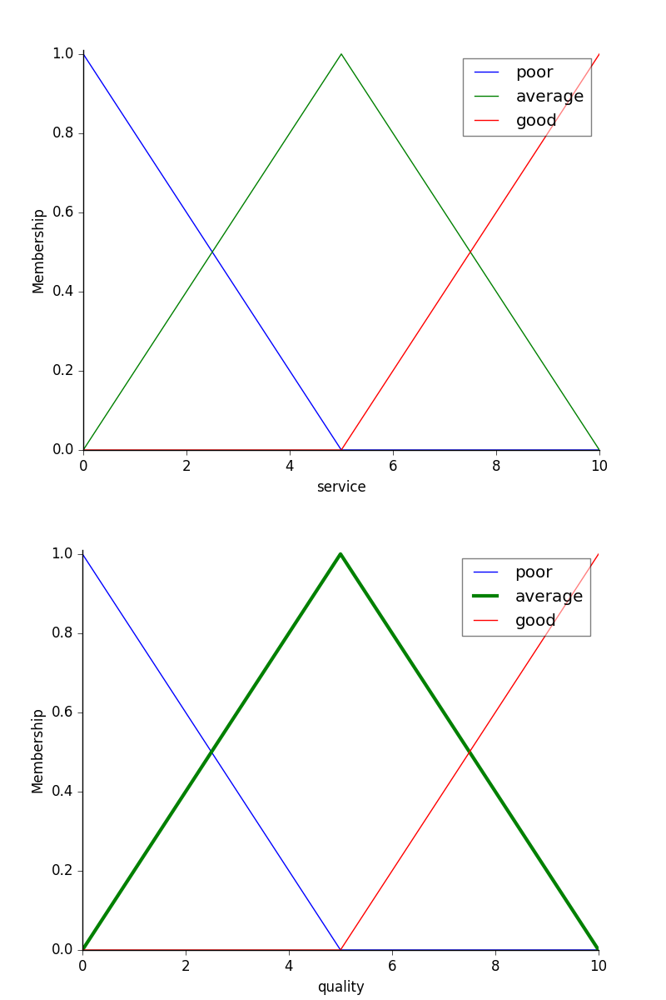

---

### Ejemplo: propinas (II)

#### Variables de salida

- **Propina**:
  - **Baja**: $[0, 13]$
  - **Media**: $[0, 25]$
  - **Alta**: $[13, 25]$

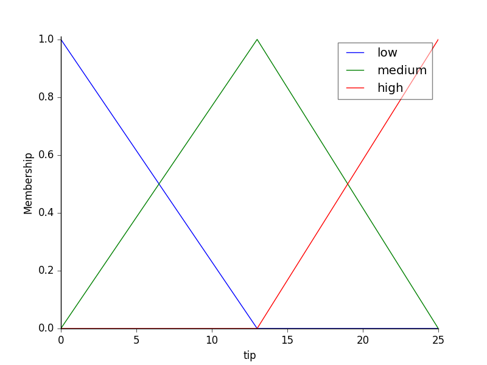

---

### Ejemplo: propinas (III)

#### Reglas

- **IF** (la calidad del servicio es **baja** o la comida es **baja**) **THEN** (la propina es **baja**)
- **IF** (la calidad del servicio es **media**) **THEN** (la propina es **media**)
- **IF** (la calidad del servicio es **alta** o la comida es **alta**) **THEN** (la propina es **alta**)

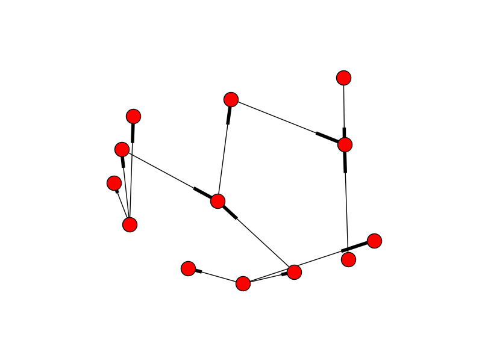

---

### Ejemplo: propinas (IV)

#### Inferencia

- Calidad del servicio: **9,8**
- Calidad de la comida: **6,5**
- Propina: **20,24 %**

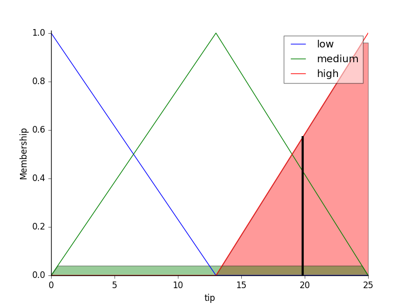

---
