<style scoped>
h1, p {
  color: #FFFFFF;
  text-shadow:
    0px 0px 3px #000000;
}
</style>

# 7. Procesamiento del lenguaje natural

Modelos de inteligencia artificial

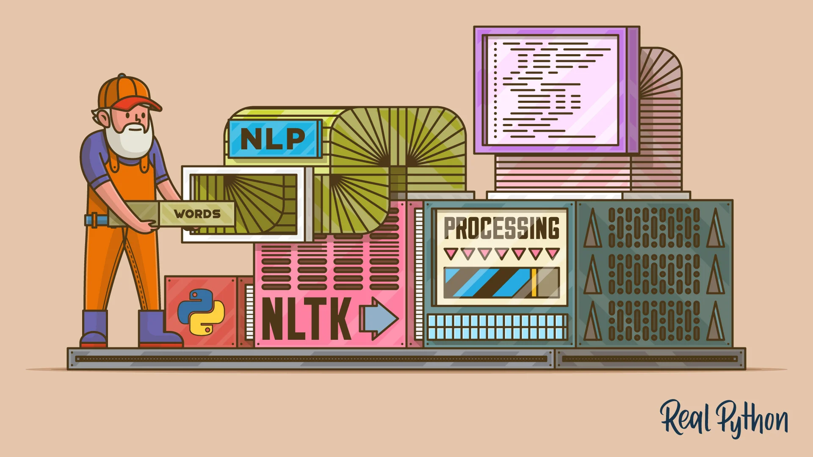

---

<style scoped>section { font-size:33px; }</style>

## Procesamiento del lenguaje natural

- **Definición:** campo de la IA que estudia la interacción entre los ordenadores y el lenguaje humano.
- Se centra en la **comprensión** y la **generación** del lenguaje humano.
- Es uno de los campos más activos y complejos de la IA.

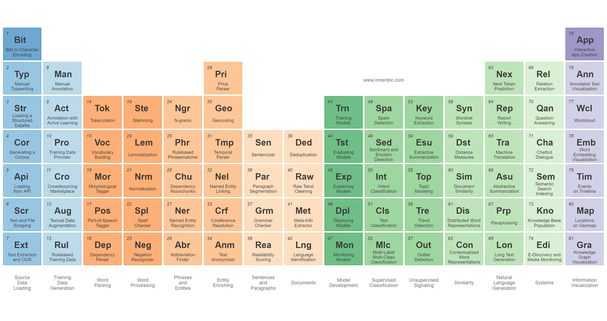

---

## Aplicaciones

- Traducción automática.
- Reconocimiento de voz.
- Síntesis de voz.
- Generación y resumen de texto.
- Análisis de sentimientos.
- Clasificación de texto.

---

## Introducción (I)

- Campo multidisciplinar que combina:
  - Lingüística.
  - Inteligencia artificial.
  - Ciencias cognitivas.
  - Informática.
  - etc.

---

## Introducción (II)

- Es un problema **difícil** porque:
  - El lenguaje humano es **ambiguo**.
  - El lenguaje humano es **rico**.
  - El lenguaje humano es **contextual**.
  - El lenguaje humano es **cultural**.
- Estas características hacen que el lenguaje humano no sea **formal** y, por tanto, no pueda tratarse con las técnicas de la IA tradicional.

---

<!--
_class: invert lead
-->

<style scoped>
h1, h2, h3, h4, h5, h6, p {
  color: #FFFFFF;
  font-weight: 800;
  text-shadow:
    0px 0px 3px #000000;
}
</style>

# El texto como dato


---

## Introducción

- El texto es una fuente de datos **muy importante**.
- Los seres humanos **generamos** y **consumimos** texto de forma **masiva**.
- Saber cómo tratar el texto es **fundamental** para muchas aplicaciones.

> Llamamos **texto** a una secuencia coherente de símbolos que puede interpretarse como un conjunto de palabras siguiendo las reglas gramaticales y sintácticas de una lengua.

---

## Significado

- ¿Qué entendemos por **significado**?
  - El significado de una palabra es el concepto que representa.
  - El significado de una frase es el concepto que representa la combinación de las palabras que la forman.
  - El significado de un texto es el concepto que representa la combinación de las frases que lo forman.

$$\text{significante}(\text{símbolo}) \Leftrightarrow \text{significado}(\text{idea})$$
$$\text{árbol} \Leftrightarrow \text{\{🌲, 🌳, 🌴, } \dots \}$$

---

<style scoped>section { font-size:32px; }</style>

## Significado en los ordenadores

- ¿Cómo pueden conocer los ordenadores el significado de palabras, frases y textos?
- Técnicas clásicas: bases de datos de sinónimos e hiperónimos.
  - `WordNet`: base de datos léxica que relaciona palabras entre sí.
  - Los sinónimos permiten relacionar palabras con el mismo significado.
    - Ejemplo: `malo` es sinónimo de `malvado`, `malparido`, `miserable`, etc.
  - Los hiperónimos permiten relacionar palabras con significados más generales.
    - Ejemplo: `carnívoro` y `vertebrado` serían hiperónimos de `gato`.

---

<style scoped>section { font-size:32px; }</style>

## Problemas de WordNet y herramientas similares

- Es muy útil, pero no capta los matices semánticos.
  - Ejemplo: `gato` y `felino` son sinónimos, pero no significan exactamente lo mismo.
- No todos los sinónimos son adecuados en todos los contextos.
  - Ejemplo: `cabrón` es sinónimo de `malo`, pero no siempre se pueden intercambiar.
- Actualizar la base de datos es un proceso **manual**, **costoso** y subjetivo.
  - Ejemplo: `the shit` puede ser sinónimo de `the best` en inglés, pero esa acepción no aparece en WordNet.
- Las soluciones modernas se basan en representaciones del texto.

---

<style scoped>section { font-size:32px; }</style>

## Representaciones del texto (I)

- Los ordenadores necesitan representar el texto mediante datos numéricos.
- Necesitaremos un **vocabulario** que relacione las unidades de texto con números.
- ¿Qué unidad de texto elegimos y cómo la representamos?
- Estas decisiones determinarán la **complejidad** del modelo, el tamaño del **vocabulario** y su **precisión**.
- Los modelos de representación del texto son **muy importantes** en el procesamiento del lenguaje natural.
- A continuación veremos algunas de las técnicas más utilizadas.

---

<style scoped>section { font-size:31.5px; }</style>

## Representación de caracteres

- Cada carácter se representa mediante un número.
  - El diccionario será muy pequeño (en ASCII, 128 caracteres).
  - El modelo debe ser muy complejo, porque tiene que aprender a combinar los caracteres para formar palabras.
  - Ejemplo: "AND" puede representarse como $[65, 78, 68]$.

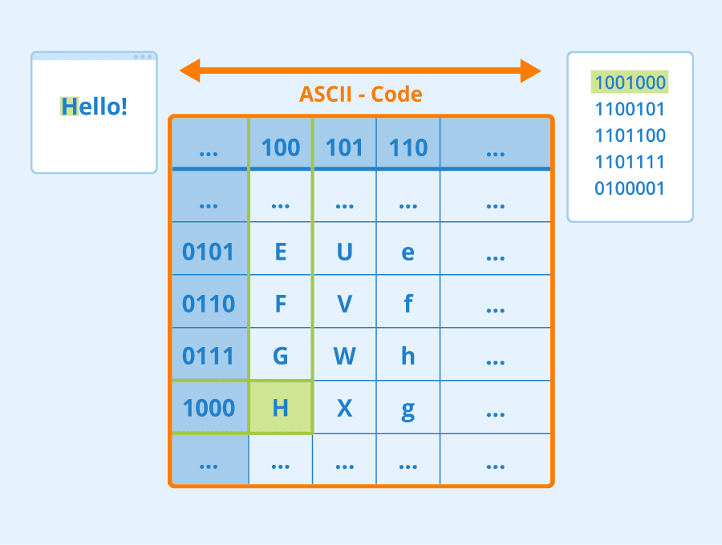

---

## Representación de palabras

- Cada palabra se representa mediante un número.
  - El diccionario será muy grande, porque contendrá una entrada por palabra.
  - El modelo será más sencillo, porque las palabras son unidades semánticas.
  - Ejemplo: si el vocabulario es `["gato", "perro", "caballo", "pájaro", "pez"]`, "gato" puede representarse como $1$ y "caballo" como $3$.

---

## Representación de subpalabras

- Cada subpalabra se representa mediante un número.
  - El diccionario será más pequeño que el de palabras, porque las subpalabras son unidades semánticas.
  - El modelo será más sencillo, porque las subpalabras son unidades semánticas.
    - Permite representar palabras raras o que no están en el vocabulario.
    - Es útil para lenguas con muchas palabras compuestas y derivadas.

---

<style scoped>section { font-size:30.5px; }</style>

## Tokens y tokenización (I)

- Independientemente del enfoque, el texto debe **dividirse** en **tokens**.
  - Ejemplo: "New York in winter" $\rightarrow$ `["New", "York", "in", "winter"]`
- **Token**: unidad mínima de texto que puede considerarse una unidad semántica.
  - Puede ser una palabra, subpalabra, signo de puntuación, número, etc.; cualquier unidad que se elija como unidad mínima.
- **Tokenización**: proceso de dividir un texto en tokens para facilitar su tratamiento y comprensión.
  - Es un proceso **nada trivial**. Depende de la lengua y del ámbito.
    - Ejemplo: ¿"New York" es un token o dos?

---

<style scoped>section { font-size:35px; }</style>

## Tokens y tokenización (II)

- Aspectos que hay que tener en cuenta:
  - **Puntuación**: ¿se considera un token? Puede cambiar la interpretación del texto.
  - **Mayúsculas/minúsculas**: ¿se consideran tokens distintos?
  - **Palabras vacías (stopwords)**: palabras que no aportan información al texto (artículos, preposiciones, etc.).
  - **Idioma y ámbito**: el proceso de tokenización depende del idioma y del ámbito del texto.

---

<style scoped>section { font-size:32.5px; }</style>

## Tokens y tokenización (III)

- N-gramas: secuencias de n tokens consecutivos.
- Algunas palabras tienen significado propio, pero su combinación con otras también puede tenerlo. Ejemplo: "New York".
- Los n-gramas representan estas combinaciones de palabras y amplían el vocabulario con las combinaciones de n tokens que elijamos.
- Bigramas: secuencias de dos tokens consecutivos; trigramas: secuencias de tres tokens consecutivos, etc.
- Problema: el vocabulario y la complejidad del modelo aumentan mucho.

---

<style scoped>section { font-size:34px; }</style>

## Vectorización (I)

- Aunque los tokens son muy útiles, presentan algunos problemas:
  - No son fáciles de manipular para las máquinas.
  - No son fáciles de comparar.
  - No permiten calcular la similitud entre palabras y textos.
- La **vectorización** es el proceso de convertir un texto en un vector numérico.
- Los vectores son más fáciles de manipular y comparar para las máquinas.

---

## Vectorización (II)

- Algunas técnicas de vectorización (*embeddings*):
  - **NNLM**: modelo basado en redes neuronales. El número de dimensiones es fijo.
  - **Word2Vec**: cada palabra es un vector en un espacio semántico. El número de dimensiones es fijo.
  - **FastText**: creado por Facebook. Es similar a Word2Vec, pero permite representar palabras raras y fuera del vocabulario.
  - **GloVe**: modelo basado en NNLM y Word2Vec.

---

<style scoped>section { font-size:28px; }</style>

## Word2Vec

- Se basa en la idea de que las palabras con significados parecidos aparecen en contextos similares.
  - «You shall know a word by the company it keeps» (J. R. Firth, 1957).
- Cuando una palabra **p** aparece en un texto, las palabras cercanas a `p` forman su **contexto**.
- Los distintos contextos de `p` definen su significado.


---

<style scoped>section { font-size:30.6px; }</style>

## Word2Vec (II)

- Para cada palabra obtenemos un vector **denso** y de **longitud fija**.
- Cada dimensión del vector representa un **aspecto semántico** de la palabra.
- Representa su **posición** en un espacio semántico n-dimensional.
- Los vectores de palabras con contextos parecidos estarán próximos en el espacio semántico.

> Facilita el cálculo de la similitud entre palabras.

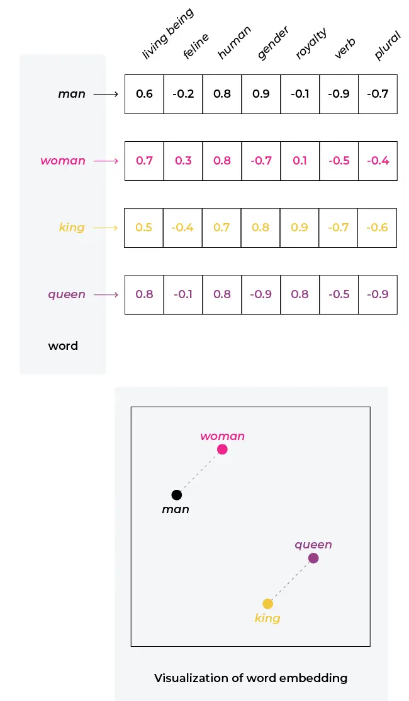

---

<style scoped>section { font-size:31px; }</style>

## Word2Vec (III)

- Los vectores de palabras también se denominan **embeddings** o **representaciones vectoriales**.
- **FastText** es una variante de **Word2Vec** que utiliza subpalabras.
  - Permite representar palabras poco frecuentes o que no están en el vocabulario.
  - Es útil para lenguas con muchas palabras compuestas y derivadas.
- Los _embeddings_ generados pueden utilizarse en muchas tareas, como la clasificación de textos o el análisis de sentimientos.
- Estos modelos necesitan un entrenamiento previo con las palabras del vocabulario. A continuación veremos un ejemplo.

---

<!--
_class: invert lead
-->

<style scoped>
h1, p {
  color: #FFFFFF;
  text-shadow:
    0px 0px 3px #000000;
}
</style>

# Representación de textos

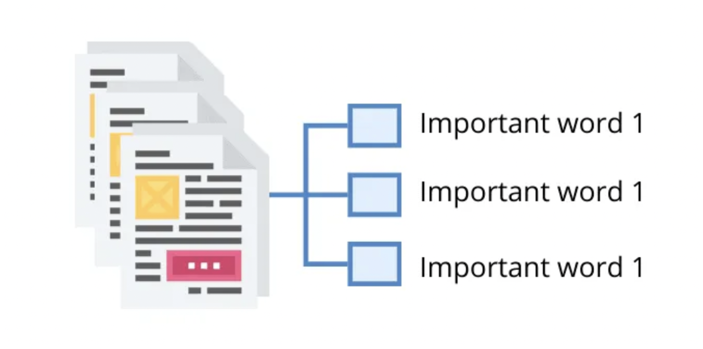

---

<style scoped>section { font-size:30.6px; }</style>

## Representación de textos

- Hasta ahora hemos visto cómo representar palabras. Ahora veremos cómo representar textos para analizar las relaciones entre las palabras que los forman.
- Algunas de las técnicas utilizadas son:
  - **One-hot encoding**: cada token $\rightarrow$ una dimensión; el valor es 1 si el token aparece y 0 si no.
  - **Bag of Words**: modelo basado en frecuencias. El valor de cada celda es el número de apariciones del token en el documento. Es sencillo y muy utilizado.
  - **TF-IDF**: modelo basado en la frecuencia y en la frecuencia inversa.
  - **Word embeddings**: vectorización de palabras con _Word2Vec_, _FastText_, etc.

---

<style scoped>section { font-size:30px; }</style>

### One-hot encoding

- El modelo **one-hot encoding** se basa en tokens.
- Los vectores generados son **dispersos** y **grandes**, porque cada token ocupa una dimensión.
- Cada token ocupa una dimensión y el valor de cada celda es 1 si aparece y 0 si no.
- Los vectores generados son **independientes** de la semántica.
- No facilita el cálculo de la similitud entre palabras y textos.

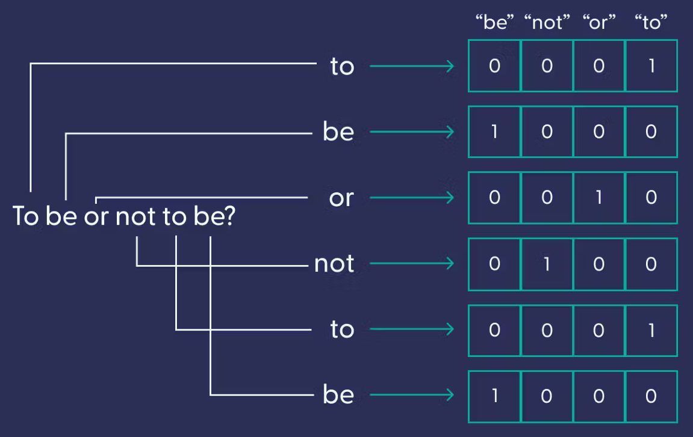

---

<style scoped>section { font-size:31.5px; }</style>

### Bag of Words (BoW)

- El modelo **BoW** se basa en frecuencias.
- Puede entenderse como la suma de los vectores *one-hot*.
- Los vectores generados son **independientes** de la semántica.
- El índice del token puede interpretarse como un **orden**, aunque en muchos casos no representa ningún orden real. Esta discrepancia puede afectar a la calidad del modelo.

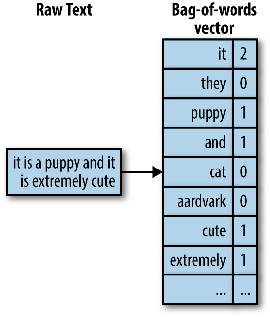

---

<style scoped>section { font-size:33px; }</style>

### TF-IDF

- El modelo **TF-IDF** se basa en la frecuencia y en la frecuencia inversa.
- Es parecido a **BoW**, pero tiene en cuenta la frecuencia del token en el documento y en el conjunto de documentos.
- El valor de cada celda es el producto de la frecuencia del token en el documento por su frecuencia inversa en el conjunto de documentos.
- Da más importancia a los tokens que aparecen en pocos documentos, ya que los que aparecen en muchos suelen aportar menos información.

---

### Word embeddings

- Los _embeddings_ generados por Word2Vec son vectores de _n_ dimensiones.
- Los vectores generados son **densos**, de **longitud fija** y tienen **significado semántico**.
- Para representar un **texto** se puede utilizar la media, el máximo o la suma de los _embeddings_ de las palabras que lo componen.

---

#### Generación de _embeddings_ con Word2Vec y la biblioteca Gensim

```python
from gensim.models import Word2Vec

sentences = [
    ["Gavi", "company", "Pedri"],
    ["Xavi", "entrena", "Barça"],
    ["Gavi", "juga", "Barça"],
    ["Gavi", "chuta"],
    ["Kepa", "para"],
    ["Xavi", "entrena"],
]
model = Word2Vec(sentences, min_count=1)
```

---

#### Visualización de los _embeddings_

```python
gavi = model.wv["Gavi"]
print(gavi)
```

```python
[
    -0.00536227  0.00236431  0.0510335   0.09009273
                                         - 0.0930295 - 0.07116809 0.06458873  0.08972988
                                         - 0.05015428 - 0.03763372
]
```

---

#### Búsqueda de palabras similares

```python
model.wv.most_similar("Gavi")
```

```python
[('Barça', 0.5436005592346191),
 ('Pedri', 0.3792896568775177),
 ('entrena', 0.3004249036312103),
 ('Xavi', 0.10494352877140045),
 ('juga', -0.1311161071062088),
 ('chuta', -0.1897382140159607),
 ('para', -0.22418655455112457),
 ('Kepa', -0.2726020812988281),
 ('company', -0.7287455797195435)]
```

---

<style scoped>section { font-size:32px; }</style>

#### Similitud del coseno

- Los _embeddings_ generados por Word2Vec son vectores de _n_ dimensiones.
- Para calcular la similitud entre dos vectores se utiliza la **similitud del coseno**.
- El resultado es un valor entre -1 y 1.
  - -1: vectores opuestos.
  - 0: vectores ortogonales.
  - 1: vectores iguales.
- Esta medida se utiliza mucho en el procesamiento del lenguaje natural.

---

<!--
_class: invert lead
-->

<style scoped>
h1, h2, h3, h4, h5, h6, p {
  color: #FFFFFF;
  font-weight: 800;
  text-shadow:
    0px 0px 3px #000000;
}
</style>

# Conversión de texto a voz y de voz a texto


---

<style scoped>section { font-size:31.5px; }</style>

## Reconocimiento de voz y transcripción automática

- La **síntesis de voz** y la **transcripción automática** son tareas de **procesamiento del lenguaje natural**.
  - La síntesis de voz consiste en **convertir un archivo de texto en un archivo de audio**.
  - La transcripción automática consiste en **convertir un archivo de audio en un archivo de texto**.
- Ambas son técnicas muy importantes del procesamiento del lenguaje natural, aunque a menudo pasan desapercibidas.
- En este apartado veremos cómo funcionan estas técnicas.

---

<style scoped>section { font-size:31px; }</style>

## Síntesis de voz

- La **síntesis de voz** consiste en **convertir un archivo de texto en un archivo de audio**.
- Esta tecnología ha mejorado mucho en los últimos años gracias a los modelos de lenguaje y las redes neuronales.
- Hay varios enfoques; a continuación veremos los más importantes.


---

### Síntesis de voz: concatenación de sonidos

- Se basa en grabar **sonidos** y **concatenarlos** para formar palabras y frases.
- Se buscan los sonidos más adecuados para cada contexto y se combinan para que suenen lo más naturales posible.
- Requiere muchos datos y tiene dificultades para adaptarse a contextos nuevos.

---

### Síntesis de voz basada en formantes

- Los **formantes** son las **frecuencias** características de la voz.
- Se ajustan los formantes para representar distintos sonidos y se combinan para formar palabras y frases.
- La síntesis por formantes permite obtener voces claras y precisas.
- Requiere menos datos que la concatenación de sonidos, pero produce voces menos naturales y expresivas.

---

### Síntesis de voz basada en unidades

- Se basa en sintetizar **unidades** menores que las palabras, como **fonemas** o **diptongos**.
  - Estas unidades se almacenan en una base de datos y se combinan dinámicamente según el texto.
  - La síntesis por unidades permite obtener voces más naturales y expresivas.
  - Requiere menos datos que la síntesis por concatenación de sonidos.

---

<style scoped>section { font-size:32px; }</style>

### Síntesis de voz con redes neuronales (I)

- Las redes neuronales pueden sintetizar voz a partir de texto.
- Estas redes se entrenan con grandes cantidades de datos de voz y texto, y pueden generar voces muy naturales.
- Se utilizan redes neuronales recurrentes (RNN) específicas, como LSTM o GRU, y modelos más recientes, como los Transformers.
- Estas redes pueden generar voces muy naturales y expresivas si disponen de suficientes datos de entrenamiento y capacidad de procesamiento.

---

<style scoped>section { font-size:31.5px; }</style>

### Síntesis de voz con redes neuronales (II)

- Estos modelos utilizan espectrogramas de voz, que representan la señal en función del tiempo y la frecuencia.

- Funcionan en cuatro etapas:
  - **Etapa de secuencia a secuencia**: el texto se convierte en una secuencia de vectores.
  - **Etapa de secuencia a espectrograma**: los vectores se convierten en espectrogramas.
  - **Etapa de síntesis**: los espectrogramas se convierten en voz.
  - **Etapa de posprocesamiento**: se mejora la calidad de la voz.

---

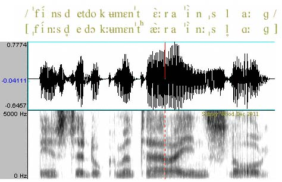

---

## Transcripción automática

- En la actualidad, el **reconocimiento de voz** es una tarea **muy madura**.
- Asistentes virtuales como **Siri**, **Alexa** o **Google Assistant** reconocen voz con gran precisión.
- Para implementar un sistema de reconocimiento de voz podemos utilizar herramientas como **Google Cloud Speech-to-Text** o **IBM Watson Speech to Text**.
- Estas herramientas se basan en técnicas similares a las que hemos visto para la síntesis de voz.

---

<style scoped>section { font-size:31px; }</style>

### Modelos de reconocimiento de voz y transcripción automática

- Los modelos de reconocimiento de voz y transcripción automática son modelos de **secuencia a secuencia**.
- Estos modelos pueden convertir una secuencia de entrada en una secuencia de salida.
- Algunos de los modelos más conocidos son:
  - **Whisper**: modelo de reconocimiento de voz de **OpenAI**.
  - **DeepSpeech**: modelo de reconocimiento de voz de **Mozilla**.
  - **Hugging Face Speech2Text**: modelo de reconocimiento de voz.
  - **Bark**: modelo de generación de voz de **Suno Labs**.

---

<!--
_class: invert lead
-->

<style scoped>
h1, p {
  color: #FFFFFF;
  text-shadow:
    0px 0px 3px #000000;
}
</style>

# Similitud entre textos

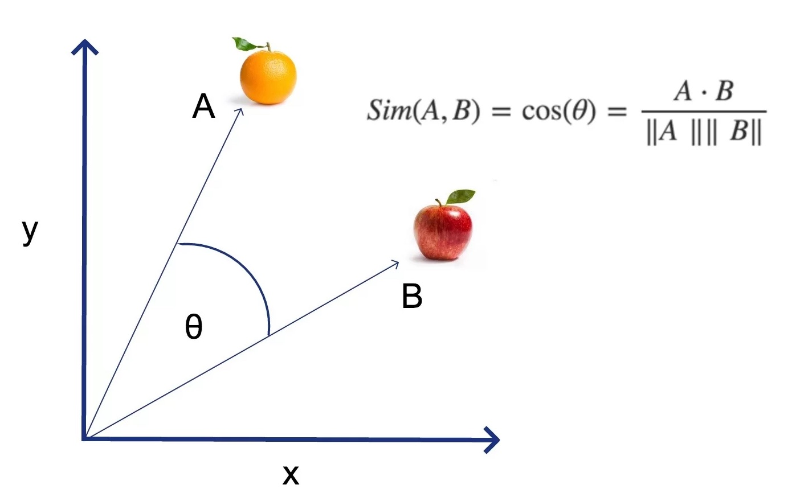

---

## Similitud entre textos

- La similitud entre textos mide cuánto se parecen dos textos.
- Es una de las funciones más evidentes del procesamiento del lenguaje natural.
- Sin embargo, calcular la similitud entre textos es una tarea **difícil**.
- Veamos algunas de las técnicas más utilizadas.

---

<style scoped>section { font-size:31px; }</style>

### Técnicas para calcular la similitud entre textos (I)

- **Basadas en reglas**: utilizan reglas predefinidas; son fáciles de implementar y útiles para casos sencillos.
  - **Distancia de Levenshtein**: número mínimo de operaciones necesarias para transformar una cadena en otra.
  - **Distancia de Hamming**: número de posiciones en las que difieren dos cadenas de la misma longitud.
  - **Recuento de palabras**: número de palabras comunes entre dos textos.
  - **Distancia de Jaccard**: número de palabras comunes en dos textos dividido por el total de palabras distintas de ambos textos.

---

<style scoped>section { font-size:31px; }</style>

### Técnicas para calcular la similitud entre textos (II)

- **Basadas en características sintácticas**: utilizan las características sintácticas y gramaticales de los textos. Requieren **analizarlos sintácticamente** para estudiar su estructura.
- **Basadas en características semánticas**: utilizan el significado de los textos. Modelos como Word2Vec son útiles porque representan el significado contextual de las palabras.
  - **Word Mover's Distance**: mide la distancia entre dos textos a partir de las distancias entre los vectores de sus palabras.
  - **Similitud del coseno**: utiliza el coseno del ángulo entre los vectores.

---

<style scoped>section { font-size:33px; }</style>

### Técnicas para calcular la similitud entre textos (III)

- **Basadas en aprendizaje automático**: utilizan técnicas de aprendizaje automático para calcular la similitud entre textos.
  - **BERT y GPT**: modelos de lenguaje basados en redes neuronales que pueden utilizarse para calcular la similitud entre textos.
  - **Universal Sentence Encoder**: modelo entrenado específicamente para el _transfer learning_ (transferencia del aprendizaje de una tarea a otra).

---

### Aplicaciones de la similitud entre textos

- **Corrección ortográfica**: para corregir una palabra se busca la más parecida.
- **Clasificación de textos**: para clasificar un texto se busca el texto más parecido.
- **Agrupamiento de textos**: permite agrupar textos similares en *clusters*.
- **Búsqueda de respuestas**: para responder una pregunta se buscan textos parecidos a ella.

---

<style scoped>section { font-size:30.5px; }</style>

### Word embeddings

- Las técnicas clásicas de PLN se basan en representaciones no semánticas, como BoW o TF-IDF.
- Las técnicas modernas utilizan modelos de lenguaje (LM) y *word embeddings*.
- Como hemos visto, los _embeddings_ de Word2Vec son vectores de _n_ dimensiones.
- Para representar un texto se puede utilizar la media de los _embeddings_ de sus palabras.
- Los vectores generados son **densos**, de **longitud fija** y tienen **significado semántico**.
- Esto facilita calcular la similitud entre palabras y textos.

---

### LLM (modelos de lenguaje)

- Los **LLM** son modelos complejos basados en redes neuronales recurrentes y en la arquitectura **Transformer**.
- Pueden aprender la semántica del texto y generar sus propios _embeddings_ mediante el mecanismo de **atención**.
- Ofrecen un gran rendimiento en muchas tareas, como calcular la similitud entre textos.
- Son complejos y necesitan entrenarse previamente con grandes cantidades de datos.

---

<!--
_class: invert lead
-->

<style scoped>
h1, p {
  color: #FFFFFF;
  text-shadow:
    0px 0px 3px #000000;
}
</style>

# Clasificación de textos y análisis de sentimientos

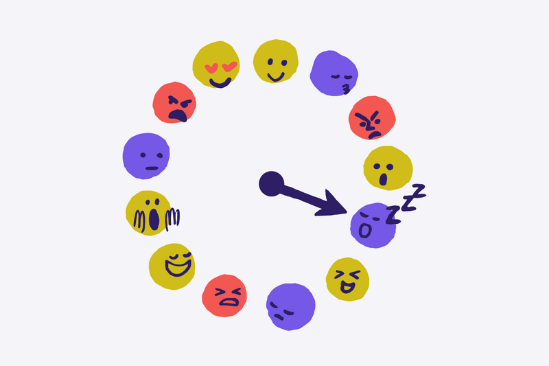

---

## Análisis de sentimientos

- El análisis de sentimientos es un tipo de clasificación y una de las tareas más habituales del procesamiento del lenguaje natural.
- Su objetivo es determinar la actitud de un autor respecto a un tema o producto.
- Se basa en la **polaridad** del texto, que puede ser **positiva**, **negativa** o **neutra**.
- También se pueden detectar emociones concretas, como la **alegría**, la **tristeza** o la **ira**.

---

<style scoped>section { font-size:34px; }</style>

## Análisis subjetivo y objetivo

- El análisis de sentimientos puede ser **subjetivo** u **objetivo**.
- El análisis subjetivo busca las **emociones y sentimientos** del autor.
- El análisis objetivo se basa en **hechos y datos concretos**.
- Ambos tipos de análisis son **complementarios** y pueden combinarse.
- Ejemplo: «_La película tiene grandes momentos, pero el final es muy triste_».
  - Análisis subjetivo: «_La película es buena_».
  - Análisis objetivo: «_El final es triste_».

---

<style scoped>section { font-size:30.5px; }</style>

## Preprocesamiento del texto

- El **preprocesamiento** del texto ayuda a obtener buenos resultados en PLN.
- Permite reducir la **dimensionalidad** del texto, eliminar ruido y capturar información semántica.
- Algunas de las técnicas más utilizadas son:
  - **Tokenización**: vista anteriormente.
  - **Normalización**: convertir el texto a un formato estándar.
  - **Eliminación de palabras vacías**: retirar palabras que no aportan información.
  - **Stemming** y **lematización**: convertir las palabras a su forma base.
  - **Gestión de negaciones y modalidades**: normalizar estos fenómenos lingüísticos.

---

### Preprocesamiento: tokenización

- Como hemos visto, la tokenización consiste en dividir un texto en tokens.
- Los tokens pueden ser palabras, subpalabras, signos de puntuación, etc.
- Facilita un análisis más profundo del texto y la extracción de características relevantes.
- Ejemplo: "El Barça está en crisis" $\rightarrow$ `["El", "Barça", "está", "en", "crisis"]`.

---

<style scoped>section { font-size:34px; }</style>

### Preprocesamiento: normalización

- La **normalización** consiste en eliminar los elementos que no aportan información.
  - Números, signos de puntuación, etc.
- También implica convertir el texto a un formato estándar, pasando a minúsculas y eliminando espacios innecesarios, por ejemplo.
  - Ejemplo: "El Barça está en crisis! 😡" $\rightarrow$ "el Barça está en crisis".
- La normalización facilita la comparación entre textos y la detección de palabras clave.

---

### Preprocesamiento: eliminación de palabras vacías

- Las **palabras vacías (stopwords)** son palabras que no aportan información al texto.
- Son palabras muy comunes en un idioma, como artículos y preposiciones.
- Al retirar las palabras vacías, los textos son más sencillos y rápidos de procesar.
- Ejemplo: "El Barça está en crisis" $\rightarrow$ `["Barça", "crisis"]`.

---

<style scoped>section { font-size:34px; }</style>

### Preprocesamiento: *stemming* y lematización

- El **stemming** y la **lematización** convierten las palabras a su forma base para facilitar la agrupación de términos relacionados.
- El **stemming** es un proceso heurístico basado en reglas, mientras que la **lematización** se apoya en conocimientos lingüísticos.
  - Ejemplo de *stemming*: "jugar", "jugaré", "jugará" $\rightarrow$ "jug".
  - Ejemplo de lematización: "jugar", "jugaré", "jugará" $\rightarrow$ "jugar".
- El *stemming* es más rápido, pero la lematización es más precisa.

---

### Preprocesamiento: negaciones y modalidades

- Las **negaciones** y las **modalidades** pueden cambiar el significado de una frase.
- Ejemplos: _"El Barça no está en crisis"_, _"El Barça puede estar en crisis"_, _"Deberías ir al estadio"_.
- Los modelos de PLN no pueden interpretar estas frases correctamente sin un tratamiento previo.
- Necesitamos técnicas específicas, como detectar **dobles negaciones** y **reasignar la polaridad**.

---

## Enfoques para el análisis de sentimientos

- Como en otras tareas de PLN, el análisis de sentimientos puede abordarse con distintos enfoques.
- Los enfoques más utilizados son:
  - Basados en **reglas**
  - Basados en el **aprendizaje automático supervisado**
  - Basados en el **aprendizaje automático no supervisado**

---

### Enfoque basado en reglas

- Los enfoques basados en reglas son los más sencillos y rápidos.
- También se denominan **basados en léxico** (*lexicon-based*).
- Utilizan listas de palabras para determinar la polaridad del texto.
- Se consulta la polaridad de cada palabra en la lista y se suman los valores.
  - _"El Barça está en crisis"_. _"crisis"_ $\rightarrow$ **-1** $\rightarrow$ **negativo**.
  - _"Me hace ilusión ir al estadio"_. _"ilusión"_ $\rightarrow$ **1** $\rightarrow$ **positivo**.
  - _"El partido terminó en empate"_. _"empate"_ $\rightarrow$ **0** $\rightarrow$ **neutro**.

---

### Enfoque basado en aprendizaje automático supervisado

- Los enfoques basados en aprendizaje automático supervisado son de los más utilizados.
- Consisten en entrenar un modelo con un conjunto de datos etiquetados según la polaridad del texto.
- El modelo identifica los patrones del texto que determinan su polaridad.
- Algunos modelos habituales son: **Naive Bayes**, **Support Vector Machines**, **Random Forest** y **redes neuronales**.

---

<style scoped>section { font-size:34px; }</style>

### Enfoque basado en aprendizaje automático no supervisado

- Los enfoques no supervisados identifican patrones en el texto sin necesitar etiquetas previas.
- Se pueden utilizar técnicas como el **agrupamiento** para agrupar los textos en *clusters* según su polaridad.
- Una vez agrupados, los *clusters* se pueden etiquetar manualmente.
- Estas técnicas ayudan a detectar patrones y agrupar textos parecidos según la distancia entre ellos.

---

<style scoped>section { font-size:33px; }</style>

## Modelos para el análisis de sentimientos

Algunos de los modelos más utilizados para el análisis de sentimientos son:

- **BoW** + clasificador: modelo basado en BoW y un clasificador.
- **Embeddings** + clasificador: Word2Vec, FastText, etc.
- **VADER**: modelo basado en reglas, muy utilizado en inglés.
- **Transformers**: modelos muy potentes para PLN. Uno de los más utilizados es **BERT**, cuya implementación utilizaremos en la segunda práctica.

---

## Redes neuronales para el análisis de sentimientos

- Las redes neuronales son uno de los modelos más utilizados para el análisis de sentimientos.
- Las redes neuronales pueden aprender los patrones del texto y generar sus propios _embeddings_.

---

<!--
_class: invert lead
-->

<style scoped>
h1, p {
  color: #FFFFFF;
  text-shadow:
    0px 0px 3px #000000;
}
</style>

# Modelos de lenguaje


---

## Modelos de lenguaje

- Hasta ahora hemos visto cómo representar texto y realizar tareas como el análisis de sentimientos.
- Hemos visto que los modelos de lenguaje son herramientas potentes que pueden utilizarse en muchas tareas.
- En esta sección veremos qué son los modelos de lenguaje y cómo funcionan.
- También conoceremos algunos de los más utilizados y sus aplicaciones.

---

<style scoped>section { font-size:31px; }</style>

## Aplicaciones de los modelos de lenguaje

- Es uno de los campos más activos y complejos de la IA.
- Son la base de muchas aplicaciones de PLN, como:
  - **Traducción automática**: traducir un texto de un idioma a otro.
  - **Reconocimiento de voz**: transcribir el contenido de un archivo de audio.
  - **Síntesis de voz**: generar un archivo de audio a partir de un texto.
  - **Generación y resumen de texto**: generar o resumir textos a partir de un contexto.
  - **Análisis de sentimientos**: determinar la polaridad de un texto.
  - **Clasificación de texto**: asignar un texto a una categoría.
  - **Generación de textos**: crear textos a partir de un tema o un estilo.

---

<style scoped>section { font-size:30px; }</style>

### Definición

- Un **modelo de lenguaje** asigna una probabilidad a una secuencia de palabras.
  - Por tanto, permite predecir la siguiente palabra de una secuencia.
  - Ejemplo: "El Barça está en \_\_\_" $\rightarrow$ `[{crisis: 0.8}, {forma: 0.1}, {casa: 0.1}]`
- Se basan en la idea de que las palabras de una secuencia no son independientes, sino que dependen de las anteriores.
- Permiten calcular la **probabilidad** de una secuencia de palabras.
  - Esto no es lo mismo que la **corrección** de una secuencia de palabras.
  - El objetivo es modelar el lenguaje humano, con sus **matices y ambigüedades**.

---

## Historia: modelos basados en reglas

- Los modelos de lenguaje son uno de los campos más antiguos del procesamiento del lenguaje natural.
- Se basan en reglas gramaticales y lingüísticas para definir las características del lenguaje.
- Las reglas las definen expertos y son difíciles de modificar.
- No son flexibles y no se adaptan a contextos nuevos.
- Ejemplos: gramática de Chomsky, gramática de Montague, etc.

---

<style scoped>section { font-size:30.6px; }</style>

## Historia: modelos estocásticos

- Los modelos basados en reglas fueron sustituidos por modelos **estadísticos**, más flexibles y capaces de modelar mejor el lenguaje. Los modelos de Markov fueron los primeros en obtener resultados aceptables.
- Se basan en la idea de que las palabras de una secuencia no son independientes, sino que dependen de las anteriores. Algunos ejemplos:
  - **N-grama**: modela cada palabra en función de las n palabras anteriores (uni-, bi-, trigramas, etc.).
  - **Skip-gram**: modela cada palabra en función de las n palabras anteriores y posteriores.
  - **Basados en sintaxis**: utilizan la estructura sintáctica de las frases y no solo su secuencia.

---

<style scoped>section { font-size:30px; }</style>

## Historia: RNN

- Los modelos estadísticos fueron sustituidos por modelos basados en **redes neuronales**.
- Los primeros modelos de este tipo fueron las **RNN** (redes neuronales recurrentes).
  - A diferencia de las redes neuronales tradicionales, las RNN tienen **memoria**.
  - La entrada de una neurona puede depender de su propia salida.
  - Permiten procesar secuencias de longitud variable.
  - Los modelos de lenguaje basados en RNN fueron los primeros en obtener resultados aceptables.

---

<style scoped>section { font-size:30px; }</style>

## Historia: LLM

- Los modelos basados en RNN fueron sustituidos por modelos basados en **Transformers**.
- Los Transformers son modelos neuronales que utilizan el mecanismo de **atención**.
  - Son más potentes que las RNN y ofrecen mejores resultados.
  - Son los modelos más utilizados actualmente.
  - Necesitan entrenarse previamente con un gran volumen de datos (*corpus*).
  - Pueden captar el contexto, la semántica y la sintaxis del texto.

---

## Historia: LLM (II)

- El mecanismo de atención permite a las redes neuronales aprender a **centrarse** en las partes importantes de sus entradas.
- Es un mecanismo que imita el comportamiento humano.
- Podemos entenderlo como una **capa** que se añade a una red neuronal.
- Los Transformers utilizan una variante del mecanismo de atención llamada **self-attention**.

---

<!--
_class: invert lead
-->

<style scoped>
h1, p {
  color: #FFFFFF;
  text-shadow:
    0px 0px 3px #000000;
}
</style>

# Arquitecturas para el PLN

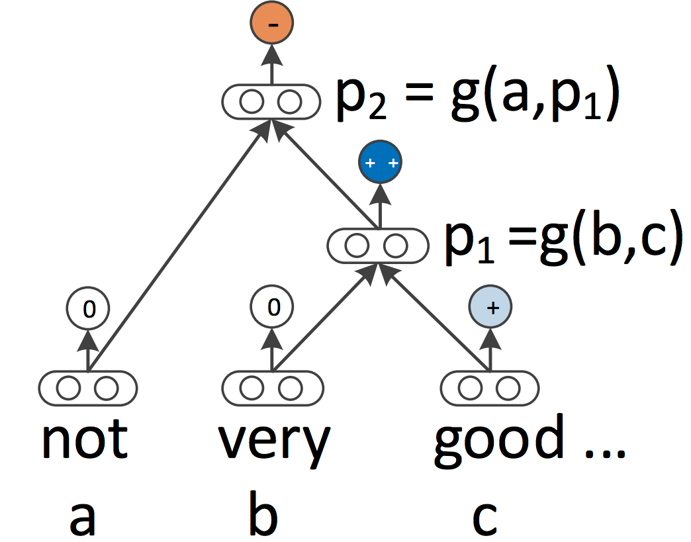

---

<style scoped>section { font-size:30px; }</style>

## Cadenas de Markov

- Los **modelos ocultos de Markov** (HMM) son modelos estocásticos que permiten modelar secuencias de palabras.

- Se basan en la idea de que las palabras de una secuencia no son independientes, sino que dependen de las anteriores.

- Los HMM pueden modelar la probabilidad de transición entre palabras.

- Su principal desventaja es que no pueden modelar dependencias a largo plazo.

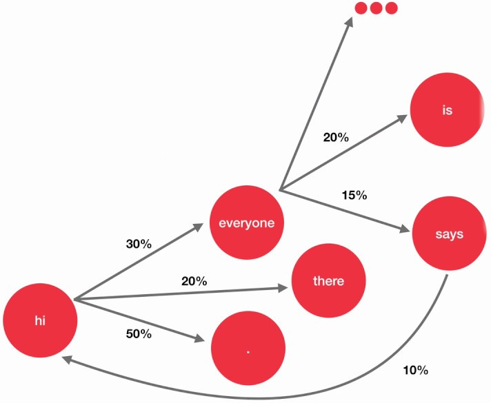

---

## Redes neuronales recurrentes (RNN)

- Como hemos comentado, las redes neuronales recurrentes (RNN) pueden procesar secuencias de longitud variable de forma eficiente.

- En esta sección veremos con más detalle cómo funcionan las RNN y cómo se utilizan en PLN.

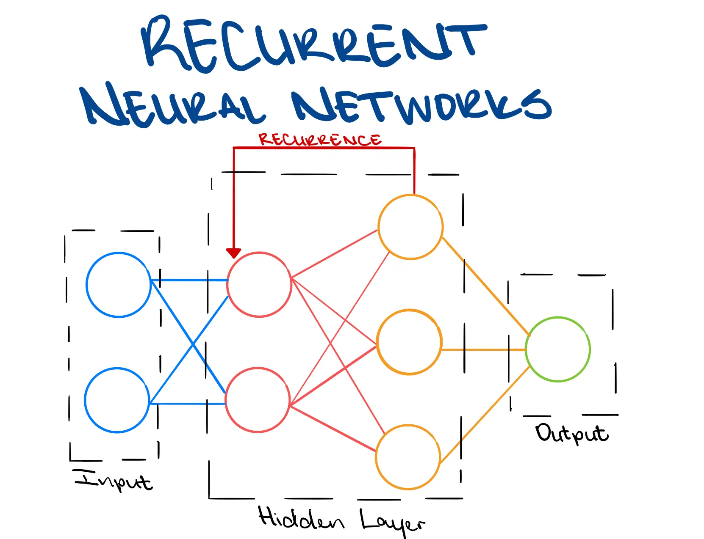

---

### Memoria

- La principal característica de las RNN es que tienen **memoria**.
- ¿Cómo se consigue esta memoria?
  - La salida de una neurona puede depender de su **propia salida**.
  - Esto permite procesar información en la misma capa, sin añadir otra.
  - Aparece un nuevo problema: el **desvanecimiento del gradiente**. ¿Qué información se conserva y cuál se pierde?
  - Por eso se han desarrollado distintas arquitecturas a lo largo del tiempo.

---

### Redes recurrentes tradicionales (I)

- La salida de una neurona puede depender de su propia salida.
- Cada neurona tiene dos entradas: el **valor actual** y el **valor anterior**.
- Esta memoria es, por naturaleza, de corta duración.
- Para facilitar su comprensión, suelen mostrarse **desplegadas**, como veremos a continuación.
- Mejoran los modelos ocultos de Markov, pero son vulnerables al desvanecimiento del gradiente.

---

### Redes recurrentes tradicionales (II)

- En las RNN, la memoria se mantiene en la capa oculta.
- El esquema siguiente muestra una RNN sin desplegar.

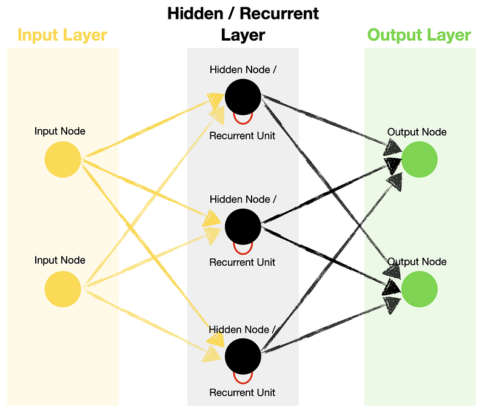

---

<style scoped>section { font-size:26px; }</style>

<!-- _footer: "" -->

### Redes recurrentes tradicionales (III)

- El esquema representa tres pasos temporales.
- Solo hay un nodo de entrada, pero como se necesitan tres pasos temporales, hay que proporcionarle tres valores de entrada.
- En las neuronas recurrentes se entrenan tres valores: el peso de entrada, el peso recurrente y el sesgo.

## 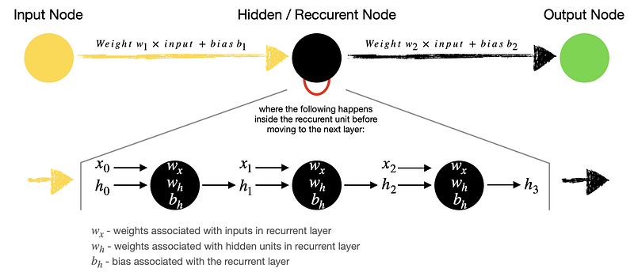

---

### LSTM (Long Short-Term Memory) (I)

- Las **LSTM** mejoran las RNN tradicionales mediante una **memoria a largo plazo**.
- Tienen una **memoria interna** que puede conservarse, **modificarse** o **eliminarse** según sea necesario.
- **Reducen el desvanecimiento** del gradiente, **aunque son más complejas y costosas** de procesar.
- Cada celda LSTM equivale a cuatro capas de una RNN tradicional.

---

### LSTM (Long Short-Term Memory) (II)

- El estado interno de la celda se controla mediante **puertas**.
- Las LSTM tienen tres puertas:
  - **Puerta de olvido**: si se activa, la celda descarta información anterior.
  - **Puerta de entrada**: si se activa, la celda incorpora información nueva.
  - **Puerta de salida**: si se activa, la celda genera una salida.
- Estas puertas permiten a la LSTM conservar la información importante y descartar la que no lo es.

---

### LSTM (Long Short-Term Memory) (III)

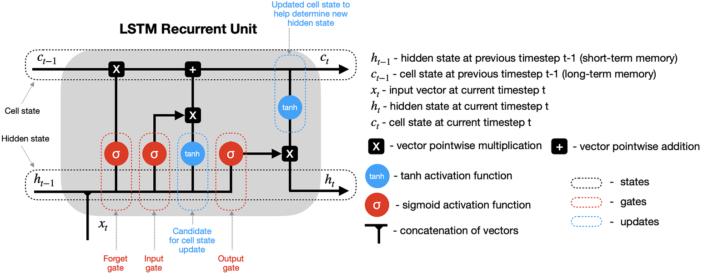

---

### GRU (Gated Recurrent Unit)

- Las GRU son otra mejora de las RNN tradicionales e incorporan memoria a largo plazo.
- No tienen una memoria interna como las LSTM, pero son más sencillas y rápidas de procesar.
- Tienen dos puertas: actualización y reinicio. Juntas determinan cuánta información se conserva y cuánta se descarta.
- Reducen el desvanecimiento del gradiente sin ser tan complejas como las LSTM.

---

### GRU (Gated Recurrent Unit) (II)

- Las GRU tienen dos puertas: **puerta de actualización** y **puerta de reinicio**.
- Si se activa la puerta de reinicio, la celda olvida la información anterior.
- Si se activa la puerta de actualización, la salida incorpora información nueva.
  - Esta información puede ser la anterior o una combinación de información nueva y anterior. La posibilidad de conservar información previa explica por qué las GRU no tienen una memoria interna como las LSTM.
- El efecto es similar al de las LSTM, pero con menos complejidad.

---

### GRU (Gated Recurrent Unit) (III)

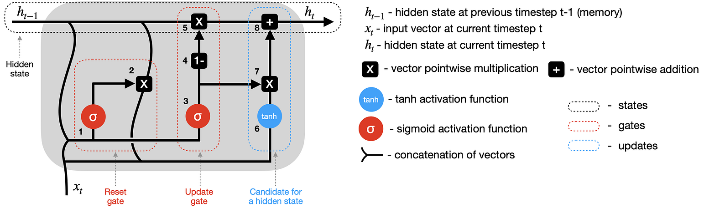

---

<!--
_class: invert lead
-->

<style scoped>
h1, h2, h3, h4, h5, h6, p {
  color: #FFFFFF;
  font-weight: 800;
  text-shadow:
    0px 0px 3px #000000;
}
</style>

## Transformers


---

### Introducción

- Como hemos comentado, los **Transformers** son modelos neuronales que utilizan el mecanismo de **atención**.
- Actualmente son los modelos más utilizados en el procesamiento del lenguaje natural.
- Su arquitectura permite obtener mejores resultados que los modelos anteriores y aprovechar el **paralelismo** y las **GPU**.
- Por su complejidad, vamos a estudiarlos con más detalle.

---

### Origen

- Los Transformers fueron presentados por **Vaswani et al.** en 2017.
  - El artículo original se titula «_Attention Is All You Need_».
- Se diseñaron para mejorar el rendimiento de los modelos de lenguaje.
- Su primer uso fue la traducción automática.
- Este trabajo situó la atención en el centro del procesamiento del lenguaje natural.

---

### Arquitectura de los Transformers (I)

- Los Transformers son modelos modernos y complejos.
- Sin embargo, es más fácil entenderlos si analizamos sus partes por separado.
- Veamos sus componentes principales y cómo funcionan.

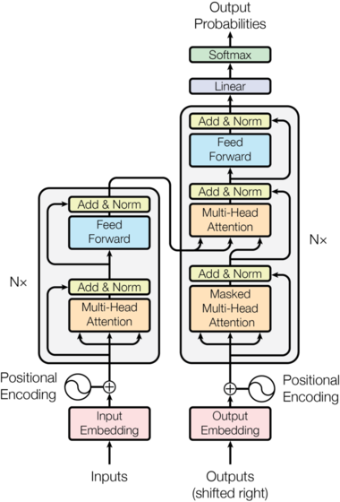

---

<style scoped>section { font-size:33px; }</style>

### Arquitectura de los Transformers (II)

- Desde fuera, los Transformers funcionan como una caja negra.
- Reciben un texto como entrada y generan otro como salida.
- Su complejidad está en su arquitectura interna.
- Los Transformers tienen _dos_ componentes principales: **codificadores** (*encoders*) y **decodificadores** (*decoders*).

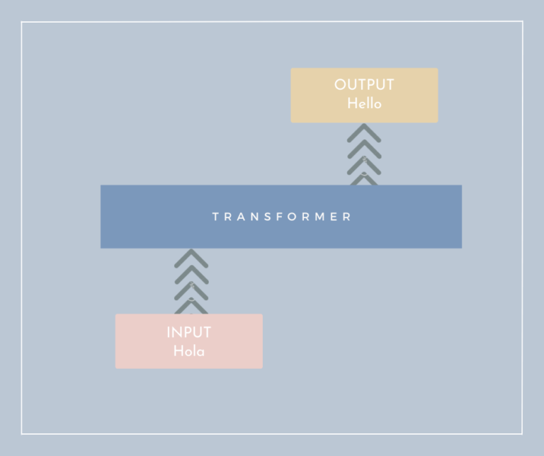

---

<style scoped>section { font-size:33px; }</style>

### Arquitectura de los Transformers (III)

- La entrada pasa por una serie de capas de codificadores.
- A continuación, la salida de los codificadores pasa por una serie de capas de decodificadores.
- El artículo original utiliza **6 capas de codificadores y 6 de decodificadores**.
- También podemos proporcionar un **objetivo** (*target*) como entrada **durante el entrenamiento**.

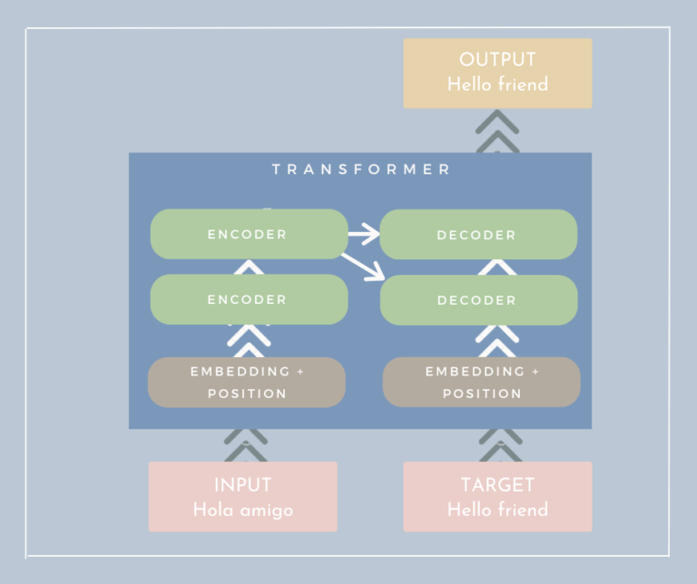

---

<style scoped>section { font-size:30px; }</style>

### Codificadores y decodificadores

- Los **codificadores** y **decodificadores** son los componentes principales de los Transformers.
- Internamente son parecidos y comparten muchas características.
  - Tienen una o más capas de **atención** y una capa **feed-forward** como salida.
- La diferencia principal es que los **codificadores** tienen una capa de atención, mientras que los **decodificadores** tienen dos.

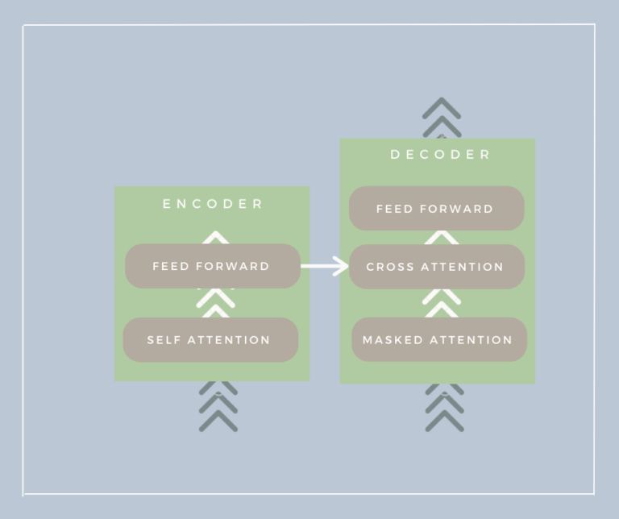

---

<style scoped>section { font-size:30px; }</style>

### Embeddings y posiciones

- Los Transformers utilizan **embeddings** para representar las palabras (de 512 dimensiones en el artículo original).
- También utilizan la **codificación posicional** (*positional encoding*) para representar la posición de las palabras en la secuencia.
  - Es básicamente una función sinusoidal que varía según la posición; por eso, el mismo vector cambia ligeramente en distintas posiciones.
  - $$PE_{(pos, 2i)} = \sin(pos / 10000^{2i/d_{model}})$$
- Esta codificación conserva la información posicional y permite **enviar todos los tokens a la red al mismo tiempo**.

---

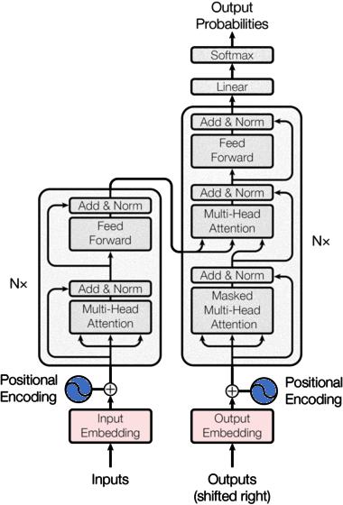

---

<style scoped>section { font-size:30px; }</style>

### Codificador

- Los **codificadores** se componen de tres capas:
  - **Self-attention**: calcula la importancia de cada palabra de la secuencia. A continuación veremos cómo funciona.
  - **Feed-forward**: procesa la información obtenida mediante la atención.
  - **Normalización y conexiones residuales**: ayudan a evitar el desvanecimiento del gradiente y facilitan el entrenamiento.

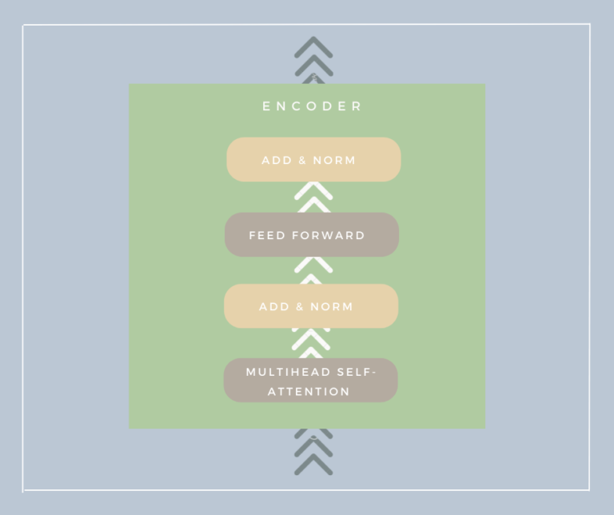

---

<style scoped>section { font-size:31px; }</style>

### Self-attention (I)

- **Self-attention** es el mecanismo clave de los Transformers.
- Permite que la red se «centre» en las partes importantes de la secuencia.
  - Ejemplo: en la frase _"El gato gris va a la casa"_, sabemos que $gris$ y $gato$ están relacionados. ¿Cómo puede saberlo la red?
- Los Transformers crean una especie de «**diccionario suave**» de atención entre las palabras de la secuencia. Así, la atención de $gris$ hacia $gato$ podría ser $1$ y hacia $casa$, $-1$.
- Que el diccionario sea «suave» significa que puede ir cambiando.
  - En la frase «El gato va a la casa gris», la atención de $gris$ hacia $casa$ sería $1$.

---

<style scoped>section { font-size:34px; }</style>

### Self-attention (II)

- Para calcular la atención se generan tres matrices a partir de la secuencia de entrada: **Q** (*query*), **K** (*key*) y **V** (*value*).
- **Q** y **K** representan la secuencia de entrada, mientras que **V** representa el valor de cada palabra.
- Para obtener la atención, multiplicamos **Q** por la transpuesta de **K**.
  - Así obtenemos la similitud entre palabras.
- Multiplicamos el resultado por los valores de **V**.
  - Así obtenemos la matriz de atención.

---

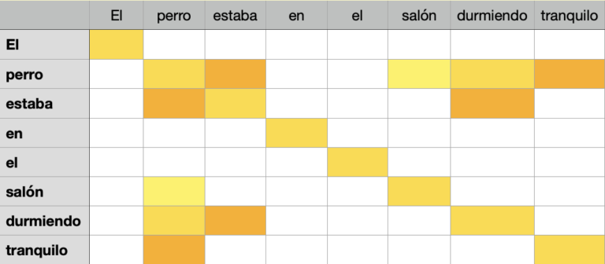

---

<style scoped>section { font-size:32px; }</style>

### Self-attention (III)

- Los Transformers utilizan **atención multicabeza** (*multi-head attention*).
- Esta técnica calcula la atención con distintos grupos de dimensiones.
- El artículo original utiliza **8** cabezas de atención.
- Se combinan los resultados y, según diversos estudios, la representación obtenida es más significativa.
- El cálculo de la atención se paraleliza y acelera mediante la GPU (multiplicación de matrices), por lo que puede ser muy rápido.

---

<style scoped>section { font-size:31px; }</style>

### Otros tipos de atención

- Además de **self-attention**, los Transformers utilizan otros tipos de atención:
  - **Cross-attention**: el decodificador utiliza como entrada las salidas del codificador, que le proporciona información contextual.
  - **Atención enmascarada** (*masked attention*): el decodificador no puede utilizar palabras futuras para calcular la atención. Así se evita que el modelo «mire al futuro».

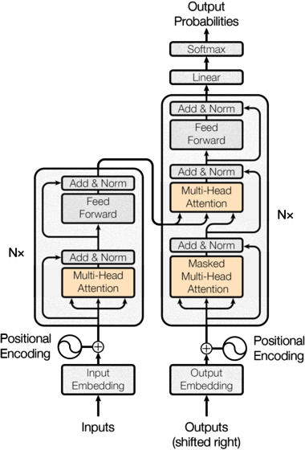

---

<style scoped>section { font-size:35px; }</style>

### Normalización y conexiones residuales

- Las conexiones residuales ayudan a evitar el desvanecimiento del gradiente.
  - Este problema aparece en redes muy profundas.
  - Las conexiones residuales permiten conservar los valores de entrada en las capas posteriores.
- La normalización mantiene los valores de entrada dentro de un rango determinado.
  - Esto facilita el entrenamiento y mejora el rendimiento.

---

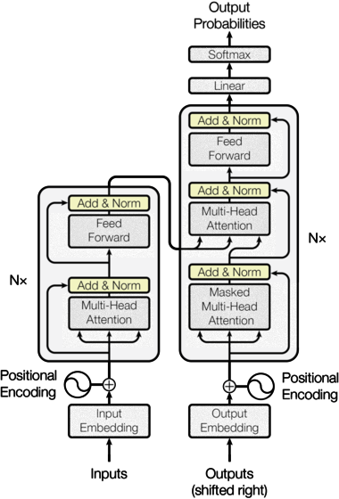

---

<style scoped>section { font-size:32px; }</style>

### Feed-forward

- La capa **feed-forward** es una capa neuronal convencional.
- Su función es procesar la información obtenida mediante la atención.
- Incluye dos capas de *dropout* para evitar el sobreajuste (*overfitting*) y una función de activación no lineal (ReLU en el artículo original).

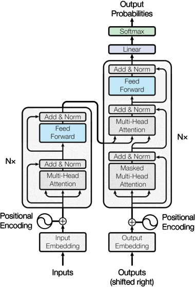

---

<style scoped>section { font-size:33px; }</style>

### Decodificador

- Los **decodificadores** son muy parecidos a los **codificadores**.
- En muchos modelos, durante el entrenamiento utilizamos la salida esperada para validar el resultado.
- En cambio, en los modelos de lenguaje el **objetivo** (*target*) se proporciona como entrada durante el entrenamiento.
- Así el modelo aprende a generar el texto de salida.

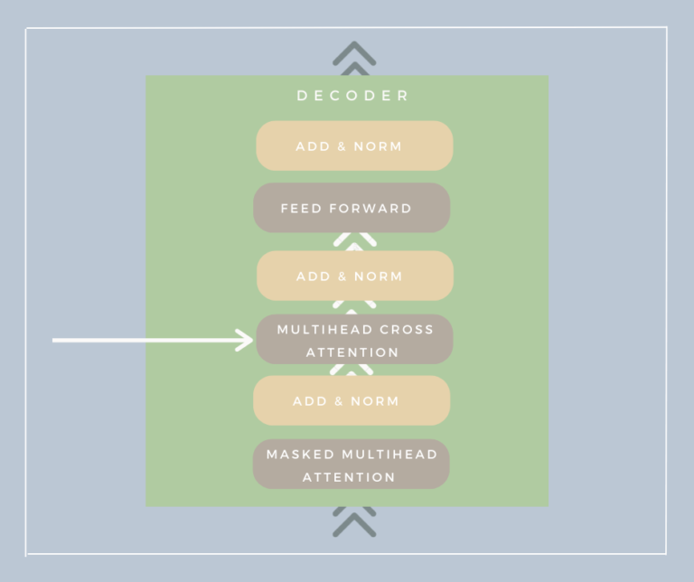

---

### Salida final del modelo

- Recordemos que se utilizan varias capas de codificadores y decodificadores.
- La salida de la última capa del decodificador pasa por una capa **softmax**.
- Esta salida es un vector cuya longitud coincide con el número de palabras del vocabulario.
- Cada elemento del vector representa la probabilidad de una palabra del vocabulario (entre 0 y 1).
- La palabra con mayor probabilidad será la siguiente palabra generada.

---

<style scoped>section { font-size:30px; }</style>

### Aplicaciones de los Transformers

- Se utilizan en muchas tareas de PLN y también en otros ámbitos, por ejemplo:

  - **Visión por computador**: se utilizan para clasificar imágenes, entre otras tareas. _Vision Transformer (ViT)_.
  - **Series temporales**: las secuencias de palabras se parecen a las secuencias de eventos a lo largo del tiempo.
  - **Modelos generativos**: se utilizan para generar textos, imágenes, etc.
  - **Aprendizaje por refuerzo**: se utilizan para entrenar agentes en entornos complejos.

- Estos usos los convierten en herramientas muy potentes, capaces de sustituir algunos modelos actuales.

---

<style scoped>section { font-size:29px; }</style>

### Clasificación de los LLM

- **Solo codificador** (*encoder-only*): procesan el texto de entrada sin generar una respuesta.
  - Usos: clasificación de texto, análisis de sentimientos, etc. Ejemplos: BERT, RoBERTa, ALBERT, ELECTRA.
- **Solo decodificador** (*decoder-only*): generan texto de salida a partir de la entrada.
  - Usos: generación de texto y escritura creativa. Ejemplos: GPT-X, Mixtral, Águila.
- **Codificador + decodificador** (*encoder-decoder*): procesan el texto de entrada y generan una salida.
  - Usos: traducción automática, resumen y síntesis. Ejemplos: T5 y BART.

---

<style scoped>section { font-size:30px; }</style>

## Uso de los LLM

- Los Transformers son modelos complejos y necesitan entrenarse previamente con grandes volúmenes de datos.
- Normalmente se utilizan modelos ya entrenados que pueden aplicarse a distintas tareas.
- Para mejorar el rendimiento del modelo se puede utilizar el **ajuste fino** (*fine-tuning*).
  - El ajuste fino consiste en entrenar el modelo con datos específicos de la tarea que queremos realizar.
  - Se utiliza un conjunto de datos más pequeño que el corpus original.
  - En las prácticas utilizaremos un modelo ya entrenado y lo ajustaremos para mejorar su rendimiento en las tareas propuestas.

---
