# 8. Visión artificial

Modelos de inteligencia artificial

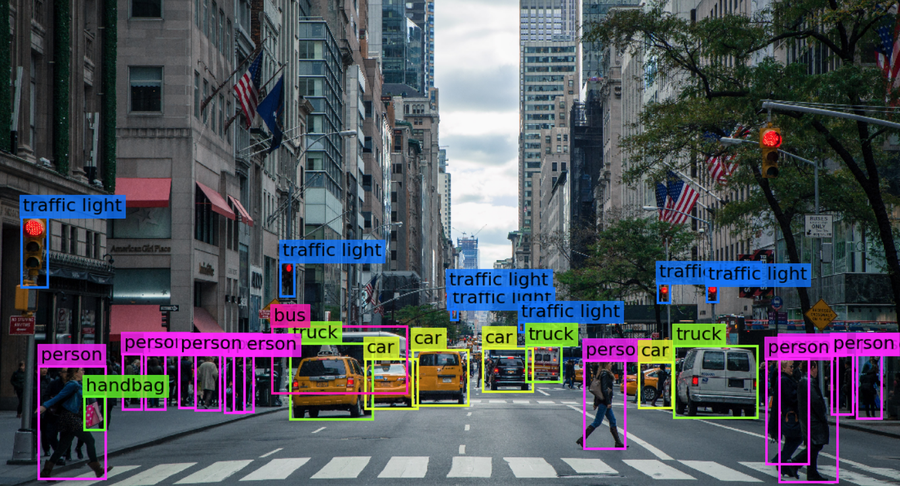

# Introducción

- La visión artificial es una de las áreas más antiguas de la inteligencia artificial.
- Los primeros sistemas de visión artificial se desarrollaron en la década de 1960.
- Los sistemas de visión artificial analizan imágenes y vídeos para extraer información.
- Veremos los conceptos básicos de la visión artificial y cómo se aplican en la práctica.

# Visión

- Proceso de **percepción** mediante el cual el sistema visual construye una representación (_imagen_) a partir de la información que capta la retina.
- Este proceso puede ser **activo** (cuando quien observa mueve los ojos) o **pasivo** (cuando no los mueve).
- La visión artificial básica es un proceso **pasivo**. Sin embargo, algunas tareas, como la **localización** o la **reconstrucción 3D**, requieren un proceso **activo**.

## Enfoques

- Hay dos enfoques principales en visión artificial:
  - **Extracción de características**:
    - Se aplican varias **transformaciones** a la imagen para extraer características relevantes (_bordes_, _textura_, _flujo óptico_, _segmentos_, entre otras).
  - **Basado en modelos**:
    - Se utilizan modelos matemáticos (_geométricos_ o _estadísticos_) para representar la imagen.
- En la práctica, ambos enfoques suelen combinarse.

## El color (I)

- Propiedad de la luz que depende de su longitud de onda.
- Los seres humanos lo percibimos mediante unas células receptoras de la retina llamadas **conos**.
  - Hay tres tipos de conos:
    - **L** (longitud de onda larga)
    - **M** (longitud de onda media)
    - **S** (longitud de onda corta)
  - Cada tipo de cono responde a un rango de longitudes de onda y, por tanto, a una gama de colores.

## El color (II)

- **Principio de tricromía**: cualquier color puede representarse como una combinación de tres colores primarios.
- **Colores primarios**
  - No se pueden descomponer en otros colores.
  - **azul**, **verde** y **rojo**.
- Espacios de color: RGB, HSV, YUV, etc.
- El más utilizado en visión artificial es **RGB** (**R**ed, **G**reen, **B**lue).

# Características de las imágenes

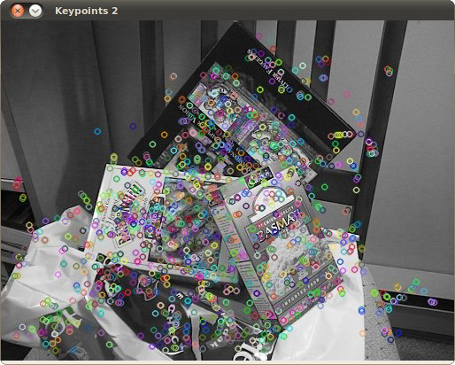

## Definición

- Una imagen contiene mucha información que no es relevante.
- En visión artificial se suelen utilizar **características** de las imágenes.
- Las características son las partes de la imagen relevantes para la tarea que se quiere realizar.
- Nos centraremos en cuatro características que suelen ser relevantes.
  - _Bordes_, _textura_, _flujo óptico_ y _segmentación_.

## Bordes

- **Líneas que separan regiones de distinta intensidad**.
- Permiten **identificar objetos**.
- Simplifican la imagen y permiten **reducir la cantidad de información**.
- Pasamos de una imagen compleja a una **matriz de bordes**

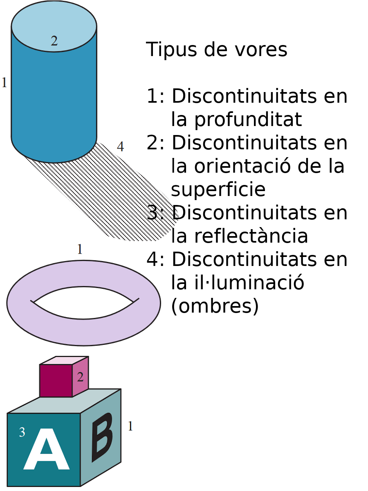

### Detección de bordes

- Tarea de visión artificial que consiste en detectar los bordes de una imagen.
- Hay muchos algoritmos para detectar bordes, pero uno de los más utilizados es el algoritmo de **Canny**, publicado por John F. Canny en 1986.
- Objetivos:
  - **Buena detección**: detectar todos los bordes.
  - **Buena localización**: los bordes detectados deben estar lo más cerca posible de los bordes reales.
  - **Minimizar las detecciones falsas**

### Algoritmo de Canny

- Consta de cuatro pasos principales:
  1. Se reduce el ruido con un **filtro gaussiano**.
  2. Se calcula el gradiente de la imagen con el **filtro de Sobel**.
  3. Se detectan los bordes mediante la **supresión de no máximos**.
  4. Se decide qué bordes son válidos mediante **histéresis**.

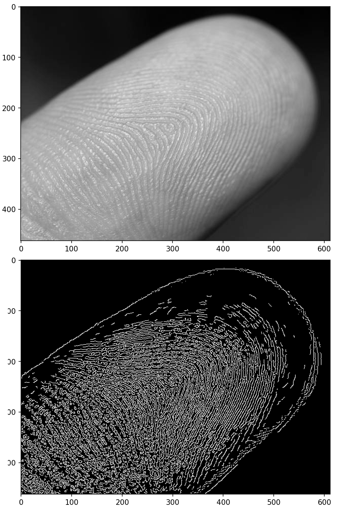

## Textura

- En visión artificial, una textura es un **patrón de píxeles** que puede observarse en una imagen.
  - Ejemplos: ventanas de un edificio, manchas de una vaca, etc.
- Al igual que los bordes, ayudan a **identificar objetos**.

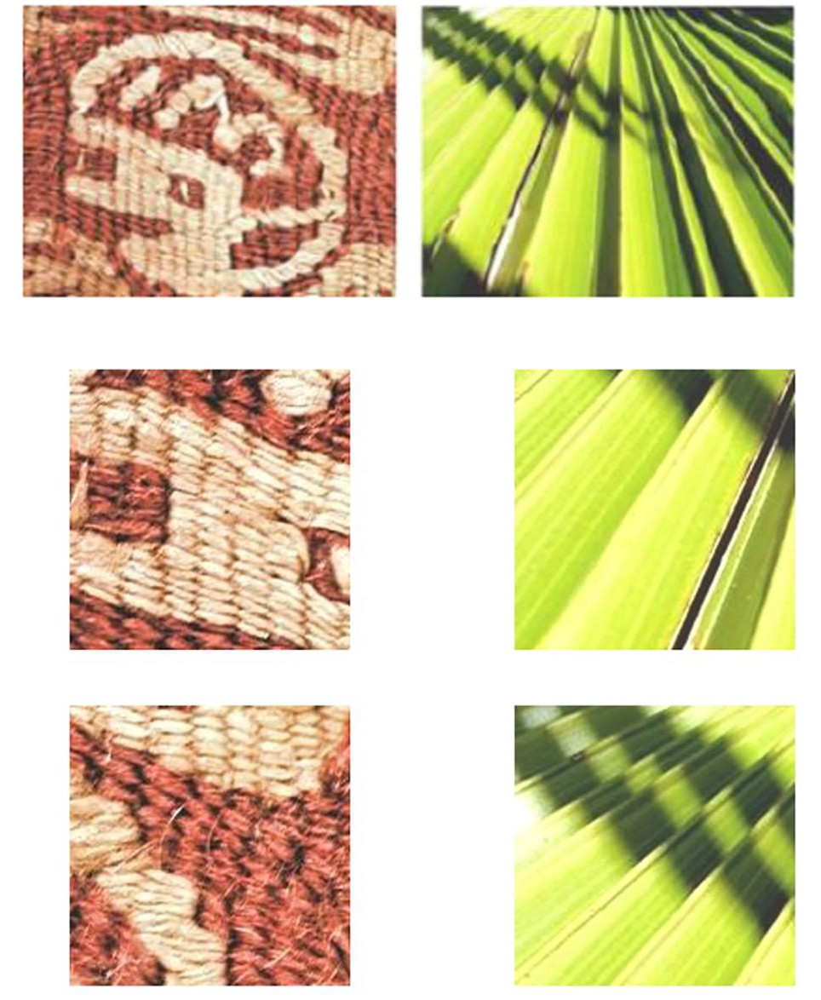

### Características de la textura

- La textura puede ser más o menos regular. Para describirla se suele utilizar un modelo de **teselas**. Veamos algunas características:

  - **Tesela**: patrón que se repite en una imagen.
  - **Teselación**: proceso de cubrir una superficie con teselas.
  - **Tipos**:
    - **Regulares**: se repiten siempre de la misma manera.
    - **Irregulares**: no siguen un patrón claro de repetición.
  - **Escala**: la textura puede tener un tamaño mayor o menor.

### Aplicaciones de la textura

- **Identificación**: permite distinguir objetos. Ejemplo: la textura de un caballo es distinta de la de una cebra.
- **Correspondencia**: permite encontrar zonas equivalentes en distintas imágenes. Es importante para la reconstrucción 3D.
- **Segmentación**: permite dividir la imagen en distintas regiones.
- **Reconstrucción**: permite reconstruir la imagen a partir de las teselas.
- **Clasificación**: permite clasificar objetos.

## Flujo óptico

- El **flujo óptico** es la **velocidad aparente** a la que se mueven los objetos entre dos imágenes.
- Los algoritmos de visión artificial pueden calcular el flujo óptico a partir de varias imágenes.
- Es importante en tareas como la **reconstrucción 3D**, la **compensación del movimiento** y la **compresión**.

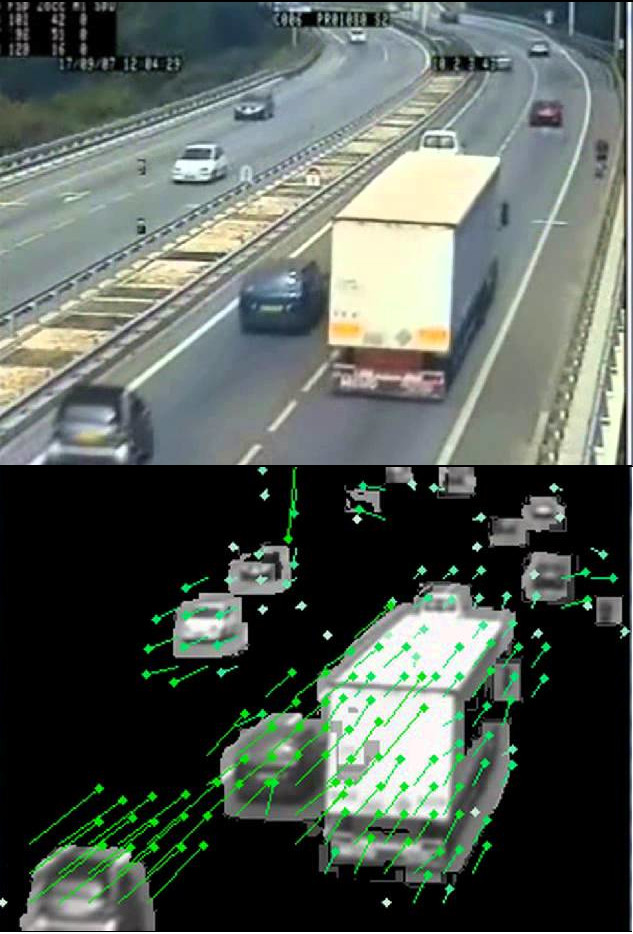

## Segmentos

- Llamamos **segmentos** a las **regiones** de una imagen que comparten alguna propiedad (color, textura, forma, etc.).
- Para definir los segmentos hay dos enfoques principales:
  - **Basado en límites**: se buscan los límites de las regiones. Puede plantearse como un problema de _clasificación_ en el que se decide si cada píxel pertenece a un segmento, utilizando técnicas de aprendizaje automático y modelos preentrenados.
  - **Basado en regiones**: se agrupan los píxeles según alguna propiedad común. Puede plantearse como un problema de *clustering* y utilizar técnicas como _k-means_.

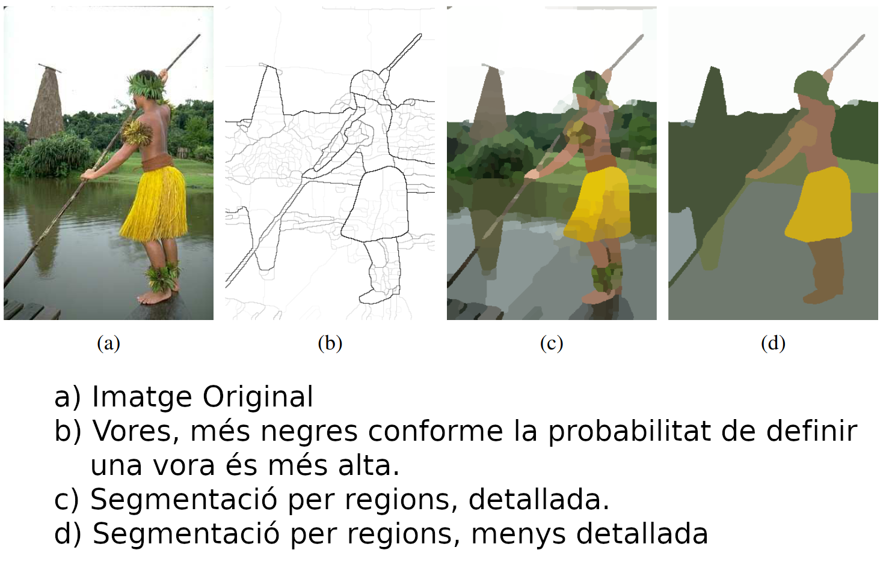

# Tareas de visión artificial

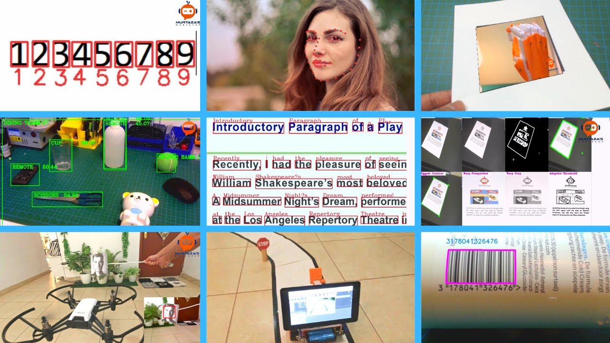

## Tareas

- Las tareas de visión artificial son aquellas que pueden realizarse a partir de imágenes.
- Hay muchas tareas de visión artificial, pero todas se basan en el **análisis** de imágenes.
- Veremos algunas de las más importantes:
  - **Procesamiento de imágenes**
  - **Clasificación de imágenes**
  - **Reconocimiento de objetos**
  - **Segmentación**

## Procesamiento de imágenes

- El **procesamiento** de imágenes reúne las técnicas que se aplican para mejorar su calidad o extraer información.
- Históricamente, el procesamiento de imágenes era la única forma de obtener resultados en visión artificial. Con la aparición de las redes neuronales, esta tarea perdió protagonismo.
- Aun así, sigue siendo importante en tareas tradicionales de visión artificial o **cuando no hay GPU disponibles**.
- Veremos algunas de las técnicas más comunes.

### Histogramas

- El **histograma** de una imagen representa gráficamente la distribución de los píxeles según su intensidad.
- Los histogramas son útiles para comprender la distribución de los píxeles de una imagen.
- Se utilizan mucho para normalizar imágenes durante el preprocesamiento.
- Se pueden calcular histogramas para cada canal de color (R, G, B) o para la imagen en escala de grises.
- Se utilizan mucho para la **normalización** de imágenes.

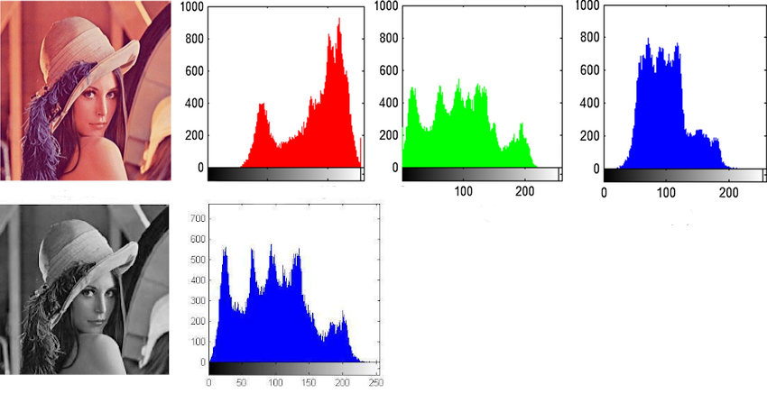

### Ecualización del histograma

- La **ecualización del histograma** es una técnica para mejorar el contraste de una imagen.
- Su objetivo es que la distribución de los píxeles sea más uniforme.
- Se divide el histograma en _bins_ y se redistribuyen los píxeles para uniformar la distribución.
- El resultado puede no parecer realista, pero puede ser útil para tareas de visión artificial.
  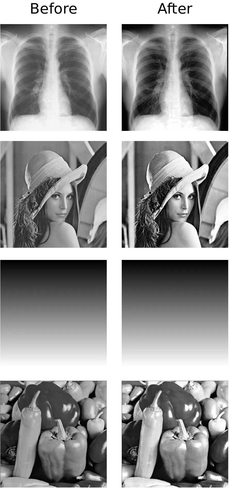

### Filtrado

- El **filtrado** es una técnica para mejorar la calidad de una imagen.
- Hay muchos tipos de filtros, pero los más comunes son los de **suavizado** y **realce**.
- Los filtros de suavizado ayudan a reducir el ruido de la imagen.
- Los filtros de realce ayudan a mejorar el contraste de la imagen.
- Los filtros pueden aplicarse a toda la imagen o a una región concreta.

#### Filtros de suavizado

- El ruido es un problema habitual en las imágenes.
- Podemos reducir el ruido aplicando filtros de suavizado. Los más comunes son el **filtro de media** y el **filtro gaussiano**.
- Filtro de media: sustituye cada píxel por la media de los píxeles que lo rodean.
- Filtro gaussiano: sustituye cada píxel por la media ponderada de los píxeles que lo rodean.
  - Los píxeles más cercanos al píxel central tienen mayor peso.

#### Filtros de realce

- Los filtros de realce ayudan a mejorar el contraste de la imagen y se utilizan mucho para detectar bordes.
- Los filtros más comunes son:
  - **Filtro de Sobel**:
    - Calcula el gradiente de la imagen, es decir, la intensidad de sus cambios.
  - **Filtro de Laplace**:
    - Calcula el laplaciano de la imagen, es decir, su segunda derivada.

### Umbralización (*thresholding*)

- La **umbralización** (*thresholding*) es una técnica para binarizar una imagen.
- Se aplica un **umbral** a la imagen: los píxeles con una intensidad superior se vuelven blancos y los que quedan por debajo, negros.
- Es una forma sencilla de **segmentación**: se separa la imagen en _objeto_ y _fondo_.
- Para binarizar, suele ser mejor opción que ajustar el brillo y el contraste.

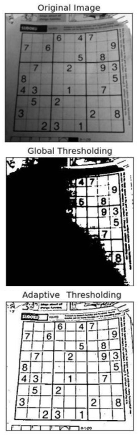

### Transformaciones

- Las **transformaciones** permiten cambiar la forma de una imagen.
- Las transformaciones más comunes son la **rotación**, el **escalado**, el **desplazamiento** y los **cambios de perspectiva**.
- Se dividen en **lineales** y **no lineales**, según cómo modifican la forma de la imagen.

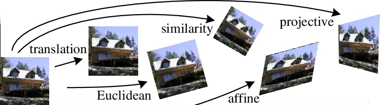

### Extracción del flujo óptico (*optical flow*)

La **extracción del flujo óptico** puede realizarse con distintas técnicas, que se dividen en dos grandes grupos:

- **Discretos**: calculan el flujo óptico en puntos concretos de la imagen. Son rápidos, pero poco precisos.
  - Uno de los algoritmos más conocidos es **Horn-Schunck**.
- **Densos**: calculan el flujo óptico para cada píxel. Tienen un mayor coste computacional porque procesan más puntos.
  - Entre los algoritmos más conocidos están **Lucas-Kanade** y **Farnebäck**.

### Extracción del flujo óptico (*optical flow*)

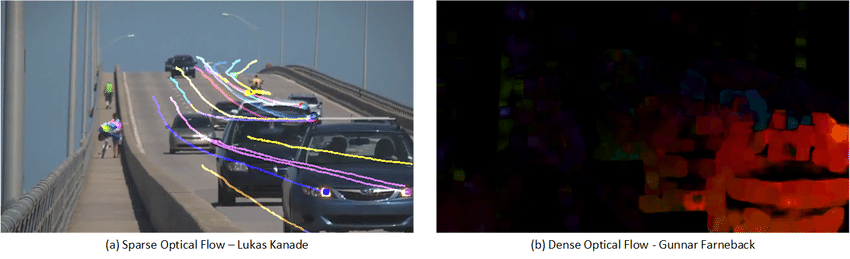

### Bibliotecas

- Hay muchas bibliotecas que permiten preprocesar imágenes.
- Algunas de las más comunes son:
  - **OpenCV**: biblioteca de visión artificial y aprendizaje automático.
    - Es la biblioteca más utilizada para visión artificial.
  - **Pillow**: biblioteca de procesamiento de imágenes.
  - **Scikit-image**: biblioteca de procesamiento de imágenes.
  - **Mahotas**: biblioteca de procesamiento de imágenes.
  - **SimpleCV**: biblioteca de visión artificial.

## Clasificación de imágenes y reconocimiento de objetos

- Estas tareas consisten en **identificar** los objetos que aparecen en una imagen.
- La **clasificación de imágenes** consiste en **identificar** el objeto que aparece en la imagen.
- El **reconocimiento de objetos** consiste en **identificar** los objetos de la imagen y **localizarlos**.
- Ambas tareas son fundamentales en visión artificial y sirven de base para muchas aplicaciones.

### Clasificación de imágenes

- La mayoría de los sistemas actuales de clasificación de imágenes se basan en la **apariencia** del objeto (textura, color, forma, etc.), aunque algunos también utilizan su geometría.
- Hay dos dificultades principales:
  - **Variabilidad del objeto**: un mismo tipo de objeto puede tener apariencias muy distintas (por ejemplo, dos perros).
  - **Variabilidad de la imagen**: un objeto puede verse de formas diferentes según la luz, las sombras, etc.
- Las redes neuronales convolucionales son las más utilizadas para esta tarea.

#### Redes neuronales convolucionales

- Las **redes neuronales convolucionales** (CNN) están diseñadas para procesar datos en forma de matrices, como las imágenes.
- Son muy eficaces en tareas de clasificación de imágenes.
- Como las demás redes neuronales, necesitan entrenarse con muchos datos numéricos.
- A continuación veremos cómo se procesan las imágenes en la red.

#### Convolución

- La **convolución** reduce la cantidad de información de la imagen y permite enviar a la red solo las **características más relevantes**. Este proceso mejora la precisión y la velocidad de la red.
- La convolución se realiza con **filtros** que se aplican a la imagen (matrices pequeñas de 3 × 3, 5 × 5, etc.).
- El resultado es una **imagen más pequeña** que la original, llamada **mapa de características**.
- Si no queremos reducir el tamaño de la imagen, podemos utilizar *padding*.

#### Convolución

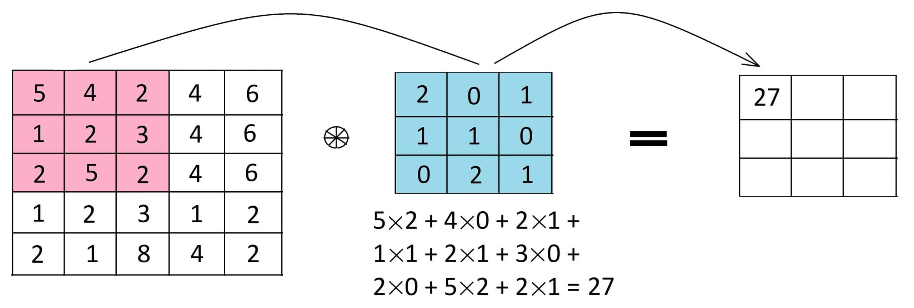

#### Funciones de activación

- Después de la convolución se aplica una **función de activación**.
- Las funciones de activación introducen una **no linealidad** en la red.
- Una de las más utilizadas en redes convolucionales es **ReLU**: convierte los valores negativos en cero y mantiene los positivos.
- La función de activación es importante para que la red conserve su **capacidad de generalización**.
- Después de la función de activación se puede aplicar *pooling*.

#### Pooling

- El **pooling** es una técnica para reducir aún más el tamaño de la imagen.
- Hay distintos tipos de *pooling*, pero el más común es **max pooling**.
- Se suele utilizar una ventana pequeña (2 × 2, 3 × 3, etc.) y se conserva su valor máximo.
- El resultado es un **mapa de características reducido** que se pasa a la siguiente capa.
- El *pooling* ayuda a que la red sea **invariante ante pequeñas transformaciones**.

#### Regularización

- Después de las capas de convolución y *pooling* se suelen añadir capas de **regularización**.
- Las capas de regularización ayudan a la red a **generalizar**.
- Una técnica habitual de regularización es **dropout**.
- Estas capas desactivan temporalmente un porcentaje de las neuronas durante cada iteración.
- Así se reduce el **sobreajuste** de la red.

#### Aplanamiento y capas totalmente conectadas

- Entre las capas de regularización y las capas totalmente conectadas se realiza un **aplanamiento**.
- El aplanamiento convierte el **mapa de características** en un **vector**.
- Este vector se envía a las capas totalmente conectadas.
- Las capas totalmente conectadas se utilizan para **clasificar** la imagen.
- Estas capas **reducen la dimensionalidad** del vector de características.

#### Estructura de una red neuronal convolucional

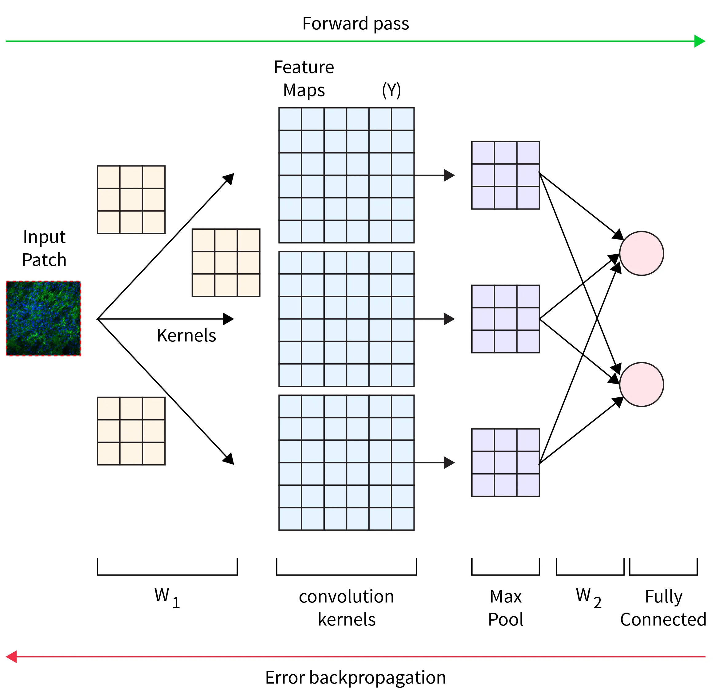

#### Funcionamiento de una CNN (I)

- En una imagen, los píxeles individuales no suelen tener significado por sí solos.
  - Sabemos que un 8 tendrá píxeles negros en el centro, pero no exactamente en qué posiciones.
- Los patrones locales sí pueden ser importantes.
  - Por ejemplo, el 0 y el 8 tienen curvas, mientras que el 1 y el 7 tienen líneas, entre otros rasgos.
- Las relaciones entre patrones también aportan información.
  - Por ejemplo, el 1 tiene líneas y el 6 combina una línea con una curva.
- Estrategia general: **extraer patrones locales y después combinarlos para obtener patrones más globales**

#### Funcionamiento de una CNN (II)

- Las redes neuronales convolucionales (CNN) permiten realizar este proceso.
  - Una capa está formada por una convolución y una función ReLU.
  - La convolución mide la similitud entre un filtro y una ventana. Cada filtro detecta un patrón distinto.
  - ReLU convierte en cero los valores negativos y conserva los positivos, resaltando patrones.
  - Al añadir otra capa que combine la información de las anteriores, el efecto es similar a utilizar una ventana más grande.

#### Funcionamiento de una CNN (III)

- Si seguimos añadiendo capas, los campos receptivos serán mayores y más complejos.
- Así se pueden identificar patrones más globales.
- Por último, las capas totalmente conectadas combinan los patrones para clasificar la imagen.
- Esta es la idea básica de una CNN:
  - Extraer patrones locales.
  - Combinarlos para obtener patrones globales.
  - Clasificar la imagen.

#### Aumento de datos (*data augmentation*)

- El **aumento de datos** (*data augmentation*) es una técnica para mejorar la precisión de la red.
- Consiste en **aumentar** la cantidad de datos de entrenamiento.
- Se pueden utilizar distintas técnicas para ampliar los datos:
  - **Rotación**, **traslación**, **escalado**, **reflejo**, **zoom**, **desplazamiento**, **distorsión**, **filtros**, **ruido**, etc.
  - Estas técnicas mejoran la precisión de la red y ayudan a evitar el **sobreajuste**.
- A cambio, el entrenamiento será más lento.

#### Arquitecturas de redes neuronales convolucionales

- Existen muchas arquitecturas de redes neuronales convolucionales; algunas de las más conocidas son:
  - **VGG-16**: red de 16 capas. Alcanzó un 92,7 % de exactitud en el conjunto de datos ImageNet en 2014.
  - **ResNet**: red de 152 capas basada en el **aprendizaje residual**. Alcanzó un 96,4 % en ImageNet en 2015.
  - **Inception**: red de 22 capas basada en la **factorización de convoluciones**. Alcanzó un 97,3 % en ImageNet en 2015.

## Reconocimiento de objetos

- El **reconocimiento de objetos** es una tarea más compleja que la clasificación de imágenes.
- Mientras que la clasificación de imágenes **identifica** el objeto principal, el reconocimiento de objetos **identifica y localiza** todos los objetos de la imagen (dibujando un rectángulo o _bounding box_ alrededor de cada uno).
- Las clases de objetos que se deben identificar están **predefinidas**. Así, el sistema puede detectar, por ejemplo, perros, coches o personas.

### Procedimiento básico

- El procedimiento básico para reconocer objetos es el siguiente:
  1. Definir una _ventana_ que se desplace por toda la imagen.
  2. Desplazar la ventana por la imagen y procesar cada región con una CNN.
  3. Conservar las puntuaciones más altas e ignorar las demás.
  4. Resolver los conflictos y reducir el número de _bounding boxes_.

### Problemas del procedimiento básico

- **Tamaño de la ventana**: si es demasiado grande, puede pasar por alto objetos pequeños; si es demasiado pequeña, no detectará bien los grandes.
- **Selección de ventanas**: analizar toda la imagen es lento; analizar pocas posiciones puede hacer que se pierdan objetos.
- **Resolución de conflictos**: si dos ventanas detectan el mismo objeto, ¿cuál es correcta?
- **Determinación del _bounding box_**: ¿cómo se eligen su tamaño y su posición?

#### Selección de ventanas

- En una imagen de tamaño N × N hay N⁴ ventanas posibles.
- Las ventanas que contienen objetos suelen presentar cierta coherencia de textura y color.
- En las ventanas que cortan objetos, algunas regiones o bordes atraviesan la ventana.
- Necesitamos un mecanismo eficiente para estimar la probabilidad de que una ventana contenga un objeto.
- Una opción es utilizar una **RPN** (*Region Proposal Network* o red de propuestas de región).

#### Resolución de conflictos

- Si dos ventanas detectan el mismo objeto, ¿cómo decidimos cuál es correcta?
- Una opción es utilizar un algoritmo de **supresión de no máximos** (*non-maximum suppression*).
- Este algoritmo elimina ventanas con puntuación baja, ordena las restantes y descarta las que se solapan demasiado con otra de mayor puntuación.
- Es un algoritmo eficiente que reduce el número de ventanas.

#### Determinación del _bounding box_

- ¿Cómo decidimos el tamaño y la posición del _bounding box_?
- La ventana que detecta el objeto no suele coincidir exactamente con el tamaño y la posición del objeto.
- Para determinar el tamaño y la posición del _bounding box_ se utiliza un **algoritmo de regresión**.
- Este algoritmo estima el tamaño y la posición del _bounding box_ a partir de la ventana y de las características extraídas por la CNN.

### Modelos preentrenados

- Entrenar una CNN requiere muchos recursos.
  - A menudo se utilizan **modelos preentrenados**.
  - Son CNN entrenadas con muchos datos y que han obtenido buenos resultados.
- Ejemplos:
  - **YOLO**: red neuronal convolucional para detectar objetos en tiempo real. Solo necesita una pasada por la imagen y es muy rápida.
  - **DETR**: se basa en la arquitectura Transformer y puede detectar todos los objetos en una sola pasada.

## Segmentación

- La **segmentación** consiste en **dividir una imagen en distintas regiones significativas**.
- Su objetivo principal es **agrupar** los píxeles en **regiones** que compartan alguna propiedad.
- Facilita la **comprensión** de la imagen y tareas como la **clasificación**, el **reconocimiento de objetos**, el **seguimiento**, el análisis de escenas y la **reconstrucción 3D**.

### Tipos de segmentación (I)

- Algunos tipos de segmentación son:
  - **Segmentación binaria** o por umbral: divide la imagen en dos regiones, objeto y fondo (por ejemplo, _thresholding_).
  - **Segmentación por bordes**: divide la imagen en regiones separadas por bordes (por ejemplo, _Canny_).
  - **Segmentación semántica**: asigna una categoría predefinida a cada píxel (por ejemplo, _Mask R-CNN_).

### Tipos de segmentación (II)

- **Segmentación en superpíxeles**: divide la imagen en regiones compactas y coherentes (por ejemplo, _SLIC_).
- **Segmentación de instancias**: distingue cada instancia de los objetos (por ejemplo, _Mask R-CNN_).
- **Segmentación panóptica**: combina las categorías semánticas con la segmentación de cada instancia de objeto.

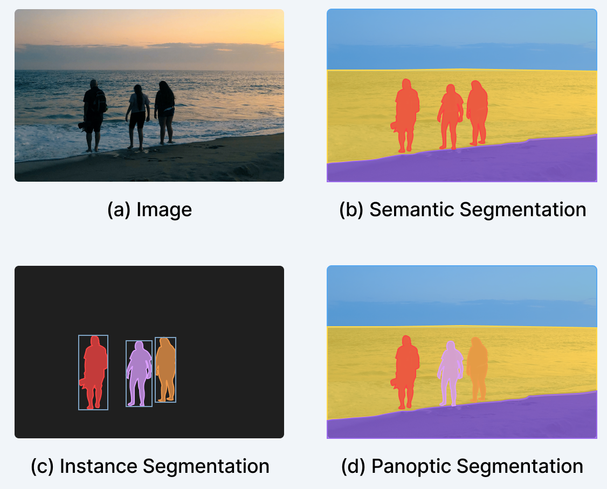

# Aplicaciones

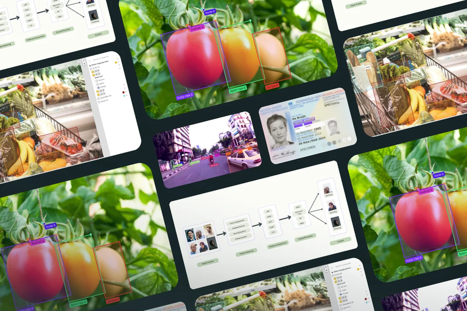

## Aplicaciones

- Hasta ahora hemos visto los conceptos básicos de la visión artificial y algunas de sus aplicaciones prácticas.
- Sus aplicaciones han crecido en los últimos años gracias a la disponibilidad de bibliotecas y modelos preentrenados.
- Esta facilidad de uso ha convertido la visión artificial en un área muy activa, aplicada a ámbitos como la medicina, la industria y la seguridad.
- A continuación veremos algunas de sus aplicaciones más importantes.

### Percepción de personas

- Las personas son uno de los **elementos más importantes** de las imágenes.
- Comprender qué hacen las personas permite crear **interfaces persona-máquina** más naturales, observando sus acciones y respondiendo a ellas.
- Es una tarea muy compleja que combina distintas técnicas de visión artificial.
- Se ha avanzado mucho en los últimos años, pero aún quedan retos por resolver.
- A continuación veremos qué aplicaciones permite.

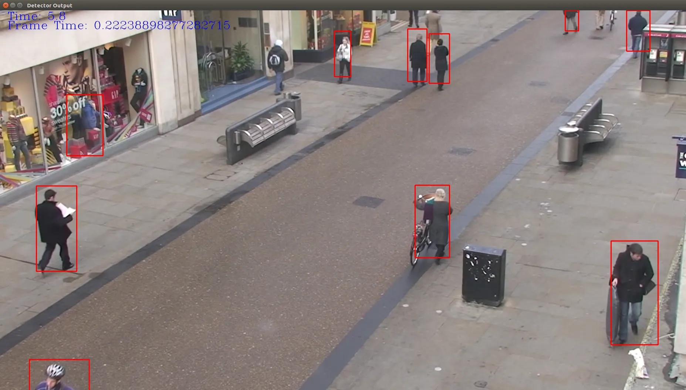

#### Usos

- **Seguridad**: crear sistemas de vigilancia más eficaces y menos intrusivos.
- **Urbanismo**: analizar los desplazamientos de las personas para diseñar mejor las ciudades.
- **Deporte**: analizar vídeos de partidos para mejorar los entrenamientos y obtener estadísticas.
- **Ahorro energético**: activar o desactivar la climatización y la iluminación según la presencia de personas.

También se aplica en videojuegos, industria, medicina y muchos otros ámbitos.

#### Detección de la postura

- Algunas tareas, como la **detección de la postura** (localizar las articulaciones), están muy avanzadas.
- Es relativamente sencilla porque las articulaciones tienen formas y posiciones conocidas, y los efectos de la perspectiva son previsibles.
- En cambio, es mucho más difícil inferir qué está haciendo una persona.

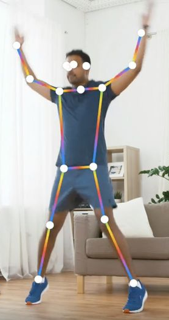

#### Descripción de acciones

- La **descripción de acciones** es una tarea mucho más compleja.
- Consiste en **entender** qué hace una persona en una imagen.
- A menudo es necesario **entender el contexto** para saber qué está haciendo una persona.
- Esta dependencia del contexto dificulta garantizar el funcionamiento correcto de los sistemas.
  - Ejemplo: en una piscina es fácil inferir que alguien está nadando. ¿El sistema ha reconocido la acción o simplemente ha detectado la piscina?

### Generación de imágenes

- Las redes neuronales pueden **generar imágenes** a partir de texto u otras imágenes.
- Una aplicación está relacionada con el _aprendizaje autosupervisado_ (*self-supervised learning*).
  - Cuando hay pocos datos etiquetados, se pueden generar datos adicionales.
  - Estos datos pueden mejorar el rendimiento de las redes.
  - A continuación veremos cómo hacerlo.

#### Autoencoder

- Un **autoencoder** es una arquitectura neuronal que **reconstruye** la imagen de entrada, a veces con modificaciones.
- Un autoencoder tiene tres partes:
  - **Codificador** (*encoder*): convierte la imagen de entrada en un **vector de características**.
  - **Cuello de botella** (*bottleneck*): vector de características que constituye la parte central del autoencoder.
  - **Decodificador** (*decoder*): transforma el vector de características en una imagen.

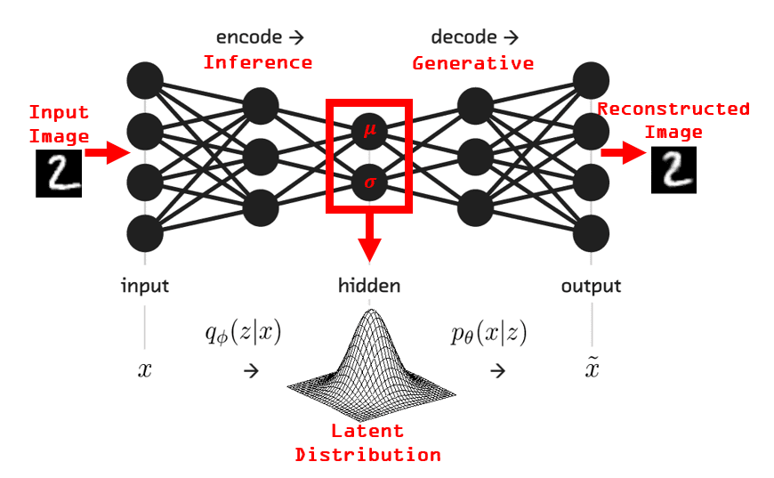

#### Aplicaciones de los autoencoders

- **Reducción de dimensionalidad**: el autoencoder puede reducir la dimensionalidad de la imagen.
- **Eliminación de ruido** (*denoising*): el vector de características conserva la información importante de la imagen y elimina parte del ruido.
- **Superresolución**: convierte una imagen de baja resolución en otra de mayor resolución.
- **Generación de imágenes**: el decodificador puede generar imágenes a partir de vectores de características aleatorios.

### Autoencoders variacionales

- Los **autoencoders variacionales** son una variante de los autoencoders que permite generar imágenes.
- El enfoque es parecido, pero en lugar de generar un vector de características, producen una **distribución de probabilidad** que se utiliza para generar imágenes.
- Así se generan imágenes similares a las de entrada, pero no idénticas.

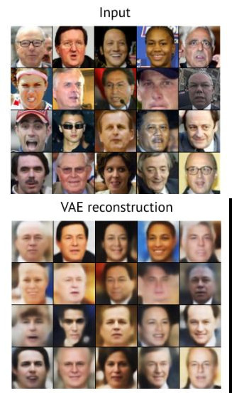

### GAN (redes generativas adversarias)

- Las **GAN** son redes neuronales utilizadas para generar imágenes.
- Las GAN están formadas por dos redes:
  - **Generador**: crea imágenes a partir de vectores de características aleatorios.
  - **Discriminador**: intenta distinguir las imágenes reales de las generadas.
  - Ambas redes se **entrenan de forma adversaria**: el generador intenta engañar al discriminador y este intenta no dejarse engañar.

### GAN (redes generativas adversarias)

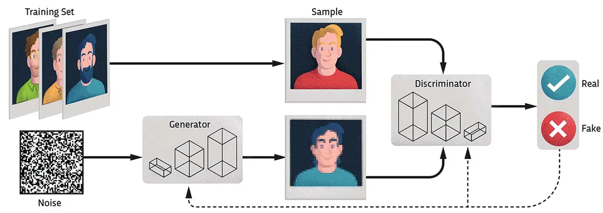

## Control del movimiento

- Entre las aplicaciones más importantes de la visión están la manipulación de objetos y la navegación evitando obstáculos. Los vehículos autónomos son un ejemplo claro y requieren varias tareas:
  - **Control lateral**: mantenerse dentro del carril.
  - **Control longitudinal**: mantener la distancia de seguridad.
  - **Evitar obstáculos**: detectar y evitar otros vehículos, peatones, etc.
  - **Respetar las señales**: incluidos los semáforos y las indicaciones de los agentes.

### Procedimiento

- El procedimiento básico genera una secuencia de órdenes (acelerar, frenar, girar, etc.) que permite al vehículo realizar esas tareas.
- Se necesita un modelo del mundo y de los objetos cercanos. En teoría puede construirse solo con visión, pero no es sencillo; por ejemplo, es difícil estimar la velocidad de un vehículo a partir de una imagen.
- En la práctica se combinan datos visuales y de otros sensores (radar, lidar, etc.).

### Modelo del mundo

- El **modelo del mundo** representa el entorno y permite al vehículo anticipar lo que puede ocurrir.
- Ejemplo: en verde aparecen las zonas por las que puede circular el vehículo y los objetos están delimitados con recuadros rojos.

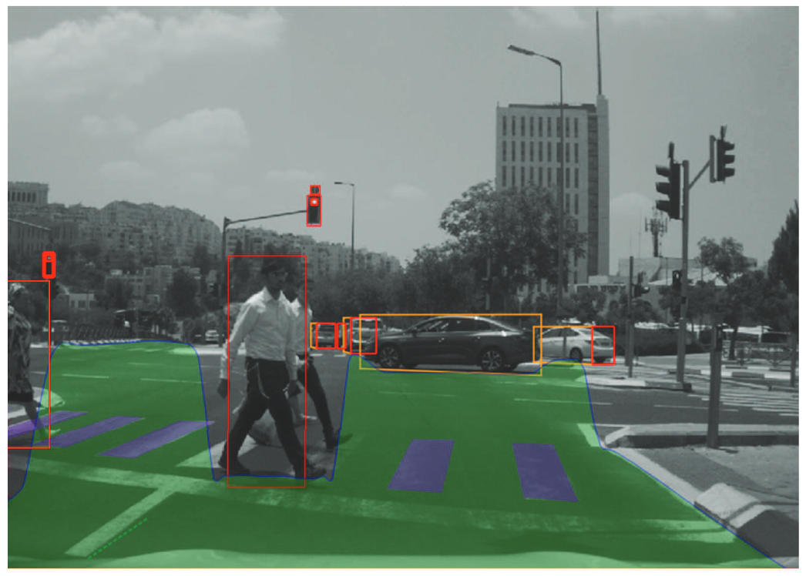

### Navegación autónoma

- La **navegación autónoma** consiste en **desplazarse** por un entorno sin **intervención humana**.
- Suele dividirse en dos tareas:
  - **Mapeo**: crear un **mapa** del entorno. Entre las técnicas habituales están **SLAM** (*Simultaneous Localization and Mapping*).
  - **Planificación de trayectorias**: cuando el robot tiene un mapa 3D y conoce su posición, debe **planificar** una **trayectoria** hasta su destino evitando colisiones.

### Mapeo y planificación de trayectorias

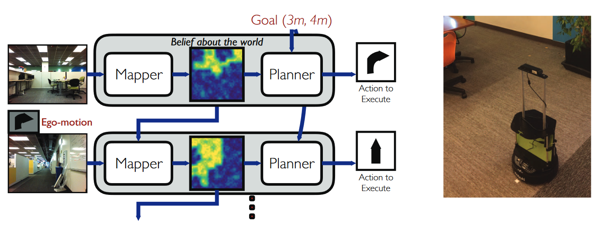

## Seguimiento de objetos

- El **seguimiento de objetos** consiste en **seguir** una **serie de objetos** a través de una **secuencia de imágenes**.
- La **complejidad** del seguimiento depende de la cantidad de imágenes de un vídeo.
  - 24 fps × 60 s × 60 min = **86 400 imágenes por hora**.
  - Si se siguen entre 8 y 10 objetos, son **más de 800 000 detecciones**.
- Esta tarea es importante en aplicaciones como la **vigilancia** y los **robots autónomos**.

### Tipos de seguimiento

- Veremos los siguientes tipos de seguimiento:
  - **Seguimiento de un solo objeto** (*single object tracking*, SOT).
  - **Seguimiento de múltiples objetos** (*multiple object tracking*, MOT).
  - **Seguimiento semisupervisado de múltiples objetos sin clase**, una extensión de SOT.
  - **Segmentación de objetos en vídeo** (VOS).
- Los dos primeros son los más habituales y los veremos con más detalle.

#### Seguimiento de un solo objeto

- El **seguimiento de un solo objeto** consiste en seguir un objeto en una secuencia de **imágenes** a partir de una anotación manual inicial.
- El primer fotograma anotado se denomina _template_ y cada región de búsqueda posterior, _search area_.
- Las redes neuronales para estas tareas se entrenan para seguir cualquier objeto del primer fotograma.
  - Se denominan **redes neuronales agnósticas a la clase** (*Class-Agnostic Neural Networks*, CAN).

#### Seguimiento de múltiples objetos: definición

- El **seguimiento de múltiples objetos** **NO** consiste simplemente en **repetir SOT** para cada objeto.
- Consiste en identificar y seguir todos los objetos de un conjunto de clases predefinidas.
  - El usuario no puede corregir el modelo ni proporcionarle comentarios.
- Un uso habitual consiste en **aplicar el modelo a un vídeo y extraer estadísticas**.
  - Ejemplo: cuántas personas pasan por una calle en una hora.
- Se utiliza menos para etiquetar.

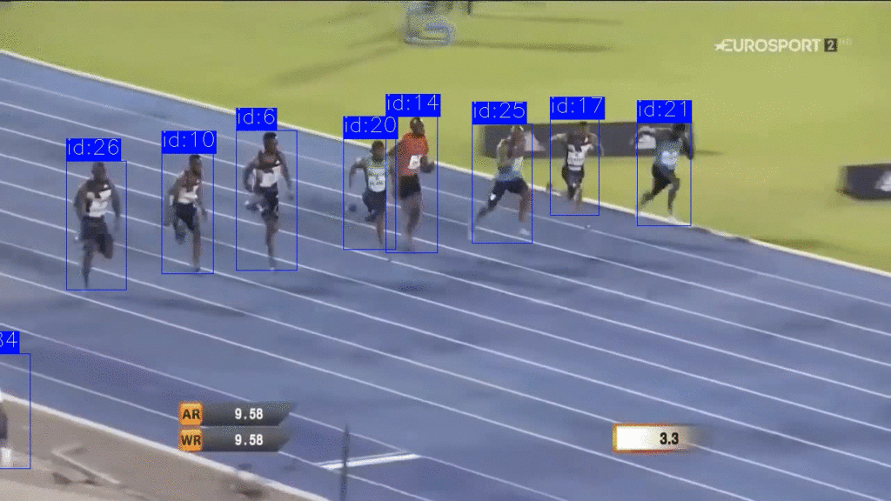

#### Seguimiento de múltiples objetos: funcionamiento

- Consta de dos pasos: **detección** (localizar los objetos de una imagen) y **asociación** (vincularlos con los de la imagen anterior mediante _tracklets_).
- Algunas redes neuronales realizan ambas tareas a la vez. Sin embargo, requieren vídeos etiquetados para entrenarse, que son costosos de producir.
- Es más habitual utilizar una red para detectar y otra para identificar y reidentificar: **seguimiento por detección** (*tracking by detection*). Su rendimiento puede ser menor.

##### Tracking by detection

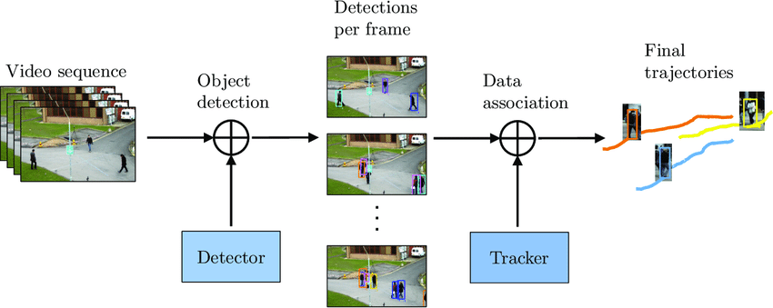

##### Identificación y reidentificación

- La **identificación** asigna un **identificador único** a cada objeto detectado.
- La **reidentificación** asigna el **mismo identificador** al objeto en distintas imágenes.
  - Es la tarea más difícil porque la apariencia puede cambiar mucho; por ejemplo, si una persona se tapa la cara.
- Algunos algoritmos habituales son:
  - **ByteTrack**: algoritmo sencillo y rápido.
  - **FairMOT**: algoritmo más complejo, pero más preciso.

## Reconocimiento facial

- El **reconocimiento facial** consiste en **identificar** a una **persona** a partir de una **imagen** o un **vídeo**.
- Se utiliza en aplicaciones de **seguridad**, **control de acceso**, **vigilancia**, entre otras.
- Aunque métodos como las **huellas dactilares** o el **iris** pueden ser más seguros, el **reconocimiento facial** resulta más **cómodo** y **menos intrusivo**.
- Por ello, se ha seguido investigando en esta área y se ha alcanzado un **alto rendimiento**.

### Funcionamiento

- El **reconocimiento facial** funciona de forma parecida a la **clasificación de imágenes**.
- La **diferencia** principal es que, en lugar de clasificar un objeto, se clasifica a la **persona**.
- Esto hace que sea más **complejo** que la clasificación de imágenes: la apariencia de una persona cambia con la **iluminación**, la **posición**, la **expresión**, etc.
- Además, las personas pueden **cambiar** con el tiempo, por lo que hay que buscar **características invariantes**.

#### Enfoques para el reconocimiento facial

- **Basados en la geometría**: analizan la disposición de las **características** faciales.
- **Enfoque holístico**: analiza la **imagen** completa y las relaciones entre sus características.
- **Basados en modelos**: crean un vector de características a partir de la imagen y lo comparan con vectores predefinidos.
- **Basados en redes neuronales**: utilizan redes convolucionales para clasificar la imagen; hasta hace poco, requerían demasiados datos para resultar prácticos.

# Modelos avanzados de visión artificial

Transformers y modelos de difusión

## Transformers en visión artificial

- Los **Transformers**, diseñados originalmente para el procesamiento del lenguaje natural (PLN), también se han adaptado a la visión artificial.
- **ViT (Vision Transformer)**: uno de los modelos más conocidos que aplica la arquitectura Transformer a las imágenes.
  - Divide la imagen en **parches** (*patches*) y los procesa como una secuencia.
  - Utiliza **atención multicabeza** (*multi-head attention*) para captar relaciones globales entre los parches.
- **Aplicaciones**:
  - Clasificación de imágenes.
  - Detección de objetos.
  - Segmentación semántica.

### Visión con Transformers (ViT)

- **Cómo funciona**:
  1. Divide la imagen en parches pequeños (por ejemplo, de 16 × 16 píxeles).
  2. Aplana cada parche y lo proyecta en un espacio latente mediante una capa lineal.
  3. Añade embeddings posicionales para conservar la información espacial.
  4. Procesa la secuencia de parches con un codificador Transformer.
- **Ventajas**:
  - Capta dependencias a largo plazo entre las regiones de la imagen.
  - Escala mejor con grandes cantidades de datos.

### Visión con Transformers (ViT)

## Modelos de difusión

- Los **modelos de difusión** son una familia de modelos generativos con gran potencial para crear imágenes de alta calidad.
- **Funcionamiento**:
  - Se basan en un proceso de **difusión** que añade ruido a los datos (imágenes) en varios pasos.
  - Después, el modelo aprende a invertir el proceso para generar imágenes a partir del ruido.
- **Ejemplos conocidos**:
  - **DALL·E**: genera imágenes a partir de descripciones de texto.
  - **Stable Diffusion**: modelo eficiente que genera imágenes de alta calidad con menos recursos de cálculo.

### Proceso de difusión

1. **Proceso directo** (*forward process*):
   - Añade ruido gaussiano a la imagen en pasos sucesivos.
   - Tras muchos pasos, la imagen se convierte en ruido.
2. **Proceso inverso** (*reverse process*):
   - El modelo aprende a retirar el ruido paso a paso para reconstruir la imagen.
3. **Generación**:
   - Se parte de ruido y se aplica el proceso inverso para generar imágenes nuevas.

### Proceso de difusión

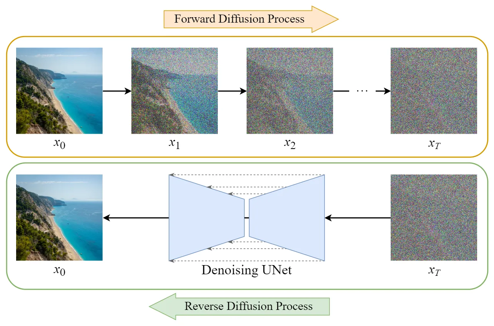

### Aplicaciones de los modelos de difusión

- **Generación de imágenes**:
  - Crear imágenes realistas a partir de descripciones de texto.
  - Ejemplo: «Un perro sentado en un campo bajo un cielo azul».
- **Edición de imágenes**:
  - Modificar imágenes existentes añadiendo o eliminando objetos.
- **Superresolución**:
  - Mejorar la resolución de imágenes de baja calidad.
- **Arte generativo**:
  - Crear obras únicas combinando estilos y conceptos.

## Comparativa entre Transformers y modelos de difusión

| **Característica**         | **Transformers**                 | **Modelos de difusión**       |
| -------------------------- | -------------------------------- | ----------------------------- |
| **Enfoque**                | Atención global y secuencial.    | Proceso iterativo de ruido.   |
| **Aplicaciones principales** | Clasificación y detección.     | Generación y edición de imágenes. |
| **Complejidad**            | Alta (requiere muchos recursos). | Moderada (más eficiente).     |
| **Escalabilidad**          | Excelente con grandes datos.     | Buena, aunque menor que ViT.  |

## Futuro de la visión artificial

- **Integración de modelos**:
  - Combinar Transformers y modelos de difusión para tareas más complejas.
- **Eficiencia computacional**:
  - Desarrollar modelos más ligeros para dispositivos móviles e IoT.
- **Aplicaciones emergentes**:
  - Realidad aumentada, medicina personalizada y vehículos autónomos.
- **Ética y privacidad**:
  - Garantizar que los modelos de visión artificial se desarrollen de forma responsable.

# ¡Gracias!
