---

marp: true
published: false
size: 16:9
theme: lawer
class: default
\_class: invert lead
paginate: true
\_paginate: false
auto-scaling: true
footer: 🄯 Carles Gonzàlez - CC-BY-NC-SA

---

# 9. Robótica

Modelos de inteligencia artificial

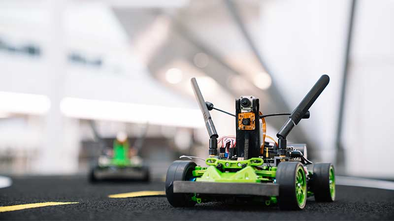

---

## Introducción

- La robótica es una rama de la tecnología dedicada al diseño y la construcción de robots.
- Los robots permiten a nuestros modelos de inteligencia artificial interactuar con el mundo real.
- La robótica es una disciplina multidisciplinar que combina conocimientos de ingeniería, informática, matemáticas, física, biología, etc.

---

## Robots

- Un robot es un dispositivo programable que realiza tareas manipulando su entorno.
- Para ello, los robots utilizan actuadores para interactuar con el mundo real.
- Los cambios pueden ser físicos (mover objetos) o digitales (enviar información).

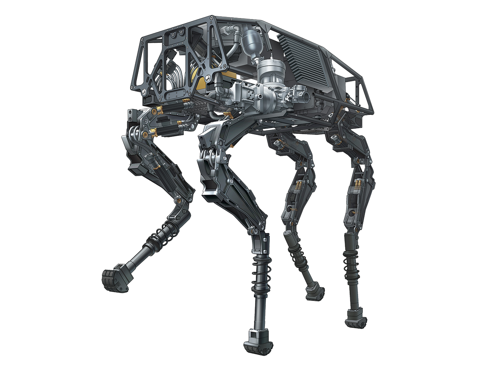

---

### Sensores

- Los sensores son dispositivos que permiten a los robots percibir su entorno.
- Hay muchos tipos de sensores. Los grupos más importantes son:
  - **Medir el estado del entorno**: cámaras, radares, ultrasonidos, etc.
  - **Medir el estado del robot**: acelerómetros, giroscopios, encoders, etc.

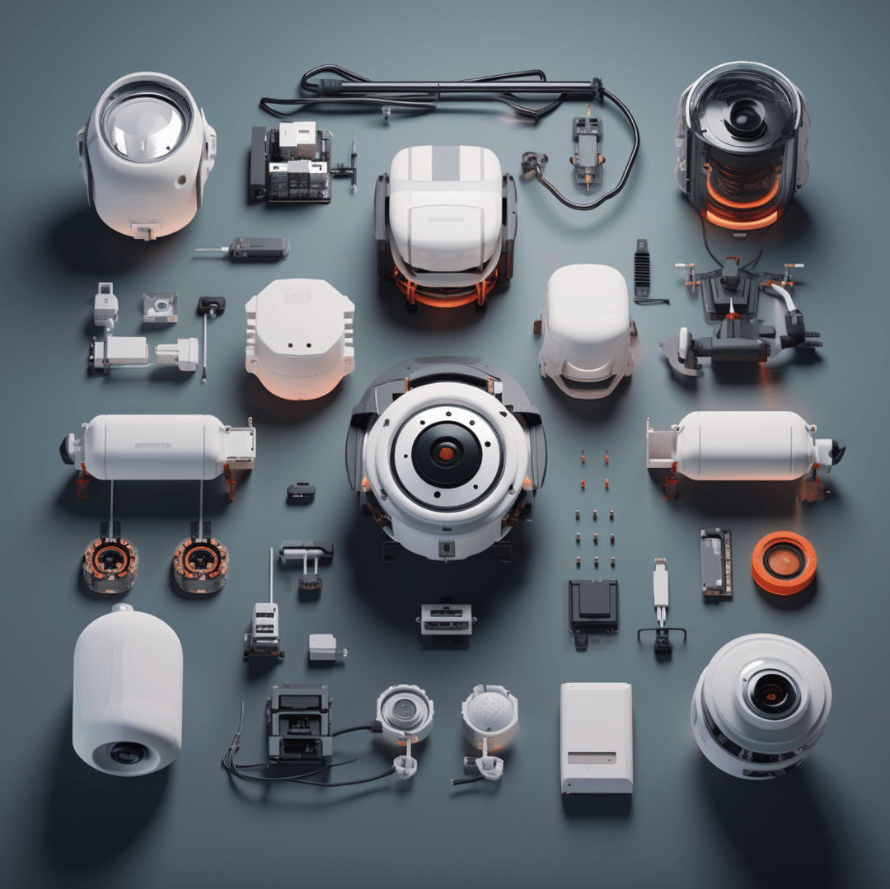

---

### Operaciones

- Para maximizar su eficiencia, los robots deben ser capaces de tomar **decisiones**.
- Las decisiones pueden ser simples (moverse hacia un objetivo) o complejas (conducir un coche), siempre con el objetivo de **realizar una tarea**.
- Podemos reducirlo a un problema de **optimización**: aplicar las fuerzas adecuadas para maximizar el objetivo.
- **Problema**: ¿cómo hacerlo de manera eficiente?

---

### Entorno

- En los problemas de optimización que hemos visto **hasta ahora**, el entorno era **virtual, observable y determinista**.
- En el **mundo real**, el entorno es **no observable, no determinista y no estático**.
- Esto hace que los problemas de robótica sean mucho más complicados que los problemas de optimización tradicionales.
- También se **dificulta el aprendizaje**: no se puede retroceder en el tiempo para probar distintas acciones ni acelerarlo.

---

### Inteligencia artificial

- Todo lo que hemos visto hasta ahora nos lleva a que la robótica **integra muchos conceptos** estudiados durante el curso.
- Algunos de los conceptos estudiados encuentran en la robótica una **aplicación práctica**. Por ejemplo, los robots autónomos utilizan redes neuronales para procesar la información de los sensores y tomar decisiones.
- Otros conceptos se verán **ampliados**: por ejemplo, los algoritmos de optimización deben adaptarse para funcionar en entornos no deterministas.

---

## Hardware de robótica

- Hasta ahora hemos supuesto que la forma de interactuar con el mundo real era a través de la pantalla.
- Con la robótica, esta interacción se realiza mediante **sensores y actuadores**.
- No solo podemos programar el comportamiento del robot: también debemos diseñar el **hardware** que nos permitirá interactuar con el mundo real.
- La selección de sensores y actuadores determinará cómo funcionará en las tareas que deberá realizar.

---

### Tipos de robots según su hardware

- **Robots antropomórficos**: imitan la forma humana. También se conocen como **robots humanoides**. Son los más populares, pero también muy complejos y costosos.
- **Brazos robóticos**: pueden mover objetos. También se conocen como **robots manipuladores**. Son los más comunes, especialmente en la industria.
- **Robots móviles**: pueden desplazarse por su entorno. Pueden ser **terrestres, acuáticos o aéreos**. Son los más comunes en robótica autónoma.

---

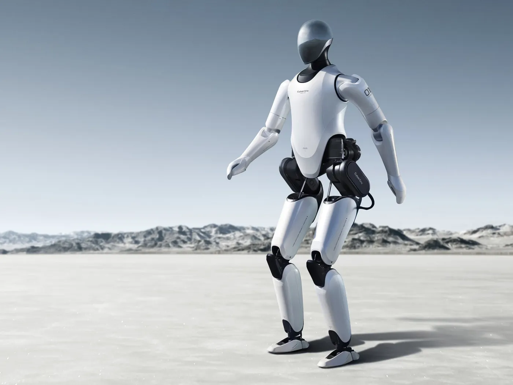

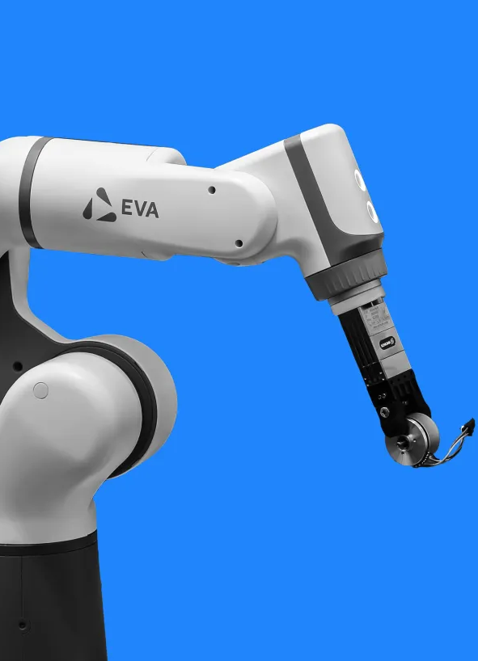

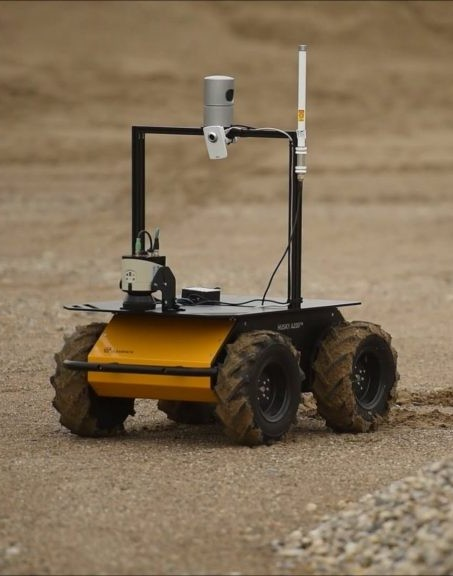

---

<!--
_class: invert lead
-->

## Sensores y actuadores

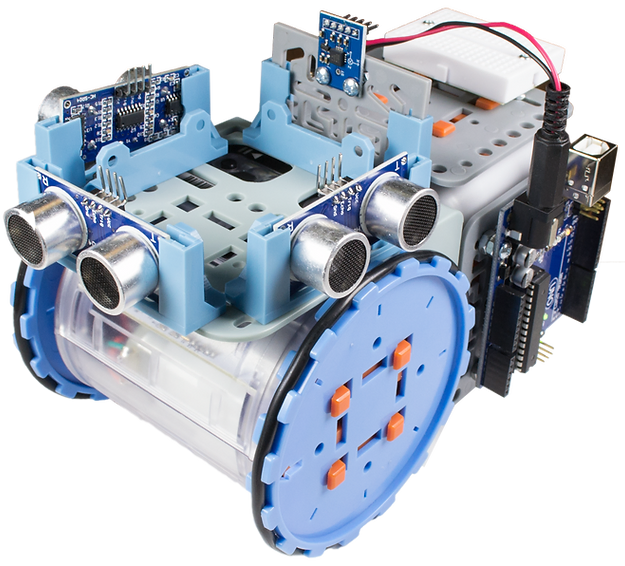

---

### Tipos de sensores

- **Activos**: emiten una señal y miden la respuesta. Suelen utilizarse para medir distancias.
  - Necesitan una fuente de energía. Son más precisos, pero también más caros y complejos.
  - _radares, ultrasonidos_.
- **Pasivos**: miden la radiación que reciben. Suelen utilizarse para medir la luz o el sonido.
  - No necesitan una fuente de energía. Son económicos y fáciles de utilizar.
  - _cámaras, micrófonos_.

---

#### Sensores de distancia

Permiten a los robots medir la distancia a los objetos.

- **Ultrasonidos**: emiten ondas sonoras y miden el tiempo que tarda en recibirse el eco. Son versátiles y económicos.
- **Radares**: emiten ondas electromagnéticas y miden el tiempo que tarda en recibirse el reflejo. Se utilizan mucho en robots aéreos.
- **LIDAR**: utiliza láser para medir con gran precisión la distancia a los objetos. Se emplea mucho en vehículos autónomos terrestres.

---

##### LIDAR

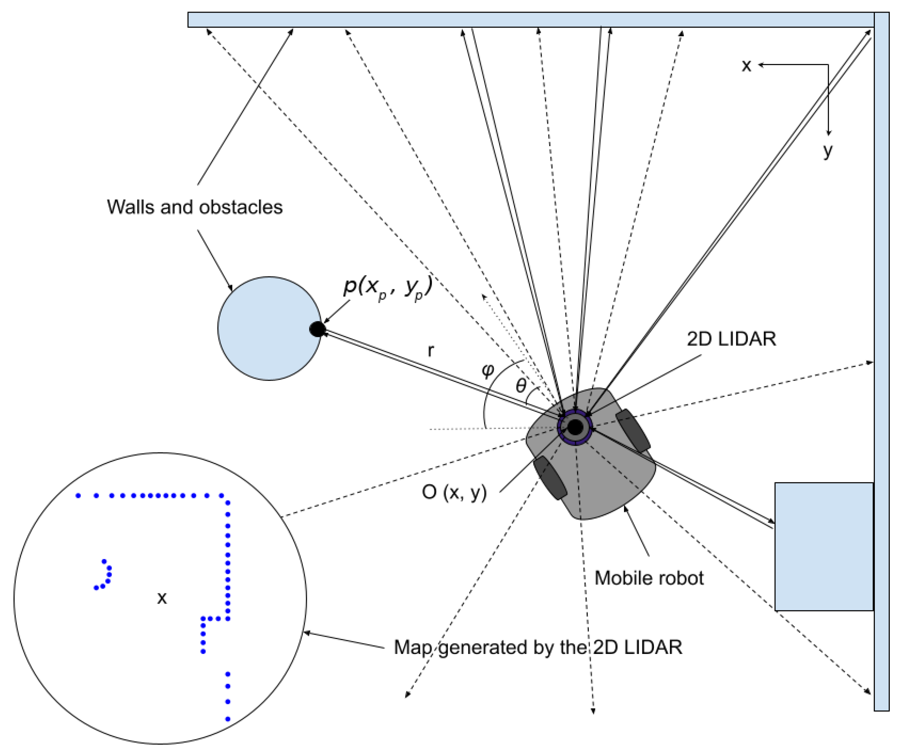

---

#### Sensores de localización

Permiten a los robots conocer su posición en el entorno.

- **GPS**: permite a los robots conocer su posición en un mapa. Sus equivalentes ruso y chino son GLONASS y BeiDou. Solo funciona al aire libre.
- **Balizas**: emiten una señal que permite a los robots conocer su posición en un espacio conocido. Se utilizan mucho en robótica de interiores.
- **Wi-Fi**: la intensidad de la señal permite sustituir a las balizas en entornos con cobertura.

---

#### Propiocepción

Es la capacidad de los robots para conocer su posición y orientación en el espacio.

- **Sensores inerciales**: acelerómetros y giroscopios que permiten a los robots conocer su orientación.
- **Encoders**: permiten a los robots conocer su posición en un eje.
- **Odometría**: permite a los robots conocer su posición en un plano. Utiliza encoders y giroscopios.
- **SLAM**: permite a los robots conocer su posición en un entorno desconocido. Utiliza cámaras y LIDAR.

---

#### Otros

- **Sensores de temperatura, humedad, presión, etc.**: permiten medir variables ambientales.
- **Sensores de fuerza**: permiten medir la fuerza que ejercen.
- **Sensores de color**: permiten medir el color de los objetos.
- **Sensores de luz**: permiten medir la luz ambiental.
- **Sensores de sonido**: permiten medir el sonido ambiental.

---

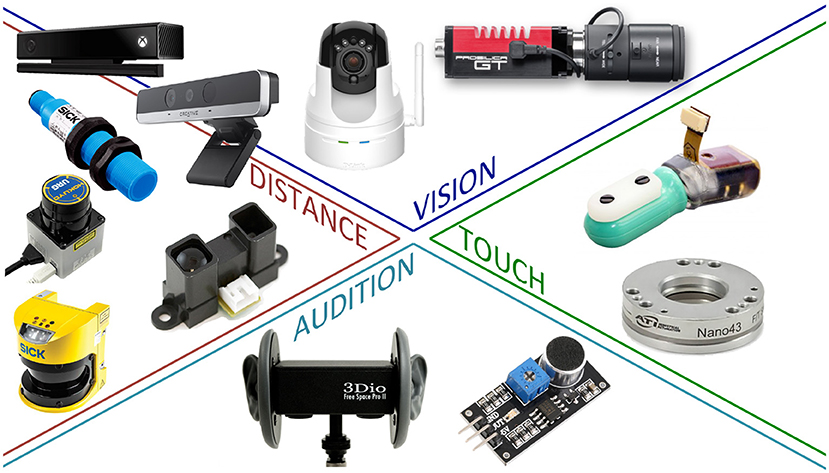

---

### Actuadores

- Los actuadores son los componentes que permiten al robot moverse e interactuar con su entorno. Los más comunes son:
  - **Servomotores**: permiten moverse en un eje. Se utilizan mucho en robots manipuladores.
  - **Motores de corriente continua (DC)**: permiten moverse en un eje. Se utilizan mucho en robots móviles.
  - **Motores paso a paso**: permiten moverse en un eje con gran precisión.
  - **Actuadores hidráulicos**: permiten mover cargas con mucha fuerza. Se utilizan mucho en robots industriales.

---

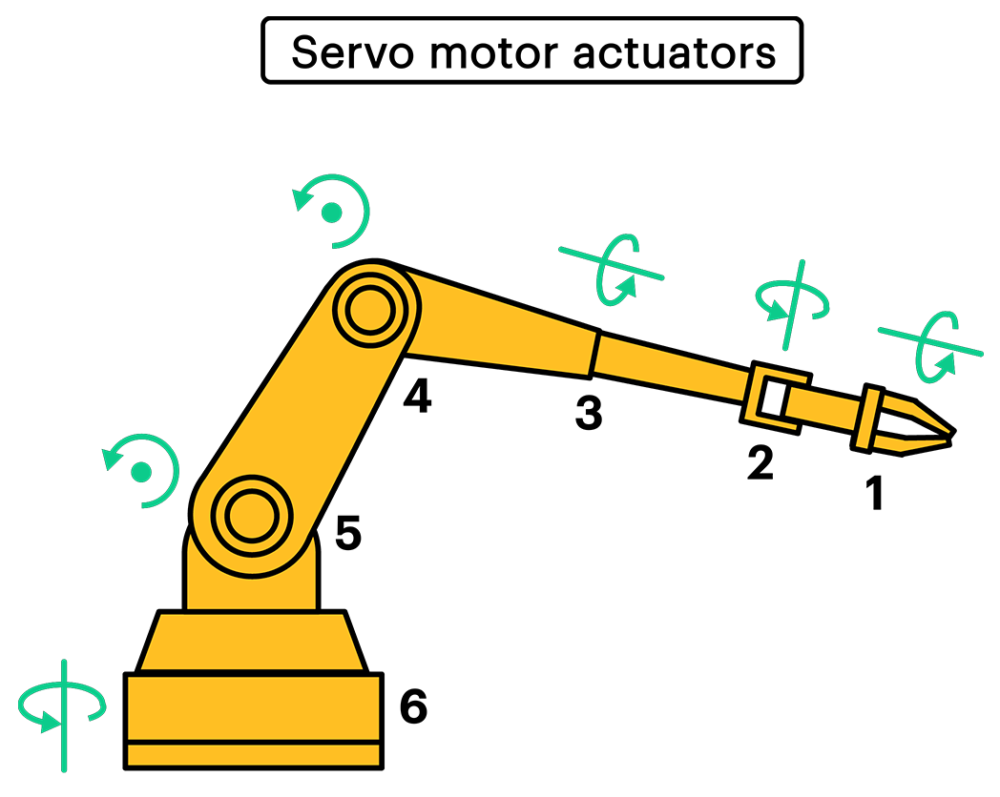

---

<!--
_class: invert lead
-->

## Programación de robots

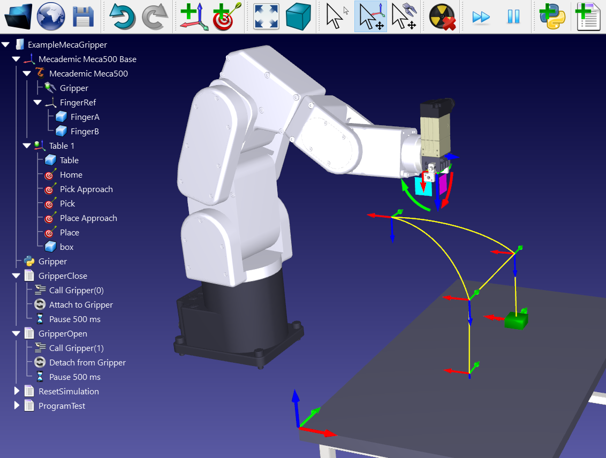

---

## Programación de robots

- La programación de robots es mucho más compleja que la programación de software tradicional.
- Como no conocemos por completo el estado del entorno, debemos plantear las tareas del robot como un **problema de optimización** y buscar la mejor secuencia de acciones para alcanzar un objetivo.
- Veremos cómo aplicar a la robótica los conceptos de programación e inteligencia artificial estudiados hasta ahora.

---

### Percepción

- La percepción es la capacidad del robot para **percibir su entorno**.
  - Consiste en convertir los datos de los sensores en una representación interna.
- Es un problema complejo, porque los sensores pueden ser muy **ruidosos** e **inexactos**.
  - Necesitamos **filtrar** y **procesar** los datos de los sensores para obtener una representación fiable del entorno.
  - Tendremos que construir un modelo del entorno **completo**, **fácil de actualizar** y **eficiente**.

---

#### Localización

- **Localización**: determinar la posición de los objetos (incluido el robot) en el entorno.
- Incluso en entornos conocidos, localizarse es complejo porque los sensores pueden ser muy inexactos.
- A partir de una posición inicial y de las acciones realizadas, la posición final del robot se representa mediante una **distribución de probabilidad**.
  - **Monte Carlo Localization (MCL)** vs **Extended Kalman Filter (KF)**: MCL es más preciso, pero más lento. EKF es más rápido, pero menos preciso.
  - Ambos se basan en la **teoría de la probabilidad**.

---

#### Mapeo

- **Mapeo**: construir un mapa del entorno a partir de los datos de los sensores.
- Es un problema complejo: es difícil localizarse sin un mapa, pero también construir un mapa sin saber dónde se está.
- **Simultaneous Localization and Mapping (SLAM)**: resolver simultáneamente los problemas de localización y mapeo.
  - **SLAM visual**: utiliza cámaras para localizarse y construir un mapa.
  - **SLAM con LIDAR**: utiliza LIDAR para localizarse y construir un mapa.

---

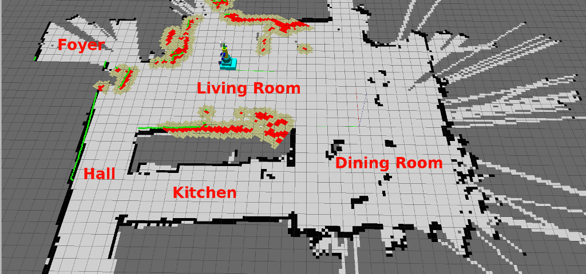

---

#### Otros tipos de percepción

- En robótica también son importantes otros tipos de percepción, como la **temperatura, la luz o el olor**.
- Percibir variables ambientales es importante en muchas tareas robóticas.
- Por ejemplo, un robot que limpia una habitación necesita detectar la suciedad.
- Este tipo de percepción puede realizarse con sensores especializados.
- Podemos aplicar un enfoque similar al de la percepción visual o un enfoque reactivo.

---

### Comportamiento reactivo

- Los robots reactivos toman decisiones basadas en los datos de los sensores en tiempo real.
- Es una estrategia sencilla, pero eficaz para muchas tareas robóticas.
- Los robots reactivos son rápidos y eficientes, pero no siempre pueden resolver tareas complejas.
- Podemos combinar los robots reactivos con otras estrategias para resolver tareas más complejas.
- El ejemplo más sencillo es el de los vehículos de Braitenberg.

---

#### Vehículos de Braitenberg

- Valentino Braitenberg propuso un modelo sencillo de vehículos autónomos que muestran comportamientos sorprendentes.
- Los vehículos de Braitenberg tienen sensores y actuadores que siguen reglas sencillas. Normalmente conectan directamente los sensores con los actuadores.
- Muestran comportamientos complejos, como seguir la luz o evitar obstáculos.
- Son representativos de la **robótica BEAM** (Biology, Electronics, Aesthetics, Mechanics).

---

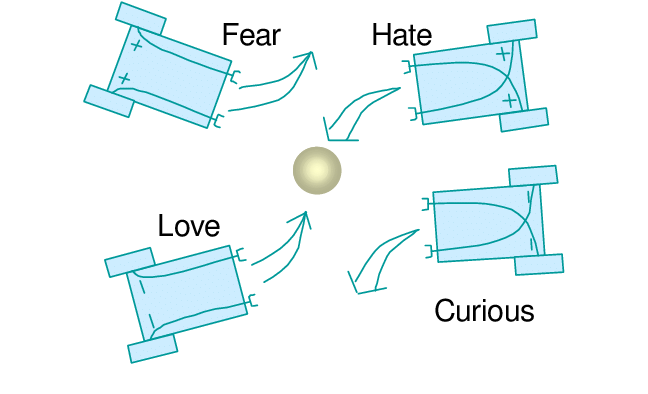

---

#### Seguimiento de líneas

- El seguimiento de líneas es una tarea habitual en robótica móvil.
- Consiste en seguir una línea en el suelo utilizando sensores infrarrojos o cámaras.
- Los robots seguidores de líneas utilizan un algoritmo sencillo para determinar en qué dirección deben moverse.
- En su forma más sencilla, el robot gira hacia la línea cuando la detecta y corrige su trayectoria cuando la pierde.

---

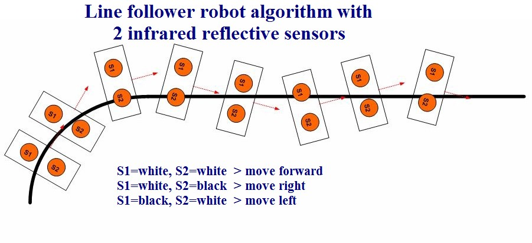

---

#### Máquinas de estados finitos

- Las **máquinas de estados finitos** son una herramienta muy útil para programar robots.

  - Suponen un paso más que los robots reactivos en complejidad y flexibilidad.

- Modelo matemático que describe el comportamiento de un **sistema como una serie de estados y transiciones**, donde cada estado representa una situación en la que puede encontrarse
- Robots reactivos: las decisiones se toman según el estado actual.
- FSM: **en función de las entradas actuales y del estado en el que se encuentra el robot**.

---

#### Ejemplo de máquina de estados finitos (I)

- Un ejemplo sencillo de uso de una máquina de estados finitos es buscar un objetivo.

- En este caso, hay cuatro estados:
  - **Izquierda**: el robot gira a la izquierda mientras busca el objetivo.
  - **Derecha**: el robot gira a la derecha mientras busca el objetivo.
  - **Adelante**: el robot avanza.
  - **Objetivo**: el robot ha encontrado el objetivo y se detiene.

---

#### Ejemplo de máquina de estados finitos (II)

- Las transiciones entre estados dependen de los datos de los sensores:
  - Si el robot supera +45°, pasa al estado **Derecha**.
  - Si el robot supera -45° en sentido negativo, pasa al estado **Izquierda**.
  - Si el robot detecta el objetivo, pasa al estado **Adelante** y empieza a moverse hacia él.
  - Cuando llega al objetivo, pasa al estado **Objetivo** y se detiene.

---

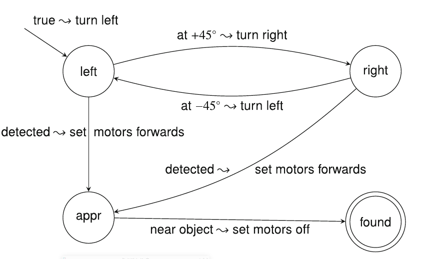

---

#### Estado del algoritmo

- Casi todos los algoritmos de robótica mantienen un **estado**.
  - Necesitan guardar información sobre el estado actual del robot.
- Esta información puede ser muy sencilla (como en una máquina de estados finitos) o muy compleja.
- Las FSM son una herramienta muy útil para introducir el estado en los algoritmos de robótica.
  - Para algoritmos más complejos necesitaremos herramientas más avanzadas.

---

### Redes neuronales

- Las redes neuronales son una herramienta muy potente para resolver problemas de robótica.
- Como las redes neuronales pueden aproximar funciones, podemos utilizarlas para controlar un robot.
- Las redes neuronales *feedforward* son las más comunes en robótica porque son sencillas y eficientes.
  - Serían equivalentes a un sistema reactivo.
- Las redes neuronales recurrentes son más complejas, pero más potentes.
  - Serían equivalentes a un sistema basado en FSM.

---

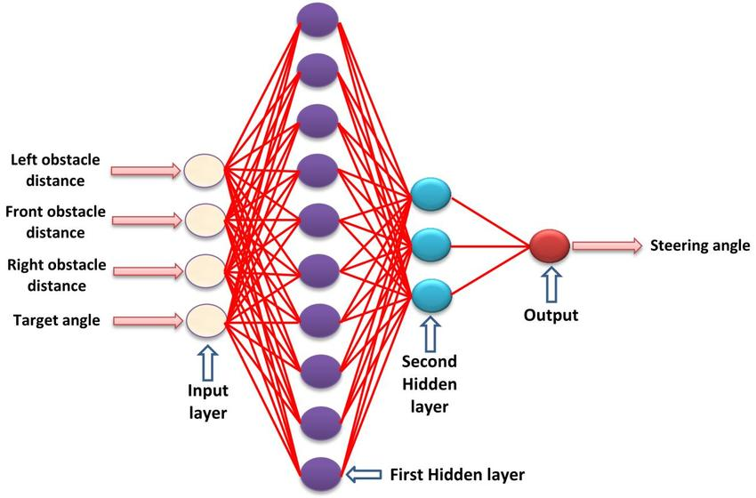

---

#### Aprendizaje (I)

- Para entrenar redes neuronales podemos utilizar técnicas de aprendizaje supervisado o no supervisado.
  - **Supervisado**: proporcionamos datos de entrada y salida, y la red aprende a partir de ellos.
    - Recopilaremos datos de sensores y actuadores para entrenar la red.
    - Si queremos que el robot siga una línea, recopilaremos datos de los sensores de línea y de los actuadores de movimiento.
    - Una vez entrenada la red, el robot podrá seguir la línea sin necesidad de programar explícitamente cada movimiento.

---

#### Aprendizaje (II)

- **Aprendizaje por refuerzo**: las redes aprenden mediante la interacción con el entorno.
  - Definiremos una **recompensa** para las acciones deseadas y un **castigo** para las no deseadas. El robot probará distintas acciones y aprenderá cuáles son mejores a partir de las recompensas recibidas.
- **Neuroevolución**: utilizar algoritmos evolutivos para hacer evolucionar redes neuronales.
  - Crearemos una población de redes neuronales y las haremos competir. Las redes más eficaces se reproducirán y evolucionarán.

---

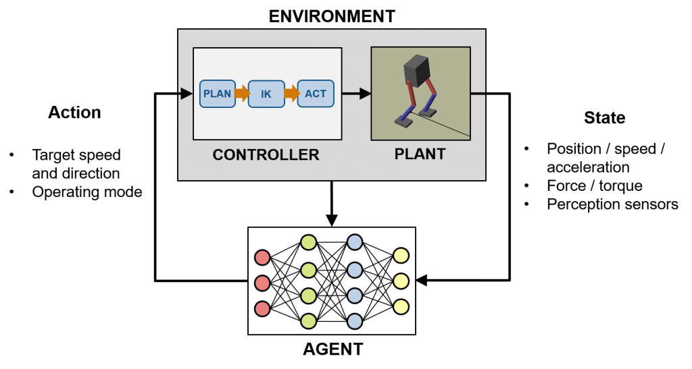

---

## Conclusiones

- La robótica es una disciplina multidisciplinar que combina conocimientos de ingeniería, informática, matemáticas, física, biología, etc.
- Los robots permiten a nuestros modelos de inteligencia artificial interactuar con el mundo real.
- La robótica es una herramienta potente para resolver problemas complejos en entornos no deterministas.
- Hemos visto cómo aplicar a la robótica los conceptos de programación e inteligencia artificial estudiados hasta ahora.

---
