

# Integrar la IA en la educación

Preparando el futuro más inmediato.

---

## Introducción a la charla

- **Inteligencia artificial**.
        - Sistemas que realizan tareas que requieren inteligencia humana.
- En muy poco tiempo ha cambiado nuestra vida.
- También ha llegado a la educación. ¿Cómo podemos aprovecharla?
- Veremos qué aporta la IA a la educación, qué **retos** plantea y qué estamos haciendo en el IES Benigasló para **integrarla**.

---

## IES Benigasló

- El **IES Benigasló** es un centro público de **La Vall d'Uixó**.
- Más de **1000 alumnos** y más de **100 profesores**.
- ESO, Bachillerato, FP (básica, grado medio y grado superior) y máster.
    - En los ciclos superiores de FP se trabaja el desarrollo de aplicaciones web y móviles.
    - El curso de especialización en IA y Big Data es la incorporación más reciente al centro.

---

## La IA en la educación

- La **IA** ya es una realidad en la educación y plantea retos y oportunidades.
- El alumnado utilizará la IA en su vida diaria, aunque no queramos o no esté preparado.
- La educación debe preparar al alumnado para convivir con la IA y aprovecharla.
- La IA puede ayudar a personalizar el aprendizaje, mejorar la eficiencia de la gestión y abrir nuevas oportunidades laborales.

- **¿Cómo integrarla?** Dependerá de cada nivel educativo.

---

## La IA como herramienta inclusiva

- La IA puede ayudar a personalizar el aprendizaje y adaptarse a las necesidades particulares del alumnado.
- Puede ayudar a detectar dificultades de aprendizaje y ofrecer soluciones.
- Puede mejorar la comunicación con el alumnado con discapacidad.
- Un mismo recurso se puede adaptar a las necesidades de cada estudiante.
    - Detallar mejor el procedimiento
    - Ofrecer más ejemplos
    - Adaptar la dificultad

---

<!--
_class:  invert lead
-->

### ESO y CFGM

Conociendo la IA

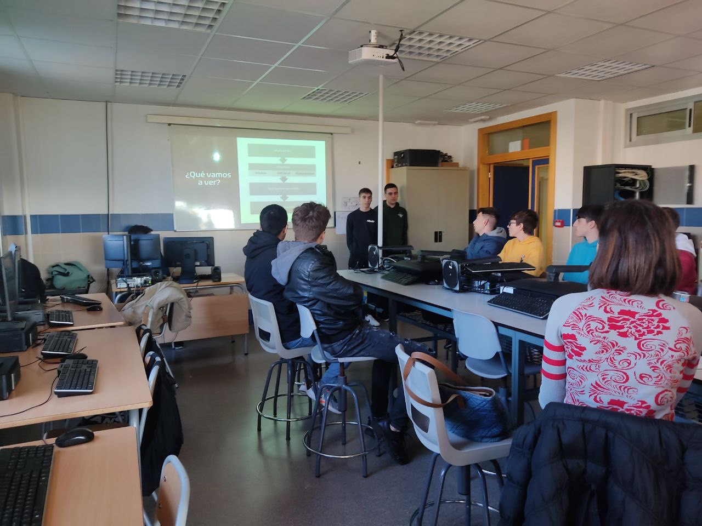

---

#### ESO y CFGM (I)

- **Objetivos**:
    - Conocer los conceptos básicos de la IA.
    - Entender cómo funciona.
    - **Ver ejemplos de uso.**
- **Metodología**:
    - Teoría y práctica.
    - Trabajo en grupo.
    - Proyectos.

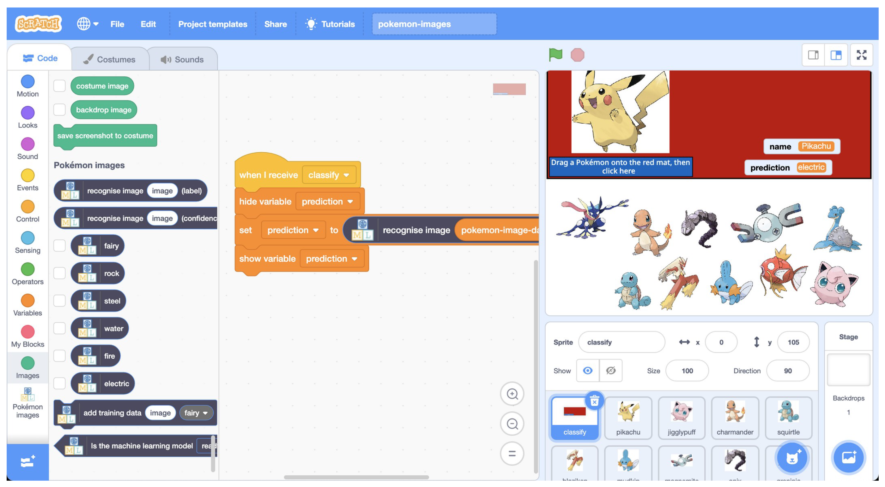

---

#### ESO y CFGM (II)

- **Contenidos**:
    - Conceptos básicos: algoritmos, datos y aprendizaje.
    - Aplicaciones: asistentes, juegos, imagen y voz, robótica.
    - Reflexión ética: privacidad y seguridad.
- **Competencias**:
    - Digital, matemática, lingüística, social y cívica.
    - Autonomía e iniciativa personal. Trabajo en equipo.

---

#### Actividades guiadas para ESO y CFGM

- _Generar imágenes para trabajos_
    - Trabajamos la competencia lingüística para obtener el resultado deseado.
- _Reescribimos textos_
    - Vemos las diferencias entre los textos originales y los generados.
- _Generar esquemas, resúmenes e infografías_
    - Ayudamos al alumnado a sintetizar la información.
    - Técnicas de estudio.

---

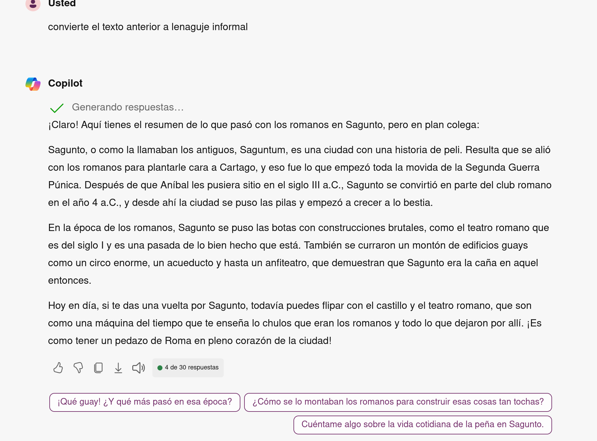

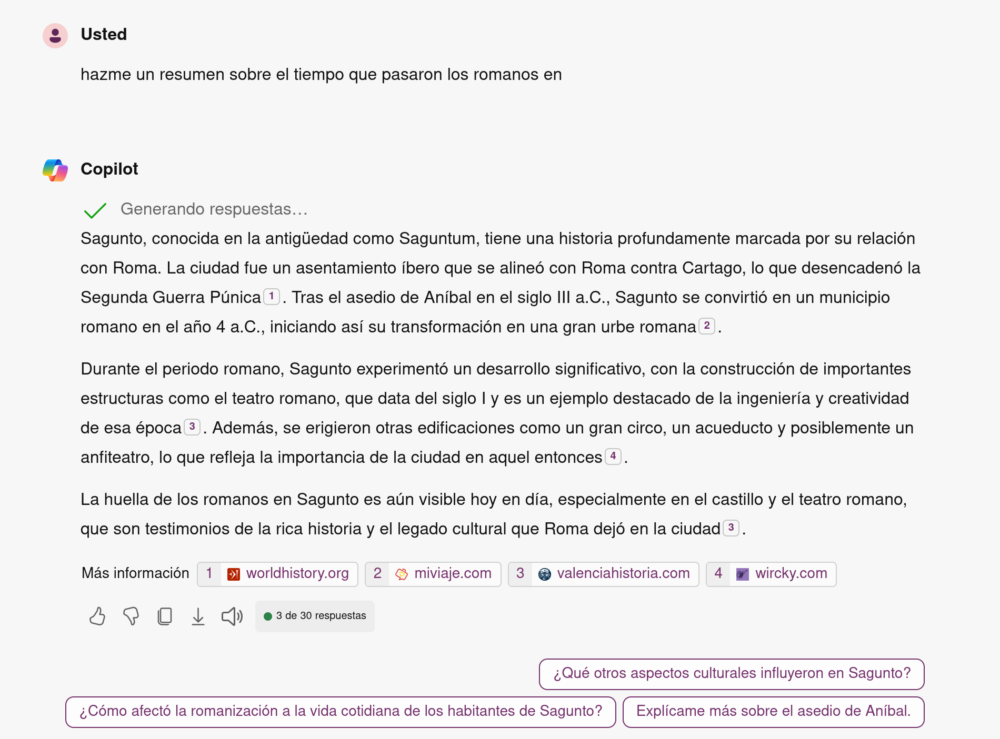

---
<!--
_class:  invert lead
-->

### Bachillerato y FP de grado superior

Aplicando la IA

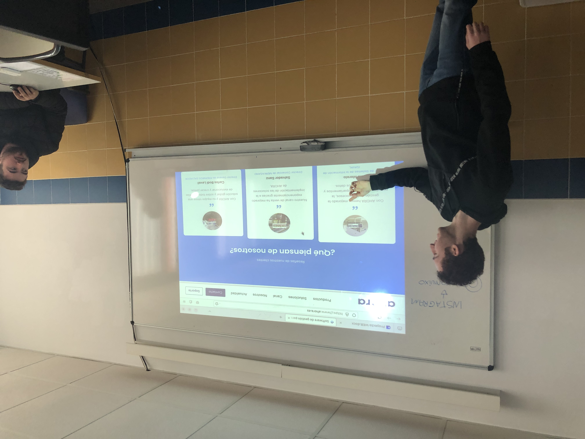

---

#### Bachillerato y CFGS (I)

- **Objetivos**:
    - Aplicar la IA a la resolución de problemas.
    - **Desarrollar proyectos con IA.**
    - Preparar para estudios superiores y el mundo laboral.
- **Metodología**:
    - Proyectos.
    - Trabajo en grupo.
    - Colaboración con empresas.

---

#### ESO y CFGM (II)

- **Contenidos**:
    - Conceptos: algoritmos avanzados, datos complejos y procesamiento del lenguaje natural.
    - Aplicaciones: uso de asistentes de programación y análisis documental.
    - Reflexión ética: privacidad y seguridad.
- **Competencias**:
    - Digital, matemática, lingüística, social y cívica.
    - Autonomía e iniciativa personal. Trabajo en equipo.

---

##### Actividades en bachillerato

- Normativa APA
    - **Generación de bibliografías** y citas.
- Investigación de temas
    - **Resumir** y **sintetizar** la información.
- Mapas conceptuales
    - **Generar mapas** a partir de textos.

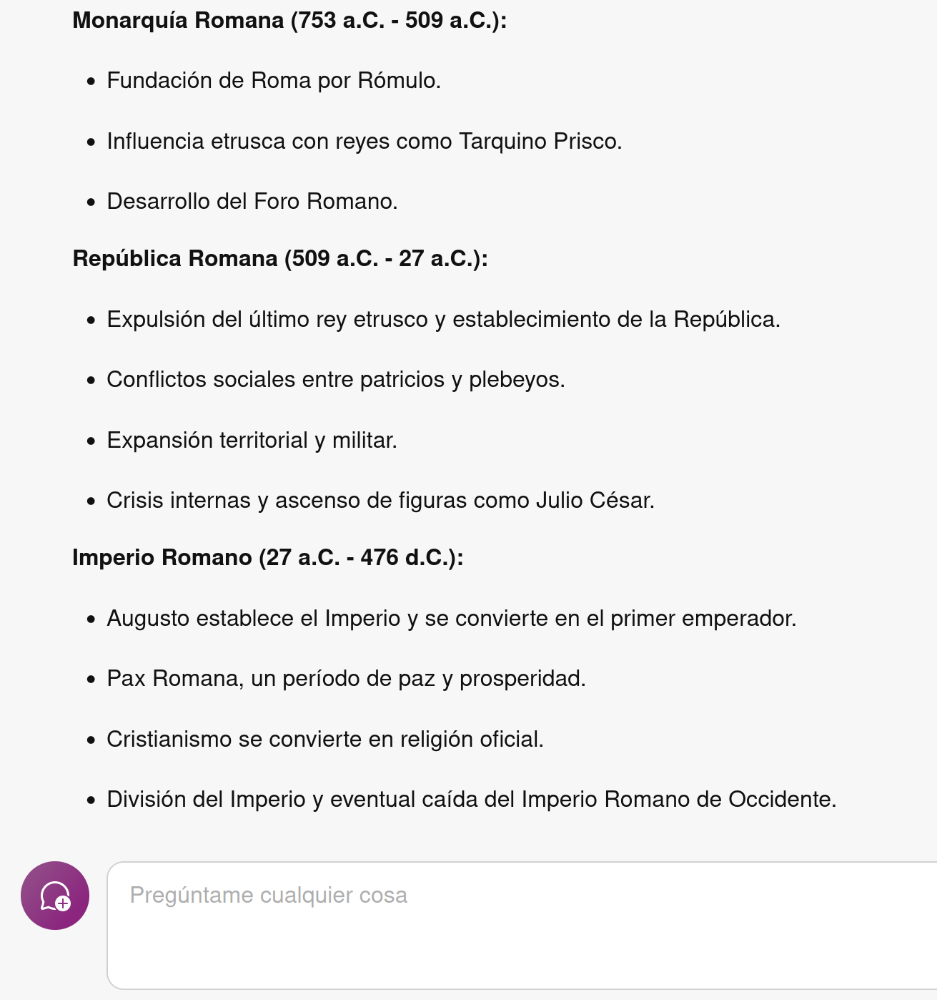

---

#### Actividades en CFGS

- Uso de asistentes de programación
    - **Generar código** a partir de preguntas y comentarios.
- Creación de datos de prueba
    - **Generar datos ficticios** que cumplan unas especificaciones para probar los programas.
- Explicaciones de código:
    - Explicar **paso a paso** código complejo o desconocido
- Integración en motores de IA:
    - **Utilizar la API de ChatGPT** en nuestro programa

.

---
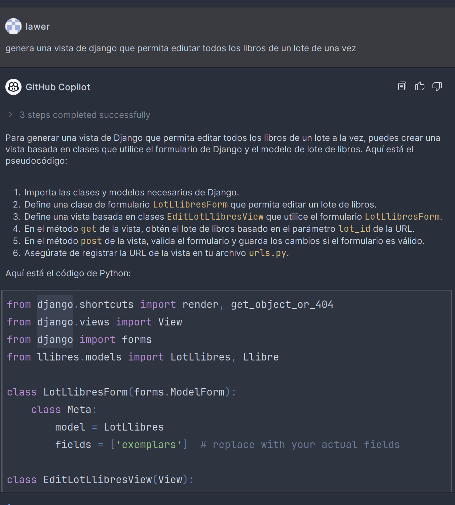
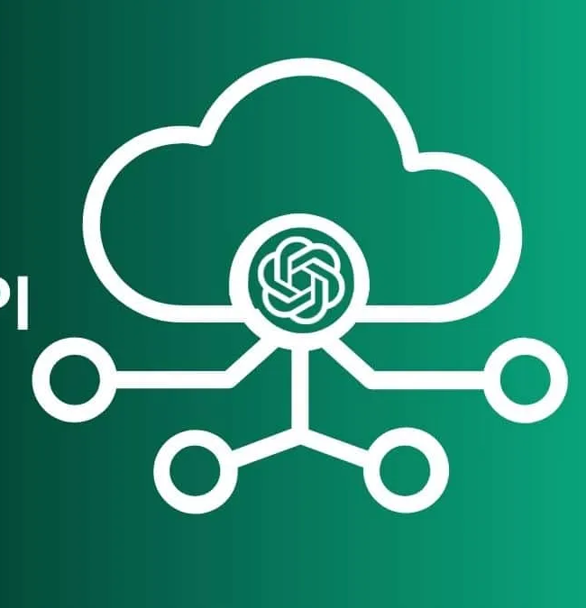
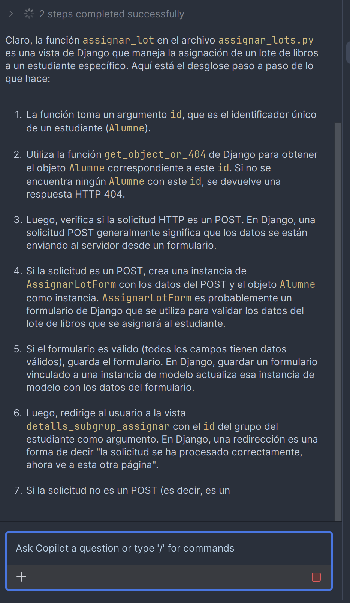

---

<!--
_class:  invert lead
-->

### Curso de especialización en IA y Big Data

Desarrollando la IA

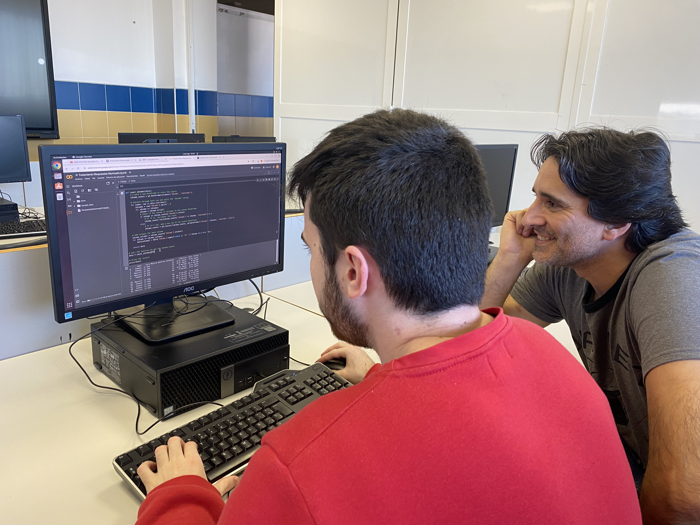

---

#### Curso de especialización (I)

- **Objetivos**:
    - Entender en profundidad cómo funciona la IA.
    - Conocer las distintas técnicas y herramientas que se utilizan en el ámbito empresarial y académico.
    - Crear proyectos reales con IA y grandes volúmenes de datos.
- **Metodología**:
    - Proyectos.
    - Colaboración con empresas.
    - Conferencias.

---

#### Curso de especialización (II)

- **Contenidos**:
    - Conceptos avanzados de IA: redes neuronales, algoritmos genéticos, lógica difusa, procesamiento del lenguaje natural y visión artificial.
    - Aplicaciones reales: chatbots, análisis de datos, predicciones médicas y robótica industrial.
    - Ética de la IA: privacidad, seguridad y discriminación.
- **Competencias personales**:
    - Pensamiento crítico, comunicación, autonomía e iniciativa personal y trabajo en equipo.

---

#### Actividades del curso de especialización

- **Creación de modelos predictivos**
    - Previsión de ventas en una empresa.
- **Reconocimiento de imágenes**
    - Detección de objetos en imágenes.
- **Procesamiento del lenguaje natural**
    - Generación de textos según un patrón establecido.
    - Análisis de sentimientos en tuits y comentarios.
- **Robótica**
    - Crear robots que aprenden a moverse mediante IA.

---

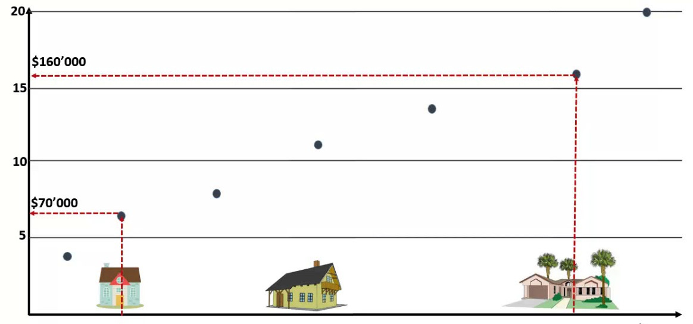

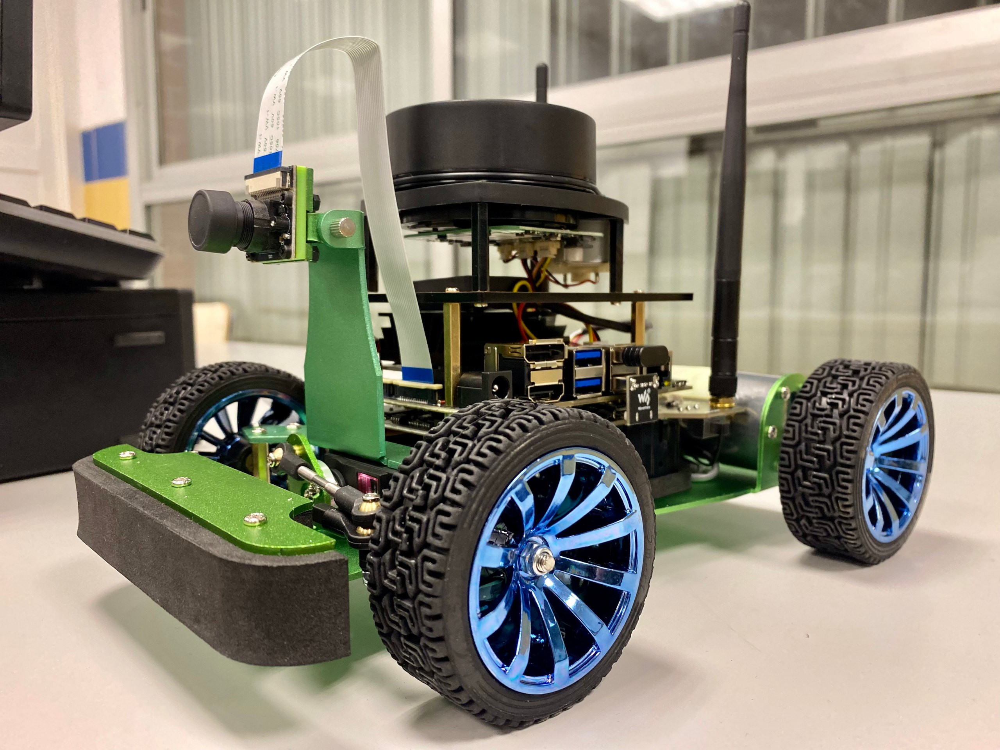

---

<!--
_class:  invert lead
-->

### ¿Preguntas?

---