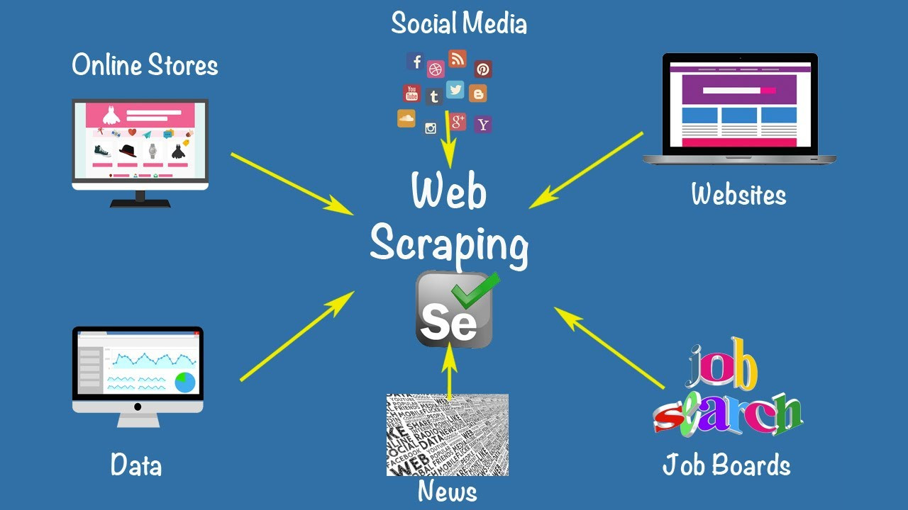
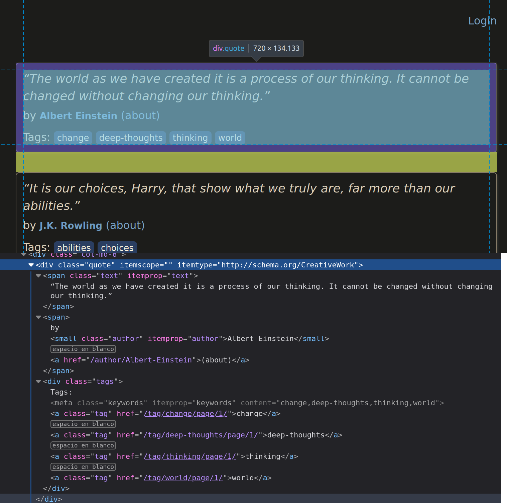

<style scoped>
h1, p {
  color: #FFFFFF;
  font-weight: 800;
  text-shadow:
    0px 0px 3px #000000;
}
</style>

# Web scraping con Scrapy


---

## ¿Qué es Scrapy?

- Framework de web scraping (rastreo de páginas web)
- Escrito en Python
- Orientado a la simplicidad y la facilidad de uso
- Escalable y flexible
- Utiliza spiders para definir cómo rastrear un sitio web
- Puede utilizar XPath o CSS para seleccionar elementos de la página

---

## Casos de uso

- Recopilación de datos para análisis
- Monitorización de páginas web
- Investigación de datos
- Creación de bots
- ...



---

## Instalación

```bash
pip install scrapy
```

- Requiere Python 3.6 o superior
- Para evitar problemas, conviene instalarlo en un entorno virtual

```bash
python -m venv scrapy_env
source scrapy_env/bin/activate
pip install scrapy
```

---

## Ejemplo: Quotes to Scrape

- Sitio web con citas de libros
- Diseñado para extraerlas
- [https://quotes.toscrape.com/](https://quotes.toscrape.com/)
- Queremos extraer las citas, sus autores y las etiquetas



---

## Creación de un proyecto

```bash
scrapy startproject project_name
```

```
project_name/
    scrapy.cfg
    project_name/
        __init__.py
        items.py
        middlewares.py
        pipelines.py
        settings.py
        spiders/
            __init__.py
```

---

## Componentes de un proyecto Scrapy

- **Items**: definen los elementos que queremos extraer de la página
- **Spiders**: definen cómo rastrear la página
- **Pipelines**: procesan los datos extraídos
- **Middlewares**: procesan las solicitudes y respuestas HTTP
- **Settings**: configuración del proyecto

---

## Creación de un spider (I)

```bash
scrapy genspider quotes quotes.toscrape.com
```

```python
import scrapy

class QuotesSpider(scrapy.Spider):
    name = "quotes"
    allowed_domains = ["quotes.toscrape.com"]
    start_urls = ["https://quotes.toscrape.com"]

    def parse(self, response):
        pass
```

---

## Creación de un spider (II)

- Modificamos `parse` para extraer datos

```python
def parse(self, response):
    for quote in response.css('div.quote'):
        text = quote.css('span.text::text').get() # extrae el texto del span con la clase text
        author = quote.css('small.author::text').get() # extrae el autor
        tags = quote.css('div.tags a.tag::text').getall() # extrae las etiquetas

        yield {
            'text': text,
            'author': author,
            'tags': tags
        }
```

---

## Ejecución del spider (I)

Por defecto, el resultado se muestra en pantalla

```bash
scrapy crawl quotes
```


```
2024-06-04 22:33:17 [scrapy.utils.log] INFO: Scrapy 2.11.2 started (bot: quotes_scrap)
...
{'text': '“The world as we have created it is a process of our thinking. It cannot be changed without changing our thinking.”', 'author': 'Albert Einstein', 'tags': ['change', 'deep-thoughts', 'thinking', 'world']}
2024-06-04 22:33:20 [scrapy.core.scraper] DEBUG: Scraped from <200 https://quotes.toscrape.com>
{'text': '“It is our choices, Harry, that show what we truly are, far more than our abilities.”', 'author': 'J.K. Rowling', 'tags': ['abilities', 'choices']}
2024-06-04 22:33:20 [scrapy.core.scraper] DEBUG: Scraped from <200 https://quotes.toscrape.com>
{'text': '“There are only two ways to live your life. One is as though nothing is a miracle. The other is as though everything is a miracle.”', 'author': 'Albert Einstein', 'tags': ['inspirational', 'life', 'live', 'miracle', 'miracles']}
2024-06-04 22:33:20 [scrapy.core.scraper] DEBUG: Scraped from <200 https://quotes.toscrape.com>
{'text': '“The person, be it gentleman or lady, who has not pleasure in a good novel, must be intolerably stupid.”', 'author': 'Jane Austen', 'tags': ['aliteracy', 'books', 'classic', 'humor']}
2024-06-04 22:33:20 [scrapy.core.scraper] DEBUG: Scraped from <200 https://quotes.toscrape.com>
{'text': "“Imperfection is beauty, madness is genius and it's better to be absolutely ridiculous than absolutely boring.”", 'author': 'Marilyn Monroe', 'tags': ['be-yourself', 'inspirational']}
2024-06-04 22:33:20 [scrapy.core.scraper] DEBUG: Scraped from <200 https://quotes.toscrape.com>
{'text': '“Try not to become a man of success. Rather become a man of value.”', 'author': 'Albert Einstein', 'tags': ['adulthood', 'success', 'value']}
2024-06-04 22:33:20 [scrapy.core.scraper] DEBUG: Scraped from <200 https://quotes.toscrape.com>
{'text': '“It is better to be hated for what you are than to be loved for what you are not.”', 'author': 'André Gide', 'tags': ['life', 'love']}
2024-06-04 22:33:20 [scrapy.core.scraper] DEBUG: Scraped from <200 https://quotes.toscrape.com>
{'text': "“I have not failed. I've just found 10,000 ways that won't work.”", 'author': 'Thomas A. Edison', 'tags': ['edison', 'failure', 'inspirational', 'paraphrased']}
2024-06-04 22:33:20 [scrapy.core.scraper] DEBUG: Scraped from <200 https://quotes.toscrape.com>
{'text': "“A woman is like a tea bag; you never know how strong it is until it's in hot water.”", 'author': 'Eleanor Roosevelt', 'tags': ['misattributed-eleanor-roosevelt']}
2024-06-04 22:33:20 [scrapy.core.scraper] DEBUG: Scraped from <200 https://quotes.toscrape.com>
{'text': '“A day without sunshine is like, you know, night.”', 'author': 'Steve Martin', 'tags': ['humor', 'obvious', 'simile']}
2024-06-04 22:33:20 [scrapy.core.engine] INFO: Closing spider (finished)
2024-06-04 22:33:20 [scrapy.statscollectors] INFO: Dumping Scrapy stats:
...
2024-06-04 22:33:20 [scrapy.core.engine] INFO: Spider closed (finished)

```

---
<!--
_footer: ""
-->


## Ejecución del spider (II)

Podemos guardarlo en un archivo

```bash
scrapy crawl quotes -o quotes.json
```

```json
[
{"text": "“The world as we have created it is a process of our thinking. It cannot be changed without changing our thinking.”", "author": "Albert Einstein", "tags": ["change", "deep-thoughts", "thinking", "world"]},
{"text": "“It is our choices, Harry, that show what we truly are, far more than our abilities.”", "author": "J.K. Rowling", "tags": ["abilities", "choices"]},
{"text": "“There are only two ways to live your life. One is as though nothing is a miracle. The other is as though everything is a miracle.”", "author": "Albert Einstein", "tags": ["inspirational", "life", "live", "miracle", "miracles"]},
{"text": "“The person, be it gentleman or lady, who has not pleasure in a good novel, must be intolerably stupid.”", "author": "Jane Austen", "tags": ["aliteracy", "books", "classic", "humor"]},
{"text": "“Imperfection is beauty, madness is genius and it's better to be absolutely ridiculous than absolutely boring.”", "author": "Marilyn Monroe", "tags": ["be-yourself", "inspirational"]},
{"text": "“Try not to become a man of success. Rather become a man of value.”", "author": "Albert Einstein", "tags": ["adulthood", "success", "value"]},
{"text": "“It is better to be hated for what you are than to be loved for what you are not.”", "author": "André Gide", "tags": ["life", "love"]},
{"text": "“I have not failed. I've just found 10,000 ways that won't work.”", "author": "Thomas A. Edison", "tags": ["edison", "failure", "inspirational", "paraphrased"]},
{"text": "“A woman is like a tea bag; you never know how strong it is until it's in hot water.”", "author": "Eleanor Roosevelt", "tags": ["misattributed-eleanor-roosevelt"]},
{"text": "“A day without sunshine is like, you know, night.”", "author": "Steve Martin", "tags": ["humor", "obvious", "simile"]}
]

```

Otros formatos: csv, xml, jsonlines, jl, marshal, pickle y yaml

```bash
scrapy crawl quotes -o quotes.csv
scrapy crawl quotes -o quotes.xml
```

---

## Definición de items (I)

- Los items son objetos que contienen los datos extraídos
- Por defecto, son diccionarios de Python
- Si necesitamos más control sobre los datos, podemos definirlos como clases en `items.py`

```python
import scrapy

class QuoteItem(scrapy.Item):
    text = scrapy.Field()
    author = scrapy.Field()
    tags = scrapy.Field()
```

---

<!--
_footer: ""
-->


## Definición de items (II)

- Modificamos el spider para utilizar el item definido. En lugar de devolver un diccionario, devolvemos un objeto `QuoteItem`, aunque seguimos accediendo a sus campos como si fuera un diccionario

```python
from project_name.items import QuoteItem

def parse(self, response):
    for quote in response.css('div.quote'):
        item = QuoteItem()
        item['text'] = quote.css('span.text::text').get()
        item['author'] = quote.css('small.author::text').get()
        item['tags'] = quote.css('div.tags a.tag::text').getall()

        yield item
```

---

## Definición de items (III)

- Podemos acceder a los campos del item como a los de un objeto

```python
def parse(self, response):
    for quote in response.css('div.quote'):
        item = QuoteItem(
            text=quote.css('span.text::text').get(),
            author=quote.css('small.author::text').get(),
            tags=quote.css('div.tags a.tag::text').getall()
        )

        yield item
```

---

<style scoped>section { font-size: 33px; }</style>

## Varias páginas (I)

- Si queremos extraer datos de más de una página, podemos utilizar dos métodos:
    - Si conocemos todas las páginas, podemos generar las URL y añadirlas a `start_urls`
        - Ejemplo: `start_urls = [f'https://quotes.toscrape.com/page/{ i }' for i in range(1, 11)]`
    - Si no conocemos cuántas páginas hay, podemos usar el método `parse` para extraer la URL de la página siguiente y seguirla con `response.follow`. Lo veremos a continuación.

---

<!--
_footer: ""
-->


## Varias páginas (II)

```python
def parse(self, response):
    for quote in response.css('div.quote'):
        text = quote.css('span.text::text').get()
        author = quote.css('small.author::text').get()
        tags = quote.css('div.tags a.tag::text').getall()

        yield {
            'text': text,
            'author': author,
            'tags': tags
        }

    next_page = response.css('li.next a::attr(href)').get()
    if next_page is not None:
        yield response.follow(next_page, self.parse)
```

---

<style scoped>section { font-size: 32px; }</style>


## Varias páginas (III)

- `response.css('li.next a::attr(href)').get()` extrae el atributo `href` del elemento `a` dentro del elemento `li` con la clase `next`
- `response.follow(next_page, self.parse)` sigue la URL `next_page` y llama a `parse` con la respuesta
    - Podríamos definir otro método para procesar la página siguiente, según el tipo de contenido

- Para evitar extraer dos veces la misma página, podemos utilizar `response.urljoin(next_page)`. Las URL visitadas se guardan en `response.meta['visited']` y podemos comprobar si ya hemos visitado la página. De todos modos, Scrapy ya lo hace automáticamente.

---

<!--
_footer: ""
-->

## Posprocesamiento con pipelines (I)

- Los datos extraídos se pueden procesar antes de guardarlos
- Por ejemplo, podemos limpiar los datos, eliminar duplicados, guardarlos en una base de datos, etc.
- Para activar una pipeline, hay que añadirla a `ITEM_PIPELINES` en `settings.py`

```python
ITEM_PIPELINES = {
    'project_name.pipelines.QuotesPipeline': 300,
}
# 300 es la prioridad de la pipeline, entre 0 y 1000,
# donde 0 es la prioridad más alta
```

---

## Posprocesamiento con pipelines (II)

- Creamos una pipeline en `pipelines.py` que limpia los datos, elimina los espacios en blanco y los devuelve.

```python
class QuotesPipeline:
    def process_item(self, item, spider):
        item['text'] = item['text'].strip()
        item['author'] = item['author'].strip()
        item['tags'] = [tag.strip() for tag in item['tags']]

        return item
```

---

## Posprocesamiento con pipelines (III)

- Podemos añadir tantas pipelines como queramos; se ejecutarán en el orden definido en `ITEM_PIPELINES`
- Por ejemplo, podemos guardar los datos en una base de datos

```python
class QuotesPipeline:
    def open_spider(self, spider):
        self.conn = sqlite3.connect('quotes.db')
        self.cur = self.conn.cursor()
        self.cur.execute('CREATE TABLE IF NOT EXISTS quotes (text TEXT, author TEXT, tags TEXT)')

    def process_item(self, item, spider):
        self.cur.execute('INSERT INTO quotes VALUES (?, ?, ?)', (item['text'], item['author'], ', '.join(item['tags'])))
        return item

    def close_spider(self, spider):
        self.conn.commit()
        self.conn.close()
```

---

<style scoped>section { font-size: 32px; }</style>

## Posprocesamiento con pipelines (IV)

- Podemos añadir más funciones a la pipeline, como comprobar si los datos ya existen en la base de datos antes de guardarlos

```python
class QuotesPipeline:
    def open_spider(self, spider):
        self.conn = sqlite3.connect('quotes.db')
        self.cur = self.conn.cursor()
        self.cur.execute('CREATE TABLE IF NOT EXISTS quotes (text TEXT, author TEXT, tags TEXT)')

    def process_item(self, item, spider):
        self.cur.execute('SELECT * FROM quotes WHERE text = ? AND author = ?', (item['text'], item['author']))
        if not self.cur.fetchone():
            self.cur.execute('INSERT INTO quotes VALUES (?, ?, ?)', (item['text'], item['author'], ', '.join(item['tags']))
        return item

    def close_spider(self, spider):
        self.conn.commit()
        self.conn.close()
```

---

## Errores y registros (I)

- Scrapy tiene un sistema de registros que permite consultar los errores y la información de depuración
- Podemos configurar el nivel de registro en `settings.py`

```python
LOG_LEVEL = 'INFO'
```

- Niveles de registro: `CRITICAL`, `ERROR`, `WARNING`, `INFO`, `DEBUG`

- Por defecto, Scrapy muestra los registros en pantalla. Podemos guardarlos en un archivo con `-s LOG_FILE=quotes.log`


---

## Errores y registros (II)

- Con `logging` podemos añadir registros personalizados


```python
import logging

# ...

def parse(self, response):
    logging.info('Procesando la página %s', response.url)

# ...
```

---

<style scoped>section { font-size: 30px; }</style>

<!--
_footer: ""
-->


## Errores y registros (III)

Podemos capturar errores y procesarlos

```python
def parse(self, response):
    if response.status == 404:
        logging.error('Página no encontrada: %s', response.url)
    elif response.status == 500:
        logging.error('Error del servidor: %s', response.url)
    else:
        for quote in response.css('div.quote'):
            text = quote.css('span.text::text').get()
            author = quote.css('small.author::text').get()
            tags = quote.css('div.tags a.tag::text').getall()

            yield {
                'text': text,
                'author': author,
                'tags': tags
            }
```

---

<style scoped>section { font-size: 32px; }</style>

## Ejercicio

- Crea un proyecto Scrapy para extraer los datos de todas las noticias publicadas en [https://portal.edu.gva.es/iesbenigaslo/entrades/](https://portal.edu.gva.es/iesbenigaslo/entrades/)
- Extrae el título, la fecha, el autor y el contenido de cada noticia
    - Tendrás que seguir los enlaces entre páginas para extraer todos los datos solicitados.
- Guarda los datos en un archivo JSON.
- Utiliza pipelines para procesar los datos antes de guardarlos
- Utiliza registros para mostrar información de depuración y errores
- Extra: guarda los datos en una base de datos SQLite

---
